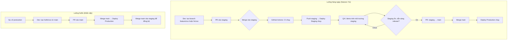
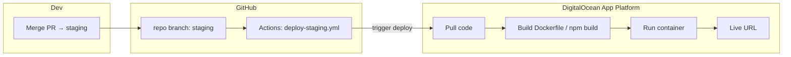

# Luồng Deploy — Staging vs Production

> Tài liệu này mô tả quy trình deploy cho môi trường **staging** và **production**, đồng bộ với [GIT_AND_CI_RULES.md](.github/GIT_AND_CI_RULES.md).

---

## 1. Rule bắt buộc: Staging trước, main chỉ hotfix hoặc release

- **Team chỉ được merge vào `staging` trước.** Mọi tính năng / fix (feature/*, fix/*) → PR vào **staging** → QA/demo trên staging.
- **`main` không nhận PR từ feature/fix.** Cập nhật `main` chỉ qua:
  1. **Luồng hotfix:** `hotfix/*` → PR vào `main` (sửa gấp production).
  2. **Luồng release:** Khi staging đã ổn định → PR **staging → main** → deploy production.

---

## 2. Tổng quan môi trường

| Môi trường   | Nhánh Git | Workflow              | Mục đích                    |
|-------------|-----------|------------------------|-----------------------------|
| **Staging** | `staging` | `deploy-staging.yml`   | QA, demo, test trước prod   |
| **Production** | `main` | `deploy-production.yml` | Môi trường live cho user    |

- **CI** (`ci.yml`): chạy trên mọi PR và push vào `main` / `staging`: lint, typecheck, test, build.
- **Deploy Staging**: push lên `staging` → build → deploy lên môi trường staging.
- **Deploy Production**: push lên `main` → build → deploy lên production.

---

## 2.1 Vercel vs DigitalOcean — khác nhau thế nào?

| | **Vercel** | **DigitalOcean** |
|---|------------|-------------------|
| **Loại** | **PaaS** (Platform as a Service) — “đẩy code lên, nhà cung cấp lo build + chạy”. | Vừa **PaaS** (App Platform) vừa **IaaS** (Droplet = máy ảo tự quản). |
| **Anh làm gì** | Connect repo → chọn branch → Vercel tự build (Next.js), host, scale. Không chọn OS, không SSH vào server. | **App Platform:** gần giống Vercel — connect repo, DO build + chạy. **Droplet:** anh chọn plan (CPU/RAM), OS (Ubuntu…), region → có một máy ảo, tự cài Node, Docker, reverse proxy, v.v. |
| **So sánh nhanh** | Giống DO **App Platform** (đều PaaS). Không giống DO **Droplet** (Droplet là máy ảo, Vercel không bán máy ảo). | App Platform = “Vercel-style”; Droplet = “máy chủ ảo” (như ảnh anh gửi — chọn plan $18, Ubuntu, Singapore). |

**Tóm lại:** Vercel và DigitalOcean **không cùng một dạng**. Vercel chỉ làm PaaS (deploy app, không bán server). DigitalOcean có cả PaaS (App Platform) và IaaS (Droplet). Staging hiện tại đang cấu hình dùng **DO App Platform** — không cần tạo Droplet.

---

## 2.2 Staging: App Platform hay Droplet (build server)? Cần build server thế nào?

**Hai cách chạy staging trên DigitalOcean:**

| Cách | Anh cần làm | Phù hợp khi |
|------|--------------|-------------|
| **App Platform** (đã setup trong §5.0) | Tạo **App** từ GitHub, branch `staging`; cấu hình build/run command + env. **Không** tạo Droplet, không chọn OS/plan. | Muốn đơn giản: push code → DO tự build và chạy. |
| **Droplet** (máy ảo — như trong ảnh) | Tạo **Droplet**: chọn plan (vd. $18/mo — 2 GB RAM, 2 CPU), **region** (vd. Singapore SGP1), **image** (vd. Ubuntu 24.04 LTS). Sau đó tự cài Node, PM2/Docker, cấu hình Nginx, deploy bằng SSH/rsync hoặc Docker từ GitHub Actions. | Muốn full control, dùng chung server cho nhiều service, hoặc stack đặc thù (Docker, nhiều container). |

**Với môi trường staging hiện tại (đã chọn App Platform):**

- **Không cần** “build server” kiểu tạo Droplet. Anh chỉ cần:
  1. Trong DO: **Apps** → **Create App** → Source = GitHub, branch `staging` (không vào mục **Droplets**).
  2. Cấu hình Build Command / Run Command và env (xem §5.0).
  3. Thêm secret `DIGITALOCEAN_ACCESS_TOKEN` trên GitHub.

**Nếu sau này anh muốn dùng Droplet cho staging** (một máy ảo như trong ảnh):

1. **Create Droplet** → chọn **Basic** (Shared CPU), plan ví dụ **$12–18/mo** (2 GB RAM) đủ cho staging.
2. **Region:** Singapore (SGP1) hoặc region gần team/user.
3. **Image:** Ubuntu 24.04 LTS x64.
4. Thêm SSH key, tạo Droplet xong → SSH vào máy, cài Node, PM2 hoặc Docker, cấu hình app. Trong workflow `deploy-staging.yml` đổi bước deploy: dùng SSH + `rsync`/`scp` đẩy `.next` và chạy `pm2 restart`, hoặc build Docker image rồi push lên DO Container Registry và pull/chạy trên Droplet.

Tóm lại: **staging đang setup theo App Platform** thì không cần vào màn “Create Droplet” hay chọn OS/plan; chỉ cần tạo **App** từ GitHub và cấu hình build/run như §5.0.

---

## 2.3 App Platform vs Droplet — khác gì, chi phí thế nào?

### Khác nhau

| | **App Platform** | **Droplet** |
|---|------------------|-------------|
| **Anh quản lý** | Repo, branch, build/run command, env. | Toàn bộ: OS, Node/Docker, Nginx, PM2, firewall, SSL, backup, monitoring. |
| **DO quản lý** | Build, deploy, runtime, HTTPS, scale (nếu bật), patch OS. | Chỉ phần cứng ảo; còn lại anh tự làm. |
| **Deploy** | Push code → DO tự build và chạy (hoặc trigger từ GitHub Actions). | Anh tự: SSH, rsync/Docker, script restart. |
| **Phù hợp** | Staging/prod đơn giản, ưu tiên tốc độ, ít vận hành. | Cần full control, nhiều service trên một máy, stack đặc thù. |

### Chi phí (ước lượng — xem [DO Pricing](https://www.digitalocean.com/pricing) để số chính xác)

| | **App Platform** | **Droplet** |
|---|------------------|-------------|
| **Cách tính** | Theo resource container (vCPU + RAM) + transfer. Web service từ ~$5/tháng. | Cố định theo plan: $4 / $6 / $12 / $18 / $24 …/tháng (Basic). |
| **Staging nhẹ (1 app Next.js)** | ~**$5–12/tháng** (vd. 0.5–1 vCPU, 512 MiB–1 GiB RAM). | ~**$12–18/tháng** (Basic 2 GB RAM, 1–2 CPU). |
| **Đã gồm** | Build, deploy, HTTPS, CDN cơ bản. | Chỉ máy ảo; SSL, Nginx, PM2/Docker anh tự cấu hình. |
| **DB (PostgreSQL/Redis)** | Development DB (~$7/tháng) hoặc Managed Database (tính riêng). | Cài trên Droplet (tốn RAM) hoặc Managed DB riêng. |

**Tóm tắt:** App Platform thường **$5–25/tháng** cho 1 web service staging (tùy size + DB), đổi lại không tốn công cấu hình server. Droplet **$12–18/tháng** cho Basic 2 GB; rẻ hơn nếu một máy chạy nhiều thứ nhưng anh tốn thời gian setup/bảo trì. Chọn App Platform khi ưu tiên đơn giản; chọn Droplet khi cần full control hoặc tối ưu chi phí nhiều service trên một máy.

---

## 3. Luồng làm việc (flow)

### 3.1 Sơ đồ tổng quan



### 3.2 Luồng chi tiết (theo bước)

**Luồng thường — Feature / Fix (team chỉ vào staging trước):**

| Bước | Ai làm | Việc |
|------|--------|------|
| 1 | Dev | `git checkout staging` → `git pull` → `git checkout -b feature/PROJ-123-mô-tả` |
| 2 | Dev | Code, commit (Conventional Commits), push branch |
| 3 | Dev | Tạo **PR: base = staging** (không chọn main) |
| 4 | CI | GitHub Actions chạy: Lint → Typecheck → Test → Build |
| 5 | Reviewer | Review, approve |
| 6 | Dev / Maintainer | Merge PR vào **staging** |
| 7 | CI/CD | Push lên staging → workflow **Deploy Staging** chạy → app staging cập nhật |
| 8 | QA / PM | Test, demo trên staging |
| 9 | Khi ổn | Tạo **PR: staging → main** → merge → **Deploy Production** chạy |

**Luồng hotfix — Sửa gấp production:**

| Bước | Ai làm | Việc |
|------|--------|------|
| 1 | Dev | `git checkout main` → `git pull` → `git checkout -b hotfix/PROJ-789-mô-tả` |
| 2 | Dev | Sửa, commit, push, tạo **PR vào main** |
| 3 | CI + Review | CI pass, approve → merge vào **main** |
| 4 | CI/CD | Deploy Production chạy |
| 5 | Dev | Merge **main** vào **staging** để staging không lệch với prod |

### 3.3 Tóm tắt (text)

```
┌─────────────────────────────────────────────────────────────────┐
│  Luồng thường (feature / fix)                                   │
├─────────────────────────────────────────────────────────────────┤
│  feature/* hoặc fix/*  →  PR vào staging  →  Merge staging       │
│                                    ↓                             │
│                          Deploy Staging chạy                      │
│                                    ↓                             │
│                          QA/demo trên staging                    │
│                                    ↓                             │
│  Khi sẵn sàng release:  PR staging → main  →  Merge main         │
│                                    ↓                             │
│                          Deploy Production chạy                  │
└─────────────────────────────────────────────────────────────────┘

┌─────────────────────────────────────────────────────────────────┐
│  Luồng hotfix (sửa gấp production)                              │
├─────────────────────────────────────────────────────────────────┤
│  hotfix/*  →  PR vào main  →  Merge main  →  Deploy Production   │
│  (Sau đó nên merge main vào staging để đồng bộ.)                 │
└─────────────────────────────────────────────────────────────────┘
```

**Tóm tắt:**

1. **Feature / fix:** PR vào **staging** only. Không tạo PR feature → main.
2. **Release:** Khi staging đã test xong → tạo PR **staging → main** → merge → production deploy.
3. **Hotfix:** Tạo nhánh `hotfix/xxx` từ main → PR vào **main** → merge → deploy production; sau đó merge main vào staging.

---

## 4. GitHub Actions đang dùng

| File | Trigger | Nội dung |
|------|---------|----------|
| `.github/workflows/ci.yml` | Push/PR vào `main`, `staging` | Lint, typecheck, test, build |
| `.github/workflows/deploy-staging.yml` | Push `staging` | Build + bước deploy staging (cấu hình thêm) |
| `.github/workflows/deploy-production.yml` | Push `main` | Build + bước deploy production (cấu hình thêm) |

---

## 5. Build chạy ở đâu — Deploy nên đặt trên AWS, DigitalOcean hay BytePlus?

Team đang dùng **AWS, DigitalOcean, BytePlus** — gợi ý chọn nền tảng phù hợp:

### 5.0 Build vs Deploy (phân biệt)

| Khái niệm | Chạy ở đâu | Ghi chú |
|-----------|------------|--------|
| **Build** (compile Next.js, chạy test) | **GitHub Actions** | Workflow `ci.yml` / `deploy-*.yml` chạy trên runner của GitHub (Ubuntu). **Không phụ thuộc** AWS, DO hay BytePlus. Không cần chọn “build ở đâu”. |
| **Deploy** (chạy app staging/production) | **AWS / DigitalOcean / BytePlus** (hoặc Vercel, v.v.) | Đây là nơi cần quyết định: app + DB + cache chạy trên provider nào. |

**Kết luận:** Build luôn chạy trên GitHub. Chỉ cần chọn **một (hoặc vài) provider để deploy/host** app.

### 5.0.1 So sánh nhanh — Nên build/deploy ở đâu?

| Tiêu chí | AWS | DigitalOcean | BytePlus (Volcengine) |
|----------|-----|----------------|----------------------|
| **Độ phức tạp** | Cao (nhiều dịch vụ, IAM, VPC) | Thấp–trung bình (App Platform đơn giản, Droplet rõ ràng) | Trung bình (tài liệu tiếng Anh ít hơn, mạnh ở châu Á) |
| **Next.js / Node** | Amplify, ECS, EKS, Lambda | App Platform (PaaS), Droplet + Docker | Container/ECS tương tự, CDN tốt |
| **PostgreSQL / Redis** | RDS, ElastiCache | Managed DB, Redis | Có managed DB, Redis |
| **Chi phí (ước lượng)** | Trung bình–cao, tính theo từng service | Dễ dự đoán, gói cố định | Cạnh tranh, thường rẻ ở thị trường châu Á |
| **Region / latency** | Nhiều region toàn cầu | Nhiều DC (SG, NYC, AMS…) | Mạnh **châu Á** (VN, SG, ID…), latency tốt cho user Việt/Đông Nam Á |
| **Phù hợp khi** | Đã dùng AWS (RDS, S3, Lambda…); cần tích hợp sâu | Muốn đơn giản, giá rõ, scale vừa; team quen VPS/Docker | User chủ yếu ở **VN/Đông Nam Á**; đã dùng BytePlus (CDN, object storage, DB) |

### 5.0.2 Gợi ý chọn nền tảng (team đang dùng cả AWS, DO, BytePlus)

- **Ưu tiên đơn giản, time-to-market:**  
  **DigitalOcean App Platform** — connect GitHub, auto build + deploy, managed Postgres. Staging + production có thể là 2 app trên DO. Phù hợp nếu không bắt buộc phải “all-in” AWS/BytePlus.

- **Ưu tiên user Việt Nam / Đông Nam Á, đã có BytePlus:**  
  **BytePlus** — deploy app (container hoặc VM) + DB/Redis trên BytePlus; latency tốt trong khu vực. Build vẫn GitHub Actions; bước deploy trong workflow gọi API BytePlus (push image, update service) hoặc SSH lên VM BytePlus.

- **Ưu tiên tích hợp AWS (S3, RDS, Lambda, …):**  
  **AWS** — dùng Amplify (Next.js) hoặc ECS/Fargate (Docker). Staging/prod = 2 environment trên cùng tài khoản AWS. Build vẫn GitHub Actions; deploy qua AWS CLI / CDK / Terraform trong workflow.

- **Khuyến nghị thực tế:**  
  Chọn **một** provider làm **primary** cho app này (cả staging + prod) để dễ quản lý, một bill, một bộ secret. Nếu đã có DB/Redis trên AWS thì deploy app lên **AWS**. Nếu đã có trên BytePlus và user chủ yếu châu Á thì deploy lên **BytePlus**. Nếu chưa gắn chặt với provider nào thì **DigitalOcean** dễ bắt đầu (App Platform hoặc Droplet + Docker).

---

## 5. Cấu hình deploy thực tế

### 5.0 Staging trên DigitalOcean App Platform (đang dùng)

Staging được deploy lên **DigitalOcean App Platform**. Workflow `deploy-staging.yml` sẽ build trên GitHub Actions rồi gọi DigitalOcean deploy (action `digitalocean/app_action/deploy@v2`). App trên DO build lại từ source và deploy.

#### Flow deploy với DigitalOcean App Platform

```
┌─────────────────────────────────────────────────────────────────────────────────────────┐
│  LUỒNG DEPLOY STAGING (DigitalOcean App Platform)                                       │
└─────────────────────────────────────────────────────────────────────────────────────────┘

  Dev / PM
     │
     │  1. Merge PR vào nhánh staging (hoặc push trực tiếp lên staging)
     ▼
┌─────────────┐
│   GitHub    │   branch: staging
│   (repo)    │
└──────┬──────┘
       │
       │  2a. GitHub Actions (deploy-staging.yml)
       │      • Checkout code
       │      • npm ci → npm run build (verify build OK)
       │      • Deploy step: gọi digitalocean/app_action/deploy@v2 (token từ Secrets)
       │
       │  2b. DigitalOcean App Platform (khi nhận trigger hoặc auto-deploy)
       │      • Pull code mới từ GitHub, branch staging
       │      • Build: Dockerfile hoặc Source build (npm run build)
       │      • Deploy: chạy container / process (node server.js hoặc npm start)
       │      • Gắn env (DATABASE_URI, PAYLOAD_SECRET, …) và Dev DB nếu có
       │
       ▼
┌─────────────────────────────────────┐
│  DigitalOcean App Platform          │
│  • Web Service (ech-prime-web-v2)   │  ──►  https://xxx.ondigitalocean.app
│  • Dev DB (PostgreSQL)               │
└─────────────────────────────────────┘
       │
       │  3. QA / PM test trên URL staging
       ▼
  Done (hoặc tạo PR staging → main cho production)
```

**Mermaid (xem trong viewer hỗ trợ Mermaid):**



**Tóm tắt từng bước:**

| Bước | Nơi | Việc |
|------|-----|------|
| 1 | GitHub | Code được merge/push lên nhánh **staging**. |
| 2a | GitHub Actions | Workflow `deploy-staging.yml` chạy: build để verify, rồi gọi DO action deploy (token trong Secrets). |
| 2b | DigitalOcean | App Platform nhận trigger (hoặc auto-deploy khi bật): pull code từ **staging**, build (Dockerfile hoặc source), chạy app với env + DB. |
| 3 | Browser | Truy cập URL staging (vd. `https://ech-prime-web-v2-staging-xxx.ondigitalocean.app`) để QA/demo. |

---

#### Bước 1 — Tạo App trên DigitalOcean (một lần)

1. Đăng nhập [DigitalOcean](https://cloud.digitalocean.com/) → **Apps** → **Create App**.
2. **Source:** chọn **GitHub** → authorize (nếu chưa) → chọn repo và **branch `staging`**.
3. **Resource type:** chọn **Web Service**.
4. **Build settings:**
   - **Build Command:** `NODE_OPTIONS='--require ./node-polyfill.js' npm run build`
   - **Output Directory:** để trống hoặc `.` (Next.js output nằm trong `.next`; DO thường tự nhận).
   - **Run Command:** `npm start` (hoặc `npx next start`).
5. **Environment variables:** thêm biến cần thiết (ví dụ `DATABASE_URI`, `PAYLOAD_SECRET`, `NEXT_PUBLIC_APP_ENV=staging`). Có thể dùng DO Managed Database và lấy connection string.
6. **Instance size:** chọn plan phù hợp (Basic hoặc Professional).
7. **Region:** chọn region gần user (ví dụ Singapore).
8. Tạo app → DO sẽ build và deploy lần đầu từ branch `staging`. Ghi lại **App URL** (ví dụ `https://staging-xxx.ondigitalocean.app`).

#### Bước 2 — API Token và GitHub Secrets

1. Trên DigitalOcean: **API** → **Tokens/Create** → tạo token với quyền **Read + Write** (ít nhất App Platform).
2. Trên GitHub: repo → **Settings** → **Secrets and variables** → **Actions** → **New repository secret**:
   - Tên: `DIGITALOCEAN_ACCESS_TOKEN`
   - Value: token vừa tạo.

Sau khi tạo App từ GitHub (bước 1), App Platform đã “biết” repo + branch. Action `digitalocean/app_action/deploy@v2` dùng token để trigger deployment của app đó (app gắn với repo này).

#### Build failed trên App Platform — kiểm tra gì

- **Xem log:** Trong DO App → **Activity** hoặc **Runtime Logs** → mở bản deploy fail → **View details** để xem log build (lỗi cụ thể).
- **Husky trong Docker:** Dockerfile đã set `ENV HUSKY=0` để tránh lỗi khi `npm ci` (môi trường không có git). Nếu repo clone cũ, pull code mới có Dockerfile đã sửa rồi redeploy.
- **Polyfill:** Dockerfile builder stage đã set `NODE_OPTIONS="--require ./node-polyfill.js"` cho `npm run build`. Thiếu có thể gây lỗi khi collect page data.
- **Build args (tùy chọn):** Nếu build cần DB/secret lúc build time, cấu hình **Build-time environment variables** trong DO App (DATABASE_URI, PAYLOAD_SECRET). Thường Next.js build không cần DB; runtime mới cần.

Sau khi sửa, commit + push lên branch `staging` (hoặc bấm **Redeploy** trên DO) để build lại.

#### Bước 3 — Workflow đã cấu hình

File `.github/workflows/deploy-staging.yml` đã được cấu hình để:

1. Push lên nhánh `staging` → chạy workflow.
2. Build trên GitHub (lint/typecheck đã chạy ở CI khi merge PR; workflow này chỉ build để verify).
3. Bước **Deploy to Staging** gọi `digitalocean/app_action/deploy@v2` với secret `DIGITALOCEAN_ACCESS_TOKEN` → DigitalOcean pull code mới từ branch `staging` và build + deploy trên App Platform.

Nếu chưa thêm secret `DIGITALOCEAN_ACCESS_TOKEN`, bước deploy sẽ báo lỗi; thêm secret theo bước 2 rồi push lại (hoặc re-run workflow).

#### Tối ưu chi phí và cấu hình cho staging (vd. đang ~$24/mo)

- **Giảm số container:** Đang **2 containers** → với staging thường chỉ cần **1 container**. Vào **Edit** phần **Size** → đổi **Containers** từ 2 xuống **1** → cost giảm còn khoảng **~$12/mo** (1 Shared vCPU, 1 GB RAM).
- **Environment variables (bắt buộc):** Phần "App-level environment variables" cần ít nhất: `DATABASE_URI`, `PAYLOAD_SECRET`, `NEXT_PUBLIC_APP_ENV=staging`. App (Payload) đọc **`DATABASE_URI`**; DO dev database thường inject **`DATABASE_URL`** → cần thêm biến `DATABASE_URI` = connection string của DB (trên DO có thể set `DATABASE_URI` = `${tên-component-database.DATABASE_URL}` để trỏ cùng chuỗi kết nối).
- **Database:** Cần có PostgreSQL. Chọn **+ Create dev database** (DO tạo DB, thường inject `DATABASE_URL`) → nhớ thêm `DATABASE_URI` như trên; hoặc **+ Attach DigitalOcean database** / DB ngoài rồi set `DATABASE_URI` trong env.
- **Build:** Nếu dùng **Dockerfile** (repo đã có) thì giữ Dockerfile; nếu muốn build từ source (không Docker) thì đổi Build strategy sang source và dùng Build Command / Run Command như mục trên.

#### Cấu hình hiện tại đủ không — và sau này khi cần scale

| Hiện tại (staging) | Đánh giá |
|--------------------|----------|
| **1 GB RAM / 1 Shared vCPU, 150 GB bandwidth** | **Đủ** cho staging (QA, demo, vài người test). Next.js + Payload chạy ổn với 1 GB nếu không có traffic lớn. |
| **Containers: 2** | Staging thường chỉ cần **1 container**. Giảm xuống 1 → tiết kiệm (~$12/mo thay vì $24 nếu đang tính 2 container). |
| **Autoscaling: tắt** | Plan Shared vCPU không bật được autoscale. Với staging không cần; khi lên production hoặc staging nặng hơn mới cân nhắc. |

**Sắp tới khi cần:**

- **Tăng tải staging (nhiều tester, demo lớn):** Tăng **Instance size** (vd. 2 GB RAM, 2 vCPU) hoặc tăng **Containers** lên 2. Vẫn dùng Shared vCPU được.
- **Cần autoscale (production hoặc staging gần prod):** Đổi sang **Dedicated instance** (từ ~$29/mo) → bật **Set containers to autoscale** (min/max container). Phù hợp khi đã lên production và cần scale theo traffic.
- **Production trên DO App Platform:** Nên dùng Dedicated + autoscale; staging có thể giữ Shared, 1 container, 1 GB.

#### Tóm tắt

| Việc | Nơi thực hiện |
|------|----------------|
| Tạo App, connect GitHub branch `staging` | DigitalOcean Control Panel (một lần) |
| Build/Run command, env vars | DigitalOcean App spec (trong App settings) |
| Token → GitHub Secret `DIGITALOCEAN_ACCESS_TOKEN` | GitHub repo Settings → Secrets |
| Mỗi lần push `staging` | GitHub Actions build → DO action trigger deploy → DO build + deploy |

---

Hiện tại bước **Deploy to Production** vẫn chỉ placeholder. Để deploy thật, tùy hạ tầng:

### 5.1 Docker + server (BytePlus ECS, DO Droplet, AWS EC2/ECS, …)

- Build image trong workflow, push lên registry.
- Trên server: pull image, chạy container (docker run / docker-compose).
- Có thể dùng SSH (key trong GitHub Secrets) hoặc Docker Registry.

### 5.2 Vercel

- Dùng `vercel deploy --prebuilt` sau bước build.
- Cấu hình token và project trong repo Secrets; tạo environment `staging` / `production` trên Vercel.

### 5.3 SSH + rsync / script

- Lưu host, user, key trong GitHub Secrets.
- Bước deploy: rsync `.next` và assets lên server, chạy script restart (pm2 / systemd / docker).

---

## 6. GitHub Environments & Secrets

- **Settings → Environments**: tạo `staging` và `production` (optional: protection rules, reviewers).
- **Settings → Secrets and variables → Actions**: thêm secrets và dùng trong workflow.

**Staging (DigitalOcean App Platform):**

| Secret | Mô tả |
|--------|--------|
| `DIGITALOCEAN_ACCESS_TOKEN` | API token DO (Read + Write App Platform). Dùng trong `deploy-staging.yml` bước Deploy to DigitalOcean App Platform. |

**Khác (khi dùng thêm):** `REGISTRY_PASSWORD`, `VERCEL_TOKEN`, `SSH_PRIVATE_KEY`, `STAGING_HOST`, `PROD_HOST`, …

---

## 7. Branch protection (khuyến nghị)

Để đảm bảo **chỉ staging trước, main chỉ hotfix/release**:

| Nhánh    | Protection rule gợi ý |
|----------|------------------------|
| **main** | Require PR (không push trực tiếp). Chỉ cho phép merge từ nhánh `staging` hoặc `hotfix/*`. Có thể dùng rule "Restrict who can push" hoặc quy ước team: không merge feature/fix vào main. |
| **staging** | Require PR (optional). Cho phép merge từ `feature/*`, `fix/*`. Sau khi CI pass, merge → deploy staging chạy. |

Trong **Settings → Branches** tạo rule cho `main`: Require pull request, Require status checks (CI), 1 approval. Base branch cho feature/fix khi tạo PR: chọn **staging** (không chọn main).

---

## 8. Checklist trước khi bật deploy thật

**Staging (DigitalOcean):**

- [ ] Đã tạo nhánh `staging`.
- [ ] Đã tạo App trên DigitalOcean App Platform, source = GitHub repo + branch `staging` (xem §5.0).
- [ ] Đã cấu hình Build Command (`NODE_OPTIONS='--require ./node-polyfill.js' npm run build`), Run Command (`npm start`), env vars.
- [ ] Đã thêm secret `DIGITALOCEAN_ACCESS_TOKEN` (Settings → Secrets and variables → Actions).
- [ ] Workflow `deploy-staging.yml` đã dùng action `digitalocean/app_action/deploy@v2` (đã cấu hình).

**Chung:**

- [ ] Đã cấu hình GitHub Environment `staging` (và `production` nếu dùng).
- [ ] Deploy Production: sửa bước "Deploy to Production" trong workflow khi có hạ tầng (Docker, Vercel, SSH, …).
- [ ] Branch protection cho `main` (và `staging` nếu cần): require PR, approval, CI pass.
