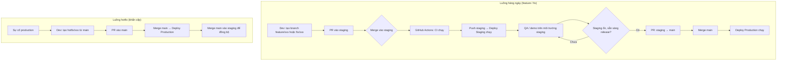

# Luồng Deploy — Staging vs Production

> Tài liệu này mô tả quy trình deploy cho môi trường **staging** và **production**, đồng bộ với [GIT_AND_CI_RULES.md](.github/GIT_AND_CI_RULES.md).

---

## 1. Rule bắt buộc: Staging trước, main chỉ hotfix hoặc release

- **Team chỉ được merge vào `staging` trước.** Mọi tính năng / fix (feature/*, fix/*) → PR vào **staging** → QA/demo trên staging.
- **`main` không nhận PR từ feature/fix.** Cập nhật `main` chỉ qua:
  1. **Luồng hotfix:** `hotfix/*` → PR vào `main` (sửa gấp production).
  2. **Luồng release:** Khi staging đã ổn định → PR **staging → main** → deploy production.

---

## 2. Tổng quan môi trường

| Môi trường   | Nhánh Git | Workflow              | Mục đích                    |
|-------------|-----------|------------------------|-----------------------------|
| **Staging** | `staging` | `deploy-staging.yml`   | QA, demo, test trước prod   |
| **Production** | `main` | `deploy-production.yml` | Môi trường live cho user    |

- **CI** (`ci.yml`): chạy trên mọi PR và push vào `main` / `staging`: lint, typecheck, test, build.
- **Deploy Staging**: push lên `staging` → build → deploy lên môi trường staging.
- **Deploy Production**: push lên `main` → build → deploy lên production.

---

## 3. Luồng làm việc (flow)

### 3.1 Sơ đồ tổng quan



### 3.2 Luồng chi tiết (theo bước)

**Luồng thường — Feature / Fix (team chỉ vào staging trước):**

| Bước | Ai làm | Việc |
|------|--------|------|
| 1 | Dev | `git checkout staging` → `git pull` → `git checkout -b feature/PROJ-123-mô-tả` |
| 2 | Dev | Code, commit (Conventional Commits), push branch |
| 3 | Dev | Tạo **PR: base = staging** (không chọn main) |
| 4 | CI | GitHub Actions chạy: Lint → Typecheck → Test → Build |
| 5 | Reviewer | Review, approve |
| 6 | Dev / Maintainer | Merge PR vào **staging** |
| 7 | CI/CD | Push lên staging → workflow **Deploy Staging** chạy → app staging cập nhật |
| 8 | QA / PM | Test, demo trên staging |
| 9 | Khi ổn | Tạo **PR: staging → main** → merge → **Deploy Production** chạy |

**Luồng hotfix — Sửa gấp production:**

| Bước | Ai làm | Việc |
|------|--------|------|
| 1 | Dev | `git checkout main` → `git pull` → `git checkout -b hotfix/PROJ-789-mô-tả` |
| 2 | Dev | Sửa, commit, push, tạo **PR vào main** |
| 3 | CI + Review | CI pass, approve → merge vào **main** |
| 4 | CI/CD | Deploy Production chạy |
| 5 | Dev | Merge **main** vào **staging** để staging không lệch với prod |

### 3.3 Tóm tắt (text)

```
┌─────────────────────────────────────────────────────────────────┐
│  Luồng thường (feature / fix)                                   │
├─────────────────────────────────────────────────────────────────┤
│  feature/* hoặc fix/*  →  PR vào staging  →  Merge staging       │
│                                    ↓                             │
│                          Deploy Staging chạy                      │
│                                    ↓                             │
│                          QA/demo trên staging                    │
│                                    ↓                             │
│  Khi sẵn sàng release:  PR staging → main  →  Merge main         │
│                                    ↓                             │
│                          Deploy Production chạy                  │
└─────────────────────────────────────────────────────────────────┘

┌─────────────────────────────────────────────────────────────────┐
│  Luồng hotfix (sửa gấp production)                              │
├─────────────────────────────────────────────────────────────────┤
│  hotfix/*  →  PR vào main  →  Merge main  →  Deploy Production   │
│  (Sau đó nên merge main vào staging để đồng bộ.)                 │
└─────────────────────────────────────────────────────────────────┘
```

**Tóm tắt:**

1. **Feature / fix:** PR vào **staging** only. Không tạo PR feature → main.
2. **Release:** Khi staging đã test xong → tạo PR **staging → main** → merge → production deploy.
3. **Hotfix:** Tạo nhánh `hotfix/xxx` từ main → PR vào **main** → merge → deploy production; sau đó merge main vào staging.

---

## 4. GitHub Actions đang dùng

| File | Trigger | Nội dung |
|------|---------|----------|
| `.github/workflows/ci.yml` | Push/PR vào `main`, `staging` | Lint, typecheck, test, build |
| `.github/workflows/deploy-staging.yml` | Push `staging` | Build + bước deploy staging (cấu hình thêm) |
| `.github/workflows/deploy-production.yml` | Push `main` | Build + bước deploy production (cấu hình thêm) |

---

## 5. Cấu hình deploy thực tế

Hiện tại bước **Deploy to Staging** / **Deploy to Production** chỉ in thông báo. Để deploy thật, tùy hạ tầng:

### 5.1 Docker + server (BytePlus ECS, VPS, …)

- Build image trong workflow, push lên registry.
- Trên server: pull image, chạy container (docker run / docker-compose).
- Có thể dùng SSH (key trong GitHub Secrets) hoặc Docker Registry.

### 5.2 Vercel

- Dùng `vercel deploy --prebuilt` sau bước build.
- Cấu hình token và project trong repo Secrets; tạo environment `staging` / `production` trên Vercel.

### 5.3 SSH + rsync / script

- Lưu host, user, key trong GitHub Secrets.
- Bước deploy: rsync `.next` và assets lên server, chạy script restart (pm2 / systemd / docker).

---

## 6. GitHub Environments & Secrets

- **Settings → Environments**: tạo `staging` và `production` (optional: protection rules, reviewers).
- **Settings → Secrets and variables → Actions**: thêm secrets (ví dụ `REGISTRY_PASSWORD`, `VERCEL_TOKEN`, `SSH_PRIVATE_KEY`, `STAGING_HOST`, `PROD_HOST`) và dùng trong workflow.

---

## 7. Branch protection (khuyến nghị)

Để đảm bảo **chỉ staging trước, main chỉ hotfix/release**:

| Nhánh    | Protection rule gợi ý |
|----------|------------------------|
| **main** | Require PR (không push trực tiếp). Chỉ cho phép merge từ nhánh `staging` hoặc `hotfix/*`. Có thể dùng rule "Restrict who can push" hoặc quy ước team: không merge feature/fix vào main. |
| **staging** | Require PR (optional). Cho phép merge từ `feature/*`, `fix/*`. Sau khi CI pass, merge → deploy staging chạy. |

Trong **Settings → Branches** tạo rule cho `main`: Require pull request, Require status checks (CI), 1 approval. Base branch cho feature/fix khi tạo PR: chọn **staging** (không chọn main).

---

## 8. Checklist trước khi bật deploy thật

- [ ] Đã tạo nhánh `staging` (nếu dùng staging).
- [ ] Đã cấu hình GitHub Environments `staging` / `production` (nếu dùng).
- [ ] Đã thêm Secrets cần thiết cho bước deploy (registry, Vercel, SSH, …).
- [ ] Đã sửa bước "Deploy to Staging" / "Deploy to Production" trong workflow để gọi đúng lệnh/script (Docker, Vercel, SSH).
- [ ] Branch protection cho `main` (và `staging` nếu cần): require PR, approval, CI pass.
