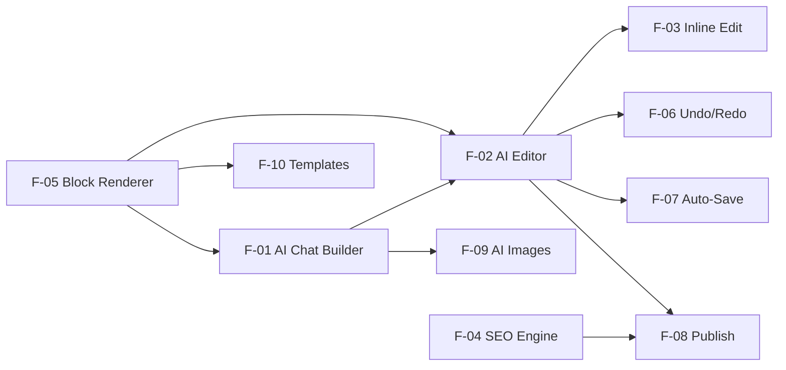

# PLAN — AI Web Builder (Full Feature Build)
> **Version:** 1.0 | **Created:** 2026-03-08 | **Owner:** Ben (Antigravity)  
> **Project Type:** WEB (Next.js 15 + Payload CMS)  
> **BMAD Status:** Phase 2 — Requirements Definition  
> **Ref:** [AI_BUILDER_SPEC.md](./AI_BUILDER_SPEC.md) | [SPEC.md](../SPEC.md)

---

## 🔴 BMAD PRE-FLIGHT

| Check | Status | Note |
|-------|--------|------|
| **Project type identified** | ✅ WEB | Next.js 15 + Payload CMS |
| **Agent routing verified** | ✅ | frontend-specialist + backend(Payload) |
| **SPEC.md exists** | ✅ | 737 lines, §7 AI Features |
| **AI_BUILDER_SPEC.md exists** | ✅ | 700 lines, 16 sections |
| **Socratic Gate** | ✅ | Requirements extracted from 3 source docs |

---

## 📋 FEATURE INVENTORY

> Each feature below follows BMAD: **PRD → Architecture → Stories → Readiness Gate → Sprint → QA**

| # | Feature | Priority | Size | Wave | Agent(s) |
|---|---------|----------|------|------|----------|
| F-01 | [AI Chat Builder](#f-01-ai-chat-builder) | P0 🌟 | XL | 3 | `project-planner` → `backend-specialist` → `frontend-specialist` |
| F-02 | [AI Editor (Split Screen)](#f-02-ai-editor-split-screen) | P0 🌟 | XL | 3 | `frontend-specialist` → `backend-specialist` |
| F-03 | [Inline AI Edit](#f-03-inline-ai-edit) | P0 | L | 3 | `frontend-specialist` → `backend-specialist` |
| F-04 | [AI SEO Engine](#f-04-ai-seo-engine) | P0 🌟 | L | 4 | `seo-specialist` → `backend-specialist` → `frontend-specialist` |
| F-05 | [Block Renderer Engine](#f-05-block-renderer-engine) | P0 | L | 3 | `frontend-specialist` |
| F-06 | [Undo/Redo System](#f-06-undoredo-system) | P0 | M | 3 | `frontend-specialist` |
| F-07 | [Auto-Save & Draft](#f-07-auto-save--draft) | P0 | M | 3 | `frontend-specialist` → `backend-specialist` |
| F-08 | [Publish Flow](#f-08-publish-flow) | P0 | M | 3 | `frontend-specialist` → `backend-specialist` |
| F-09 | [AI Image Generation](#f-09-ai-image-generation) | P1 | M | 4 | `backend-specialist` → `frontend-specialist` |
| F-10 | [Template Gallery](#f-10-template-gallery) | P1 | S | 3 | `frontend-specialist` |

---

## F-01: AI Chat Builder

### 📌 Summary
Full-screen chat interface where user describes their business → AI generates a complete website with 8-12 blocks in < 60 seconds using SSE streaming.

### 🏗️ Agent Assignments

| Phase | Agent | Skill(s) | Deliverable |
|-------|-------|----------|-------------|
| **PRD** | `project-planner` | `brainstorming`, `plan-writing` | `docs/prd/ai-chat-builder.md` |
| **Architecture** | `backend-specialist` | `api-patterns`, `ai-engineer` | `docs/architecture/ai-chat-builder.md` |
| **UI/UX Design** | `frontend-specialist` | `modern-web-architect`, `frontend-design` | Component specs + wireframe |
| **Backend** | `backend-specialist` | `ai-engineer` | Server Actions, SSE streaming |
| **Frontend** | `frontend-specialist` | `modern-web-architect` | Chat UI + Preview |
| **Test** | `quality-inspector` | `testing-patterns` | E2E + Unit tests |
| **SEO** | `seo-specialist` | `seo-expert-kit` | Meta generation logic |

### 📝 PRD — `docs/prd/ai-chat-builder.md`

```markdown
# PRD: AI Chat Builder (F-01)

## Problem Statement
SME owners waste 30-60 minutes configuring website builders 
(choose template → fill forms → upload images → configure SEO).
They need a way to describe their business and get a website instantly.

## Target User
- SME owner, no technical skills
- Wants professional website in 5 minutes
- Speaks Vietnamese (primary) or English

## Success Metrics
| Metric | Target |
|--------|--------|
| Time to first website | < 5 min (register → publish) |
| Generation success rate | > 95% |
| User satisfaction score | > 8/10 |
| Generation time (p95) | < 60s |

## User Story
AS A newly registered SME owner
I WANT TO describe my business in natural language
SO THAT AI creates a complete website without me needing design skills

## Acceptance Criteria (Gherkin)

### AC-1: Happy Path — Generate Site
GIVEN user is on /builder/new (authenticated)
WHEN user types "Shop thời trang nữ, tên Mira Boutique, bán váy và phụ kiện"
AND clicks "Tạo website" or presses Enter
THEN AI begins SSE streaming within < 2 seconds
AND progress bar shows each step: "Đang tạo header... Hero... Products..."
AND live preview (right panel) updates block-by-block in real-time
AND complete site finishes in < 60 seconds
AND minimum 8 blocks generated (nav, hero, features, about, testimonials, faq, contact, footer)
AND theme matches category (fashion → pink/rose palette)
AND all copy is in user's language (Vietnamese)
AND SEO meta (title ≤ 60 chars, description ≤ 160 chars) auto-generated
AND 2 CTAs appear: "Tinh chỉnh →" (→ /editor) and "Publish ngay"
AND draft auto-saved to database

### AC-2: Missing Business Name
GIVEN user types prompt without a business name
WHEN AI cannot extract businessName
THEN AI asks: "Tên shop/website của bạn là gì?" (1 clarifying question)
AND does NOT generate until name is provided

### AC-3: Max 2 Clarifying Questions
GIVEN AI needs more info
WHEN 2 questions already asked
THEN AI generates with reasonable assumptions (no more questions)

### AC-4: Error Recovery
GIVEN AI API fails (timeout, error)
WHEN generation fails mid-way
THEN red toast: "Không thể tạo website. Thử lại"
AND "Thử lại" button works WITHOUT re-entering prompt
AND partial blocks saved as draft

### AC-5: Draft Recovery
GIVEN user navigates away during/after generation
WHEN user returns to /builder/new
THEN dialog: "Bạn có bản nháp chưa hoàn thành"
AND options: "Tiếp tục" | "Tạo mới"

### AC-6: Rate Limiting
GIVEN free tier user
WHEN attempting 2nd generation (limit: 1 total)
THEN toast: "Đã hết lượt tạo website miễn phí"
AND show upgrade prompt

## Technical Requirements

### Backend (Server Actions)
- Server Action: `generateSite(prompt, siteId, language?)` → SSE stream
- System prompt: See AI_BUILDER_SPEC.md §8.1
- Model: GPT-4o (full generation)
- Rate limit check before generation
- Save partial blocks on each `block_complete` event
- Timeout: 120s max

### Frontend Components
| Component | Location | Description |
|-----------|----------|-------------|
| `AIBuilderPage` | `app/(builder)/builder/new/page.tsx` | Full-screen layout |
| `ChatPanel` | `components/builder/ChatPanel.tsx` | 380px left panel |
| `PreviewPanel` | `components/builder/PreviewPanel.tsx` | iframe preview |
| `ProgressBar` | `components/builder/ProgressBar.tsx` | Step-by-step progress |
| `useAIStream` | `hooks/useAIStream.ts` | SSE consumer hook |

### SSE Events
| Event | Data | UI Action |
|-------|------|-----------|
| `step` | `{step, label, progress}` | Update progress bar |
| `block_complete` | `{block: BlockConfig}` | Add block to preview |
| `theme_set` | `{theme: ThemeConfig}` | Apply theme to preview |
| `error` | `{code, message, retryable}` | Show error toast |
| `done` | `{siteId, totalBlocks, time}` | Show success + CTAs |

### Data Model
- Uses existing `sites` + `pages` + `blocks` Payload collections
- New field: `sites.aiContext` (JSON) — stores AI memory
- New collection: `ai-messages` — stores chat history

## 9-Point Done Checklist
- [ ] Loading State — Skeleton for preview, typing indicator for chat
- [ ] Empty State — Welcome message + example prompts
- [ ] Error State — Toast + retry button
- [ ] Form Validation — Not applicable (chat input)
- [ ] Button States — Send button disabled during streaming
- [ ] Toast Feedback — Success/Error/Rate limit toasts
- [ ] Auth Redirect — 401 → /login
- [ ] Mobile 375px — Chat full-width, preview hidden (toggle)
- [ ] TypeScript Clean — tsc --noEmit pass

## Definition of Ready
- [ ] This PRD reviewed and approved
- [ ] AI_BUILDER_SPEC.md §2, §8.1, §9 referenced
- [ ] OpenAI API key configured and tested
- [ ] Payload collections (sites, pages, ai-messages) ready
- [ ] Docker environment working

## Definition of Done
- [ ] 9-Point Checklist pass
- [ ] Generation time < 60s (p95 measured)
- [ ] Rate limit works (test limits per tier)
- [ ] E2E test: Full generation flow (Playwright)
- [ ] Error recovery tested (simulate API failure)
- [ ] Draft recovery tested (close tab → return)
```

### 🏛️ Architecture — `docs/architecture/ai-chat-builder.md`

```markdown
# Architecture: AI Chat Builder

## System Flow
┌──────────┐    ┌──────────────┐    ┌──────────────┐
│  Client  │───▶│ Server Action │───▶│   OpenAI     │
│ (Next.js)│◀───│ (SSE Stream) │◀───│   GPT-4o     │
└──────────┘    └──────┬───────┘    └──────────────┘
                       │
                ┌──────▼───────┐
                │  Payload CMS │
                │  (PostgreSQL)│
                └──────────────┘

## Component Architecture
app/(builder)/builder/new/page.tsx
├── ChatPanel (380px left)
│   ├── WelcomeMessage
│   ├── MessageList
│   │   ├── UserMessage
│   │   ├── AIMessage (with progress steps)
│   │   └── TypingIndicator
│   └── ChatInput (textarea + send button)
└── PreviewPanel (remaining width)
    ├── PreviewToolbar (device toggle, URL bar)
    └── PreviewIframe (sandboxed, renders blocks)

## State Management (Zustand)
builderStore:
  messages: Message[]
  blocks: BlockConfig[]
  theme: ThemeConfig | null
  status: 'idle' | 'streaming' | 'done' | 'error'
  progress: { step: string, percent: number }
  siteId: string | null

## Server Action
// app/actions/ai/generateSite.ts
'use server'
export async function generateSite(prompt, siteId, language?) {
  1. Validate auth + rate limit
  2. Extract business info from prompt
  3. Select category template
  4. Call OpenAI GPT-4o with system prompt
  5. Stream response as SSE events:
     - Parse JSON blocks from AI response
     - Emit block_complete for each block
     - Save block to Payload CMS
  6. Emit done event
}

## Error Matrix
| Scenario | Response |
|----------|----------|
| Auth expired | 401 → redirect /login |
| Rate limit exceeded | 429 + upgrade prompt |
| OpenAI timeout (>30s) | Auto-retry 1x, then manual retry |
| OpenAI invalid JSON | Auto-retry with stricter prompt |
| Network disconnect | Auto-reconnect + resume |
| Partial generation fail | Save partial, allow resume |
```

---

## F-02: AI Editor (Split Screen)

### 📌 Summary
3-panel editor: AI Chat (380px left) + Live Preview (center) + Settings (right panel, optional). User chats with AI to modify existing website. All changes apply in real-time.

### 🏗️ Agent Assignments

| Phase | Agent | Skill(s) | Deliverable |
|-------|-------|----------|-------------|
| **PRD** | `project-planner` | `brainstorming` | `docs/prd/ai-editor.md` |
| **Architecture** | `frontend-specialist` | `modern-web-architect` | Component tree + state design |
| **Backend** | `backend-specialist` | `ai-engineer` | Chat edit Server Action |
| **Frontend** | `frontend-specialist` | `modern-web-architect` | Split-screen UI + iframe |
| **Test** | `quality-inspector` | `testing-patterns` | Undo/Redo tests, streaming tests |

### 📝 PRD Highlights

```markdown
## User Story
AS A store owner who just generated a website
I WANT TO refine my website through chat or direct click
SO THAT I can customize content without knowing code

## Key Acceptance Criteria

### AC-1: Split Screen Layout
GIVEN user navigates to /editor/:siteId
WHEN page loads
THEN AI chat panel (380px fixed) on left
AND live preview (iframe) on right
AND "Publish" button always visible top-right
AND page menu accessible from toolbar

### AC-2: Chat-to-Edit
GIVEN user types "Đổi tiêu đề hero thành Khám Phá Moda"
WHEN message sent
THEN AI streams response
AND preview updates in real-time (no refresh)
AND AI explains changes: "Tôi đã đổi tiêu đề hero..."
AND "Hoàn tác" button in that message
AND 3 follow-up suggestions shown

### AC-3: Mobile Responsive
GIVEN screen width < 768px
THEN chat panel → bottom sheet (swipe up)
AND preview → full width
AND toggle buttons: [💬 Chat] [👁 Preview]

## Technical Requirements

### Frontend Components
| Component | File | Description |
|-----------|------|-------------|
| `EditorPage` | `app/(editor)/editor/[siteId]/page.tsx` | Layout orchestrator |
| `EditorChatPanel` | `components/editor/EditorChatPanel.tsx` | AI chat with suggestions |
| `EditorPreview` | `components/editor/EditorPreview.tsx` | Sandboxed iframe |
| `EditorToolbar` | `components/editor/EditorToolbar.tsx` | Actions bar |
| `PageSelector` | `components/editor/PageSelector.tsx` | Page switcher dropdown |
| `editorStore` | `store/editorStore.ts` | Zustand state (site, undo, dirty) |
| `useAIChat` | `hooks/useAIChat.ts` | Chat + change application hook |

### Server Action
// app/actions/ai/chatEdit.ts
'use server'
export async function chatEdit(siteId, messages[], context) {
  1. Validate auth + tenant scope
  2. Build context: current page blocks (summary) + theme + last 10 messages
  3. Call GPT-4o-mini with editor system prompt
  4. Parse response: { message, changes[], suggestions[] }
  5. Return structured response (NOT streaming for edits)
}

### iframe ↔ Parent Communication
Parent → iframe: UPDATE_BLOCK, HIGHLIGHT_BLOCK, SET_THEME
iframe → Parent: BLOCK_CLICKED, BLOCK_HOVERED (with rect position)
```

---

## F-03: Inline AI Edit

### 📌 Summary
Hover any block in preview → blue outline + ✨ button → click → popup with text input + quick actions → AI modifies ONLY that element → before/after diff → accept/retry.

### 🏗️ Agent Assignments

| Phase | Agent | Deliverable |
|-------|-------|-------------|
| **PRD** | `project-planner` | `docs/prd/inline-edit.md` |
| **Frontend** | `frontend-specialist` | Hover detection, popup positioning, diff view |
| **Backend** | `backend-specialist` | `inlineEdit` Server Action |

### 📝 Key AC

```gherkin
GIVEN user hovers a hero block in preview iframe
WHEN hover occurs
THEN blue outline (2px solid #2563EB) around block
AND floating [✨ AI Edit] button appears top-right

GIVEN user clicks [✨ AI Edit]
WHEN popup opens
THEN text input + quick actions (Viết lại, Đổi style, Xóa)
AND popup positioned adjacent to block (not covering it)

GIVEN user types "Viết lại ngắn gọn hơn" + clicks Apply
THEN loading spinner on Apply button
AND AI returns new content + 2 alternatives
AND before/after diff shown
AND "Accept" → block updates + fade animation + toast
```

---

## F-04: AI SEO Engine

### 📌 Summary
SEO Dashboard (/dashboard/seo): Overall score 0-100, breakdown by 4 categories, page-by-page analysis, "Fix All" button that auto-fixes all AI-fixable issues via SSE streaming.

### 🏗️ Agent Assignments

| Phase | Agent | Skill(s) | Deliverable |
|-------|-------|----------|-------------|
| **PRD** | `project-planner` + `seo-specialist` | `seo-expert-kit` | `docs/prd/ai-seo-engine.md` |
| **Backend** | `backend-specialist` | `ai-engineer` | Analyze + Fix-all Server Actions |
| **Frontend** | `frontend-specialist` | `modern-web-architect` | SEO Dashboard UI |

### 📝 Key AC

```gherkin
GIVEN user navigates to /dashboard/seo
WHEN page loads
THEN overall SEO score (0-100) displayed
AND breakdown: Meta Tags (0-25), Content (0-25), Technical (0-25), Performance (0-25)
AND page-by-page list with individual scores

GIVEN score < 70 and autoFixable issues exist
WHEN user clicks "Fix All Issues ✨"
THEN SSE streaming: "Fixing 12 issues... 4/12... 8/12... done"
AND show before/after: "Score: 52 → 89"
AND toast: "✅ Fixed 12 issues. Score improved by 37 points!"
```

---

## F-05: Block Renderer Engine

### 📌 Summary
20 block types (navigation, hero, features, about, testimonials, FAQ, etc.), each with 2-4 variants. Renders from JSON config. Used in both editor preview and published storefront.

### 🏗️ Agent Assignments

| Phase | Agent | Deliverable |
|-------|-------|-------------|
| **Architecture** | `frontend-specialist` | Block component architecture |
| **Frontend** | `frontend-specialist` | 20 block components with variants |
| **Test** | `quality-inspector` | Visual regression tests |

### Key Components
```
src/blocks/
├── navigation/    BlockNavigation.tsx + config.ts
├── hero/          BlockHero.tsx (4 variants: centered, split, video, minimal)
├── features/      BlockFeatures.tsx (4 variants: grid-2, grid-3, grid-4, list)
├── about/         BlockAbout.tsx (3 variants: simple, split, story)
├── testimonials/  BlockTestimonials.tsx (3 variants: cards, carousel, simple)
├── faq/           BlockFAQ.tsx (3 variants: accordion, grid, simple)
├── contact/       BlockContact.tsx (2 variants: form, info)
├── gallery/       BlockGallery.tsx (3 variants: grid, masonry, carousel)
├── footer/        BlockFooter.tsx (2 variants: simple, expanded)
├── pricing/       BlockPricing.tsx (2 variants: cards, table)
├── cta/           BlockCTA.tsx (2 variants: banner, inline)
├── stats/         BlockStats.tsx
├── team/          BlockTeam.tsx
├── blog-list/     BlockBlogList.tsx
├── video/         BlockVideo.tsx
├── logo-cloud/    BlockLogoCloud.tsx
├── newsletter/    BlockNewsletter.tsx
├── products-grid/ BlockProductsGrid.tsx
├── products-featured/ BlockProductsFeatured.tsx
└── custom-html/   BlockCustomHTML.tsx (sanitized)
```

---

## F-06: Undo/Redo System

### 📌 Summary
Ctrl+Z / Ctrl+Y works for ALL changes (AI chat edits, inline edits, manual drag-drop). Zustand store with max 50 actions. Each AI response = 1 undo group.

### Agent: `frontend-specialist`

### Key Architecture
```typescript
// store/editorStore.ts — Zustand
undoStack: UndoableAction[] // max 50
redoStack: UndoableAction[]

// Each action stores:
{ changes: SiteChange[], reverseChanges: SiteChange[], source: 'ai_chat' | 'inline' | 'manual' }

// Rules:
// - New change → clears redo stack
// - AI response with multiple changes → 1 undo group
// - Undo → pop from undoStack, push to redoStack, apply reverseChanges
```

---

## F-07: Auto-Save & Draft

### Agent: `frontend-specialist` → `backend-specialist`

### Logic
```
Trigger: Any state change (AI/manual)
Debounce: 3 seconds
Method: Server Action → PATCH page blocks
Success: Update lastSaved, clear isDirty
Failure: Toast "Chưa lưu được" + retry 3x (backoff 5s, 10s, 20s)
Final fail: Persistent banner "Kiểm tra kết nối"
```

---

## F-08: Publish Flow

### Agent: `frontend-specialist` → `backend-specialist`

### AC
```gherkin
GIVEN user clicks "Publish" in editor toolbar
WHEN publish modal opens
THEN checklist shown:
  ✅ Có ít nhất 1 trang
  ⚠️ SEO score < 60 (warning, not blocking)
AND "Publish ngay" button active

GIVEN user confirms publish
WHEN published successfully
THEN site.isPublished = true
AND subdomain live: [slug].webstore.app
AND confetti animation
AND toast: "🎉 Website đã live!" + link opens new tab
```

---

## F-09: AI Image Generation

### Agent: `backend-specialist` → `frontend-specialist`

### Pipeline
```
1. Chat/Inline sends image request
2. Server Action queues to background job
3. Call DALL-E 3 API (or Ideogram v2)
4. Upload to MinIO/S3
5. Update block config with CDN URL
6. SSE event: IMAGE_READY → preview auto-updates
```

---

## F-10: Template Gallery

### Agent: `frontend-specialist`

### Summary
Fallback for users who prefer starting from a template. 6+ pre-made templates by category. Click → load template blocks → /editor.

---

## 📐 READINESS GATE CHECKLIST

> Apply before each feature sprint begins.

| Gate | Check | Status |
|------|-------|--------|
| 1 | Stories/AC clear (Gherkin AC in PRD) | ⬜ |
| 2 | Architecture documented | ⬜ |
| 3 | API contracts in AI_BUILDER_SPEC.md §14 | ✅ |
| 4 | Dependencies resolved (OpenAI key, Payload collections, Docker) | ⬜ |

**Rule: < 4/4 PASS → HOLD. Fix before dev starts.**

---

## 📊 BUILD ORDER (Dependencies)



### Sprint Order:
1. **Sprint 1:** F-05 (Block Renderer) — Foundation for everything
2. **Sprint 2:** F-01 (AI Chat Builder) — Core USP
3. **Sprint 3:** F-02 (AI Editor) + F-06 (Undo) + F-07 (Auto-Save) — Refinement tools
4. **Sprint 4:** F-03 (Inline Edit) + F-08 (Publish) — Polish
5. **Sprint 5:** F-04 (SEO Engine) + F-09 (Images) + F-10 (Templates) — Growth features

---

## 🧪 VERIFICATION PLAN

### E2E Tests (Playwright)
| Test | Priority |
|------|----------|
| Register → Builder → Generate → Preview → Publish | P0 |
| Editor: Chat edit → preview update → undo → redo | P0 |
| Inline edit: hover → popup → edit → accept | P0 |
| SEO Dashboard: analyze → fix all → verify score | P1 |
| Draft recovery: close tab → return → continue | P1 |

### Performance Tests
| Metric | Target | Tool |
|--------|--------|------|
| Generation time | < 60s (p95) | Custom timing |
| Chat edit response | < 5s (p95) | Custom timing |
| Preview update latency | < 200ms | Performance API |
| Auto-save latency | < 500ms | Network tab |

---

> **Next steps:** Review this plan → Approve → Create detailed PRDs for each feature → Start Sprint 1 (F-05 Block Renderer)
