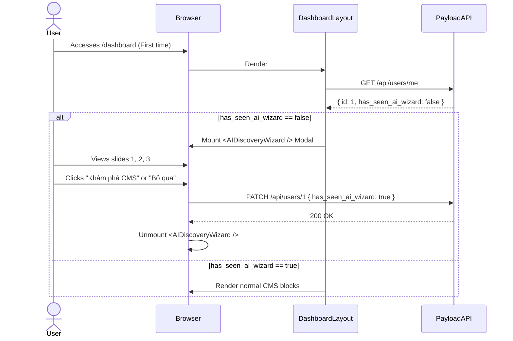

# Architecture: Onboarding Flow & AI Discovery Wizard (F06)

## 1. Overview
The F06 Onboarding Flow handles user registration, automatic login post-verification, and the crucial first-time experience in the CMS dashboard via the AI Discovery Wizard.

## 2. Core Components

### 2.1 Frontend Components (`app/(frontend)`)
- `RegisterForm`: Connects to Payload's `/api/users/login` and `/api/users/register`.
- `VerifyEmail`: Handles token parsing from the URL and auto authentication.
- `WelcomeScreen` (`/onboarding`): A simple bridge page with a single CTA pushing users to `/builder/new` (F01).

### 2.2 Backend / CMS Dashboard Components (`app/(dashboard)`)
- `AIDiscoveryWizard`: A client-side React Modal component (`components/dashboard/AIDiscoveryWizard.tsx`).
- Trigger logic is injected at the root layout of the dashboard (`app/(dashboard)/layout.tsx`) to ensure it intercepts the user before they interact with any specific module.

## 3. State Management (The `has_seen_ai_wizard` Flag)

To ensure the wizard only shows once per user, we depend on a server-side persisted flag, preventing race conditions or localized cache clears.

**Payload CMS User Collection Update:**
```typescript
{
  name: 'has_seen_ai_wizard',
  type: 'checkbox',
  defaultValue: false,
  admin: {
    position: 'sidebar',
    description: 'Whether the user has completed the initial CMS AI Wizard.',
  },
}
```

## 4. Interaction Flow (Mermaid)



## 5. Performance Considerations
- **Media Optimization:** The gifs/videos within the `AIDiscoveryWizard` must be lazy-loaded only when the modal is actually triggered (i.e., not loaded for returning users where `has_seen_ai_wizard` is true).
- **Bundle Size:** Ensure the Carousel library used inside the Wizard is lightweight or dynamically imported.
