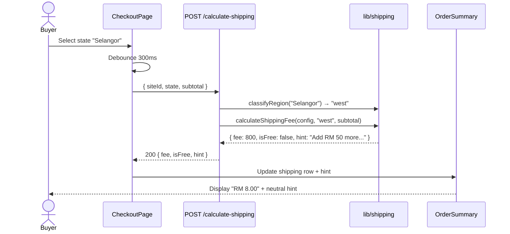
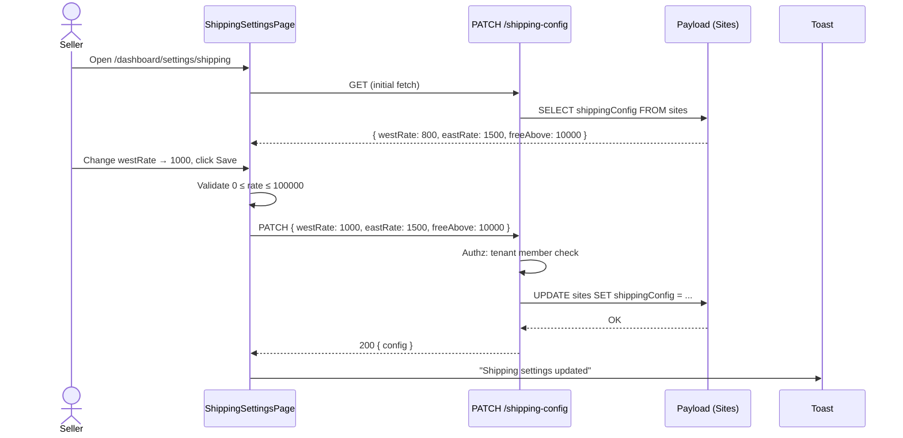

# Architecture: Shipping — Malaysia (F14)

> **Version:** 1.0 | **Created:** 2026-05-12 | **Agent:** `planner`
> **PRD:** [`docs/prd/F14-shipping.md`](../prd/F14-shipping.md)
> **Design:** [`docs/design/F14-shipping-design.md`](../design/F14-shipping-design.md)
> **Stories:** [`docs/stories/F14-shipping-stories.md`](../stories/F14-shipping-stories.md)
> **Scope:** Wave 6 — Flat-rate only (West/East MY), MYR only, single-seller cart.

---

## 1. Overview

F14 cung cấp logic tính phí ship Malaysia theo region (West/East) cho checkout, đi kèm UI cấu hình cho seller. Implementation sử dụng pure-function classifier + 3 API endpoint, không cần background job, không cần caching layer. Schema đã có sẵn ở `Sites.shippingConfig` và `Orders.shippingFee`.

> **🚚 Delivery Model: SELF-DELIVERY (Merchant-Fulfilled)**
>
> Wave 6 = merchant tự lo giao hàng ngoài hệ thống. Hệ thống KHÔNG:
> - Gọi bất kỳ carrier API nào (J&T, Pos Laju, Ninja Van, EasyParcel)
> - Generate tracking URL tự động
> - Verify tracking number hợp lệ
> - Print shipping label
> - Nhận webhook delivery status
>
> Hệ thống CHỈ:
> - Tính phí ship dạng flat-rate theo region
> - Cho seller nhập `trackingNumber` thủ công (free text)
> - Email "Shipped" hiển thị tracking number (không clickable link)
>
> Wave 7+ sẽ thêm EasyParcel aggregator để integrate với multiple carriers.

---

## 2. System Context

```
┌──────────────────────────────────────────────────────────┐
│ Storefront (F09)                                         │
│   └── CheckoutPage                                       │
│       └── AddressForm + OrderSummary ◄─── F14 surfaces   │
└──────────────────┬───────────────────────────────────────┘
                   │  POST /api/orders/calculate-shipping
                   ▼
┌──────────────────────────────────────────────────────────┐
│ Next.js API Routes                                        │
│   ├── /api/orders/calculate-shipping    (public)         │
│   ├── /api/sites/:siteId/shipping-config (GET public)    │
│   └── /api/sites/:siteId/shipping-config (PATCH auth)    │
└──────────────────┬───────────────────────────────────────┘
                   │  uses
                   ▼
┌──────────────────────────────────────────────────────────┐
│ Shared library                                            │
│   ├── lib/shipping/classify-region.ts                    │
│   ├── lib/shipping/calculate-fee.ts                      │
│   └── lib/shipping/constants.ts                          │
└──────────────────┬───────────────────────────────────────┘
                   │  reads/writes
                   ▼
┌──────────────────────────────────────────────────────────┐
│ Payload CMS (Postgres / Neon)                            │
│   ├── sites.shippingConfig (group)                       │
│   └── orders.shippingFee + shippingAddress               │
└──────────────────────────────────────────────────────────┘
                   ▲
                   │  PATCH /api/sites/:siteId/shipping-config
┌──────────────────┴───────────────────────────────────────┐
│ Dashboard (F18 layout)                                   │
│   └── /dashboard/settings/shipping                       │
│       └── ShippingSettingsCard ◄─── F14 surface          │
└──────────────────────────────────────────────────────────┘
```

---

## 3. Component Tree

```
src/app/sites/[slug]/checkout/page.tsx                    (modify existing)
└── CheckoutPage
    ├── AddressForm
    │   ├── Input (name, email, phone, line1, line2, city, postcode)
    │   └── Select (state from MY_STATES)
    └── OrderSummary
        ├── SubtotalRow
        ├── ShippingRow ◄── NEW: dynamic based on calc API
        │   ├── empty dash
        │   ├── fee number
        │   └── FREE badge
        ├── FreeShippingHint ◄── NEW: 3-tier display (see design §8.3)
        ├── SSTRow (existing)
        └── TotalRow

src/app/(dashboard)/dashboard/settings/shipping/page.tsx  (new route)
└── ShippingSettingsPage
    └── ShippingSettingsCard ◄── NEW
        ├── RegionRatesCard
        │   ├── Input westRate (with RM prefix)
        │   └── Input eastRate
        ├── FreeShippingCard
        │   ├── Switch enableFreeShipping
        │   └── Input freeAboveThreshold (conditional)
        └── ActionFooter
            ├── Button "Reset to Defaults"
            └── Button "Save"
```

### Component Responsibility

| Component | File | Responsibility |
|-----------|------|---------------|
| `CheckoutPage` | `src/app/sites/[slug]/checkout/page.tsx` | Existing — modify shipping calc logic |
| `AddressForm` | (inline in page.tsx) | State select, postcode validation, debounced onChange trigger calc |
| `OrderSummary` | (inline in page.tsx) | Render dynamic shipping fee + free hint + total |
| `ShippingSettingsPage` | `src/app/(dashboard)/dashboard/settings/shipping/page.tsx` (NEW) | Dashboard route, fetch + render settings card |
| `ShippingSettingsCard` | `src/components/dashboard/shipping/ShippingSettingsCard.tsx` (NEW) | Form with West/East rate + free threshold, save handler |
| `classifyRegion` | `src/lib/shipping/classify-region.ts` (NEW) | Pure fn: `(state: MYState) => 'west' \| 'east'` |
| `calculateShippingFee` | `src/lib/shipping/calculate-fee.ts` (NEW) | Pure fn: `(config, state, subtotal) => { fee, isFree, hint? }` |
| `SHIPPING_DEFAULTS` | `src/lib/shipping/constants.ts` (NEW) | `WEST_MY_STATES`, `EAST_MY_STATES`, `DEFAULTS` |

---

## 4. Data Flow

### 4.1. Checkout flow (buyer)



### 4.2. Settings flow (seller)



---

## 5. State Management

| State | Location | Type | Description |
|-------|----------|------|-------------|
| `shippingConfig` | Server (Payload) | `ShippingConfig` | Source of truth — per site |
| `selectedState` | `useState` in CheckoutPage | `string \| null` | Trigger recalc |
| `calculatedFee` | `useState` in CheckoutPage | `{ fee: number, isFree: boolean, hint?: string } \| null` | API response cache |
| `isCalculating` | `useState` in CheckoutPage | `boolean` | Spinner toggle |
| `settingsForm` | `useState` in SettingsCard | `ShippingConfig` (dirty copy) | Form state — diff against server |
| `isSaving` | `useState` in SettingsCard | `boolean` | Save button state |

> **No global store needed.** Cart store đã có subtotal — pass prop. Settings page tự fetch + own state.

---

## 6. API Design

### 6.1. `GET /api/sites/:siteId/shipping-config`

**Auth:** Public (read-only, non-sensitive)
**Use case:** Checkout fetch config to compute hint client-side, settings page initial load.

```typescript
// Response 200
{
  success: true,
  data: {
    westRate: number,         // sen
    eastRate: number,         // sen
    freeAbove: number | null  // sen, null = disabled
  }
}

// Response 404 — site not found
{ success: false, error: { code: 'SITE_NOT_FOUND', message: 'Site not found' } }
```

### 6.2. `PATCH /api/sites/:siteId/shipping-config`

**Auth:** Tenant member of `siteId` (verify via session + `users.tenants[].siteId`)
**Body validation:** Zod schema.

```typescript
// Request body
{
  westRate: number,          // required, integer, 0..100000
  eastRate: number,          // required, integer, 0..100000
  freeAbove: number | null   // optional, integer, ≥0 if number
}

// Response 200
{ success: true, data: { /* updated config */ } }

// Response 400 — validation
{ success: false, error: {
  code: 'VALIDATION_ERROR',
  message: 'Rate must be between 0 and RM 1,000',
  fields: { westRate: 'out_of_range' }
}}

// Response 403 — forbidden
{ success: false, error: { code: 'FORBIDDEN', message: 'Not a member of this site' } }
```

### 6.3. `POST /api/orders/calculate-shipping`

**Auth:** Public (checkout guest)
**Idempotent:** Yes (pure calc).
**Rate limit:** 60 req/min per IP (sane default; checkout debounce 300ms makes this generous).
**Body validation:** Handler guards against null or array body → returns 400.

```typescript
// Request body
{
  siteId: string,    // required
  state: string,     // required, one of MY_STATES
  subtotal: number   // required, sen, ≥0
}

// Response 200
{
  success: true,
  data: {
    fee: number,           // sen, after free-shipping rule applied
    isFree: boolean,       // true if subtotal >= freeAbove
    region: 'west' | 'east',
    hint?: {
      tier: 'neutral' | 'highlight',
      gap: number,         // sen
      message: string      // "Add RM 50 more for FREE shipping"
    }
  }
}

// Response 400 — validation error (invalid state, null/array body)
{ success: false, error: { code: 'INVALID_STATE', message: 'Unknown Malaysian state' } }

// Response 404 — site not found
{ success: false, error: { code: 'SITE_NOT_FOUND', message: 'Site not found' } }
```

---

## 7. State Classification (Source of Truth)

```typescript
// src/lib/shipping/constants.ts

export const WEST_MY_STATES = [
  'Johor', 'Kedah', 'Kelantan', 'Kuala Lumpur', 'Melaka',
  'Negeri Sembilan', 'Pahang', 'Penang', 'Perak', 'Perlis',
  'Putrajaya', 'Selangor', 'Terengganu',
] as const  // 13 states

export const EAST_MY_STATES = [
  'Sabah', 'Sarawak', 'Labuan',
] as const  // 3 states (Labuan = East per TC-F14.03)

export const MY_STATES = [...WEST_MY_STATES, ...EAST_MY_STATES] as const  // 16 total

export type MYState = typeof MY_STATES[number]
export type MYRegion = 'west' | 'east'

export const SHIPPING_DEFAULTS = {
  westRate: 800,        // RM 8.00
  eastRate: 1500,       // RM 15.00
  freeAbove: 10000,     // RM 100.00
  freeShippingEnabled: true,
} as const

export const RATE_MIN = 0
export const RATE_MAX = 100_000  // RM 1,000

export const HINT_HIGHLIGHT_THRESHOLD = 5000  // RM 50 — gap ≤ this → highlight tier
```

> **Migration note:** `MY_STATES` đã tồn tại trong `src/lib/storefront/checkout.ts:42`. Sẽ move sang `lib/shipping/constants.ts` và re-export từ checkout.ts để backward-compat.

---

## 8. Validation Rules

| Field | Rule | Error code |
|-------|------|-----------|
| `westRate`, `eastRate` | integer ∈ [0, 100000] | `VALIDATION_ERROR.out_of_range` |
| `freeAbove` | `null` or integer ≥ 0 | `VALIDATION_ERROR.invalid_threshold` |
| `state` (POST calc) | must ∈ `MY_STATES` enum | `INVALID_STATE` |
| `subtotal` (POST calc) | integer ≥ 0 | `VALIDATION_ERROR.invalid_subtotal` |
| `postcode` (form) | regex `^\d{5}$` client-side only | (UI inline error, no API check) |

Zod schemas in `src/lib/shipping/schemas.ts`.

---

## 9. Error Handling Matrix

| Error | HTTP | User-facing UI | Recovery |
|-------|------|----------------|----------|
| `SITE_NOT_FOUND` | 404 | "Unable to load store. Please refresh." | Reload page |
| `INVALID_STATE` | 400 | "Please select a valid state." | Re-select state |
| `VALIDATION_ERROR` (rate range) | 400 | Inline input: "Rate must be 0 – RM 1,000" | Fix value |
| `FORBIDDEN` (PATCH) | 403 | Toast: "You don't have permission" | Re-login |
| Network failure (POST calc) | — | Toast: "Failed to calculate. Retry" + inline retry | Auto-retry once, then manual |
| Postcode invalid | — | Input red border + "5 digits required" | User fix |

---

## 10. Database / Collection Changes

**Status:** Schema already present.

| Collection | Field | Status | Notes |
|-----------|-------|--------|-------|
| `Sites` | `shippingConfig.westRate` | ✅ exists | Default 800 — confirm matches `SHIPPING_DEFAULTS` |
| `Sites` | `shippingConfig.eastRate` | ✅ exists | Default 1500 |
| `Sites` | `shippingConfig.freeAbove` | ✅ exists | Currently no default; change default to `10000` per BR-07 |
| `Orders` | `shippingFee` | ✅ exists | Min 0, default 0 |
| `Orders` | `shippingAddress` | ✅ exists | group with line1/line2/city/state/postcode/country |
| `Orders` | `trackingNumber` | ✅ exists | Wave 7+ — leave nullable |

**Migration required (small):**
- `scripts/db-setup.js` migration to backfill existing sites with `freeAbove = 10000` if currently null. Per `.claude/rules/database-schema.md`.

---

## 11. Security Considerations

- **Auth:** PATCH gated by tenant membership check. Re-use existing `lib/auth/check-tenant-member.ts` (pattern from F19 settings).
- **Input sanitization:** All numeric inputs → `parseInt`, reject NaN. Currency strings rejected — UI converts RM → sen before send.
- **Rate limiting:** `/calculate-shipping` is public. Use `upstash/ratelimit` (60 req/min/IP) — re-use from `lib/rate-limit.ts` if exists; otherwise implement minimal in-memory.
- **CSRF:** Next.js App Router POST + same-origin policy sufficient. No additional CSRF token needed.
- **Tenant isolation:** Path param `siteId` — verify in handler `site.tenant === session.user.tenantId`. NEVER trust client-supplied tenant.

---

## 12. Performance Considerations

- **No caching layer.** Calc is pure + fast (<1ms). Network roundtrip dominates.
- **Debounce:** Client-side 300ms on state change. Prevents spam on rapid retypes.
- **SSR vs CSR:** Settings page CSR (form-heavy). Checkout already CSR. No SSR concerns.
- **Bundle impact:** New lib files <2KB gzipped. Negligible.
- **DB query:** `shippingConfig` read piggy-backs on existing site fetch in checkout (avoid extra query when possible).

---

## 13. Testing Strategy

| Layer | Tool | Coverage |
|-------|------|---------|
| Unit (pure fn) | Vitest | `classifyRegion`, `calculateShippingFee` — all 16 states + boundary + free threshold |
| Unit (component) | Vitest + Testing Library | `ShippingSettingsCard` validate + dirty state |
| API integration | Vitest + supertest-style | 3 endpoints — auth, validation, success |
| E2E | Playwright | E2E flows in `docs/qa/F14-shipping.md` §4 |

Reference: [`docs/qa/F14-shipping.md`](../qa/F14-shipping.md) — 20 TC mapped to FR-01..12.

---

## 14. Dependencies

| Dependency | Required | Notes |
|-----------|----------|-------|
| F09 Storefront Commerce | ✅ done | Checkout page exists, needs modify |
| F10 Orders Management | ✅ done | shippingFee field exists |
| F18 CMS Layout | ✅ done | Settings page slots into sidebar |
| F19 Store Configuration | ✅ done | Reuse settings page pattern |
| `lib/auth/check-tenant-member` | ✅ assumed | Same pattern as F19 PATCH endpoints |
| Zod | ✅ existing dep | Validation schemas |

---

## 15. Out of Scope (Wave 6)

- ❌ Carrier API integration (moved to F36 EasyParcel wave 7+)
- ❌ Tracking number live updates / webhook (F36 uses webhooks + polling)
- ❌ Label printing (F36)
- ❌ Per-product shipping override
- ❌ Multi-seller cart shipping split
- ❌ Estimated delivery days config
- ❌ Postcode → state cross-check
- ❌ Multi-currency rates

---

## 16. F36 Order Detail Redesign (GH-1333)

### Full-Page Order Detail with EasyParcel Fulfillment

F36 moves Order Detail from a right-slide drawer to a **full-page route** (`src/app/(dashboard)/orders/[id]/page.tsx`) with 2-column layout: left column = order items/customer/payment, right column = fulfillment zone.

#### Schema Changes (Phase 01)

New fields on `Orders` collection:
- **`selfDeliveryCourier`** (`text`): manual courier name for self-delivery orders (when EP unavailable or disabled)
- **`pickupScheduledAt`** (`date`): seller-selected pickup date (informational, EP collection date already set)
- **`pickupSlot`** (`text`): e.g. "08:00–12:00" (informational only)

New helper module: `src/lib/shipping/cod-block.ts` exports `isCodBlocked()` to detect orders with COD amount + East Malaysia state → blocked fulfillment recovery options.

> **⚠️ Superseded decision (pending code rework):** the East-Malaysia hardcode below is
> the *as-built* behavior. Verified decision (2026-07-03) is to **follow EasyParcel** —
> COD eligibility read LIVE per-route (`cod.available` + per-courier min/max, rules R1–R5),
> **no region hardcode**. `cod-block.ts` is to be reworked accordingly. This doc describes
> current code; it updates when the code changes. See
> [`docs/prd/F36-easyparcel-delivery.md`](../prd/F36-easyparcel-delivery.md) §8 + COD proof brief.

#### Fulfillment State Machine (Phase 03)

Fulfillment zone displays 1 of 7 states based on: EasyParcel enabled, order status, label creation, tracking data.

| State | Condition | Components |
|-------|-----------|------------|
| **pending→confirm** | status=pending, EP ready, no label | Wizard: enter weight → confirm → create label |
| **ready→create-label** | status=pending, missing weight | Form: input parcelWeight (sen) → re-confirm |
| **success** | status=pending, label created (labelUrl + awbNo) | Print label modal + schedule pickup popover + COD recovery (if applicable) |
| **shipping/completed** | status=shipped or completed, shippingTrackingHistory | Tracking timeline (immutable) |
| **cancelled** | status=cancelled | Reason display (immutable) |
| **cod-blocked** | codAmount>0 + East MY state | Recovery only: "Ship manually" self-delivery form |
| **missing-weight** | all states above but parcelWeight null | Inline form: weight input + confirm button |

#### New Components

Under `src/app/(dashboard)/orders/_components/detail/`:
- **`fulfillment-zone.tsx`** — main state dispatcher + subcomponent routing
- **`create-label-flow.tsx`** — single-step create-label with auto-confirm post-label
- **`schedule-pickup-popover.tsx`** — date/slot picker → persist pickupScheduledAt
- **`print-label-modal.tsx`** — modal wraps `labelUrl` PDF (open/download/print, A4/A6 toggle)
- **`missing-weight-form.tsx`** — parcelWeight input (sen) with validation
- **`self-delivery-zone.tsx`** — selfDeliveryCourier text input + trackingNumber
- **`cod-recovery.tsx`** — "Ship manually" button → self-delivery form
- **`tracking-timeline.tsx`** — milestone timeline from `shippingTrackingHistory` array
- **`order-items-card.tsx`** — SKU/weight/thumbnail, expandable details
- **`customer-card.tsx`** — buyer name/email/phone/address
- **`payment-card.tsx`** — payment method + status badge
- **`order-actions-card.tsx`** — status dropdown, cancel/refund buttons
- **`courier-logo.tsx`** — EP logo renderer (cached, fallback monogram)

Styling: `src/app/(dashboard)/orders/_components/detail/{order-detail,fulfillment,items-table,side}.css` integrated with `--dash-*` design tokens.

#### New API Routes (Phase 01)

- **`POST /api/orders/[id]/self-deliver`** — Body: `{ courier: string, trackingNumber: string }`. Sets `selfDeliveryCourier` + `trackingNumber` + status→shipped (if status=pending).
- **`POST /api/orders/[id]/pickup`** — Body: `{ scheduledAt: ISO date, slot: string }`. Persists `pickupScheduledAt` + `pickupSlot` (informational, no EP reschedule).

#### i18n Keys (Phase 06)

New sections under `dashboard.orders`:
- **`fulfillment`** — heading
- **`createLabel`** — button text, loading state, success/error messages
- **`pickup`** — schedule button, slot picker label, success message
- **`printLabel`** — modal title, open/download/print buttons
- **`missingWeight`** — form label, placeholder, error messages
- **`selfDelivery`** — courier input label, tracking input label, submit button
- **`codRecovery`** — heading, message, button
- **`tracking`** — timeline heading, milestone statuses (pending, confirmed, picked-up, in-transit, out-for-delivery, delivered)

Keys replicated in `en.json` and `ms.json` (Malay).

#### Data Flow

```
OrderDetailPage (RSC)
  │ fetches: order (via Payload), easyParcelIntegration
  ├── useQuery getOrder() on client
  ├── detailLayout (2-col)
  │   ├── Left: items-card, customer-card, payment-card, actions-card
  │   └── Right: fulfillment-zone [state dispatcher]
  │       ├── if (pending + EP + no-label) → create-label-flow
  │       ├── if (pending + missing-weight) → missing-weight-form
  │       ├── if (pending + label-ok) → print-label-modal + schedule-pickup
  │       ├── if (cod-blocked) → cod-recovery
  │       ├── if (shipped/completed) → tracking-timeline
  │       └── if (cancelled) → reason display
```

#### COD Block Detection

```typescript
// src/lib/shipping/cod-block.ts
export function isCodBlocked(order: OrderType): boolean {
  if (!order.codAmount || order.codAmount <= 0) return false
  const state = order.shippingAddress?.state
  return EAST_MY_STATES.includes(state) // Sabah, Sarawak, Labuan
}
```

East Malaysia (Sabah/Sarawak/Labuan) blocks COD + EasyParcel prepaid. Recovery in v1: self-deliver only. Repick EP prepaid deferred to v2 (requires payment-switch).

---

## 16. Wave 7+ Integration Point (F36 EasyParcel)

**F36 adds real-time courier rates via EasyParcel OAuth + v2026-03 API.** Flat-rate fallback remains as hybrid fallback when EasyParcel not configured or unavailable (timeout/error). Tracking status arrives via webhook (topics 1/2/3) + numeric codes (0-11), mapped to dual-field: `order.status` (lifecycle, manual) vs `shippingTrackingStatus` (display, cron-synced). No changes required to F14 logic; F36 branches `getRates()` → EasyParcel vs flat-rate before reaching F14 calculation.

---

## 18. Assumptions

- **Self-delivery model** — merchant handles fulfillment outside the system. No carrier API calls in Wave 6.
- Single-seller cart only — all items in cart from same `siteId`
- Buyer at checkout always reaches state selection before submit (Place Order disabled until state chosen)
- SST 6% computed on subtotal ONLY (BR-05) — existing checkout.ts behavior unchanged
- Free shipping is shop-wide, not per-product
- `trackingNumber` (Orders collection) is free-text manually entered by seller — no format validation, no live carrier lookup
- F36 order detail uses local state for pickup scheduling (no EasyParcel reschedule API call)

---

## 19. Open Risks

- **Risk:** `lib/auth/check-tenant-member` may not exist as named — verify when implementing PATCH. Mitigate: borrow pattern from `src/app/api/sites/[siteId]/save/route.ts`.
- **Risk:** Existing sites in DB have `freeAbove = null` — migration must set default to avoid checkout breaks. Mitigate: backfill in `scripts/db-setup.js`.
- **Risk:** Mobile Numpad on older Android may not respect `inputmode="numeric"`. Mitigate: add `pattern` + `type="tel"` fallback (test with QA).
