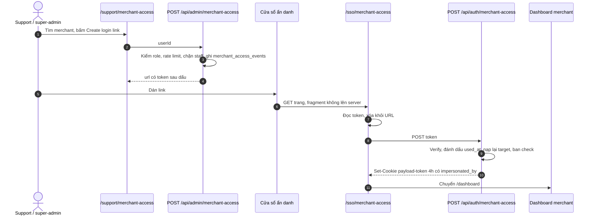

# Architecture: Support — mở CMS merchant không cần OTP (F15)

> **Version:** 1.1 (đã triển khai trong PR #2463, chưa merge) | **Updated:** 2026-11-11 | **Issue:** #2438 (v1.0), #2444 (v1.1)
> **v1.0:** PR #2441 (link một lần, phiên 4h). **v1.1:** bản bổ sung bảo mật + banner + menu Studio (issue #2444, nhánh `fix/F15-2444-merchant-access-guards`, chưa merge).
> **Related:** `docs/qa/F15-admin-management.md` TC-F15.31–37 (v1.0), TC-F15.38–45 (v1.1); `docs/architecture/F02-auth.md`.
> Các mục v1.1 mô tả code hiện tại của PR #2463. Cookie `payload-token` được decode giống Next; collection access chặn cập nhật Users/Tenants trực tiếp qua REST trong phiên hộ. Dashboard actions dùng Local API sau kiểm tra riêng. Các tham chiếu dòng v1.0 là mốc tham khảo lịch sử.

---

## 1. Tóm tắt

- Team build site (role `support`) và super-admin mở CMS của một merchant để sửa hộ, không cần OTP của merchant.
- Trang `/support/merchant-access`: tìm merchant theo email hoặc tên công ty → **Create login link** → mở link trong cửa sổ ẩn danh → vào `/dashboard` của merchant với phiên 4 giờ.
- Link dùng một lần, sống 10 phút, mỗi link được ghi vào `merchant_access_events`.
- v1.1 chặn các thao tác tạo đường vào lâu dài hoặc đổi nơi nhận tiền trong phiên này, hiện banner trong phiên, và đưa trang tạo link vào Studio.

## 2. Thành phần hiện có (v1.0, PR #2441)

| Thành phần | File | Ghi chú |
|---|---|---|
| Role | `src/lib/admin/studio-roles.ts` | `SUPPORT_ROLE = 'support'`; `canUseMerchantAccess` = super-admin hoặc support; `hasStaffRole` = super-admin, studio-viewer, support, editor, viewer |
| Token | `src/lib/support/merchant-access-token.ts` | Link token: HS256 raw `PAYLOAD_SECRET`, `aud: 'merchant-access'`, `typ: 'merchant-access-link'`, `sub` = target, `act` = actor, `jti`, 10 phút; **không** có `collection`/`id`/`mfa_verified` nên không dùng làm session được. Session token: `{id, email, collection:'users', mfa_verified:true, impersonated_by: <actor id>}`, 4 giờ |
| Tạo link | `src/app/api/admin/merchant-access/route.ts` | GET tìm merchant; POST `{ userId }` → rate limit 10/phút/actor, chặn target có staff role, ghi event, trả `url` với token sau `#` |
| Đổi link | `src/app/api/auth/merchant-access/route.ts` | POST `{ token }` → rate limit 20/phút/IP, verify, `redeemMerchantAccessLink` (một lần), nạp lại target, chặn staff role và store bị khóa, set cookie `payload-token` 4h. Mọi lỗi trả cùng 401 `invalid_link` |
| Audit / một lần | `src/lib/support/merchant-access-events.ts`, bảng `merchant_access_events` (`scripts/db-setup.js:6203`) | Ghi khi tạo; `UPDATE … WHERE used_at IS NULL AND expires_at > now()` khi đổi |
| Landing | `src/app/sso/merchant-access/page.tsx` + `_components/MerchantAccessRedeemClient.tsx` | Đọc `#token`, `replaceState` xóa khỏi URL, tự POST (`useEffect`) |
| Trang support | `src/app/support/layout.tsx`, `src/app/support/merchant-access/` | Layout riêng (không phải khung Studio), kiểm role từ DB |
| Middleware | `src/middleware.ts:11-12`, `:125-143` | Gợi ý định tuyến cho `/support/*`; layout mới là chốt chặn thật |
| Login | `src/app/(auth)/login/page.tsx` | Role `support` (không phải super-admin) đăng nhập xong vào thẳng `/support/merchant-access` |
| Refresh | `src/app/api/auth/refresh-token/route.ts:55` | Token có `impersonated_by` → 401, phiên không gia hạn |

### Luồng

## 3. Lỗ hổng của v1.0

Ở mốc v1.0 trước PR #2463, ngoài `refresh-token` không chỗ nào đọc `impersonated_by` (`git grep impersonated_by -- src`). Phiên mở bằng link khi đó có **toàn quyền của merchant**. PR #2463 bổ sung các guard ở mục 4.

| # | Mức | Vấn đề | Bằng chứng |
|---|---|---|---|
| G1 | Critical | Trong phiên, người dùng mời được owner/admin mới cho store, kể cả email của chính họ (chặn tự mời chỉ so với email merchant). Sau đó họ vào bằng OTP bình thường, không giới hạn 4h, không có dấu vết trong `merchant_access_events` | `src/collections/Users.ts:424` `/invite-staff` chỉ kiểm requester là owner (`:445`, `:450-454`); `injectUser` (`:203-225`) nhận token raw secret, không kiểm `impersonated_by`; server action gửi cookie dạng `Authorization: JWT` (`src/app/(dashboard)/settings/staff/actions.ts:15, 39`) |
| G2 | Critical | Trong phiên, đổi được nơi nhận tiền của buyer: bank, QR, Xendit, Stripe | `settings/payments/actions.ts:134, 292, 343, 417, 441`; `src/app/api/xendit/connect/route.ts` (tạo sub-account, không kiểm `XENDIT_ENABLED`); `src/app/api/stripe/connect/{onboard,account-link,callback}`; field `Tenants.ts:258-330` (Stripe/Xendit), `:545-600` (bank/QR) |
| G2b | High | (v1.1 chặn phiên hộ ở callback; state tách issue riêng) Stripe OAuth `state` tĩnh (`tenantId_HMAC(tenantId)`, không nonce, không hạn) và `callback` không kiểm phiên nào: ai từng thấy state của một tenant (một lần bấm Connect) có thể gắn Stripe của mình vào tenant đó về sau, từ trình duyệt khác | `src/lib/payment/stripe.ts:25-39`; `src/app/api/stripe/connect/callback/route.ts:13-45` |
| G3 | — (không sửa) | Super-admin tạo link (và tìm merchant) chỉ bằng phiên mật khẩu, không OTP. Giữ nguyên, xem §4.3 | `getCurrentUser(req)` không `requireMfa` (`src/app/api/admin/merchant-access/route.ts:25-38`); `passesOtpGate` miễn OTP cho super-admin (`src/lib/auth/session-user.ts:48-50`) |
| G3b | High | Bật push notification trong phiên khiến trình duyệt của support nhận thông báo đơn hàng của merchant vô thời hạn, quá mốc 4h | `PushOptInPrompt` ở `src/app/(dashboard)/layout.tsx:126`; `POST /api/notifications/push-subscribe` (`withAuth`) |
| G4 | Medium | Không có dấu hiệu trong giao diện, không có nút thoát | Không layout nào đọc `impersonated_by` |
| G5 | Low | Studio không có mục menu: PR thêm vào `admin-nav-config.ts`, file này chỉ dùng cho breadcrumb (`admin-topbar.tsx:28-40`); menu thật là `admin-sidebar.tsx:66-120` | Super-admin phải gõ URL |

Payload REST hiện không xác thực app token phiên hộ (khác signing secret và thiếu `authVersion`/`sid` của Payload). Các route / server action / endpoint custom ở trên xác thực app token. Collection access Users/Tenants vẫn chặn update khi có dấu phiên hộ, bổ sung phòng vệ độc lập với khác biệt parser/auth của REST.

## 4. Thiết kế bổ sung (v1.1, đã triển khai)

### 4.1 Nhận diện phiên mở bằng link — từ chối nếu BẤT KỲ token nào có dấu
- Helper `src/lib/support/merchant-access-session.ts`:
  - `isMerchantAccessSession(source)`: lấy **mọi** token ứng viên (header `Authorization` và cookie `payload-token`; tái dùng `candidateTokens()` ở `payload-rest-otp-guard.ts:29-42`; server action dùng `cookies()` + `headers()`), `decodeJwt` **không verify**, trả `true` nếu bất kỳ token nào có `impersonated_by !== undefined` (cùng điều kiện với `refresh-token/route.ts:55`; không dùng truthy). Token decode lỗi thì bỏ qua token đó và xét tiếp. Server action đọc header cookie thô qua `candidateTokens(await headers())` (bắt cả cookie trùng tên), không dùng `cookies().get()`.
  - Lý do không verify / không đọc "Authorization trước": server action xác định user **chỉ từ cookie** (`getCurrentUser()` không có `req`, `src/lib/auth.ts:41-52`). Nếu guard ưu tiên header và bỏ qua lỗi, người dùng tự gửi `Authorization: Bearer x` là vượt được guard trong khi action vẫn chạy bằng cookie đăng nhập hộ. Token giả có claim chỉ làm chính người gửi bị chặn; token không hợp lệ thì auth đã từ chối.
  - `getMerchantAccessBanner(cookieStore)`: cho banner, verify HS256 `PAYLOAD_SECRET` cookie `payload-token`, trả `{ actorEmail, targetEmail, exp }` hoặc `null`.
- Mã lỗi `impersonation_forbidden_action`, đúng định dạng nơi gọi: route Next → `{ error }` 403; endpoint custom Payload → `{ errors: [{ message }] }` 403 (server action staff đọc `resData.errors?.[0]?.message`, `staff/actions.ts:47, 71, 94, 117, 139, 162`); server action → `{ success: false, error }`.
- `signMerchantSessionToken` thêm claim `impersonated_by_email`; `redeemMerchantAccessLink` đổi sang `RETURNING actor_email` (cột có sẵn, `scripts/db-setup.js:6208`) nên không thêm query. Phiên cũ không có claim → banner ghi "Prime Support". `appClaims` bỏ qua claim thừa (`session-token.ts:61-66`).

### 4.2 Thao tác bị chặn trong phiên (G1, G2, G2b, G3b)

| Nhóm | Điểm chặn | Cách |
|---|---|---|
| Quản lý staff (quyết định 2026-11-10: **cho phép, trừ việc đụng tới owner**) | 6 endpoint staff trong `Users.ts` (`/invite-staff :424`, `/update-staff :675`, `/update-staff-status :788`, `/remove-staff :578`, `/bulk-remove-staff :898`, `/resend-invite :851`) | Support được mời/sửa/xoá staff giúp owner. Trong phiên, chặn 403 `impersonation_forbidden_action` khi: mời hoặc đổi sang role ngoài `editor`/`viewer`/`custom` (chặn `owner` và `admin`, vì admin sửa được payout — `src/lib/payment/payout-account-access.ts:18`); đổi role, khoá, xoá (kể cả bulk) một thành viên đang là `owner`; mời email đã có tài khoản (nhánh re-invite reset mật khẩu toàn cục, `Users.ts:494-505`). `/resend-invite` cho phép. Lý do: owner mời được owner khác (`:458-460`) và kiểm tự mời chỉ so với email merchant (`:446`), nên không chặn thì support tự mời mình làm owner và vào store vô thời hạn |
| Payout (bank/QR) | `getPaymentSettings`, `updatePaymentSettings`, `uploadQrMedia` (`settings/payments/actions.ts:105-148, 292-301`) | Tái dùng cơ chế "member không có quyền payout" sẵn có: trong phiên, `canReadPayoutAccount` coi như `false` → số tài khoản bị che (`hiddenPayoutAccount`), form ẩn trường bank (`PaymentsFormClient.tsx` `bankHidden`), đổi bank/QR trả `impersonation_forbidden_action` (không dùng `PAYOUT_OWNER_ONLY_ERROR` vì câu "Only the shop owner…" gây hiểu lầm khi đang ở phiên của owner). Kiểm phiên ở 3 call site trong `actions.ts` (`:124, :145, :301`), **không** sửa bên trong `canReadPayoutAccount` (hàm thuần, còn dùng ở field access `Tenants.ts:48`). Form đã xử lý `bankHidden` (`PaymentsFormClient.tsx:575-579, 932-995`). **Vẫn bật/tắt được phương thức** |
| Cổng thanh toán | `saveXenditKeys` `:343`, `disconnectXendit` `:417`, `disconnectStripe` `:441`; `POST /api/xendit/connect`; `src/app/api/stripe/connect/onboard`, `account-link` | Chặn hẳn |
| Stripe callback (G2b) | `src/app/api/stripe/connect/callback/route.ts` | Phiên đăng nhập hộ → redirect `?stripe=refresh`, không đổi tenant. `onboard`, `account-link`, `xendit/connect` yêu cầu owner/admin active và không phải phiên hộ (`src/lib/payment/payout-connect-guard.ts`). **Tách riêng (quyết định 2026-11-11):** state Stripe tĩnh, không hạn, không gắn user là lỗi có từ trước, không thuộc đăng nhập hộ → làm ở issue riêng. Không cần cookie phiên ở callback, nên không phụ thuộc host của redirect URI Stripe. |
| Mật khẩu | `POST /api/users/me/password` (`:14`), đặt trước `blockOwner` (`:21`) | Chặn, không gọi `payload.login` (tránh thử sai làm khóa tài khoản merchant, `maxLoginAttempts` 5, `Users.ts:252`). Email không đổi được trong app (`profilePatchSchema` chỉ có tên/điện thoại, `src/lib/profile/schemas.ts:3-16`; đổi email chỉ qua SSO super-admin) → không cần guard |
| Push | `POST /api/notifications/push-subscribe`, `GET /api/notifications/firebase-token`; `PushOptInPrompt` | Chặn API; ẩn prompt khi có banner |

Vẫn cho phép: sửa website, trang, blog, sản phẩm, đơn hàng, vận chuyển, nội dung, bật/tắt phương thức thanh toán, mời/sửa staff không phải owner.

### 4.3 Không bắt OTP khi tạo link (G3, quyết định 2026-11-10)
- Giữ nguyên như v1.0: super-admin đăng nhập Payload `/admin` (chỉ mật khẩu) vẫn vào `/studio` và tạo link được; role `support` vốn chỉ có token đã qua OTP.
- Lý do: phiên mật khẩu `/admin` của super-admin đã có quyền tạo user, gán user vào tenant bất kỳ (`src/collections/Users.ts:1272-1289`, `:1329`) và sửa tenant kể cả payout (`src/collections/Tenants.ts:46`, `:95-107`). Bắt OTP riêng cho trang support không giảm rủi ro đáng kể, trong khi `/login` thay cookie `payload-token` bằng app token và làm super-admin mất phiên `/admin` trên cùng hồ sơ trình duyệt.
- Mỗi lần tạo và đổi link vẫn ghi `merchant_access_events` (actor, tenant, thời điểm, IP).
- Nếu sau này siết OTP cho super-admin thì làm cho cả `/admin` và `/studio` (đổi `passesOtpGate`), không riêng trang support.

### 4.4 Banner + Thoát (G4)
- `src/components/auth/MerchantAccessBanner.tsx`: "Viewing as `<merchant email>` (`<actor email | Prime Support>`) · Xh Ym left · [Exit]", nền amber, tương phản AA, đếm ngược theo `exp`.
- Bố cục: `TopHeader` là `fixed top-0 h-[56px] z-50` (`src/components/dashboard/TopHeader.tsx:31`), editor dùng `100dvh` → đặt banner **cố định ở đáy màn hình** (không phải dời header, sidebar, editor). Editor/builder: chừa `padding-bottom` bằng chiều cao banner nếu che thanh công cụ dưới.
- Render ở server trong `src/app/(dashboard)/layout.tsx`, `src/app/(editor)/layout.tsx`, `src/app/(builder)/layout.tsx` (đổi sang `async` để đọc `cookies()`, `:9`).
- Exit giống `UserAvatarMenu.handleLogout` (`src/components/dashboard/UserAvatarMenu.tsx:39-55`): `POST /api/auth/logout` xóa cookie httpOnly `payload-token` và `mfa_session` (không cần CSRF, `src/app/api/auth/logout/route.ts:3-27`), `clearClientAiState()`, chuyển `/login`.
- Banner ở đáy không được che Toaster `bottom-right` (`(editor)/layout.tsx:36`) — dời toast lên trên banner khi có phiên.
- Chữ hiển thị: key mới trong `src/i18n/locales/en.json`, `ms.json` (repo không có `vi`); chạy test localization trước push.

### 4.5 Trang trong Studio + menu (G5, quyết định 2026-11-10)
- Trang chính của super-admin: `/studio/merchant-access` trong khung Studio (`src/app/studio/layout.tsx`, sidebar + topbar), mục **Merchant CMS access** ở section Admin của `src/app/studio/_components/admin-sidebar.tsx`. Không thêm API: trang gọi lại `GET/POST /api/admin/merchant-access`.
- `studio-viewer` không thấy mục và không mở được trang: thêm `/studio/merchant-access` vào `SUPER_ADMIN_ONLY_PATHS` (`src/lib/admin/studio-roles.ts`), trang tự redirect `/studio` nếu read-only.
- Role `support` không vào Studio (thiết kế #2441) nên giữ `/support/merchant-access`; super-admin mở URL này được redirect sang Studio. Hai trang dùng chung `MerchantAccessClient`.
- Bảng **Recent access** (20 dòng mới nhất `merchant_access_events`, query trong server component): lúc tạo, người tạo, merchant, trạng thái (đã mở lúc … / hết hạn / chưa dùng).
- Tiện cho admin: tự copy link sau khi tạo, hiện tên store + trạng thái store, nhắc phím tắt mở cửa sổ ẩn danh. Mở link ở tab thường sẽ ghi đè phiên Studio vì cùng cookie `payload-token` — đây là lý do bắt buộc ẩn danh.

## 5. Ngoài phạm vi / rủi ro chấp nhận

> Giả định nền: Payload REST/CRUD (`PATCH /api/tenants/:id`, `/api/users/:id`) **không** nhận app token (ký bằng `PAYLOAD_SECRET` gốc, Payload dùng secret dẫn xuất). Nếu sau này thêm auth strategy chấp nhận app token cho REST thì toàn bộ guard payout/staff ở §4.2 bị bỏ qua — phải thêm guard tương ứng.

| Mục | Lý do |
|---|---|
| Ghi từng thao tác trong phiên vào audit | #2441 đã ghi là giới hạn đã biết; cần thiết kế riêng. Là biện pháp giảm thiểu cho các dòng dưới |
| Xuất khách hàng (`/api/v1/customers/export`, `exportShopCustomersCsvAction` `customers/actions.ts:239`), mã giảm giá, giá sản phẩm, duyệt thanh toán / hoàn tiền đơn, nội dung email template, custom domain (`settings/domains/actions.ts:85`), EasyParcel | Là việc hỗ trợ hợp lệ hoặc không đổi nơi nhận tiền / không tạo đường vào lâu dài; cho phép, chờ audit từng thao tác |
| Stripe OAuth state tĩnh, không hạn (`stripe.ts:25-39`) | Lỗi có từ trước, không do đăng nhập hộ; tách issue riêng |
| Landing tự POST khi tải trang | Link dùng một lần: công cụ xem trước có JS đổi mất link thì người tạo thấy link hết hiệu lực và tạo lại |
| Support mời một email mới mình kiểm soát với role editor/viewer/custom | Có quyền CMS lâu dài nhưng không đụng được payout/staff owner; owner thấy trong danh sách staff. Chấp nhận để support mời staff giúp owner |
| Nút "Connect Stripe account" vẫn hiện trong phiên | Bấm thì 403; ẩn nút là cải tiến sau |
| Thu hồi phiên phía server trước 4h | App token không có `sid` (`src/lib/auth/session-user.ts`); Thoát chỉ xóa cookie ở trình duyệt đó |
| Banner ở `/onboarding` (`src/app/(frontend)/onboarding`) và `(preview)` | Merchant đã có store hiếm khi vào; chấp nhận |
| TC-F15.09–12 (US-F15-05 "View as Tenant" chỉ đọc) | Thiết kế cũ khác, chưa từng làm; tính năng này không thay đổi các TC đó |

## 6. Bản đồ test

| TC | Nội dung |
|---|---|
| TC-F15.31–37 | v1.0 (role, token, link một lần, trang support, refresh, token không lộ log) |
| TC-F15.38 | Staff trong phiên: chặn mọi thao tác đụng owner, email người thao tác, tài khoản nội bộ; mời editor/admin vẫn được |
| TC-F15.39 | Chặn đổi payout, cổng thanh toán, Stripe callback; header Authorization giả không vượt được guard |
| TC-F15.40 | Chặn đổi mật khẩu và đăng ký push trong phiên |
| TC-F15.41 | Super-admin chỉ đăng nhập `/admin` vẫn tìm merchant và tạo link được (giữ hành vi v1.0, §4.3) |
| TC-F15.42 | Banner hiện trong phiên, không hiện khi đăng nhập thường |
| TC-F15.43 | Exit xóa phiên, về `/login` |
| TC-F15.44 | Menu Studio có mục Merchant CMS access, viewer không thấy |
| TC-F15.45 | Trang `/studio/merchant-access`: viewer bị chặn, super-admin mở `/support/...` được chuyển sang Studio, bảng Recent access |
