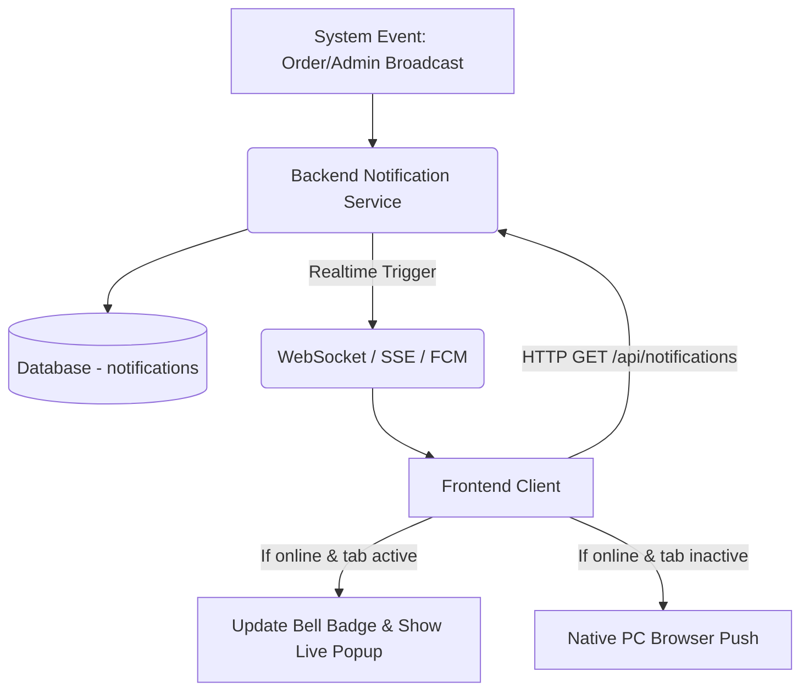

# Architecture: Notifications Center (F16)
> **Version:** 1.0 | **Created:** 2026-03-17 | **Agent:** `project-planner`  
> **PRD:** [`docs/prd/F16-notification-center.md`](../prd/F16-notification-center.md)

---

## 1. Overview

Tài liệu này mô tả kiến trúc kỹ thuật cho tính năng Notification Center (F16). Bao gồm UI Dropdown trên thanh Navigation, hệ thống Badge để đếm số lượng thông báo chưa đọc, Popup/Toast xuất hiện realtime ở góc màn hình, và tích hợp Push Notification API trên trình duyệt Desktop. Hệ thống sử dụng cơ chế Server-Sent Events (SSE) hoặc WebSocket/Polling để nhận data realtime từ backend.

## 2. System Context



## 3. Component Tree

```text
src/components/layout/Header/
├── NotificationBell      # Wrapper UI ở Header
│   ├── UnreadBadge       # UI chấm đỏ đếm số lượng
│   └── NotificationDropdown # Dropdown panel hiển thị danh sách
│       ├── NotificationHeader # Tiêu đề "Notifications" + Nút "Mark all as read"
│       ├── NotificationList   # Danh sách virtual scroll (Top 20)
│       │   └── NotificationItem # Render từng thông báo (Icon, Title, Time)
│       └── NotificationEmptyState
└── ToastContainer        # Container hứng Live Popups
```

### Component Responsibility

| Component | File | Responsibility |
|-----------|------|---------------|
| `NotificationBell` | `components/notifications/NotificationBell.tsx` | Quản lý state mở/đóng dropdown và render chuông báo. Nhận realtime events. |
| `UnreadBadge` | `components/notifications/UnreadBadge.tsx` | Hiển thị số lượng unread format `99+`. |
| `NotificationDropdown` | `components/notifications/NotificationDropdown.tsx` | Fetch danh sách thông báo khi được mở. Quản lý trạng thái loading/error. |
| `NotificationItem` | `components/notifications/NotificationItem.tsx` | Render UI một thông báo, handle sự kiện click (đánh dấu đã đọc + navigate). |
| `LivePopupManager`| `providers/NotificationProvider.tsx` | Context hứng các event realtime để dispatch Toast và tăng badge count. |

## 4. Data Flow

```text
[User Action / System Event]
1. Trạng thái "New Order" được kích hoạt ở Backend.
2. Backend lưu bản ghi vào bảng `notifications`.
3. Backend emit event qua WebSocket (hoặc Firebase FCM) tới Client ID/Store ID tương ứng.
4. Client `NotificationProvider` nhận event:
   4.a. Nếu active tab: Trigger Toast hiển thị Popup, cập nhật số UnreadBadge +1.
   4.b. Nếu in-active tab: Service Worker gọi Native Push API của Browser.
5. User click vào thông báo trong Dropdown:
   5.a. Gọi API `POST /mark-read` với ID của thông báo.
   5.b. Navigate user tới `actionUrl` (e.g. `/orders/123`).
```

## 5. State Management

| State | Location | Type | Description |
|-------|----------|------|-------------|
| `unreadCount` | global (Zustand) | `number` | Số lượng thông báo chưa đọc hiển thị ở chuông báo. Rất cần global để các component khác có thể clear. |
| `notifications` | local (Query/SWR) | `Notification[]`| Danh sách 20 item hiển thị trong Dropdown. |
| `isDropdownOpen`| local (useState) | `boolean` | Trạng thái hiển thị menu Dropdown. |
| `pushPermission`| localstorage/DB | `granted | denied`| Trạng thái quyền nhận Browser Push Notification. |

## 6. API Design

### Get Top Notifications
```json
[GET] /api/notifications?limit=20

Response (success):
{
  "success": true,
  "data": {
    "unreadCount": 3,
    "items": [
      {
        "id": "notif_123",
        "type": "ORDER_NEW",
        "title": "📦 New Order #1024",
        "message": "RM 150.00 from Customer Name",
        "actionUrl": "/orders?id=1024",
        "isRead": false,
        "createdAt": "2026-03-17T14:30:00Z"
      }
    ]
  }
}
```

### Mark as Read
```json
[POST] /api/notifications/mark-read

Request:
{
  "notificationIds": ["notif_123", "notif_124"] 
  // or "mark_all": true
}

Response (success):
{
  "success": true
}
```

## 7. Database / Collection Changes

| Collection | Change | Fields |
|-----------|--------|--------|
| `notifications` | NEW | `id` (PK)<br>`user_id`/`store_id` (FK)<br>`type` (enum: ORDER_NEW, SYSTEM_ALERT, PRODUCT_LOW_STOCK)<br>`title` (string)<br>`message` (text)<br>`action_url` (string, null)<br>`is_read` (boolean, default: false)<br>`created_at` (timestamp)<br>`expires_at` (timestamp, dùng để clear data theo retention policy 30 ngày) |

## 8. Error Handling Matrix

| Error | HTTP Code | User Message | Recovery |
|-------|-----------|-------------|----------|
| Lỗi fetch Dropdown | 500/Timeout | (Hiển thị empty state lỗi in UI) "Failed to load" | Nút [Retry] trong dropdown |
| Click mark-read failed | 400/500 | Không cần toast lỗi | Optimistic UI cập nhật đã đọc. Retry ngầm |
| Denied Notification | Client side | Native OS block | Hướng dẫn bật lại trong App Settings |

## 9. Security Considerations

- [x] Auth required? → JWT bắt buộc. User chỉ được gọi endpoint đọc notification của chính Account/Workspace đó.
- [x] Tenant-scoped access? → `notifications` table cần Index cặp `(store_id/workspace_id, user_id)` để tránh lộ data.
- [x] Rate limiting? → Các event realtime cần debounce/throttle ở server. Không bắn 100 event websocket cho 100 đơn hàng trong cùng 1 giây (Cần batching event).

## 10. Performance Considerations

- [x] SSR vs CSR → `NotificationDropdown` hoàn toàn là CSR. `UnreadBadge` có thể load initial state SSR hoặc fetch rất nhẹ CSR ngay khi mount app.
- [x] Caching strategy → Dùng React Query / RTK Query cache kết quả Dropdown (stale time: 30s) nếu user đóng mở liên tục.
- [x] Web Push Service Worker → Register và cache kĩ ở Frontend. Tải async để không block main thread.

## 11. Testing Strategy

| Type | What to Test | Tool |
|------|-------------|------|
| Unit | Utility format thời gian (VD: x mins ago) | Jest |
| Integration | Flow đánh dấu đã đọc -> Auto clear UnreadBadge | RTL + MSW |
| E2E | Mở browser, simulate receive realtime event -> verify Toast hiển thị -> Click Toast -> Verify navigation. | Playwright |

## 12. Migration / Rollback Plan

- **Migration**: 
  1. Frontend support fallback (Polling mỗi 5s) nếu Websocket chưa sẵn sàng.
  2. Implement backend Notification Table + Service CRUD.
  3. Emit trigger ở các module F10, F15 sang module Notification.
- **Rollback**: Disable feature toggle hiển thị icon `🔔` ở Header. API không bị ảnh hưởng.
- **Feature flag**: `ENABLE_NOTIFICATION_CENTER=true`

