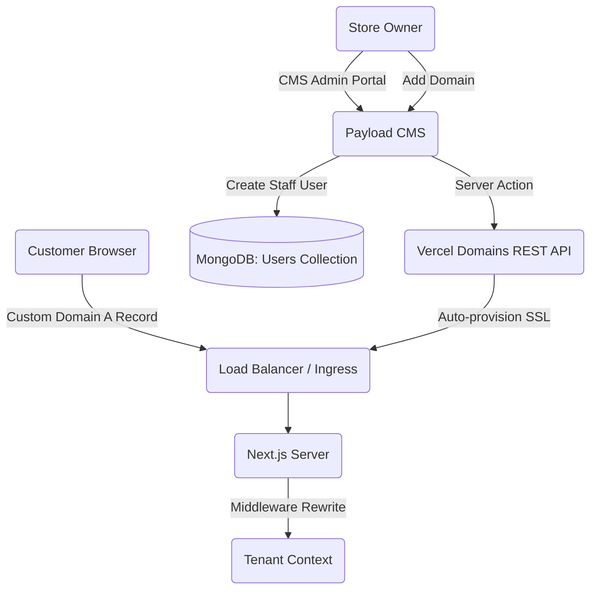

# Architecture: F19 Store Configuration & Staff Management
> **Version:** 1.0 | **Created:** 2026-03-23 | **Agent:** `ba-po-copilot`  
> **PRD:** [`docs/prd/F19-store-configuration.md`](../prd/F19-store-configuration.md)

---

## 1. Overview

This document outlines the technical design for the F19 feature, which encompasses Custom Domain Management (routing, DNS verification, auto-SSL) and Staff Management (Role-Based Access Control in Payload CMS). It addresses the complex multi-tenant routing requirements in Next.js and the granular permissions required for store staff.

## 2. System Context



## 3. Component Tree

```
[app/(admin)/settings]
├── SettingsLayout
│   ├── SettingsNav
│   ├── /domains
│   │   ├── DomainList
│   │   └── AddDomainModal
│   ├── /payments
│   │   └── PaymentToggles
│   └── /staff
│       ├── StaffList
│       └── InviteStaffModal
│           └── PermissionPicker
```

### Component Responsibility

| Component | File | Responsibility |
|-----------|------|---------------|
| `DomainList` | `app/(admin)/settings/domains/page.tsx` | Fetches and displays connected domains. Handles "Set Primary" and "Verify". |
| `AddDomainModal` | `components/settings/AddDomainModal.tsx` | Form to input new custom domain and trigger the API creation. |
| `InviteStaffModal` | `components/settings/InviteStaffModal.tsx` | Handles inviting a user and dynamically selecting RBAC features if "Custom" is chosen. |

## 4. Data Flow

**Staff Management Data Flow:**
Owner Action -> Opens Invite Modal -> Selects Custom Roles -> Submits `/api/staff/invite` -> Payload hooks create `User` with scoped `tenantId` and `roles`.

**Domain Provisioning Data Flow (Vercel):**
Owner adds domain via server action → sanitize + punycode + regex validate → Payload write `status='pending'` → `addProjectDomain()` to Vercel → if `verified=true` immediately → `status='active'` + `vercelDomainId` persisted + SSL auto-provisions (1-2 min). If `verification[]` returned → persist TXT challenges, tenant adds TXT to DNS, clicks "Verify Now" → `verifyProjectDomain()` polls Vercel → on success `status='active'`. Rate limit: 50 verify/hr per team. Errors mapped to friendly messages via `mapVercelError()`.

### Provisioning State Machine

`verifyCustomDomain` implements a 3-state machine:

```
┌───────────────────────────────┐
│ verifyProjectDomain(domain)   │
└───────────────────────────────┘
            │
       ┌────┴────┐
       │         │
       ▼         ▼
    200 ok   4xx err
       │         │
       ▼         ▼
  verified?  getProjectDomain
    │    │      │
   yes  no     persist verification
    │    │     return
    ▼    ▼
  active persist
         verification
         return
```

States:
- **unverified-needs-txt**: `verification[]` non-empty → show TXT challenge card.
- **verified-cert-pending**: `verified=true, verification` empty → `status='active'`, show SSL provisioning banner (1-2 min).
- **active**: SSL issued, tenant can reach `https://` endpoint.

## 5. State Management

| State | Location | Type | Description |
|-------|----------|------|-------------|
| `domains` | Server/SWR | `Domain[]` | List of tenant domains fetched from CMS. |
| `staffList` | Server/SWR | `User[]` | List of staff belonging to the current tenant. |
| `inviteForm`| useState | `Object` | Tracks email, role type (Full/Custom), and selected features. |

## 6. API Design

### Domain Server Actions

Actual implementation uses Next.js server actions (not REST). The `POST /api/domains/verify` route remains only as a legacy reference; business logic lives in these wrappers around the Vercel Domains REST API:

| Server Action | Vercel Endpoint | Purpose |
|---------------|-----------------|---------|
| `addCustomDomain(domain)` | `POST /v10/projects/{id}/domains` | Attach domain to the Vercel project + persist `Domain` record. |
| `verifyCustomDomain(domain)` | `POST /v9/projects/{id}/domains/{domain}/verify` | Run the 3-state machine (see §4). Enforces `tenantId AND domain` ownership check. |
| `removeCustomDomain(domain)` | `DELETE /v9/projects/{id}/domains/{domain}` | Detach from Vercel + delete Payload `Domain` record. |

All actions call `mapVercelError()` to translate platform errors to tenant-friendly messages and respect a 50 verify/hr per-team rate limit.

### POST /api/staff/invite
```json
Request:
{
  "email": "staff@mystore.com", // required
  "role_type": "custom",        // required: 'full' | 'custom'
  "permissions": ["products", "orders"] // required if role_type is custom
}

Response (success):
{
  "success": true,
  "data": { "inviteToken": "xyz..." }
}
```

## 7. Database / Collection Changes

| Collection | Change | Fields |
|-----------|--------|--------|
| `Users` | MODIFY | Add `tenant_id` (rel), `role_type` (select: owner, full, custom), `permissions` (array of strings). |
| `Domains` | NEW | `domain` (String, unique), `tenant_id` (rel), `is_primary` (boolean), `status` (select: pending, connected, error). |
| `Stores` (Tenants) | MODIFY | Add `payment_cod` (bool), `payment_qr` (bool), `qr_image` (upload rel). |

## 8. Error Handling Matrix

| Error | HTTP Code | User Message | Recovery |
|-------|-----------|-------------|----------|
| DNS_NOT_PROPAGATED | 400 | DNS records not found. Please wait 24h. | Wait and click "Verify" again. |
| DOMAIN_TAKEN | 409 | This domain is already in use. | Contact support to claim domain ownership. |
| MAX_STAFF_LIMIT | 403 | Upgrade your plan to invite more staff. | Go to billing. |

## 9. Security Considerations

- [x] Auth required? → JWT (Payload). Staff API routes must verify `req.user` owns the `tenant_id`.
- [x] Tenant-scoped access? → Payload Access Control functions must block staff from fetching/modifying data outside their `tenant_id` or `permissions` scope.
- [x] Input validation? → Zod schemas for domain format and email.
- [x] Rate limiting? → Invites API limited to prevent email spam.

## 10. Performance Considerations

- [x] SSR vs CSR → Settings pages can be CSR client components fetching via SWR for fast toggling, or use React Server Components for initial load.
- [ ] Caching strategy → Domain verification endpoint should not be cached.
- [x] Bundle impact → QR upload requires lightweight image compression before send.

## 11. Testing Strategy

| Type | What to Test | Tool |
|------|-------------|------|
| Unit | Domain validation regex | Jest |
| Integration | Payload Payload access control rules (RBAC) | Jest + Payload Test Config |
| E2E | Multi-tenant domain rewrite in Next.js Middleware | Playwright |

## 12. Migration / Rollback Plan

- **Migration**: Deploy Payload schema updates. Configure Vercel env vars (see §13) and run `scripts/backfill-vercel-domains.ts` to import existing tenant domains into the Vercel project.
- **Rollback**: Revert Next.js Middleware changes if custom domain routing fails for the default `*.echprime.com` domains.

## 13. Environment Variables

| Var | Server | Client | Source |
|-----|--------|--------|--------|
| `VERCEL_TOKEN` | Yes | No | vercel.com/account/settings/tokens |
| `VERCEL_TEAM_ID` | Yes | No | `.vercel/project.json` `orgId` |
| `VERCEL_PROJECT_ID` | Yes | No | `.vercel/project.json` `projectId` |
| `VERCEL_APEX_A_RECORD` | Yes | No | default `76.76.21.21` |
| `VERCEL_CNAME_TARGET` | Yes | No | default `cname.vercel-dns.com` |
| `NEXT_PUBLIC_VERCEL_APEX_IP` | Yes | Yes | default `76.76.21.21` |
| `NEXT_PUBLIC_VERCEL_CNAME_TARGET` | Yes | Yes | default `cname.vercel-dns.com` |

**REMOVED** (post Vercel migration): `SERVER_IP`, `NEXT_PUBLIC_SERVER_IP`, `DO_API_TOKEN`, `DO_APP_ID`, `NEXT_PUBLIC_CNAME_TARGET`.

## 14. Migration Notes (2026-04-13)

- Post DigitalOcean → Vercel platform migration, this feature rewritten per [plans/260413-1500-f19-vercel-domain-verify-rewrite/plan.md](../../plans/260413-1500-f19-vercel-domain-verify-rewrite/plan.md).
- Bug #558 root cause: `verifyCustomDomain` still referenced `SERVER_IP` env var which was DO-specific.
- Security improvement: pre-existing cross-tenant verify vulnerability (scenario 8.1) fixed — now enforces `tenantId AND domain` ownership check.
- Backfill script at `scripts/backfill-vercel-domains.ts` (idempotent, rate-limited 40s/call, cursor-paginated).
