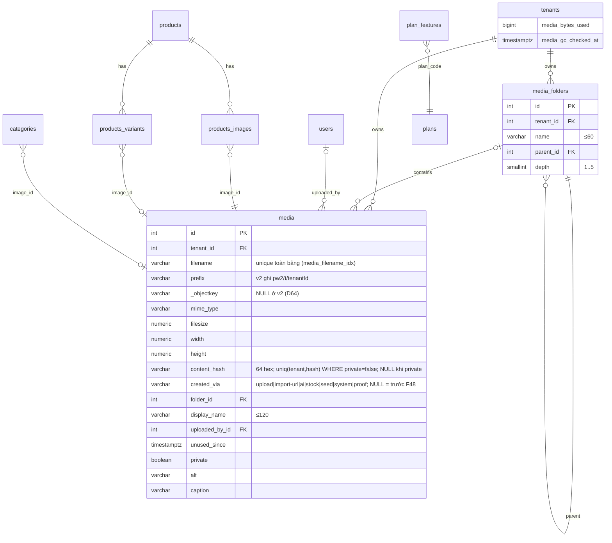

# Architecture: Media Management (F48)

> **Version:** 1.2 | **Created:** 2026-11-09 | **Cập nhật:** 2026-11-09 (review độc lập D55–D67, review lần 3 D68–D83; DAM D84–D86 — 2026-11-10) | **Owner:** Dev | **Staging tham chiếu:** `5c3e3bdca`
> **GC & vòng đời (§8):** tách sang [F48-media-management-lifecycle.md](./F48-media-management-lifecycle.md). **Tương thích DAM Commerce OS (#1812, D84–D86):** [F48-media-management-dam-alignment.md](./F48-media-management-dam-alignment.md).
> **PRD:** [F48-media-management-overview.md](../prd/F48-media-management-overview.md) (+ [S0](../prd/F48-media-management-sprint0.md) · [S1](../prd/F48-media-management-sprint1.md) · [S2](../prd/F48-media-management-sprint2.md) · [S3](../prd/F48-media-management-sprint3.md) · [S4](../prd/F48-media-management-sprint4.md) · [S5](../prd/F48-media-management-sprint5.md)) · **Stories:** [1](../stories/F48-media-management-stories.md) · [2](../stories/F48-media-management-stories-2.md) · [3](../stories/F48-media-management-stories-3.md) · [4](../stories/F48-media-management-stories-4.md) · **Design:** [F48-media-management-design.md](../design/F48-media-management-design.md) · **QA:** [F48-media-management.md](../qa/F48-media-management.md)
> **Nguồn quyết định:** brainstorm F48 (D1–D88, FR-01..36 kèm FR con, NFR-01..08) + scout PW1 vs PW2 (2026-11-09). Mã lỗi, route, purpose theo bảng PRD S0–S5 (chuẩn). **D75:** tài liệu này là nguồn chuẩn **duy nhất** cho tên migration/index (§4.2), claims `uploadToken` (§3.3) và danh sách file module (§6); PRD sprint khớp tuyệt đối hoặc link về đây. Các quyết định "chờ PO" được ghi rõ; tài liệu này không đổi quyết định đã chốt.

---

## 1. Overview

F48 thay 4 đường upload rời rạc bằng **một pipeline server-side duy nhất** (presign → upload thẳng S3 vào `pw2/tmp/` → `register` chuẩn hoá ảnh bằng sharp, khử EXIF/polyglot, khoá theo hash), **một picker dùng chung** cho 18 điểm upload, **thư viện** có phân trang server / thư mục / metadata / xoá nhiều / "đang dùng ở đâu", và **vòng đời** có GC dry-run + quota theo gói. Nền bảo mật (S0) đi trước: khoá field hệ thống của `media` (SEC-1), thu hẹp image optimizer (SEC-2), whitelist + magic check mọi đường (SEC-5).

Nguyên tắc kiến trúc:
1. **Chỉ server ghi field hệ thống** (key, mime, size, hash, tenant, private, createdVia). Client chỉ sửa `alt / caption / displayName / folder`.
2. **Mọi thao tác ghi/xoá object chỉ đụng prefix `pw2/`** — bucket DO Spaces dùng chung với PW1 (NFR-05).
3. **1 bản WebP chuẩn hoá / ảnh** (cạnh dài ≤ 2560, q80), không bật lại Payload `imageSizes` (#1284, D4); kích thước hiển thị do `next/image` + allowlist host hẹp.
4. **Không backfill**: dữ liệu block cũ (URL string) giữ nguyên; dữ liệu mới lưu `{ mediaId, url }` (D3). Usage scan đọc cả FK, id và URL.
5. File code < 200 dòng, kebab-case mô tả (`docs/standards/CODE_STANDARDS.md` §Modularization).

### 1.1 System context

```mermaid
flowchart LR
  subgraph Browser
    D[Dashboard / Editor<br/>MediaPicker]
    SF[Storefront visitor]
    B[Buyer confirm page]
  end
  subgraph Vercel["Vercel sin1 (Next 16 + Payload 3.91)"]
    API[/api/media/*<br/>presign · register · library · folders · quota · import-url/]
    PRIV[/api/media/private/:id/]
    CRON[/api/cron/media-gc<br/>hằng ngày, ngân sách 45s/lượt/]
    OPT[/_next/image<br/>allowlist host/]
    PL[Payload Local API<br/>collections media, media-folders]
  end
  PG[(Neon Postgres<br/>media, media_folders,<br/>tenants.media_bytes_used)]
  subgraph Spaces["DO Spaces sgp1 — bucket dùng chung"]
    TMP[pw2/tmp/{uuid}<br/>ACL private, lifecycle 1 ngày]
    PUB[pw2/t/{tenant}/t{tenant}-{hash32}-{uuid32}.webp|mp4|webm<br/>public-read, immutable]
    PRV[pw2/private/t/{tenant}/...<br/>ACL private]
    LEG[PW2 legacy root u{id}-*.ext<br/>+ object PW1 — KHÔNG đụng]
  end
  CDN[DO Spaces CDN<br/>custom domain cookieless<br/>media.&lt;domain&gt; — tuỳ chọn]
  REDIS[(Upstash Redis<br/>rate limit · uploadToken replay)]
  SENTRY[Sentry — chỉ cảnh báo lỗi]
  REP[pw2/reports/gc/*.json<br/>private, giữ 8]

  D -- JSON nhỏ --> API
  D -- POST multipart (presigned) --> TMP
  API -- HEAD/GET/Put/Copy/Delete --> Spaces
  API --> PL --> PG
  API --> REDIS
  B -- proof --> API
  PRIV -- GetObject --> PRV
  CRON --> PG
  CRON -- Delete chỉ pw2/ --> PUB
  CRON -- báo cáo --> REP
  SF --> OPT --> CDN --> PUB
  SF -. ảnh legacy / PW1 .-> LEG
  API & CRON -.-> SENTRY
```

---

## 2. Hiện trạng → đích

### 2.1 Bốn đường upload

| Đường | Hiện trạng (file:line) | Vấn đề | Đích F48 |
|---|---|---|---|
| **A** `POST /api/media/upload` | `src/app/api/media/upload/route.ts:19-46` buffer qua function → `payload.create` | Vướng 4.5 MB body Vercel; không rate limit (SEC-4); key = tên gốc (SEC-6) | **Bỏ** cho merchant. Giữ tạm làm fallback local-dev khi `isS3Configured()` false (`use-upload-progress.ts`) |
| **B** presign + register | `presign/route.ts:62-73`, `register/route.ts:64-155`, `use-direct-upload.ts:83-128` | Expiry 300s, `content-length-range` min 0 (`s3-presign.ts:7,35`); register nhận mọi key `u{id}-` (`register/route.ts:81`); không magic video; không xử lý ảnh; object ghi thẳng key cuối public | **Nền của pipeline đích**: `uploadToken` ký HMAC, tmp private, register chuẩn hoá |
| **C** server action | `src/app/(dashboard)/actions/media.ts:9` `uploadMediaAction` | Body action `50mb` (`next.config.ts:80`) nhưng Vercel vẫn 4.5 MB; key tên gốc | **Bỏ**; gọi `useMediaUpload` |
| **D** route riêng | avatar `src/app/api/users/me/avatar/route.ts`; proof `src/app/api/orders/[id]/upload-proof(-direct)/route.ts`; feedback `src/app/api/v1/feedback/screenshots/route.ts`; AI attachments; QR qua settings action | Validator/limit riêng lẻ, thiếu rate limit | **Giữ route** (ngữ cảnh khác), nhưng dùng chung `media-upload-policy.ts` + `normalize-image.ts` + rate limit |
| Server nội bộ | AI `src/lib/ai/media-pipeline.ts:168`, `upload-media.ts:25`, `pool-preupload.ts:59`, seeder `src/lib/images/image-library-seeder.ts:153` | `payload.create({file})` qua global mutex `media-create-lock.ts:26` (GH-1185) | `ingestMediaBuffer()` dùng chung lõi register (normalize + key hash + SQL insert); bảng caller đầy đủ ở PRD S1 FR-10a (D59); bỏ mutex chỉ khi TC thay thế pass |

### 2.2 Mười tám điểm upload → component đích (FR-20, thứ tự tích hợp)

| # | Điểm upload | File hiện tại | Component đích | Ghi chú |
|---|---|---|---|---|
| 1 | Ảnh SP | `src/components/dashboard/ImageUploader.tsx` | `ProductGalleryField` (MediaPicker multi + kéo sắp xếp) | 10 ảnh (D11, PO đồng ý — D88), `MAX_PRODUCT_IMAGES` ở `src/lib/products/image-limit.ts:1` |
| 2 | Block overlay (~10 block) | `src/blocks/shared/media-upload-overlay.tsx` | `MediaPicker` single | Lưu `{ mediaId, url }` (FR-21) |
| 3 | BlockImageEditor | `src/components/editor/BlockImageEditor.tsx` | `MediaPicker` | i18n đang cứng |
| 4 | ImageToolbar (iframe) | `src/components/editor/ImageToolbar.tsx` | Mở picker ở **parent** qua postMessage hiện có | Không render dialog trong iframe |
| 5 | Logo | `src/components/editor/LogoEditor.tsx` | `MediaFieldControl purpose="logo"` | 3 editor gần giống → 1 field |
| 6 | Favicon | `src/components/editor/FaviconEditor.tsx` | `MediaFieldControl purpose="favicon"` | Xem §3.6 (ICO, D37) |
| 7 | OG image | `src/components/editor/og-image-editor.tsx` | `MediaFieldControl purpose="og"` | |
| 8 | Footer logo | `src/components/editor/SettingsPanel.tsx:1626` | `MediaFieldControl purpose="logo"` | |
| 9 | Rich text block | `src/components/editor/RichTextBlockEditor.tsx` | Picker → chèn `` | Usage scan đọc `data-media-id` + URL |
| 10 | Blog body | `src/app/(dashboard)/blog/_components/BlogRichEditor.tsx` | như #9 | |
| 11 | Blog cover | `src/app/(dashboard)/blog/[id]/BlogEditorPageClient.tsx` | `MediaFieldControl purpose="blog"` | FK `Blogs.thumbnail` |
| 12 | Trang /media | `src/app/(dashboard)/media/page.tsx` (372 dòng) | `MediaLibraryPage` | Tách component (§6) |
| 13 | Avatar | `src/app/api/users/me/avatar/route.ts` | Route riêng + `normalize-image` | Không tenant; key §3.1 |
| 14 | QR chuyển khoản | `src/app/(dashboard)/settings/payments/PaymentsFormClient.tsx:911` | `MediaFieldControl purpose="payment-qr"` | WebP **lossless** để giữ nét module QR (D36); kiểm quyền đổi sang `tenant`/`private`/`mimeType` (D73, §4.3) |
| 15 | Biên lai người mua | `src/app/sites/[slug]/order/[orderId]/confirm/ConfirmClient.tsx:584` | Giữ `upload-proof-direct`, nhánh private (§3.5) | Không dùng picker (khách vãng lai) |
| 16 | Feedback → Lark | `src/app/api/v1/feedback/screenshots/route.ts` | Giữ luồng, dùng `media-upload-policy` | Không vào thư viện |
| 17 | Studio issue evidence | `src/app/studio/issues/_components/issue-evidence-media.ts` | Giữ luồng B + video, dùng policy | Nội bộ |
| 18 | AI chat attachments | route AI attachments | Giữ luồng, dùng policy | Không vào thư viện |

---

## 3. Upload pipeline

### 3.1 Quy ước key (D6) và bản đồ prefix

| Loại | Key | ACL | Cache-Control |
|---|---|---|---|
| Tạm | `pw2/tmp/{uuid}` | `private` | — (lifecycle xoá sau 1 ngày) |
| Ảnh public | `pw2/t/{tenantId}/t{tenantId}-{hash32}-{uuid32}.webp` | `public-read` | `public, max-age=31536000, immutable` |
| Video public | `pw2/t/{tenantId}/t{tenantId}-{hash32}-{uuid32}.mp4|.webm` | `public-read` | như trên |
| Favicon | `pw2/t/{tenantId}/t{tenantId}-{hash32}-{uuid32}.png` · ICO passthrough `….ico` (D37) | `public-read` | như trên |
| Private (proof) | `pw2/private/t/{tenantId}/t{tenantId}-{uuid32}.{webp|pdf}` (không dedupe — D57) | `private` | `private, no-store` (route trả) |
| Avatar (không tenant) | `pw2/u/{userId}/u{userId}-{uuid32}.webp` (không dedupe — D71) | `public-read` | immutable — **D36** |
| Media global khác (tenant NULL: carton placeholder…) | `pw2/g/g-{uuid32}.{webp|png}` (không dedupe — D71) | `public-read` | immutable |
| Báo cáo GC | `pw2/reports/gc/{yyyy-mm-dd}.json` | `private` | — (giữ 8 bản, D41) |

`hash32` = 32 ký tự hex đầu SHA-256 **bản đã chuẩn hoá**; `uuid32` = randomUUID bỏ dấu gạch, sinh riêng cho mỗi phiên bản. **D87:** hash chỉ phục vụ dedupe DB, không phải định danh object; key đã cấp không được tái sử dụng/ghi đè, kể cả sau xoá/timeout. Dedupe hit dùng nguyên row/key cũ; chỉ nhánh tạo row mới cấp key mới. Key hash-only cũ vẫn đọc/xoá theo `storageKey(row)`, không backfill. **Đã xác minh trên DB (D56):** bảng `media` có cột `prefix`, `_objectkey`, `width`, `height`; có `CREATE UNIQUE INDEX media_filename_idx ON media(filename)` (unique **toàn bảng**) và `media_tenant_storage_identity_idx (tenant_id, prefix, filename)`. Vì vậy `filename` phải tự mang chủ sở hữu:

| Loại | `filename` | `prefix` (`_objectKey` = NULL — D64) |
|---|---|---|
| Tenant (public) | `t{tenantId}-{hash32}-{uuid32}.{webp|png|ico|mp4|webm}` | `pw2/t/{tenantId}` |
| Tenant private (proof) | `t{tenantId}-{uuid32}.{webp|pdf}` (`content_hash` NULL → 2 biên lai giống hệt vẫn 2 row, không đụng `media_filename_idx`) | `pw2/private/t/{tenantId}` |
| Avatar (tenant NULL) | `u{userId}-{uuid32}.webp` | `pw2/u/{userId}` |
| Global khác (tenant NULL) | `g-{uuid32}.{ext}` | `pw2/g` |

**Row tenant NULL không dedupe (D71):** unique `(tenant_id, content_hash)` không áp khi `tenant_id` NULL (NULL ≠ NULL) nên filename theo hash sẽ đụng `media_filename_idx` (23505) khi cùng ảnh được ingest 2 lần. Mọi row tenant NULL (avatar, carton global…) dùng `uuid32`, `content_hash` NULL — cùng quy tắc biên lai (D57/D63).

`content_hash` = 64 hex đầy đủ (NULL với private và với row tenant NULL — D71). Không dùng `filenameCompoundIndex`. Lý do không nhét `/` vào `filename`: Payload 3.91 `sanitizeFilename` lấy basename khi dựng đường xoá (`packages/payload/src/utilities/sanitizeFilename.ts`), còn plugin ghép `_objectKey` vào prefix (`plugin-cloud-storage/src/hooks/afterDelete.ts`, `buildPrefixWithObjectKey`) — cùng bố cục `mediaObjectKeys()` ở `src/lib/media/private-media-acl.ts:27` và route `src/app/api/media/private/[id]/route.ts:33`.

**Storage key chuẩn (D64):** `storageKey(row) = [prefix, _objectKey, filename]` bỏ phần rỗng/khoảng trắng rồi nối bằng `/` (đúng thứ tự plugin + `mediaObjectKeys()` + route private). Pipeline v2 (register, `ingestMediaBuffer`, avatar, proof) **chỉ ghi `prefix`** (`pw2/t/{tenantId}`, `pw2/private/t/{tenantId}`, `pw2/u/{userId}`, `pw2/g`) và để **`_objectKey = NULL`** — nếu ghi cùng giá trị vào cả hai, key ghép thành `pw2/t/1/pw2/t/1/t1-….webp`, lệch key đã `PutObject`. `_objectKey` vẫn là field hệ thống bị khoá (D55) để chống sửa; row cũ có `_objectKey` vẫn được ghép đúng nhờ cùng một hàm. Mọi nơi dựng key (URL đọc, xoá, `isDeletableStorageKey`, quét mồ côi GC, `matchKeys` usage, kiểm D39) dùng **một** helper `storageKey()` trong `src/lib/media/media-object-key.ts`, không tự nối chuỗi. Spike S0 còn lại: `generateFileURL` nhận prefix đã gộp `_objectKey` (với `_objectKey` NULL thì = `prefix`) + điểm cắm bỏ qua xoá object (§4.3). TC: TC-F48-04-29 (URL), TC-F48-04-30 (xoá), TC-F48-12-18 (GC).

### 3.2 Sequence — ảnh (đường chính)

```mermaid
sequenceDiagram
  autonumber
  participant C as Browser (useMediaUpload)
  participant P as POST /api/media/presign
  participant S as DO Spaces
  participant R as POST /api/media/register
  participant DB as Postgres
  C->>C: validate type/size theo upload-limits; nén client (canvas → WebP ≤2560, best-effort)
  C->>P: {filename, contentType, size, purpose}
  P->>P: auth + canUseMediaPicker + rate limit (user, tenant) + quota precheck
  P->>S: createPresignedPost(key=pw2/tmp/{uuid}, eq Content-Type, content-length-range 1..max, acl private, ảnh 60s / video 600s)
  P-->>C: {url, fields, uploadToken(HMAC), expiresAt}
  C->>S: POST multipart (fields trước, file cuối) — progress XHR
  S-->>C: 204
  C->>R: {uploadToken, alt?, folderId?, displayName?}
  R->>R: verify uploadToken (HMAC, exp, userId, tenantId, purpose) + replay check
  R->>S: HeadObject tmp → size, ContentType == token.contentType
  R->>S: GetObject tmp (đọc tối đa max+1 byte, abort nếu vượt)
  R->>R: magic check (12 byte) → sharp(limitInputPixels 50MP).rotate().resize(2560 inside).webp(q80) → sha256
  R->>DB: BEGIN; hash lock tenant + full sha256; SAVEPOINT media_write; SELECT dedupe (primary)
  alt trùng
    R->>S: HeadObject storageKey(row cũ) — thiếu thì 404, không ghi lại key
    R->>DB: nâng created_via nếu cần; đọc DTO; COMMIT
    R-->>C: {media row cũ, deduped: true}
  else mới
    R->>R: cấp uuid32 mới, key t{t}-{hash32}-{uuid32}.webp
    R->>S: ghi allocation intent private; PutObject key mới; HeadObject
    R->>DB: quota + INSERT + DTO; COMMIT
    R->>S: ack allocation intent sau đối soát row/key
    R-->>C: {media, deduped: false}
  end
  R->>S: DeleteObject tmp (finally)
```

**Client (M7):** `compress-image.ts` gán `type` của file kết quả đúng `blob.type` thực tế (không giữ type gốc khi đã đổi sang WebP); input file khai `accept="image/jpeg,image/png,image/webp[,video/mp4,video/webm]"` tường minh (không `image/*`) để iOS tự đổi HEIC→JPEG khi chọn ảnh.

### 3.3 Presign (FR-07, SEC-10)

Thay `src/lib/media/s3-presign.ts` + `presign/route.ts`:

- **Key exact** `pw2/tmp/{randomUUID()}` do server sinh; client không gửi key. Không còn `buildMediaKey` theo tên gốc (`media-key.ts:36-49`) cho đường mới.
- **Conditions:** `['eq','$key',key]` (ngầm bởi `Key`), `['eq','$Content-Type', contentType]`, `['content-length-range', 1, maxBytes + S3_POST_MULTIPART_OVERHEAD_BYTES]`, `['eq','$acl','private']`. `Expires`: ảnh 60 s, video 600 s (D35).
- `contentType` ∈ whitelist của purpose (§3.7). `size` khai báo ≤ limit (best-effort; policy là chốt chặn).
- **`uploadToken`** (D36, **claims chuẩn — D75**): `base64url(JSON{v:1, uploadId, key, userId, tenantId, purpose, contentType, maxBytes, exp}) + "." + HMAC-SHA256`. `key` là tmp key `pw2/tmp/{uuid}`; không có claim `kind`/`tmpKey` (kind suy từ `contentType`). Proof thêm `orderId` (§3.5). Khoá ký dẫn xuất HKDF từ `PAYLOAD_SECRET` với info `"f48-media-upload-token"` → **không thêm env mới**. Register chỉ tin token, không tin key client gửi.
- Rate limit (D32, mỗi phút): `media-presign:u:{userId}` 60 + `media-presign:t:{tenantId}` 120 (thay 60/giờ/user ở `presign/route.ts:28`).
- CSRF (D43): kiểm `Origin`/`Sec-Fetch-Site` same-origin trước mọi bước; sai → 403 `MEDIA_FORBIDDEN`.
- Quota precheck: `media_bytes_used + size > quota` → 413 `MEDIA_QUOTA_EXCEEDED` sớm (chốt thật ở transaction register).
- **Không dựa `content-length-range` min 1** (DO có thể không thực thi điều kiện này): chốt chặn thật là register kiểm `ContentLength ≥ 1` (bước 3).
- **Flag off (M8):** `MEDIA_PIPELINE_V2_ENABLED ≠ 'true'` → presign/register trả **hợp đồng cũ** (luồng hiện tại, key `u{id}-…`); response presign có `pipeline: 'v1' | 'v2'`, `useMediaUpload` tự chọn nhánh theo field này (không cần build lại client).

### 3.4 Register (FR-11..13, D5–D7)

Thay `register/route.ts` thành route mỏng gọi `registerUploadedObject()` (`src/lib/media/register-upload-service.ts`). Các bước:

1. `getCurrentUser` → 401 `MEDIA_UNAUTHORIZED`. Verify `uploadToken`: chữ ký + `userId === user.id` + `tenantId ∈ activeTenantIds(user)` (sai → 400 `MEDIA_KEY_INVALID`), `exp` (≤ 15 phút sau presign để đủ thời gian upload video 100 MB; quá hạn → 400 `MEDIA_UPLOAD_EXPIRED`) (`media-access.ts:33`). Rate limit (D32, mỗi phút) `media-register:u:{userId}` 60 + `media-register:t:{tenantId}` 120.
2. **Replay/idempotency (D87):** Upstash `SET media:reg:{uploadId} pending NX EX 90`; thành công ghi `done:{mediaId}` EX 900. `pending` → 409 `MEDIA_REGISTER_IN_PROGRESS`. `done` chỉ là gợi ý: đọc id từ primary để biết lock identity (§8.6), BEGIN + cùng hash lock, đọc lại đúng row/id/key + HeadObject trước success. Row đã xoá hoặc object mất → 404 `MEDIA_UPLOAD_MISSING`, yêu cầu upload mới; **không** tìm row cùng hash khác để trả thay, không INSERT/Put hồi sinh key cũ. Upstash lỗi → flow thường; tmp mất → cùng 404. Retry sau lỗi không dùng lại key đã cấp cho lần thử cũ.
3. `HeadObject(tmp)` → 404 `MEDIA_UPLOAD_MISSING` nếu không có; giữ `ETag` (video dùng ở §3.5 — D83). `ContentLength ∈ [1, maxBytes]`, `ContentType === token.contentType` → sai thì xoá tmp, 413 `MEDIA_TOO_LARGE` / 415 `MEDIA_CONTENT_MISMATCH`.
4. `GetObject(tmp)` stream vào Buffer, **dừng khi vượt `maxBytes`** (không tin ContentLength). Ảnh ≤ 10 MB trước nén (D9).
5. Magic check 12 byte đầu (`src/lib/media/image-signature.ts:13`) — JPEG/PNG/WebP (+ICO chỉ khi purpose `favicon`, D37). Không khớp → 415 `MEDIA_CONTENT_MISMATCH`.
6. Chuẩn hoá (`src/lib/media/normalize-image.ts`):
   ```ts
   sharp(buf, { limitInputPixels: 50_000_000, failOn: 'error', animated: false }) // ảnh động → khung đầu (D38)
     .timeout({ seconds: 20 })
     .rotate()                                   // áp EXIF orientation rồi bỏ metadata (mặc định không withMetadata)
     .resize({ width: 2560, height: 2560, fit: 'inside', withoutEnlargement: true })
     .webp({ quality: 80 })                      // purpose 'payment-qr' → { lossless: true } (D36)
     .toBuffer({ resolveWithObject: true })      // lấy width/height đầu ra
   ```
   **Trần 3 MB bản lưu (D84):** mọi purpose WebP lossy (`library`, `product`, `block`, `blog`, `logo`, `og`) — đầu ra > 3 MB ⇒ encode lại q70 → q60, rồi cạnh dài 2048 → 1600 (q60) tới khi ≤ 3 MB; **không từ chối** (ảnh 50 MP nhiễu hạt vẫn qua). Mục đích: mọi ảnh thư viện chọn được vào gallery SP và khớp policy DAM 3 MB (`product-media-policy-provider.ts:17`). `payment-qr` (lossless) không áp.
   Cấu hình: `sharp.cache(false)`; `sharp.concurrency` thấp (1) **chỉ đặt trong route register** (D59) — không đặt toàn process để không làm chậm generate site dùng `ingestMediaBuffer`. Không `withMetadata()` → EXIF/GPS/ICC bị bỏ (SEC-3); re-encode khử polyglot (SEC-5). Ảnh hỏng → 422 `MEDIA_INVALID_FILE`; > 50 MP → 422 `MEDIA_TOO_MANY_PIXELS`. Input có nhiều khung (WebP/PNG động) → response kèm `warnings: ['animated-flattened']` để UI cảnh báo (D38).
7. `content_hash = sha256(output)`; `hash32 = content_hash.slice(0,32)`.
8. **Dedupe trước ghi object (D87 thay D76):** trên một client primary `const c = await payload.db.pool.connect()`, BEGIN → `pg_advisory_xact_lock(hashtextextended(tenantId || ':' || fullSha256, 0))` → `SAVEPOINT media_write` → SELECT `(tenant_id, content_hash)` chỉ `private = false` (D57). Mọi đường xoá dùng cùng lock trước đọc lại row (§8.6 lifecycle); Neon/PgBouncer transaction mode không dùng session lock hoặc `pool.query` rời.
    - **Hit:** `HeadObject(storageKey(row))` ngay dưới lock; có object ⇒ giữ nguyên row/id/key, không Put/Copy/INSERT/cộng quota; merchant nâng `created_via='upload'`, `unused_since=NULL` cho ai/stock/seed (M4), đọc DTO primary rồi COMMIT, trả `deduped:true`.
    - **Hit nhưng object thiếu:** rollback và 404 `MEDIA_UPLOAD_MISSING`; không repair key cũ, không tự xoá row/refs. Người dùng phải gỡ/thay refs và xoá stale row qua luồng có quyền (§8.6), rồi upload mới sinh key mới. Lỗi Head khác 404 ⇒ 5xx, không coi là miss. Ingest nội bộ cũng trả lỗi này để caller xử lý, không tự overwrite carton placeholder.
9. **Miss / tạo phiên bản mới:** sinh `uuid32` mới, key `pw2/t/{t}/t{t}-{hash32}-{uuid32}.{ext}`; ghi allocation intent bền vững **trước Put** (§8.6) → PutObject (`ContentType` đúng output, `ACL public-read`, `CacheControl: public, max-age=31536000, immutable`, `ContentDisposition: inline`) / CopyObject video → HeadObject đúng key/size → quota + INSERT + DTO trên cùng client → COMMIT. Không Put vào key từng tồn tại; lỗi/timeout Put không retry bằng key cũ. Tenant NULL/private không dedupe, dùng key UUID riêng và lock key (§8.6). Tx có thể bao gồm S3: deadline 25s, benchmark pool/p95 ở S1; không đổi sang ghi đè hash-key để tối ưu.
    ```sql
    UPDATE tenants SET media_bytes_used = media_bytes_used + $bytes
     WHERE id = $tenant AND ($enforce = false OR media_bytes_used + $bytes <= $limitBytes)
     RETURNING media_bytes_used;            -- 0 dòng: quota từ chối, không phải SQL exception
    INSERT INTO media (...) VALUES (...) ON CONFLICT (tenant_id, content_hash)
      WHERE private = false AND content_hash IS NOT NULL DO NOTHING RETURNING *;
    -- 0 dòng: ROLLBACK TO SAVEPOINT media_write hoàn quota, giữ hash lock;
    -- SELECT row thắng + Head key CŨ trước deduped:true; key thử mới chỉ được cleanup.
    ```
    Không dùng `payload.create` file-less (spike GH-1185); hooks không chạy nên đặt rule tenant/private tường minh. DTO từ `RETURNING`/SELECT trên `c` primary, dựng URL bằng `storageKey(row)` (D64), không qua `payload.find/findByID` read replica. Sau COMMIT, ack allocation intent theo §8.6; ack lỗi không biến success thành lần tạo row thứ hai.
10. **Lỗi SQL/quota (B1, D39/D87):** SQL exception thật (vd FK folder) ⇒ `ROLLBACK TO SAVEPOINT media_write` **trước mọi SELECT**, hoàn quota/INSERT, giữ hash lock lấy trước savepoint. Quota UPDATE 0 dòng không làm tx aborted nhưng vẫn rollback phần ghi. SELECT primary mọi row theo exact `storageKey` của key thử: chỉ khi không row mới được đánh dấu cleanup, không xoá key của row dedupe. ROLLBACK toàn tx; allocation intent giữ bền vững, worker kiểm lại dưới lock rồi DeleteObject (§8.6); có thể chạy cleanup ngay sau rollback nhưng phải lấy lại lock. Mất connection/COMMIT chưa rõ ⇒ không DeleteObject mù; worker đối soát primary (có row thì giữ object, không row thì dọn). Intent/orphan sweep bao phủ tenant chưa có media, không lệ thuộc cập nhật checkpoint tenant. Trong `finally` thử xoá tmp nếu còn budget; deadline/timeout đã hết thì giữ tmp cho lifecycle, lỗi xoá chỉ log (không kéo dài request).
11. Upstash ghi `done:{mediaId}` EX 900 (bước 2).
12. Log + Sentry span (§11). Trả `{ media, deduped }` (mọi caller xem quy tắc `deduped` ở §3.6 — D72).

**Timeout budget** (route `export const maxDuration = 60`; `vercel.json` glob `src/app/api/**/*.ts` đặt `maxDuration: 120` — giá trị hiệu lực chưa xác minh, xem [lifecycle §8.3](./F48-media-management-lifecycle.md#83-lịch-và-an-toàn); budget dưới đây không dựa vào cái nào thắng. NFR-01 p95 < 3s cho ảnh 5 MB): Head 0.1s · Get 5 MB sin1↔sgp1 ~0.3–0.8s · sharp 12 MP ~0.8–1.5s · Put ~0.3s · DB ~0.1s · Delete tmp ~0.1s. Deadline nội bộ 25s (AbortController cho S3 + `sharp.timeout(20)`), vượt → 504 `MEDIA_PROCESSING_TIMEOUT`, giữ tmp cho lifecycle.

### 3.5 Nhánh video và PDF proof

- **Video** (`video/mp4`, `video/webm`, ≤ 100 MB): không sharp (non-goal transcode). Bước 3–5 như ảnh nhưng magic = `hasValidEvidenceVideoSignature` (`image-signature.ts:27`) đọc bằng Range 0–11. Hash: stream toàn object qua `crypto.createHash` (không giữ buffer); chỉ khi dedupe miss, sau allocation intent trong transaction bước 9 (D87), **`CopyObject` server-side** tmp → `pw2/t/{t}/t{t}-{hash32}-{uuid32}.{ext}` với `MetadataDirective: REPLACE`, `ContentType`, `CacheControl` immutable, `ACL public-read` — bytes không đi lại qua function. Budget: stream 100 MB ~2–6s. **Chống tráo object (D83):** presign POST cho phép ghi lại cùng key tmp trong thời hạn (600 s video) ⇒ object có thể bị thay giữa lúc kiểm magic/hash và lúc copy. Mọi `GetObject` (Range magic + stream hash) gửi `IfMatch: <ETag từ bước 3>` và `CopyObject` gửi `CopySourceIfMatch: <ETag>`; S3 trả 412 (lệch ETag) ⇒ xoá tmp, trả **409 `MEDIA_KEY_INVALID`** (mã có sẵn, thông điệp "We couldn't verify this upload. Please try again." — không thêm mã mới), không tạo row. TC-F48-04-33.
- **PDF / ảnh biên lai (private, D17)**: chỉ qua `upload-proof-direct` (người mua, không session dashboard). `uploadToken` purpose `payment-proof` gắn `orderId`; rate limit (D32) `media-proof:order:{orderId}` 5/giờ + `media-proof:ip:{ip}` 20/giờ. PDF ≤ 5 MB, magic `%PDF-`, **không** re-encode, `ContentType: application/pdf`; ảnh biên lai vẫn qua `normalize-image`. Key `pw2/private/t/{t}/t{t}-{uuid32}.{ext}`, `content_hash` NULL — **không dedupe** (D57: 2 biên lai giống hệt ở 2 đơn → 2 row; trùng ảnh QR merchant cũng không lẫn), `ACL private` ngay khi Put (không phụ thuộc `privateMediaAclHook` `private-media-acl.ts:87` cho đường mới). Phục vụ duy nhất qua `/api/media/private/[id]` (CSP sandbox, nosniff — `private/[id]/route.ts:78-88`). **Quyền đọc (D79, sửa ở S0):** owner tenant, super-admin, hoặc staff cùng tenant có quyền `orders` → 200; staff cùng tenant không có `orders` → 403 `MEDIA_FORBIDDEN`; tenant khác hoặc id không private → 404 `MEDIA_NOT_FOUND`; anonymous → 401 `MEDIA_UNAUTHORIZED`. Staging hiện dùng `canReadPrivateMedia` (`media-access.ts:46`) cho mọi thành viên và trả 404 khi không đủ quyền (`route.ts:73`). **Không tính vào quota merchant** và luồng thanh toán không bao giờ bị chặn vì quota (D24).

### 3.6 Ingest nội bộ (AI / stock / seed / import-url)

`ingestMediaBuffer({ buffer, tenantId, createdVia, alt, provenance }): Promise<{ doc: MediaDTO; deduped: boolean }>` dùng lại bước 5–10 (không token, không tmp).

- **D72 — cấm xoá bù khi `deduped = true`:** row trả về có thể là row dùng chung (đang được nơi khác tham chiếu). Caller nào đang có nhánh "tạo xong nhưng bước sau lỗi/thua race → `payload.delete` row vừa tạo" phải bỏ qua xoá khi `deduped === true`. Caller hiện có nhánh xoá bù (staging `5c3e3bdca`): `src/app/api/users/me/avatar/route.ts:71`, `src/lib/sso/avatar-sync/apply-avatar-state.ts:88`, `src/app/(dashboard)/actions/media.ts:62` và `src/lib/products/save-product.ts:115` (xoá `replacedStaleId` sau khi tạo lại carton placeholder — phải thêm điều kiện `replacedStaleId !== doc.id`, vì carton cùng tenant cùng bytes sẽ dedupe về chính row cũ). Avatar/global (tenant NULL) không dedupe (D71) nên luôn `deduped=false`, nhưng code vẫn kiểm cờ để không phụ thuộc quy tắc key. TC: "xoá bù không xoá row dedupe" (QA F48).
- **D71 — tenant NULL:** `tenantId == null` ⇒ không dedupe, filename `u{userId}-{uuid32}` (avatar) / `g-{uuid32}` + prefix `pw2/g` (global khác), `content_hash` NULL.
- **D78 — cùng flag:** `ingestMediaBuffer` đọc `MEDIA_PIPELINE_V2_ENABLED`; flag off ⇒ gọi `payload.create({ file })` cũ (qua `media-create-lock`), trả `{ doc, deduped: false }` — rollback 1 công tắc cho cả register lẫn proof/QR/avatar/AI. **Mọi caller phải truyền `createdVia`**; bảng caller đầy đủ (file, `created_via`, private?, ghi chú) là PRD S1 **FR-10a** (D59). NFR-08: generate site p95 không tăng > 10% (TC-F48-04-23). `createdVia ∈ {ai, stock, seed, system, import-url}`. Quota: **đếm nhưng không chặn** (`enforce=false`) cho `ai|stock|seed|system` để không làm hỏng generate (D36); GC dọn sau 30 ngày (D8). Thay dần `uploadBufferToMedia` (`media-pipeline.ts:168`), `uploadImageBuffer` (`upload-media.ts:25`), seeder (`image-library-seeder.ts:171,187,264`); khi hết caller dùng `payload.create({file})` **và** TC thay thế (TC-F48-04-23 + cập nhật TC-GENPERF-W2-07 ở `docs/qa/F01-gen-perf.md`) pass thì mới bỏ `media-create-lock.ts`. Seeder hiện dedupe theo `alt` (`imglib:s{N}:`) — giữ logic đó, dedupe hash là lớp thứ hai.

**ICO / favicon (D37):** libvips không decode ICO. Purpose `favicon` nhận PNG/JPEG/WebP → chuẩn hoá ra **PNG 512×512 inside**; ICO chỉ nhận ở purpose `favicon`, passthrough ≤ 1 MB và ≤ 256×256 (đọc header ICO) sau magic check, `ContentType image/x-icon`. Purpose khác gửi ICO → 415 `MEDIA_UNSUPPORTED_TYPE`.

### 3.7 Chính sách theo purpose (`src/lib/media/media-upload-policy.ts`, nguồn duy nhất FR-14)

| purpose | MIME nhận | Max trước xử lý | Đầu ra | Vào thư viện |
|---|---|---|---|---|
| `library`, `product`, `block`, `blog`, `logo`, `og` | jpeg, png, webp (+ mp4, webm khi `accept` gồm video) | ảnh 10 MB / video 100 MB | WebP ≤2560 q80, bản lưu ≤ 3 MB (D84) / video nguyên bản | Có |
| `payment-qr` | jpeg, png, webp | 10 MB | WebP lossless ≤2560 | Có |
| `favicon` | png, jpeg, webp, ico | 10 MB / ICO 1 MB, ≤ 256×256 | PNG ≤512 / ICO passthrough | Có |
| `payment-proof` | jpeg, png, webp, pdf | ảnh 10 MB / pdf 5 MB | WebP / PDF nguyên bản, private | Không |
| `avatar` | jpeg, png, webp | 10 MB | WebP ≤512, key `pw2/u/{userId}/` | Không |
| `feedback`, `issue-evidence` | jpeg, png, webp (+ mp4, webm cho evidence) | như trên | như trên | Không |

Danh sách purpose chuẩn = `MediaPurpose` ở PRD S0 §13.3 (`library | product | block | blog | logo | favicon | og | payment-qr | avatar | payment-proof | feedback | issue-evidence`). Video là `kind`, không phải purpose.

Rate limit avatar/QR (D32): 10/user/giờ. Giới hạn metadata (D32): `alt` ≤ 250, `caption` ≤ 500, `displayName` ≤ 120.

GIF/SVG/AVIF/HEIC/TIFF: từ chối với 415 `MEDIA_UNSUPPORTED_TYPE`, thông điệp gợi ý đổi sang PNG/WebP/JPEG (D23). Halal cert (`Products.halalCertImage`) chỉ nhận ảnh, không PDF (D30); PDF chỉ ở `payment-proof`. `Media.upload.mimeTypes` (`Media.ts:182`) thu từ `image/*, video/*, application/pdf` về đúng danh sách trên (FR-03).

### 3.8 Ma trận lỗi

Mã lỗi và thông điệp en/ms là của PRD (S0 §15.3, S1 §15.1, S2, S3 §15.2, S4 §15.2, S5); bảng dưới chỉ ánh xạ tình huống → mã → cách phục hồi. Envelope chung `MediaErrorBody { error, code, … }` (S0 §15.1).

| Lỗi | HTTP / `code` | Phục hồi |
|---|---|---|
| Chưa đăng nhập | 401 `MEDIA_UNAUTHORIZED` | Đăng nhập lại |
| Không có quyền / CSRF khác origin | 403 `MEDIA_FORBIDDEN` | Liên hệ owner |
| Media không tồn tại / tenant khác / global / private qua route F48 (M9, INV-3) | 404 `MEDIA_NOT_FOUND` | Tải lại danh sách |
| Sai loại file (gồm GIF/SVG/AVIF/HEIC/TIFF, ICO ngoài favicon) | 415 `MEDIA_UNSUPPORTED_TYPE` | Đổi sang PNG/WebP/JPEG (D23, D37) |
| Byte không khớp loại khai báo | 415 `MEDIA_CONTENT_MISMATCH` | Chọn file khác |
| Gửi field hệ thống | 400 `MEDIA_FIELD_READONLY` | Bỏ field đó (D22) |
| Metadata quá dài | 400 `MEDIA_VALIDATION` | Rút gọn (D32) |
| Quá dung lượng file | 413 `MEDIA_TOO_LARGE` | Nén / chọn file nhỏ |
| Hết quota | 413 `MEDIA_QUOTA_EXCEEDED` | Xoá file chưa dùng / nâng gói |
| Token sai / khác user / key đã đăng ký / object tmp bị tráo (ETag lệch — D83) | 400 / 409 `MEDIA_KEY_INVALID` | Upload lại |
| Token hoặc presign hết hạn | 400 / 403 `MEDIA_UPLOAD_EXPIRED` | Upload lại |
| Object tmp/row replay/object của dedupe không còn | 404 `MEDIA_UPLOAD_MISSING` | Không hồi sinh key; gỡ/thay refs + xoá stale row có quyền nếu còn, rồi upload phiên bản mới (D87) |
| sharp không đọc được | 422 `MEDIA_INVALID_FILE` | Chọn ảnh khác |
| Ảnh > 50 MP | 422 `MEDIA_TOO_MANY_PIXELS` | Giảm độ phân giải |
| Đang register | 409 `MEDIA_REGISTER_IN_PROGRESS` | Client chờ 1s, thử lại tối đa 3 |
| Rate limit | 429 `MEDIA_RATE_LIMITED` | Chờ `Retry-After` |
| S3 chưa cấu hình | 503 `MEDIA_STORAGE_UNAVAILABLE` | Fallback local-dev |
| Lỗi xử lý | 500 `MEDIA_PROCESSING_FAILED` | Thử lại |
| Timeout xử lý | 504 `MEDIA_PROCESSING_TIMEOUT` | Thử lại / ảnh nhỏ hơn |
| Import URL: không phải https / bị chặn SSRF / tải lỗi / quá giờ | 400 `MEDIA_URL_INVALID` · 400 `MEDIA_URL_BLOCKED` · 422 `MEDIA_URL_FETCH_FAILED` · 504 `MEDIA_URL_TIMEOUT` | Tải về rồi upload |
| `mediaId` tenant khác khi lưu SP/trang | 400 `MEDIA_INVALID_REFERENCE` | Chọn lại |
| Thư mục | `MEDIA_FOLDER_DEPTH_EXCEEDED` · `MEDIA_FOLDER_LIMIT_REACHED` · `MEDIA_FOLDER_NAME_INVALID` (422) · `MEDIA_FOLDER_NAME_TAKEN` (409) · `MEDIA_FOLDER_CYCLE` (422) · `MEDIA_FOLDER_NOT_EMPTY` (409) · `MEDIA_FOLDER_NOT_FOUND` (404) · `MEDIA_MOVE_TOO_MANY` (422) | Theo thông điệp |
| Xoá media đang dùng / force | 409 `MEDIA_IN_USE` · 403 `MEDIA_FORCE_DELETE_OWNER_ONLY` · 409 `MEDIA_FORCE_DELETE_FORBIDDEN` (đơn hàng, D44) · 503 `MEDIA_USAGE_SCAN_FAILED` | Gỡ khỏi nơi dùng |
| Xoá nhiều > 100 | 400 `MEDIA_BULK_LIMIT` | Chia nhỏ |
| CORS/mạng tới S3 | client `NETWORK` | Runbook `docs/runbooks/s3-spaces-cors.md` |

---

## 4. Data model

### 4.1 ERD



### 4.2 MIGRATIONS (`scripts/db-setup.js`)

Theo `.claude/rules/database-schema.md`: `CREATE TABLE IF NOT EXISTS`, `ADD COLUMN IF NOT EXISTS`, không `DROP`; index trên bảng bận dùng `concurrentIndex` (mẫu `analytics.tenant_created_idx`); thêm `'media-folders'` vào `COLLECTION_SLUGS[]` (để `syncPayloadRelsTables()` tạo `payload_locked_documents_rels.media_folders_id`).

```js
// ── F48 Media Management ──
{ name: 'f48.media.content_hash',   sql: `ALTER TABLE media ADD COLUMN IF NOT EXISTS content_hash varchar(64);` },
{ name: 'f48.media.created_via',    sql: `ALTER TABLE media ADD COLUMN IF NOT EXISTS created_via varchar(20);` }, // không default: NULL = row trước F48, GC không bao giờ chọn
{ name: 'f48.media.display_name',   sql: `ALTER TABLE media ADD COLUMN IF NOT EXISTS display_name varchar(120);` },
{ name: 'f48.media.unused_since',   sql: `ALTER TABLE media ADD COLUMN IF NOT EXISTS unused_since timestamptz;` },
{ name: 'f48.media.uploaded_by_id', sql: `ALTER TABLE media ADD COLUMN IF NOT EXISTS uploaded_by_id integer REFERENCES users(id) ON DELETE SET NULL;` },
{ name: 'f48.media.width_height',   sql: `ALTER TABLE media ADD COLUMN IF NOT EXISTS width numeric; ALTER TABLE media ADD COLUMN IF NOT EXISTS height numeric;` }, // Payload có sẵn — bảo hiểm
{
  name: 'f48.media_folders.create_table',
  sql: `CREATE TABLE IF NOT EXISTS media_folders (
    id serial PRIMARY KEY,
    tenant_id integer NOT NULL REFERENCES tenants(id) ON DELETE CASCADE,
    name varchar(60) NOT NULL,
    parent_id integer REFERENCES media_folders(id) ON DELETE NO ACTION DEFERRABLE INITIALLY DEFERRED, -- M3: không RESTRICT (xoá tenant CASCADE cả cây)
    depth smallint NOT NULL DEFAULT 1 CHECK (depth BETWEEN 1 AND 5),
    updated_at timestamp(3) with time zone NOT NULL DEFAULT now(),
    created_at timestamp(3) with time zone NOT NULL DEFAULT now());`, // kiểu timestamp Payload
},
{ name: 'f48.media_folders.tenant_idx', sql: `CREATE INDEX IF NOT EXISTS media_folders_tenant_idx ON media_folders (tenant_id);` },
{ name: 'f48.media_folders.parent_idx', sql: `CREATE INDEX IF NOT EXISTS media_folders_parent_idx ON media_folders (parent_id);` },
{ name: 'f48.media_folders.name_uidx',
  sql: `CREATE UNIQUE INDEX IF NOT EXISTS media_folders_tenant_parent_name_uidx ON media_folders (tenant_id, COALESCE(parent_id, 0), lower(name));` },
{ name: 'f48.media.folder_id', sql: `ALTER TABLE media ADD COLUMN IF NOT EXISTS folder_id integer REFERENCES media_folders(id) ON DELETE SET NULL;` },
{ name: 'f48.media.tenant_hash_uidx', concurrentIndex: 'media_tenant_content_hash_uidx',
  sql: `CREATE UNIQUE INDEX CONCURRENTLY IF NOT EXISTS media_tenant_content_hash_uidx ON media (tenant_id, content_hash) WHERE private = false AND content_hash IS NOT NULL;` }, // D57
{ name: 'f48.media.library_cursor_idx', concurrentIndex: 'media_tenant_created_id_idx',
  sql: `CREATE INDEX CONCURRENTLY IF NOT EXISTS media_tenant_created_id_idx ON media (tenant_id, created_at DESC, id DESC) WHERE private IS NOT TRUE;` },
{ name: 'f48.media.folder_idx', concurrentIndex: 'media_tenant_folder_idx',
  sql: `CREATE INDEX CONCURRENTLY IF NOT EXISTS media_tenant_folder_idx ON media (tenant_id, folder_id);` },
{ name: 'f48.media.unused_idx', concurrentIndex: 'media_unused_since_idx',
  sql: `CREATE INDEX CONCURRENTLY IF NOT EXISTS media_unused_since_idx ON media (unused_since) WHERE unused_since IS NOT NULL;` },
// D78: 2 cột tenants dưới là SQL thuần — KHÔNG khai field Payload (lifecycle §8.5); check-migrations.js chỉ kiểm chiều field→migration nên không chặn
{ name: 'f48.tenants.media_bytes_used',    sql: `ALTER TABLE tenants ADD COLUMN IF NOT EXISTS media_bytes_used bigint NOT NULL DEFAULT 0;` },
{ name: 'f48.tenants.media_gc_checked_at', sql: `ALTER TABLE tenants ADD COLUMN IF NOT EXISTS media_gc_checked_at timestamptz;` },
// Array table products_variants: varchar id + _parent_id + _order đã có; chỉ thêm FK
{ name: 'f48.products_variants.image_id', sql: `ALTER TABLE products_variants ADD COLUMN IF NOT EXISTS image_id integer REFERENCES media(id) ON DELETE SET NULL;` },
{ name: 'f48.products_variants.image_idx', sql: `CREATE INDEX IF NOT EXISTS products_variants_image_idx ON products_variants (image_id);` },
// D88: không thêm categories.image_id/index trong S5; mẫu hoãn US-F48-16 ở ghi chú (5) bên dưới.
{ name: 'f48.products_images.image_idx', sql: `CREATE INDEX IF NOT EXISTS products_images_image_idx ON products_images (image_id);` }, // S5, bảo hiểm cho usage scan
{ name: 'f48.orders_items.image_url', sql: `ALTER TABLE orders_items ADD COLUMN IF NOT EXISTS image_url varchar;` }, // S5 snapshot, không FK (D49)
// M2: index cho cột FK media hay dùng trong scan mà Payload chưa tạo (kiểm pg_indexes khi viết), vd:
{ name: 'f48.orders.payment_proof_image_idx', concurrentIndex: 'orders_payment_proof_image_idx',
  sql: `CREATE INDEX CONCURRENTLY IF NOT EXISTS orders_payment_proof_image_idx ON orders (payment_proof_image_id);` },
{ name: 'f48.tenants.payments_qr_image_idx', sql: `CREATE INDEX IF NOT EXISTS tenants_payments_qr_image_idx ON tenants (payments_qr_image_id);` },
// Quota theo gói — soft launch `UNLIMITED` (D53): đếm + hiển thị, chưa chặn; số liệu PO chốt sau báo cáo S4 (D9, D88), super-admin sửa trong PlanFeatures, không cần migration
// D75: cách seed DUY NHẤT. Theo mẫu 'f-subscription-plan-features-ai-limits-seed' (db-setup.js:5383): chạy được trên cả 2 dạng bảng
// (bảng db-setup: plan_id + varchar + UNIQUE; bảng Payload tạo: không plan_id, plan_code enum, không unique) ⇒ NOT EXISTS, không ON CONFLICT
{ name: 'f48.plan_features.media_storage_mb', sql: `
  DO $$ DECLARE r record; BEGIN
    FOR r IN SELECT * FROM (VALUES
      ('FREEMIUM','media_storage_mb','UNLIMITED'),
      ('STARTER_TM_USER','media_storage_mb','UNLIMITED'), ('STARTER_NON_TM_USER','media_storage_mb','UNLIMITED'),
      ('STANDARD_TM_USER','media_storage_mb','UNLIMITED'), ('STANDARD_NON_TM_USER','media_storage_mb','UNLIMITED'),
      ('PROFESSIONAL_TM_USER','media_storage_mb','UNLIMITED'), ('PROFESSIONAL_NON_TM_USER','media_storage_mb','UNLIMITED')
    ) AS v(plan_code, feature_code, value) LOOP
      IF NOT EXISTS (SELECT 1 FROM plan_features WHERE plan_code::text = r.plan_code AND feature_code = r.feature_code) THEN
        EXECUTE format('INSERT INTO plan_features (plan_code, feature_code, value, created_at, updated_at) VALUES (%L, %L, %L, now(), now())',
          r.plan_code, r.feature_code, r.value);
      END IF;
    END LOOP;
  END $$;` },
```

Ghi chú: (0) gói chưa có dòng `media_storage_mb` → dùng hạn mức của `FREEMIUM` (D25), xử lý trong `media-quota-service.ts`. (1) seed `UNLIMITED` (D53); số đề xuất khi PO chốt: FREEMIUM 500, STARTER_* 2048, STANDARD_* 5120, PROFESSIONAL_* 20480 (MB). Không dùng lại `tenants.settings.storageUsed/storageLimitBytes` (để nguyên, không xoá — D53). (1a) **Seed `plan_features` chỉ một cách duy nhất** = entry `f48.plan_features.media_storage_mb` ở trên (D75); PRD không mô tả cách seed khác. (2) `products_images` là array table hiện có; gallery 10 ảnh chỉ đổi `maxRows` + `MAX_PRODUCT_IMAGES`, không đổi schema. (3) Không backfill `content_hash`/`created_via` cho row cũ: row cũ có `created_via = NULL` → **GC không bao giờ tự xoá row cũ** (chỉ `ai|stock|seed` mới là ứng viên). (4) `media_bytes_used` khởi tạo 0, cron đối soát ([lifecycle §8.5](./F48-media-management-lifecycle.md#85-đối-soát-quota)) tính lại tổng thật — đây là cột dẫn xuất, không phải migrate dữ liệu. Row PW1 migrate (`filename` null) **không tính quota** (M6; tính nội bộ PW2, không migrate); đối soát xong **mọi** tenant trước khi bật chặn quota. (5) **D88 — hoãn US-F48-16:** không copy migration category vào S5. Chỉ khi story được mở lại sau quyết định cutover mới thêm `f48.categories.image_id` (`ALTER TABLE categories ADD COLUMN IF NOT EXISTS image_id integer REFERENCES media(id) ON DELETE SET NULL;`) và `f48.categories.image_idx` (`CREATE INDEX IF NOT EXISTS categories_image_idx ON categories (image_id);`), đồng thời bật registry category. Hai entry phải đứng sau `categories.drop_image_id` (#1587), dùng tên khác entry drop; AC khi đó bắt buộc có bề mặt hiển thị storefront (D74, FR-36b).

### 4.3 Field access matrix (chặn SEC-1, SEC-8 — FR-01, FR-02, D15)

Ký hiệu: ✔ cho phép · ✘ chặn · S = chỉ server (SQL/Local API trong `src/lib/media/**`) · M = member active của tenant row · Pub = khách/visitor. Cột "create (REST)": **không** đặt field access `create: false` (D69) — REST create do collection access (super-admin) + guard D70 chặn; ✘ (S) = chỉ server đặt giá trị.

| Field | create (REST) | update (REST) | read Pub | read M | Ghi chú |
|---|---|---|---|---|---|
| `filename`, `_objectKey`, `prefix`, `url` | ✘ (S) | ✘ | ✔ `url` · ✘ còn lại | ✔ | **D55:** `_objectKey`/`prefix` do plugin-cloud-storage thêm và **ghi đè access** → khoá trong plugin chạy **sau** `s3Storage` |
| `mimeType`, `filesize`, `width`, `height` | ✘ (S) | ✘ | ✔ | ✔ | Cần cho `next/image` |
| `contentHash`, `createdVia`, `uploadedBy`, `unusedSince` | ✘ (S) | ✘ | ✘ | ✔ | |
| `tenant` | (S, `assignMediaTenant`) | ✘ (super-admin) | ✘ | ✔ | `Media.ts:200-213` |
| `private` | ✘ (S) | ✘ (super-admin) | ✔ | ✔ | `Media.ts:214-223` |
| `aiGenerated`, `aiPrompt` | ✘ (S) | ✘ | ✘ | ✔ | SEC-8: hiện public theo id |
| `sourceProvider`, `sourceUrl`, `license*`, `attribution` | ✘ (S) | ✘ | `attribution`, `licenseName`, `licenseUrl` ✔ · `sourceUrl` ✘ | ✔ | Ghi công cần public; `Media.ts:117-120` |
| `alt`, `caption`, `displayName`, `folder` | ✘ (qua `/api/media/library/[id]`) | ✘ (qua route) | ✔ `alt`, `caption` · ✘ khác | ✔ | Validate độ dài + folder cùng tenant |

Thực thi:
- **Collection access** (`Media.ts:187-194`): `create`, `update`, `delete` → `isSuperAdmin` (REST/admin chỉ super-admin) → member gọi Payload REST/GraphQL ghi media nhận **403** (Payload Forbidden); route F48 trả **404** cho id không thuộc tenant (M9, INV-3). Member đi qua route F48 dùng `overrideAccess: true` **sau** kiểm tra `assertCanManageMedia(user, row)` + tenant của row = tenant đang chọn. **D68:** route `DELETE /api/media/library/[id]` hiện gọi `payload.delete({ user, overrideAccess: false })` (`src/app/api/media/library/[id]/route.ts:55`) → sau khi collection access thành super-admin, merchant sẽ bị 403 ⇒ **S0 sửa route này** sang `assertCanManageMedia` + kiểm tenant + `overrideAccess: true` (404 `MEDIA_NOT_FOUND` thay 403 cho tenant khác/global/private). Không client nào gọi Payload REST `/api/media` để ghi (đã grep staging) → tắt an toàn.
- **Field access** cho từng field hệ thống **chỉ khoá `update: () => false`**, read theo bảng; **không** đặt `create: false` (D69): Payload `generateFileData` gán `filename/mimeType/filesize/width/height/url` **trước** `beforeValidate`, field access `create: false` sẽ gỡ các giá trị đó ⇒ upload ở `/admin` (super-admin) và Local API `payload.create({ file })` mất `filename`. Client REST tạo row đã bị collection access (super-admin) + guard D70 chặn. **D55:** `@payloadcms/plugin-cloud-storage` tự thêm/ghi đè field `_objectKey` (và `prefix`) với access của nó → khoá các field này trong plugin chạy **sau** `s3Storage` trong mảng `plugins` (mở rộng `privateMediaAclPlugin` hoặc plugin mới `mediaFieldLockPlugin`); test khẳng định sanitized config có access khoá cho `_objectKey`.
- **Guard** `rejectSystemFieldWrites` (D22, D58) — **duy nhất ở `beforeOperation`** (create/update; trước khi field access âm thầm gỡ field khỏi data): **D70:** chỉ áp cho request **REST/GraphQL** (`req.payloadAPI !== 'local'`) có `req.user` **không phải super-admin**. Local API là code server tin cậy — kể cả khi truyền `user` (vd `carton-placeholder.ts:154,162` truyền `tenant` + `user` vào `payload.create`; `save-product`, `actions/media`) — đi qua guard; D65 chỉ áp REST/GraphQL. **D82 — lý do tin cậy:** không đường Local API nào đưa input client vào field hệ thống (giá trị do server tính). Local API mặc định `overrideAccess: true` ⇒ field access `update` **không** áp, nên field access **không** phải lớp bảo vệ của Local API. **Luật:** mọi lời gọi Local API ghi media có mang input client (vd alt/caption từ form) phải dùng `overrideAccess: false` (field access `update` khi đó giữ nguyên field hệ thống) **hoặc** chỉ chép field trong allowlist (`alt`, `caption`, `displayName`, `folder`) từ input vào `data`; review PR kiểm luật này. TC hồi quy carton (QA F48). create: body **có mặt** field hệ thống → 400 `MEDIA_FIELD_READONLY`; update: chỉ từ chối khi giá trị **khác `originalDoc`** — form gửi lại nguyên giá trị cũ không bị chặn. **Lấy `originalDoc` (D65):** `beforeOperation` chưa có doc gốc → update theo `id` thì đọc `req.payload.findByID({ collection: 'media', id, depth: 0, overrideAccess: true, req })` (cùng `req`/transaction); update **bulk theo `where`** (không có `id`) qua REST/GraphQL mà `data` chứa bất kỳ field hệ thống nào → **chặn luôn** 400 `MEDIA_FIELD_READONLY` (không so từng doc; bulk chỉ sửa field metadata). Super-admin sửa alt trong `/admin` thành công (field storage vẫn bị field access giữ nguyên). Không lặng lẽ bỏ qua với member. Route F48 (`PATCH /api/media/library/[id]`) áp cùng rule bằng schema strict (key lạ ngoài `alt/caption/displayName/folderId` → 400 `MEDIA_FIELD_READONLY`).
- **D87:** guard dưới đây giữ nguyên quyền/prefix, chấp nhận key version có UUID và key legacy; timing lock/intent/after-COMMIT theo lifecycle §8.6–§8.7 (wrapper Local API/admin cũng tham gia; registry exact-key độc lập row, metadata lỗi fail-closed mọi prefix). **Guard xoá object** `isDeletableStorageKey(row)` (D21, tên duy nhất ở mọi tài liệu): tính trên **key đã ghép đầy đủ** `storageKey(row)` = join phần khác rỗng của `[prefix, _objectKey, filename]` (D64, §3.1) — đúng key adapter sẽ `DeleteObject`; chỉ xoá object khi (a) `storageKey(row)` bắt đầu `pw2/` (không `..`, không `/` đầu, không encode lạ), **hoặc** (b) `prefix` và `_objectKey` đều rỗng nên key phẳng (không chứa `/`) **và** bằng đúng `filename` của chính row PW2 đang xoá (`filename` not null). Row migrate PW1 (`filename` null, URL trỏ PW1) → xoá row, **không đụng object**; UI hiện badge "Legacy". Mọi trường hợp khác → bỏ xoá object, log `media.skip_foreign_key` (Sentry khi key bất thường), vẫn xoá row. Audit (D78/D81/D87, lifecycle §8.7): flagged id/key phải có exclusion exact key durable trước khi row mất; mọi enqueue/DeleteObject/retry/watch/orphan kiểm registry ngay cả không row/intent. Registry thiếu/lỗi/incomplete/revision unknown ⇒ rollback giữ row/quota trước COMMIT và không xoá object **mọi prefix**, kể cả `pw2/`; sau COMMIT giữ retry, không phục hồi row. Chỉ explicit Ops clearance bỏ chặn, không cached allow. Vì plugin `afterDelete` tự xoá theo `doc`, guard chạy ở `beforeDelete` và khi không đạt thì đặt cờ `req.context.skipStorageDelete` + bọc adapter `handleDelete` (spike S0 xác nhận điểm cắm; dự phòng: route F48 xoá row bằng SQL và tự gọi `s3-object-io.deleteObject` có guard). Trừ quota: đường Local API trừ trong `afterDelete`, đường SQL trực tiếp tự trừ trong transaction — mỗi đường trừ đúng 1 lần (D67, §8.5).
- **Read by id qua REST** (`/api/media/{id}`): mở rộng `isRestMediaListing` (`media-access.ts:65`) thành `isRestMediaRequest` → chỉ member/super-admin; **giữ nguyên loại trừ `params.filename`** (request `/api/media/file/*` — file route public của Payload/handler local — không bị coi là REST read, nếu không ảnh public vỡ); storefront đọc media qua populate Local API nên không ảnh hưởng.
- **QR thanh toán (D73, vùng payment):** `settings/payments/actions.ts:178` hiện kiểm ``media.alt === `qr-${tenantId}` `` ⇒ ảnh chọn từ thư viện hoặc trúng dedupe (alt khác) bị từ chối. Đổi sang `media.tenant === tenantId && media.private !== true && mimeType.startsWith('image/')` (đọc `findByID` `overrideAccess: true`, `select` tối thiểu). Từ chối (D80): tenant khác/không tồn tại → 404 `MEDIA_NOT_FOUND`; private hoặc không phải `image/*` → 400 `MEDIA_UNSUPPORTED_TYPE` (mã có sẵn). Áp từ S1 (QR chuyển sang `ingestMediaBuffer`, có dedupe) — PRD S1.

---

## 5. API design

Quy ước lỗi giữ như code hiện có: `MediaErrorBody { error: string, code: MediaErrorCode }` (PRD S0 §15.1) + `Cache-Control: private, no-store`. Mọi route đổi trạng thái kiểm CSRF (D43). Auth: `getCurrentUser` (OTP session, same-site Origin). Tenant: `tenantIdForQuery(user)` (workspace đang chọn).

### 5.1 Kiểu dùng chung

```ts
type MediaKind = 'image' | 'video'
type MediaPurpose = 'library'|'product'|'block'|'blog'|'logo'|'favicon'|'og'|'payment-qr'|'avatar'|'payment-proof'|'feedback'|'issue-evidence'
// MediaErrorCode: hợp các bảng mã PRD S0–S4 (tiền tố MEDIA_); mã S5 (PRODUCT_IMAGES_*, VARIANT_IMAGE_NOT_IN_GALLERY,
// CATEGORY_IMAGE_INVALID, HALAL_CERT_IMAGE_ONLY) thuộc collection Products/Categories. Xem §3.8.
interface MediaDTO {
  id: number; url: string; kind: MediaKind; mimeType: string; filesize: number
  width: number | null; height: number | null; alt: string; caption: string | null
  displayName: string | null; folderId: number | null; createdVia: string; createdAt: string
  canEdit: boolean; canDelete: boolean; unused?: boolean
}
// MediaUsage: dùng đúng kiểu PRD S4 §15.1 { kind, docId, title, path, via: 'fk'|'media-id'|'url', editHref, readOnly }
```

### 5.2 Endpoint

| Method & path | Request | Response | Quyền | Mới/Sửa |
|---|---|---|---|---|
| `POST /api/media/presign` | `{ filename: string; contentType: string; size: number; purpose: MediaUploadPurpose }` | `{ pipeline: 'v1'|'v2'; url: string; fields: Record<string,string>; uploadToken?: string; expiresAt: string }` (M8: `v1` = hợp đồng cũ khi flag off) | picker | Sửa |
| `POST /api/media/register` | `{ uploadToken: string; alt?: string; displayName?: string; folderId?: number }` | `{ media: MediaDTO; deduped: boolean; warnings?: string[] }` | picker | Sửa |
| `GET /api/media/library` | query `cursor?, limit 1..100 (mặc định 50), q?, type?=image|video|all, folder?=<id>|root|all, filter?=unused, sort?=-createdAt|createdAt|displayName|-filesize, context?` | `{ docs: MediaDTO[]; nextCursor: string | null }` | picker | Sửa (bỏ cap 200 `workspace-media-library.ts:18`) |
| `PATCH /api/media/library/[id]` | `{ alt?: string(≤250); caption?: string(≤500); displayName?: string(≤120); folderId?: number | null }` | `{ media: MediaDTO }` | manage hoặc uploader | Mới |
| `DELETE /api/media/library/[id]` | query `force?=1` | `{ id; freedBytes; cleanupPending: boolean; brokenRefs? }` · 409 `MEDIA_IN_USE` + `usages` · 403 `MEDIA_FORCE_DELETE_OWNER_ONLY` · 409 `MEDIA_FORCE_DELETE_FORBIDDEN` (PRD S4 §15.1) | manage (force: **chỉ owner**, từng file — D28) | Sửa (`library/[id]/route.ts:25`; S0 đổi `:55` sang `assertCanManageMedia` + tenant + `overrideAccess: true` — D68) |
| `POST /api/media/library/bulk-delete` | `{ ids: number[] (1..100) }` — **không có force** (D28); rate limit 10/user + 20/tenant mỗi phút (D32); sau flag `MEDIA_BULK_DELETE_ENABLED` (D34) | `{ deleted: number[]; kept: { id; reason: 'in_use'|'forbidden'|'legacy_shared'|'not_found'|'delete_failed'; usages? }[]; freedBytes: number; cleanupPending: number[] }` | manage | Mới |
| `GET /api/media/library/[id]/usages` | — | `{ usages: MediaUsage[]; scannedAt: string }` | picker | Mới |
| `POST /api/media/import-url` | `{ url: string; alt?: string; displayName?: string; context: PickerContext }` | `{ media: MediaDTO; deduped: boolean }` | picker | Mới |
| `POST /api/media/move` | `{ mediaIds: number[]; folderIds: number[]; targetFolderId: number | null }` (tổng ≤ 100) | `{ movedMedia: number; movedFolders: number }` | manage | Mới |
| `GET /api/media/folders` | — | `{ folders: { id; name; parentId; depth; count }[] }` | picker | Mới |
| `POST /api/media/folders` | `{ name: string(1..60); parentId: number | null }` | `{ folder }` | manage | Mới |
| `PATCH /api/media/folders/[id]` | `{ name?: string; parentId?: number | null }` | `{ folder }` | manage | Mới |
| `DELETE /api/media/folders/[id]` | query `mode=empty|move-up` | `{ deletedId; movedMedia; movedFolders; renamed[] }` · 409 `MEDIA_FOLDER_NOT_EMPTY` | manage | Mới |
| `GET /api/media/quota` | — | `{ usedBytes: number; quotaBytes: number | null; percent: number | null; level: 'ok'|'warn'|'full' }` | picker | Mới |
| `GET /api/cron/media-gc` | header `Authorization: Bearer ${CRON_SECRET}`; query `dryRun?=1` (ép dry-run kể cả khi env bật) | `MediaGcReport` (PRD S4 §15.1, §8.3) | cron | Mới |

- **Cursor**: base64url `{ sortValue, id }` theo `(created_at DESC, id DESC)` (index `media_tenant_created_id_idx`); `sort=displayName|-filesize` dùng offset ≤ 2.000 (tenant nhỏ: PW1 p90 31 file). `q` = `ILIKE` trên `display_name`, `alt` trong phạm vi tenant (đủ nhanh, không cần pg_trgm — NFR-02).
- Thư viện vẫn liệt kê **row legacy không tenant mà site đang dùng** (`workspace-media-library.ts:28-37`, `canDelete=false`) — lấy từ usage set (§7), chỉ ở trang đầu khi `folder=all`.
- **Import URL (D18, FR-22)** — `src/lib/media/import-remote-image.ts`: chỉ `https:`, port 443; resolve DNS và chặn IP private/loopback/link-local/CGNAT/metadata (IPv4 + IPv6) **trên địa chỉ đã resolve**, kết nối tới đúng IP đó (chống DNS rebinding); `redirect: 'manual'`, tối đa 3 lần, kiểm tra lại từng hop; timeout tổng 10s; dừng khi body > 10 MB; Content-Type phải là ảnh whitelist; rồi vào `ingestMediaBuffer(createdVia='import-url')` (bước magic → sharp). Rate limit (D32, mỗi phút) 10/user + 30/tenant.
- **Xoá (D19, FR-29)**: chạy `findMediaUsages`; có usage và không `force` → 409 `MEDIA_IN_USE`. Tham chiếu từ **đơn hàng** (D29) là chỉ-đọc: luôn hiện trong cảnh báo; media có tham chiếu đơn hàng **không force được**, kể cả owner → 409 `MEDIA_FORCE_DELETE_FORBIDDEN` (D44). **D78:** media đang là **QR thanh toán đang bật** (`tenants.payments_qr_image_id` khi `payments.payment_qr = true`, `sites.payment_config_merchant_qr_code_id`) cũng **không force được** → cùng mã 409 `MEDIA_FORCE_DELETE_FORBIDDEN` (không set NULL làm hỏng trang thanh toán; merchant đổi QR trước). `force` (**chỉ owner**, từng file — D28; staff → 403 `MEDIA_FORCE_DELETE_OWNER_ONLY`) — **M2:** 1 transaction SQL (một client `pool.connect()`): set NULL mọi FK (registry §7.1 + variants/categories, gồm bảng `_pages_v*` bản mới nhất); **xoá dòng** `products_images` trỏ media (array table, không để `image_id` NULL); xoá row media; trừ `media_bytes_used` **trong cùng transaction** (không qua Payload ⇒ hook `afterDelete` không chạy, không trừ đôi — D67); ghi deletion intent bền vững trước COMMIT → **sau commit** mới xoá exact key cũ qua `isDeletableStorageKey`; lỗi/timeout giữ intent cho GC retry, không hồi sinh row/quota và không chặn upload key mới (D87, lifecycle §8.6). Block URL giữ nguyên (ảnh vỡ được báo trong response `brokenRefs`).
- **Thư mục (D2, D20, FR-23..25)**: tạo/di chuyển kiểm `depth(parent)+1 ≤ 5` và chiều sâu cây con; ≤ 200 folder/tenant; chống vòng bằng `WITH RECURSIVE` (target không là hậu duệ của nguồn); cập nhật `depth` cây con trong cùng transaction. `move-up`: chuyển file + folder con lên cha rồi xoá, tên trùng ở cha → "Tên (2)", "(3)"… (D51); `empty`: chỉ khi không có file/folder con. Collection riêng `media-folders`, không bật folders thử nghiệm của Payload (D54).

### 5.3 Ma trận quyền (D14, FR-26)

| Hành động | Owner/Admin | Staff có `media` | Staff không `media` (có products/blog/builder/settings) | Khác |
|---|---|---|---|---|
| Vào `/media`, sidebar | ✔ | ✔ | ✘ | ✘ (role legacy `viewer`: chỉ xem, không có `media` — D52) |
| Picker: duyệt thư viện, upload, import URL | ✔ | ✔ | ✔ | ✘ |
| Sửa alt/caption | ✔ | ✔ | Chỉ file `uploaded_by = mình`, trong màn hình có quyền (D26) | ✘ |
| Đổi tên / chuyển thư mục / xoá | ✔ | ✔ | ✘ (D26) | ✘ |
| Xoá `force` khi đang dùng | Owner ✔ · Admin ✘ (D28) | ✘ | ✘ | ✘ |
| Cấp quyền `media` cho staff | Chỉ owner (D27) | ✘ | ✘ | ✘ |
| Thư mục CRUD | ✔ | ✔ | ✘ (chỉ chọn) | ✘ |

`PermissionId` thêm `'media'` (`src/lib/permissions.ts:4,7`); helper `canUseMediaPicker(user)`, `canManageMedia(user)` ở `src/lib/media/media-permissions.ts`.

---

## 6. Module / file layout đích

```
src/lib/media/
├── media-upload-policy.ts          # S0: validateMediaBytes (whitelist + magic); S1: purpose → mime, max bytes, output — nguồn duy nhất FR-14 (thay upload-limits.ts; re-export tạm)
├── media-errors.ts                 # S0: MediaErrorCode, mediaErrorResponse()
├── media-rate-limit.ts             # S0: bọc checkRateLimit theo bảng D32
├── media-csrf-guard.ts             # S0: Origin/Sec-Fetch-Site (D43)
├── media-upload-token.ts           # sign/verify uploadToken HMAC (HKDF từ PAYLOAD_SECRET)
├── media-object-key.ts             # build key phiên bản pw2/… hash32 + uuid32 (D87), _objectKey NULL (D64), storageKey(row) = join [prefix,_objectKey,filename] bỏ rỗng, isPw2Key, isLegacyPw2Key
├── s3-presign.ts                   # (sửa) tmp key, ảnh 60s / video 600s, range 1..max, acl private
├── s3-object-io.ts                 # head, readCapped, put, copy, delete (guard pw2/)
├── normalize-image.ts              # sharp pipeline (§3.4 bước 6)
├── media-content-hash.ts           # sha256 buffer + stream
├── register-upload-service.ts      # bước 1–12 cho uploadToken
├── ingest-media-buffer.ts          # đường nội bộ AI/seed/import
├── media-row-repository.ts         # SQL insert/select/dedupe + lock tenant/full hash (D87)
├── media-cleanup-intents.ts        # S1: JSON durable allocation/delete, retry sau commit (lifecycle §8.6)
├── media-quota-service.ts          # limit theo plan_features, reserve/release trong tx
├── media-permissions.ts            # canUseMediaPicker, canManageMedia, assertCanManageMedia
├── media-field-guards.ts           # rejectSystemFieldWrites (beforeOperation), isDeletableStorageKey
├── media-field-lock-plugin.ts      # plugin chạy SAU s3Storage, khoá _objectKey/prefix (D55)
├── media-audit-flagged-ids.ts      # D87 §8.7: exact-key registry durable, bootstrap/explicit Ops clear; unknown ⇒ không xoá mọi prefix, không cached allow
├── media-library-query.ts          # list cursor/filter/sort (thay workspace-media-library.ts)
├── media-dto.ts                    # row → MediaDTO, select an toàn
├── import-remote-image.ts          # SSRF guard + fetch có giới hạn
├── media-folder-rules.ts           # pure: normalize/validate tên, wouldCreateCycle, subtreeHeight, nextFreeName
├── media-folder-service.ts         # CRUD, depth, cycle, move-up (tx + advisory xact lock theo tenant)
├── media-ref.ts                    # S2: MediaRef, resolveMediaUrl, toMediaRef
├── media-source.ts                 # S2: adapter nguồn media cho UI (list, getById, resolveUrl); triển khai Payload, sau cutover thêm DAM (D86)
├── assert-tenant-media-refs.ts     # S2: FR-20b, gọi trong beforeChange Products/Pages/Sites/Blogs/Tenants
├── usage/
│   ├── media-reference-sources.ts  # registry 28 FK + nguồn JSON/text (§7.1)
│   ├── media-url-normalizer.ts     # URL → storage key/filename
│   ├── collect-tenant-media-references.ts  # 1 lượt quét/tenant → Map<mediaId, usage[]> + Set<key>
│   └── find-media-usages.ts        # FR-28 cho 1 media
├── gc/
│   ├── media-gc-mark.ts            # set/clear unused_since
│   ├── media-gc-sweep.ts           # chọn tenant ứng viên bằng SQL (D66); xoá ai/stock/seed > 30 ngày (SQL + trừ quota cùng tx — D67) + mồ côi pw2/t/ > 1 ngày theo storageKey, circuit breaker
│   ├── media-gc-report-store.ts    # ghi pw2/reports/gc/{yyyy-mm-dd}.json, giữ 8 bản
│   └── media-bytes-reconcile.ts    # đối soát media_bytes_used (pha đầu lượt cho tenant lệch — D66)
└── (giữ) image-signature.ts, media-access.ts, private-media-acl.ts, s3-client.ts, s3-public-url.ts, compress-image.ts

src/hooks/
├── use-media-upload.ts             # thay use-direct-upload + use-upload-progress (queue, progress, cancel, retry 409)
├── use-media-library.ts            # TanStack Query infinite list
└── use-media-folders.ts

src/collections/Media.ts (sửa, tách hook sang lib) · src/collections/MediaFolders.ts (mới)
scripts/media-audit-suspicious-keys.ts (S0, ops chạy: đọc DB/S3 chỉ đọc, ghi duy nhất report JSON pw2/reports/audit/ — gate D78, D81)

D75: danh sách này là chuẩn; PRD sprint không đặt tên file khác (nếu cần file mới, thêm vào đây trước).

src/app/api/media/{presign,register,import-url,quota}/route.ts
src/app/api/media/library/route.ts · library/[id]/route.ts · library/[id]/usages/route.ts · library/bulk-delete/route.ts
src/app/api/media/folders/route.ts · folders/[id]/route.ts · move/route.ts · src/app/api/cron/media-gc/route.ts

src/components/media/
├── media-library-page.tsx          # MediaLibraryPage (client shell)
├── media-grid.tsx · media-grid-item.tsx · media-toolbar.tsx (search/filter/sort/bulk)
├── media-detail-drawer.tsx         # metadata form + UsagePanel
├── media-usage-panel.tsx           # UsagePanel
├── media-folder-tree.tsx           # FolderTree (aria tree, bàn phím)
├── media-storage-meter.tsx         # MediaStorageMeter
├── media-upload-button.tsx         # MediaUploadButton (+ dropzone)
├── media-upload-queue.tsx          # tiến trình từng file
├── media-picker.tsx                # MediaPicker (dialog)
├── media-picker-tab-upload.tsx · media-picker-tab-library.tsx · media-picker-tab-url.tsx
├── media-field-control.tsx         # MediaFieldControl (logo/favicon/og/blog cover/payment-qr/halal cert)
├── media-move-dialog.tsx · media-folder-delete-dialog.tsx   # S3
└── media-delete-confirm-dialog.tsx # cảnh báo nơi dùng (D19)
```

Component tree:

```
app/(dashboard)/media/page.tsx (Server: auth + canManageMedia, prefetch trang 1)
└── MediaLibraryPage
    ├── FolderTree ── (DnD target cho file/folder)
    ├── MediaToolbar (search · type · unused · sort · bulk delete/move)
    ├── MediaStorageMeter
    ├── MediaUploadButton → MediaUploadQueue
    ├── MediaGrid → MediaGridItem × n (next/image width 256)
    └── MediaDetailDrawer → UsagePanel · MediaDeleteConfirmDialog
MediaPicker (props: accept, mode single|multiple, max, purpose, context, onSelect(PickedMedia[]))
├── Tabs: Upload (MediaUploadButton) | Library (FolderTree compact + MediaGrid selectable) | URL
└── Footer: số đã chọn + Chọn
```

State: danh sách/folder/quota = TanStack Query (key theo tenant); lựa chọn picker + hàng đợi upload = `useState` cục bộ; không đưa vào Zustand builder-store (chỉ `onSelect` trả `{ mediaId, url }` cho block).

---

## 7. Usage scanning (FR-28, FR-30, NFR-03)

### 7.1 Nguồn tham chiếu

**FK `upload` → media (28 field, theo `grep "type: 'upload'"` staging):**

| Collection | Field (cột) |
|---|---|
| Blogs | `thumbnail` (`Blogs.ts:256`) |
| ContentPacks | `coverImage` (`ContentPacks.ts:34`) |
| Orders | `paymentProofImage` (`Orders.ts:269`) — **chỉ-đọc** (D29) |
| Products | `images[].image` (`Products.ts:457`), `halalCertImage` (`:609`) |
| Sites | `ogImage` (`Sites.ts:303`), `merchantQrCode` (`:534`) |
| Templates | `thumbnail` (`Templates.ts:99`) |
| Tenants | `payments.qr_image` → cột `payments_qr_image_id` (`Tenants.ts:565`) |
| Users | `avatar` (`Users.ts:1376`) |
| Pages (18) | `ogImage` (`Pages.ts:1717`); block `hero.image` (:54), `hero.backgroundImage` (:55), `navigation.logo` (:95), `about.image` (:150), `footer.logo` (:242), `testimonials.avatar` (:397), `gallery.image` (:438), `team.image` (:688), `video.posterImage` (:766), `logo-cloud.logo` (:786), `products-featured.image` (:859), `carousel.image` (:940), `social-proof.avatar` (:1126), `client-logos.image` (:1170), `menu-food.image` (:1203), `portfolio-grid.image` (:1270), `property-card.image` (:1340) |

S4 dùng 28 field hiện có; S5 chỉ thêm `products_variants.image_id` (tổng **29 FK**). **D88:** `categories.image_id` hoãn cùng US-F48-16; không sinh nhánh SQL category, không yêu cầu cột tồn tại trong S4/S5. Chỉ khi story danh mục được mở lại và migration category triển khai cùng registry mới tăng lên 30 FK. `orders_items.image_url` là nguồn snapshot URL riêng, không tính vào tổng FK.

**Đơn hàng (D29, D44, D49):** ngoài `paymentProofImage`, quét `orders_items.image_url` (snapshot ảnh dòng hàng, S5) nếu là URL PW2 (normalizer §7.2). Mọi usage nguồn `orders` mang `readOnly: true` → cảnh báo khi xoá, **không force được** (D44), và **GC không bao giờ xoá** media còn được đơn hàng tham chiếu. Pages có `versions.drafts` (`Pages.ts:1613`) → quét bản published + bản nháp mới nhất (`_pages_v` latest/autosave); version cũ hơn **không** tính (D48), như `referencedMediaIds` hiện làm (`src/lib/ai-platform/media-access.ts:137`).

**JSON / text (id + URL):** **toàn bộ doc site** (M1): `sites.header_block|footer_block|global_blocks` + bản `pending_*` (jsonb, `Sites.ts:590-615`), `branding_logo`/`branding_favicon` (text URL) và mọi cột text/json khác của row site; `pages_blocks_hero.slides`, `.source_layout`; `pages_blocks_content_cards.source_content`; `pages_blocks_rich_text.html`; `pages_blocks_custom_html.html`; JSON `imageUrls` (`Pages.ts:1441`); before-after / client-logos / video `videoUrl` (text); `blogs.content`, `products.description` (richText jsonb). Dữ liệu mới: `{ mediaId, url }` trong JSON, `data-media-id` trong HTML.

**Registry + chống lệch:** `media-reference-sources.ts` khai báo tường minh từng nguồn `{ table, column, kind: 'fk'|'json'|'text', tenantJoin, label, href }`. Unit test duyệt **sanitized Payload config** tìm mọi field `upload relationTo:'media'` và fail nếu registry thiếu → thêm field upload mới mà quên registry sẽ đỏ CI.

### 7.2 Chuẩn hoá URL (`media-url-normalizer.ts`)

`normalizeMediaUrl(raw): { key?: string; filename?: string } | null`:
1. Bóc `/_next/image?url=…` (decode `url`), bỏ query/hash, decode `%xx`.
2. Path-style S3: `https://sgp1.digitaloceanspaces.com/{bucket}/{key}` (cả `S3_ENDPOINT`, `NEXT_PUBLIC_S3_ENDPOINT`) → `key`.
3. Virtual-host / CDN: `https://{bucket}.sgp1.digitaloceanspaces.com/{key}`, `https://{bucket}.sgp1.cdn.digitaloceanspaces.com/{key}`, custom CDN host (env) → `key`.
4. Payload file route: `/api/media/file/{filename}` (tương đối hoặc tuyệt đối với host app) → `filename`.
5. Host PW1 (`tm-prime-web.sgp1…`, `tm-prime-web-dev.sgp1…`) → `{ key, external: 'pw1' }` — không bao giờ khớp row PW2 mới, chỉ dùng thống kê.
6. Khác → `null`.
So khớp: row mới theo `storageKey(row)` (join phần khác rỗng của `[prefix, _objectKey, filename]` — D64, không tự nối `_objectKey + '/' + filename`); row legacy theo `filename` (đã chứa UUID → duy nhất).

### 7.3 So sánh phương án

| | **A. Quét theo tenant khi cần (chọn)** | B. Bảng `media_references` cập nhật khi save |
|---|---|---|
| Ghi | Không đổi write path | Phải hook ≥ 7 đường ghi: site save, page publish/draft, product, blog, settings, AI generate, apply template, PW1 tools |
| Đúng đắn | Luôn khớp dữ liệu thật | Lệch khi quên 1 đường ghi; cần job rebuild toàn bộ cho dữ liệu hiện có |
| Hiệu năng | 1 lượt/tenant: ~30 truy vấn FK có index + đọc text/json của site tenant | O(1) tra cứu |
| Phạm vi dữ liệu | Tenant nhỏ: PW1 median 7 file, p90 31; site ≤ vài chục trang | — |
| Rủi ro | Tenant rất lớn chậm | Drift im lặng → xoá nhầm (nguy hiểm hơn chậm) |

**Chọn A** vì lỗi của B là **xoá nhầm ảnh đang dùng** (im lặng), còn lỗi của A chỉ là chậm; dữ liệu theo tenant nhỏ; tái dùng được `collectUploadIds/referencedMediaIds` (`src/lib/ai-platform/media-access.ts:80,104`). Thiết kế `collectTenantMediaReferences(tenantId)`:
- FK: 1 câu `UNION ALL` sinh từ registry (tên cột **thật** của DB, vd `payments_qr_image_id`, `payment_proof_image_id` — M1), mỗi nhánh lọc theo tenant (qua `tenant_id` hoặc join `pages.site_id → sites.tenant_id`) và `image_id IS NOT NULL` — dùng index `*_image_idx` Payload tạo sẵn cho relationship.
- JSON/text: `SELECT id, col::text` của **chỉ các row thuộc tenant**, chạy regex URL + `"mediaId":\s*(\d+)` + `data-media-id="(\d+)"` trong Node; không `LIKE '%…%'` toàn bảng nên không cần GIN/pg_trgm.
- Kết quả cache Upstash `media:refs:{tenantId}` 60s (xoá cache khi save site/product/blog nếu dễ; không bắt buộc).
- `findMediaUsages(id)` = lọc kết quả trên; filter "Chưa dùng" (`filter=unused`) = `owned \ referenced`.
- **NFR-03 (p95 < 1,5s)**: đo trên staging với tenant lớn nhất; **ngưỡng chuyển B**: p95 > 1,5s ở > 1% tenant → làm B cho riêng Pages (nguồn lớn nhất).
- An toàn khi xoá: luôn quét lại **không dùng cache** ngay trước khi xoá/force/GC.

---

## 8. GC & lifecycle (D8, FR-31, FR-32, NFR-05)

Chi tiết tách sang **[F48-media-management-lifecycle.md](./F48-media-management-lifecycle.md)** (giữ số mục §8.1–§8.7): mark, sweep, cron hằng ngày ngân sách 45 s + chọn tenant ứng viên (D61, D66), khoá lượt Redis + lease theo tenant bằng `UPDATE tenants … RETURNING` (D77 — Redis lỗi ⇒ bỏ lượt), audit key bất thường là gate trước deploy S0 và trước khi bật xoá (D78), lifecycle `pw2/tmp/`, trừ quota đúng 1 lần (D67) + đối soát, cột `tenants.media_bytes_used`/`media_gc_checked_at` là SQL thuần (D78).

---

## 9. Security architecture

### 9.1 SEC → control

| SEC | Control | File sửa | Test chính |
|---|---|---|---|
| SEC-1 (Cao) | Field access + `rejectSystemFieldWrites` (beforeOperation) + collection create/update/delete super-admin + `isDeletableStorageKey` + khoá `_objectKey`/`prefix` trong plugin sau `s3Storage` (D55) | `src/collections/Media.ts`, `src/lib/media/media-field-guards.ts` | **Test đỏ trước**: member PATCH `filename`/`_objectKey` qua REST rồi DELETE → object khác không bị xoá; integration với mock S3 ghi lại `DeleteObject` key |
| SEC-2 | remotePatterns allowlist (§9.4), `minimumCacheTTL` 1 ngày, `formats: ['image/webp']` | `next.config.ts:88-106` | Unit config: host lạ → không khớp pattern |
| SEC-3 | sharp re-encode không metadata | `normalize-image.ts` | Ảnh mẫu có GPS → đầu ra không có EXIF |
| SEC-4 | Rate limit D32: presign 60/120, register 60/120, import-url 10/30, bulk delete 10/20 (user/tenant mỗi phút); proof 5/đơn/giờ + 20/IP/giờ; avatar/QR 10/user/giờ | các route §5 + `src/lib/rateLimit.ts:138` | 429 sau ngưỡng |
| SEC-5 | Whitelist theo purpose, magic check mọi đường (gồm REST create bị tắt), `mimeTypes` hẹp | `media-upload-policy.ts`, `Media.ts:182` | Polyglot JPEG+HTML → output WebP sạch; video sai header → 415 `MEDIA_CONTENT_MISMATCH` |
| CSRF (D43) | `Origin`/`Sec-Fetch-Site` same-origin + cookie SameSite trên mọi route media đổi trạng thái | `src/lib/media/media-csrf-guard.ts` | Khác origin → 403 `MEDIA_FORBIDDEN` |
| SEC-6 | Key theo hash, không tên gốc | `media-object-key.ts` | Key không chứa tên file người dùng |
| SEC-7 | `ContentType` chính xác + `ContentDisposition: inline` trên object; header app toàn cục `X-Content-Type-Options: nosniff`, `Referrer-Policy: strict-origin-when-cross-origin` | `next.config.ts:109` headers, `Media.ts:86-95` | Snapshot headers route |
| SEC-8 | Field read ẩn `aiPrompt`, `sourceUrl`, hash…; REST by-id chỉ member | `Media.ts`, `media-access.ts:65` | Visitor GET `/api/media/{id}` → 403 |
| SEC-9 | Xoay key; key Spaces riêng PW2 (nếu DO hỗ trợ giới hạn theo bucket — câu hỏi ops §12.3); kiểm listing công khai | ops runbook | Checklist ops |
| SEC-10 | `uploadToken` HMAC, expiry ảnh 60s / video 600s, range min 1, tmp private | `s3-presign.ts`, `media-upload-token.ts` | Token user khác → 400 `MEDIA_KEY_INVALID`; hết hạn → 400 `MEDIA_UPLOAD_EXPIRED` |
| SEC-11 | sharp 0.35.x mới nhất, `npm audit --audit-level=high` trong CI; không AVIF/SVG ở optimizer | `package.json`, `.github/workflows/ci.yml` | CI gate |

### 9.2 STRIDE rút gọn

| Luồng | S | T | R | I | D | E |
|---|---|---|---|---|---|---|
| Upload | Session OTP + `uploadToken` gắn user/tenant + CSRF same-origin | Re-encode server; magic; hash | Log `uploadedBy`, Sentry | tmp private; EXIF bỏ | Rate limit, `limitInputPixels`, timeout, quota | Server gán tenant; field hệ thống khoá |
| Serve | — | Key immutable theo hash | — | Private qua route session + CSP sandbox; REST by-id hạn chế | CDN cache; optimizer allowlist | Domain CDN cookieless (không cookie app) |
| Delete | Session + `canManageMedia` | Field khoá ⇒ không đổi key | Log `media.delete` (actor, ids, force) | 404 thay 403 cho private | Bulk ≤ 100, rate limit | `force` chỉ owner, từng file; guard D21 |
| GC | `CRON_SECRET` | — | Báo cáo JSON private mỗi lượt | — | Ngân sách 45 s/lượt (độc lập maxDuration 60/120), lease theo tenant (D77) | Kill-switch, dry-run, breaker theo tỉ lệ, đợt đầu chỉ `pw2/`, id bị cờ audit không xoá object (D78) |

### 9.3 Header

Object public: `Content-Type` chính xác, `Cache-Control: public, max-age=31536000, immutable`, `Content-Disposition: inline`. S3/Spaces **không** cho đặt `X-Content-Type-Options` theo object (chỉ nhóm system metadata) → bù bằng: re-encode, Content-Type chính xác, phục vụ từ domain cookieless không cùng origin app. Route app (`/api/media/file/*` `Media.ts:67-115`, private, API JSON) đặt `nosniff`.

### 9.4 remotePatterns allowlist (thay `https://**` ở `next.config.ts:93`)

| Host | pathname | Lý do |
|---|---|---|
| `sgp1.digitaloceanspaces.com` | `/${S3_BUCKET}/**` | Path-style PW2 hiện tại |
| CDN custom (`media.<domain>`, tuỳ chọn) + `${S3_BUCKET}.sgp1.cdn.digitaloceanspaces.com` | `/**` | D16 |
| `tm-prime-web.sgp1.digitaloceanspaces.com` | `/**` | Ảnh PW1 trỏ trực tiếp (40 tham chiếu trong code) |
| `tm-prime-web-dev.sgp1.digitaloceanspaces.com` | `/**` | 12.232 ảnh SP trỏ bucket dev (rủi ro đã ghi nhận) |
| `cdn.pixabay.com`, `upload.wikimedia.org`, `images.unsplash.com`, `images.pexels.com` | `/**` | Stock/template |
| `http://localhost`, `http://minio` | — | Chỉ khi `NODE_ENV !== 'production'` |

Trước khi bật: đọc log `/_next/image` 7 ngày trên prod lấy danh sách host thật; host ngoài danh sách → component dùng `unoptimized` (ảnh custom-html/rich text do merchant dán) thay vì mở rộng pattern.

### 9.5 Key rotation & CDN

Xoay key Spaces bị lộ 2026-04-15 (`docs/tracking/OPEN_BLOCKERS.md`): tạo key mới → cập nhật Vercel (staging rồi prod) → redeploy → thu hồi key cũ; xác nhận PW1 không dùng chung key đó (nếu dùng chung phải phối hợp). CDN (tuỳ chọn, không chặn release — D16): PW1 chưa từng bật CDN, mọi URL prod là link gốc `{bucket}.sgp1.digitaloceanspaces.com` (scout 2026-11-10); ảnh storefront đi qua `next/image` nên đã cache ở edge Vercel. Khi cần: bật Spaces CDN, custom domain + chứng chỉ, domain riêng không chia cookie với app (`media.<domain>` không phải subdomain có cookie `Domain=.<domain>` — kiểm tra cookie scope hiện tại).

---

## 10. Delivery & performance

- **URL**: `s3PublicUrl` (`src/lib/media/s3-public-url.ts:10`) đổi sang ưu tiên `NEXT_PUBLIC_MEDIA_CDN_URL` khi có (env mới, rỗng = path-style như cũ). Row cũ giữ URL cũ (không backfill); URL mới đi CDN. Biến `NEXT_PUBLIC_*` được nhúng lúc build → đổi/rollback CDN **cần rebuild + redeploy** (M8).
- **Generate site (NFR-08, D59):** sau khi AI/seed chuyển sang `ingestMediaBuffer`, thời gian generate site p95 không tăng > 10% so với baseline (TC-F48-04-23).
- **next/image**: `formats: ['image/webp']`, `minimumCacheTTL: 86400` (1 ngày — Low D62: ảnh đã gỡ/xoá không bị optimizer giữ lâu; object gốc vẫn immutable ở CDN), `qualities: [75]`; component storefront bắt buộc `sizes` (vd gallery `(max-width: 768px) 100vw, 50vw`), lưới dashboard `width={256}`. Không bật Payload imageSizes (D4).
- **Cache**: object immutable; API library `private, no-store`; picker dùng TanStack Query staleTime 30s.
- **Lazy**: `MediaPicker` `next/dynamic` (không vào bundle editor ban đầu); grid virtualize khi > 200 item.
- **Ước tính dung lượng** (giả định, cần đo NFR-04 bằng benchmark trên mẫu local):

| Chỉ số | Giá trị | Nguồn |
|---|---|---|
| Ảnh SP PW1 live | 37.480 SP × ~1,9 ảnh ≈ 71k ảnh | brief §2.1 (phân bố 1–8 ảnh) |
| Kích thước TB hiện tại | ~600 KB/file, PNG = 74% byte, 42/472 ảnh > 2000px | mẫu local |
| Sau WebP ≤2560 q80 | ước 150–250 KB/file (PNG ảnh chụp → WebP lossy giảm 60–80%; JPEG giảm 25–35%) | ước tính |
| Tổng 71k ảnh | ~43 GB → ~11–18 GB (đạt NFR-04 ≥ 50%) | ước tính |
| Chi phí lưu trữ | DO Spaces gói cơ bản gồm 250 GB + 1 TB egress; vượt tính theo GB — lưu trữ không phải chi phí chính | bảng giá DO (ops xác nhận) |
| Chi phí chính | Egress/CDN + Vercel Image Optimization (số lần transform) — allowlist + TTL dài + ảnh nguồn nhỏ giảm cả hai | ops lấy hoá đơn tháng làm baseline |

---

## 11. Observability, rollout, rollback

### 11.1 Quan sát

- **Log có cấu trúc** prefix `[media]`: `event=presign|register|dedupe|import|delete|gc.mark|gc.sweep|quota.reject`, `tenantId`, `userId`, `mediaId`, `purpose`, `bytesIn`, `bytesOut`, `ms`, `code`. Không log URL presign/fields (đã có redact ở `use-direct-upload.ts:14-26`).
- **Sentry**: span `media.register` (con: `s3.get`, `sharp`, `s3.put`, `db.tx`), tag `tenantId`, `purpose`, `outcome`; `captureException` cho 5xx, GC circuit breaker, guard prefix bị chạm (mức `fatal`).
- **Metric/alert** (Sentry dashboards / log query): tỉ lệ lỗi register > 5%/15 phút; p95 register > 3s (NFR-01); tỉ lệ byte `bytesOut/bytesIn` (NFR-04); số quota reject/ngày; GC dry-run ứng viên/ngày, thời gian lượt so với ngân sách 45 s; drift quota.

### 11.2 Rollout theo sprint

| Sprint | Nội dung | Flag / env | Rollback |
|---|---|---|---|
| S0 | SEC-1 field lock + REST write tắt, guard xoá; sửa route `DELETE /api/media/library/[id]` (D68); whitelist/magic; rate limit; headers; remotePatterns; nâng sharp; xoay key, CDN | Không flag (fix bảo mật); **gate: audit key bất thường đã chạy trên production + id bị cờ đã vào danh sách chặn (D78); chạy lại audit ngay sau deploy (D81)**; remotePatterns qua danh sách log | Revert PR; remotePatterns có thể nới tạm host thiếu |
| S1 | Pipeline register v2, `uploadToken`, tmp + lifecycle `pw2/tmp/`, dedupe, quota-per-file; `ingestMediaBuffer` (FR-10a); thư viện API + trang mới | `MEDIA_PIPELINE_V2_ENABLED` (server) — off: presign/register trả hợp đồng cũ, response `pipeline: 'v1'` (M8, TC-F48-04-24); `ingestMediaBuffer` cũng về `payload.create` cũ (D78); `MEDIA_BULK_DELETE_ENABLED` mặc định off (D34) | Tắt env; object `pw2/` đã tạo vẫn hợp lệ (row bình thường) |
| S2 | Picker + 18 điểm, import URL | Không flag; tích hợp theo thứ tự FR-20, mỗi nhóm 1 PR | Revert PR nhóm điểm |
| S3 | `media-folders`, permission `media`, sidebar (PO đồng ý, D88) | — | Cột/bảng mới để nguyên (không DROP) |
| S4 | Usage, xoá có kiểm tra, GC hằng ngày (D61), quota theo gói; bật xoá nhiều | `MEDIA_GC_ENABLED` (mặc định false = dry-run; bật sau audit key bất thường §8.3); bật `MEDIA_BULK_DELETE_ENABLED`; quota seed `UNLIMITED` tới khi PO chốt số (D53) | Tắt env; `media_bytes_used` chỉ là số đếm |
| S5 | Gallery 10, ảnh biến thể (+ snapshot ở giỏ hàng, `orders_items.image_url`, email — D49; ngoài phạm vi: gán 1 ảnh cho mọi biến thể cùng màu — D31), ảnh danh mục (header block products-grid khi lọc đúng 1 `categoryId` — D74; ⏸ hoãn, D88) | — | Revert; cột `image_id`/`image_url` NULL vô hại |

Env mới (D36; Vercel Dashboard + `.env.staging.example` + `.env.production.example`, `scripts/check-env-vars.js`): `MEDIA_PIPELINE_V2_ENABLED`, `MEDIA_GC_ENABLED`, `MEDIA_BULK_DELETE_ENABLED`, `NEXT_PUBLIC_MEDIA_CDN_URL`. `uploadToken` dùng HKDF từ `PAYLOAD_SECRET` (không env mới). Rollback `NEXT_PUBLIC_MEDIA_CDN_URL` = sửa env + rebuild (không chỉ redeploy).

---

## 12. Testing & rủi ro

### 12.1 Testing hooks (TC-ID gán trong [`docs/qa/F48-media-management.md`](../qa/F48-media-management.md))

| Loại | Đối tượng | Ghi chú |
|---|---|---|
| Unit | `media-upload-policy`, `media-upload-token` (giả mạo, hết hạn, sai user), `media-object-key` (parse/guard), `media-url-normalizer` (bảng URL §7.2), `normalize-image` (EXIF strip, orientation, 50MP reject, lossless QR), `media-folder-service` (depth, cycle, ≤200), registry 28 FK vs sanitized config | Import từ source, AAA, `vi.mock()` top-level |
| Integration | presign→register với MinIO trong CI (D42, ghi lại lệnh), key đọc/xoá/GC khớp key `PutObject` (D64: TC-F48-04-29, 04-30, 12-18), không trừ quota đôi (D67: TC-F48-13-11), chọn tenant ứng viên GC (D66: TC-F48-12-19), dedupe race (2 register song song cùng ảnh → 1 row, quota cộng 1 lần), private không dedupe (D57), flag off `pipeline: 'v1'` (M8), super-admin sửa alt `/admin` (D58), quota transaction, SEC-1 tái hiện (đỏ trước), REST `/api/media` write → 403, gửi field hệ thống → 400 `MEDIA_FIELD_READONLY`, xoá row PW1 (`filename` null) không gửi `DeleteObject`, media được đơn hàng tham chiếu không bị GC/force set NULL, delete force set NULL FK, GC dry-run vs enabled, **NFR-05: GC/xoá không bao giờ gửi `DeleteObject` ngoài `pw2/`** | Postgres test DB theo gold-standard |
| E2E (Playwright, staging) | Upload ảnh 8 MB qua picker vào block → hiển thị storefront; thư viện cuộn cursor; xoá ảnh đang dùng → cảnh báo; staff không `media` dùng picker nhưng không vào `/media`; biến thể đổi ảnh storefront | Tài khoản `@yopmail.com` |
| Perf | NFR-01 register 5 MB p95, NFR-02 list 50, NFR-03 usage tenant lớn nhất, NFR-08 generate site p95 ≤ +10% | Ghi số vào QA report |
| A11y | Picker/thư viện: bàn phím, focus trap, aria tree (NFR-07) | axe trong E2E |

### 12.2 Rủi ro kỹ thuật

| Rủi ro | Mức | Giảm thiểu |
|---|---|---|
| `generateFileURL`/điểm cắm bỏ qua xoá của storage-s3 3.91 khác giả định §3.1/§4.3 | TB | Spike S0 trước S1 (unique `filename` + cột `prefix`/`_objectkey` đã xác minh — D56) |
| Advisory lock mức session sai qua PgBouncer transaction mode | Cao | Chỉ `pg_advisory_xact_lock` trong transaction trên `pool.connect()` hoặc Redis TTL (D60) |
| Bỏ qua Payload hooks khi INSERT SQL ⇒ hook tương lai trên Media không chạy cho đường mới | TB | Test khẳng định danh sách hook Media đã biết; comment bắt buộc trong `media-row-repository.ts` |
| sharp RAM/CPU trên function (ảnh 50MP ~200 MB RGBA) | TB | `limitInputPixels`, `concurrency(1)` chỉ trong route register, `cache(false)`, nén client trước |
| Lifecycle PUT ghi đè rule PW1 | Cao | Runbook GET-merge-PUT, 2 người duyệt |
| Usage scan bỏ sót nguồn URL mới ⇒ xoá ảnh đang dùng | Cao | Registry test, GC chỉ ai/stock/seed, merchant xoá có cảnh báo, dry-run |
| Allowlist thiếu host ⇒ ảnh storefront vỡ | TB | Log `/_next/image` 7 ngày; fallback `unoptimized` |
| Dedupe làm 2 nơi chung 1 row ⇒ xoá ở 1 nơi ảnh hưởng nơi khác | TB | Xoá chủ động (merchant/force/GC) đi qua usage check; **xoá bù của caller không qua usage check** ⇒ `ingestMediaBuffer` trả `deduped`, caller cấm xoá bù khi `deduped=true` (D72, §3.6) |
| Đổi kiểm quyền QR thanh toán (D73) mở cho media không phải ảnh QR của tenant | TB | Vùng payment: kiểm `tenant`, `private`, `image/*`; TC tenant chéo + private; review riêng PR payment |
| Object phiên bản đã ghi nhưng INSERT/COMMIT lỗi hoặc S3 hoàn tất muộn (D87) | Thấp | Allocation intent trước Put; worker đối soát primary và sweep prefix độc lập tenant có row, không tái sử dụng key |
| Quota đếm AI/seed làm tenant mới "đầy" ngay | TB | AI/seed `enforce=false` (D36); seed `UNLIMITED` tới khi PO chốt số (D53) |

### 12.3 Câu hỏi mở

1. **Q1 (PO)** Số quota từng gói (D9). Đã chốt phần còn lại: AI/seed đếm nhưng không chặn (D36), biên lai không tính (D24), gói thiếu cấu hình → free (D25), soft launch `UNLIMITED` (D53).
2. **Q2 (PO, đã trả lời 2026-11-10 — D88)** Gallery 10 ảnh (D11) ✅, sidebar Media (D13) ✅; đảo #1587 / `categories.image` (D74) ⏸ hoãn chờ cutover Commerce OS.
3. **Q3 (Ops)** Domain CDN cookieless (tuỳ chọn, D16); DO Spaces có cấp key riêng PW2 giới hạn theo bucket/prefix không; bucket có bật listing công khai không.
4. **Q4 (Dev, spike S0)** `@payloadcms/storage-s3` 3.91: `generateFileURL` với prefix đã gộp `_objectKey`, điểm cắm bỏ qua xoá object (§3.1, §4.3).
5. **Q5 (Dev, spike S1)** `maxDuration` hiệu lực khi route export 60 và `vercel.json` glob `src/app/api/**/*.ts` đặt 120 (đọc `.vc-config.json` sau `vercel build`). Thiết kế không phụ thuộc kết quả.

Đã chốt, bỏ khỏi danh sách: unique `filename` + cột `prefix`/`_objectkey`/`width`/`height` (đã xác minh, D56), DB pooler PgBouncer (D60), favicon ICO (D37), key avatar (D36), quyền staff không `media` (D26), ngưỡng chuyển usage scan sang bảng `media_references` (giữ đề xuất §7.3 làm tiêu chí theo dõi, không chặn).
