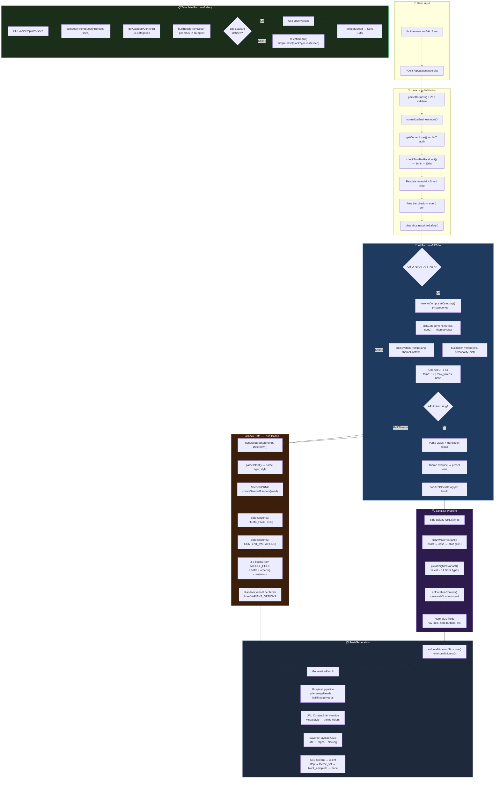
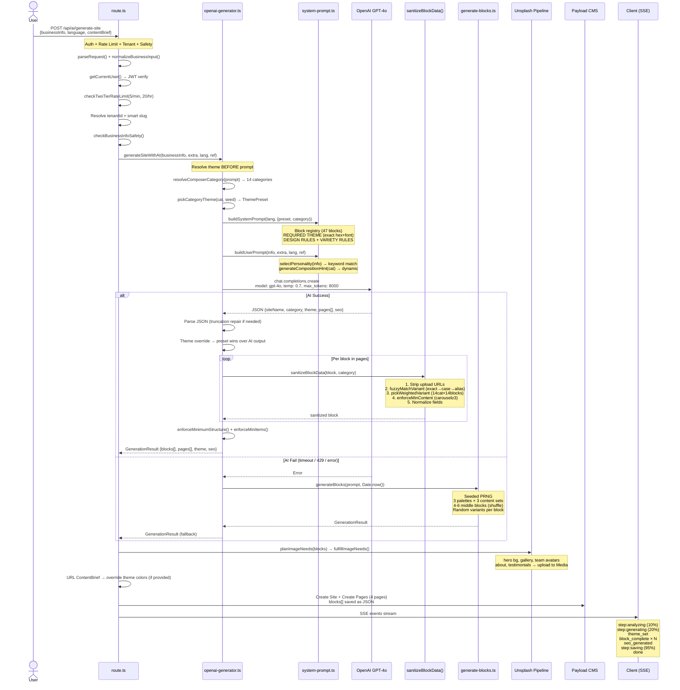
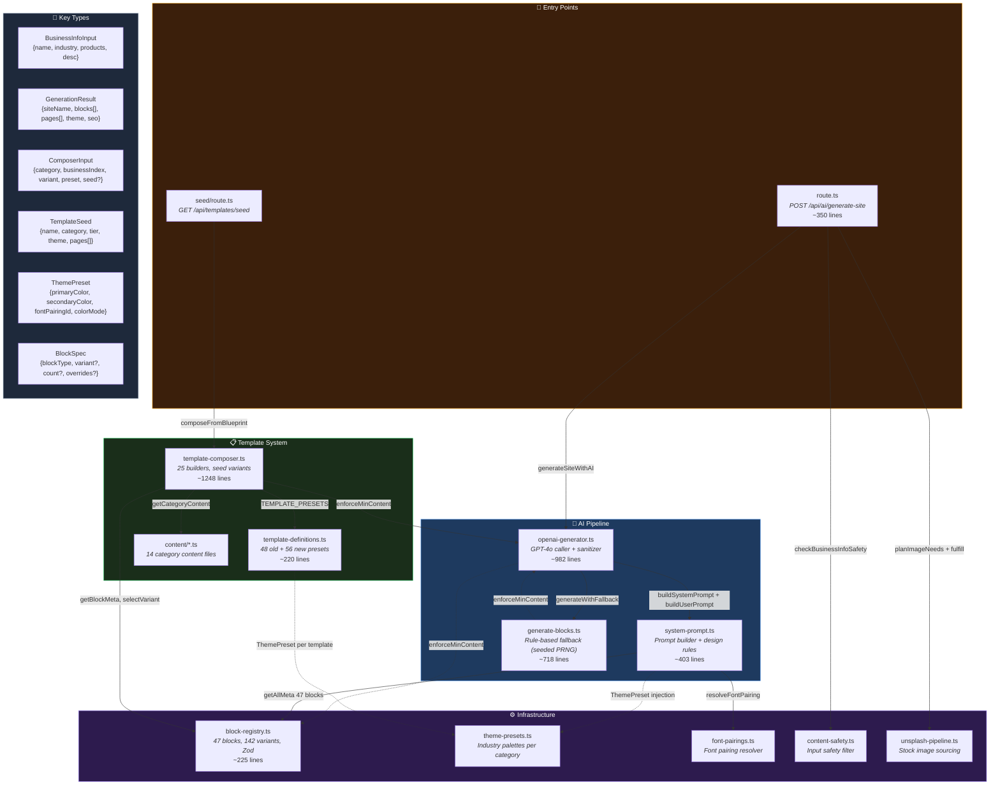
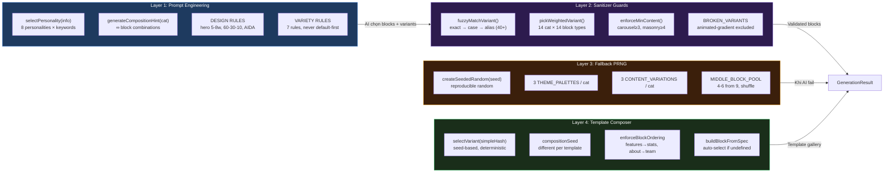

# AI Website Generation — Flow Diagrams

> Render trên GitHub, VS Code Mermaid extension, hoặc [mermaid.live](https://mermaid.live)

---

## 1. Flowchart Tổng Quan — 3 Paths

---

## 2. Sequence Diagram — Chi Tiết Giao Tiếp Giữa Các Module

---

## 3. Component / Dependency Diagram

---

## 4. Variety System — Layers Diagram

---

## Ghi chú

- **Render:** GitHub tự render Mermaid trong `.md` files. Hoặc dùng VS Code extension "Markdown Preview Mermaid Support".
- **Edit online:** Copy paste vào [mermaid.live](https://mermaid.live) để edit + export PNG/SVG.
- **Pending Phase 06:** Fallback path sẽ đổi từ `generateBlocks()` sang `composeFromBlueprint()` — diagram sẽ cần update.
