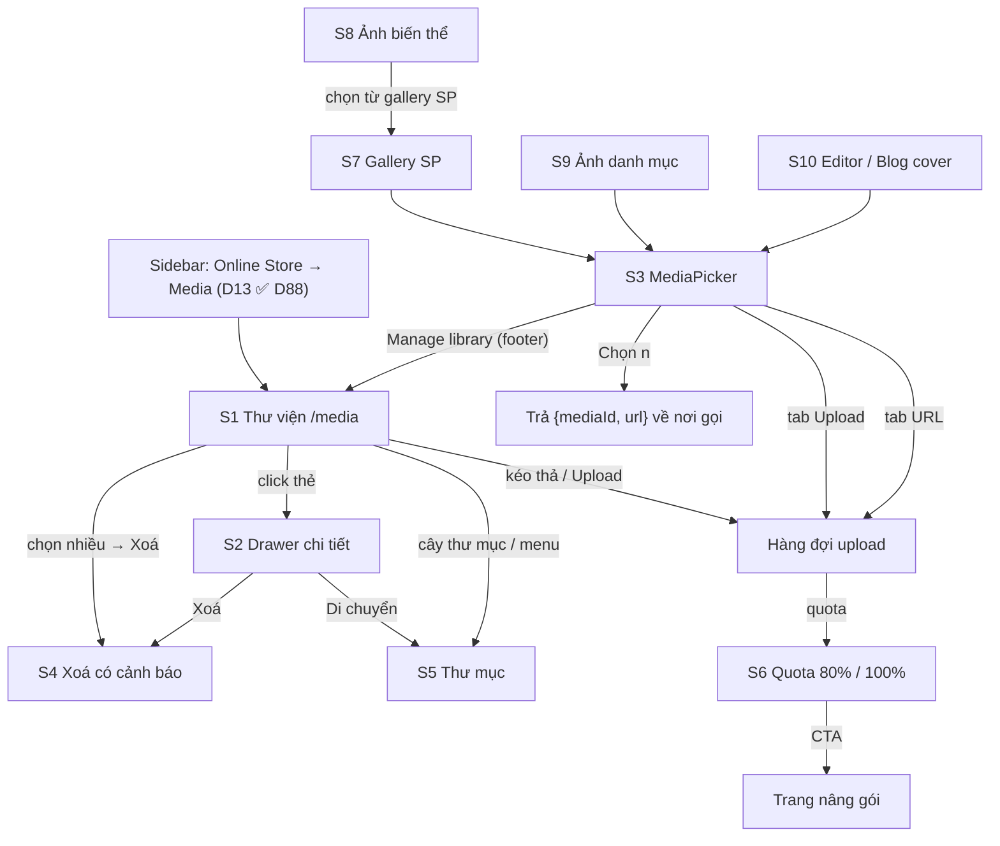

# F48 Media Management — Design & UI Spec

> **Status:** Draft for Claude Design · **Updated:** 2026-11-09 · **Owner:** Design / Dev
> **Related:** [PRD tổng](../prd/F48-media-management-overview.md) · PRD sprint [S0](../prd/F48-media-management-sprint0.md) · [S1](../prd/F48-media-management-sprint1.md) · [S2](../prd/F48-media-management-sprint2.md) · [S3](../prd/F48-media-management-sprint3.md) · [S4](../prd/F48-media-management-sprint4.md) · [S5](../prd/F48-media-management-sprint5.md) · Stories [1](../stories/F48-media-management-stories.md) · [2](../stories/F48-media-management-stories-2.md) · [3](../stories/F48-media-management-stories-3.md) · [4](../stories/F48-media-management-stories-4.md) · [Architecture](../architecture/F48-media-management.md) · [QA](../qa/F48-media-management.md)
> **Lưu ý ID:** S1–S10 trong file này là **màn hình**, không phải sprint.
> **Brainstorm (quyết định chốt D1–D67; D68–D78 ở PRD tổng; quyết định sau thay quyết định trước):** `plans/reports/brainstorm-261109-1538-F48-media-management.md`
> **Claude Design:** _(placeholder — cập nhật sau khi dựng)_
> **Mục đích:** Brief tự đủ — Claude Design / dev dựng 10 màn F48 mà không cần đọc tài liệu khác.
> **Microcopy en/ms + key i18n:** [F48-media-management-microcopy.md](./F48-media-management-microcopy.md) (tách từ §8).
> **Quyết định review lượt 3:** D68–D78 (PRD tổng); D74 (ảnh danh mục ở header products-grid) **⏸ hoãn — D88**. PO 2026-11-10 (D88): D11 = 10 ảnh, D13 sidebar chốt.

---

## 1. Overview

Hệ thống media thống nhất cho dashboard merchant (multi-tenant): **1 thư viện `/media`** (phân trang server, thư mục lồng nhau, sửa metadata, chọn nhiều + xoá nhiều, "Đang dùng ở đâu", đồng hồ dung lượng) và **1 `MediaPicker` dùng chung** thay cho 18 điểm upload rời rạc (ảnh SP, block editor, blog, logo/favicon/OG, rich text, QR…). Kèm gallery sản phẩm 10 ảnh có sắp xếp, ảnh cho biến thể, ảnh danh mục.

Người dùng: merchant SME Malaysia (owner + staff), nhiều người thao tác trên điện thoại. UI song ngữ **en + ms**.

**Phụ thuộc:** F08 Products (gallery, biến thể, danh mục), F01/F05 Editor (block image), F17 Blog, F19 Store config (logo/favicon/OG), F23 Staff permissions, Plan features (quota).
**Story:** US-F48-01 … US-F48-16 (UI chủ yếu ở US-F48-05, 06, 07, 08, 09, 10, 11, 13, 14, 15, 16).

## 2. Design Goal

Merchant **tìm và chọn lại ảnh đã có trong vài giây** thay vì upload lại; biết ngay ảnh nào đang dùng ở đâu trước khi xoá; luôn thấy còn bao nhiêu dung lượng — trên cả màn hình 375 px.

## 3. Design Principles

| # | Nguyên tắc | Hệ quả UI |
|---|---|---|
| P1 | **Chọn lại thay vì upload lại** | Picker mở tab **Thư viện** mặc định khi tenant đã có ≥1 media; tab Upload mặc định khi thư viện trống. Upload trùng nội dung → báo "Đã dùng lại ảnh có sẵn" (dedupe D7), không tốn quota. |
| P2 | **An toàn khi xoá** | Mọi xoá đi qua AlertDialog; media đang dùng → liệt kê nơi dùng, mặc định chặn; chỉ owner có "Vẫn xoá" từng file (D19, D28); media đơn hàng dùng không xoá được (D44). Xoá thư mục không bao giờ xoá file (D20). |
| P3 | **Luôn thấy dung lượng** | Đồng hồ dung lượng ở header `/media` và footer picker tab Upload; 80% cảnh báo amber, 100% chặn upload + CTA nâng gói (D9). Soft launch: quota = UNLIMITED (D53) nên mức 80/100% chỉ xuất hiện khi PO chốt số. |
| P4 | **Mobile-first cho picker** | Picker là bottom sheet full-height trên < 640 px; nút hành động chính cố định đáy, vùng chạm ≥ 44×44. |
| P5 | **Trạng thái tường minh** | Mỗi file upload có trạng thái riêng (queued → uploading → processing → done / reused / failed + lý do + Thử lại). Không có spinner câm. |
| P6 | **Không phụ thuộc màu** | Trạng thái luôn có icon + chữ; nhãn "Chưa dùng", "AI", "Đang dùng 3" là Badge có text. |
| P7 | **Một nguồn sự thật** | Giới hạn file / định dạng / thông báo lỗi lấy từ `upload-limits.ts` (FR-14) — không hard-code chuỗi "Max 5MB" trong component. |
| P8 | **Token, không mã màu cứng** | Bỏ gradient `#3b82f6→#2dd4bf`, `text-gray-*`, `text-white` của trang `/media` cũ; dùng token semantic (§4). |

## 4. Design System Reference

| Hạng mục | Giá trị / nguồn |
|---|---|
| Framework | Next.js App Router, dashboard `(dashboard)` layout |
| Styling | Tailwind + shadcn/ui (`src/components/ui/*`), light + dark |
| Icon | lucide-react (`Image`, `Film`, `FileText`, `Upload`, `Folder`, `FolderPlus`, `FolderInput`, `Link2`, `Copy`, `Trash2`, `MoreHorizontal`, `Check`, `X`, `RotateCw`, `AlertTriangle`, `HardDrive`, `GripVertical`, `Star`, `Search`, `LayoutGrid`, `List`, `ChevronRight`) |
| Font size tối thiểu | 12 px cho meta (bỏ `text-[9px]/[10px]` hiện tại) |
| Radius | `--radius` 0.5rem; card thumbnail `rounded-lg` |
| Timezone hiển thị | `Asia/Kuala_Lumpur` |
| Đơn vị dung lượng | KB/MB/GB thập phân 1 chữ số (`1.2 MB`), locale-aware |

### 4.1 Token dùng

| Token | Dùng cho |
|---|---|
| `--primary` (teal) / `--primary-foreground` | Nút chính, viền ô được chọn (`ring-2 ring-primary`), checkbox checked, thanh progress upload |
| `--card`, `--background`, `--muted`, `--muted-foreground`, `--border` | Nền thẻ, nền placeholder thumbnail, chữ phụ, viền |
| `--success` | Upload xong, "Đã dùng lại ảnh có sẵn" |
| `--warning` | Quota ≥ 80%, cảnh báo thiếu alt, "Đang dùng ở N nơi" trong dialog xoá |
| `--destructive` | Lỗi upload, quota 100%, nút xoá |
| `--info` | Badge "AI", loại video |
| `--ring` | Focus ring 2 px mọi phần tử tương tác |
| `--dash-overlay` | Overlay kéo-thả toàn trang |

### 4.2 Component shadcn

| Có sẵn trong repo | Cần thêm (shadcn add, cùng style) |
|---|---|
| `Dialog`, `Tabs`, `DropdownMenu`, `Checkbox`, `Badge`, `Tooltip`, `Popover`, `Select`, `Input`, `Textarea`, `Label`, `Button`, `Skeleton`, `Separator`, `Alert`, `Card`, `Table`, `Pagination`/`table-pagination`, `table-search`, `table-empty-state`, `filter-chip`, `confirm-modal`, `sonner` (toast) | **`Sheet`** (drawer chi tiết + bottom sheet picker mobile), **`AlertDialog`** (xoá — có thể mở rộng `confirm-modal` thay vì thêm mới, dev quyết), **`Progress`** (upload + quota), **`Breadcrumb`** (đường dẫn thư mục), **`ScrollArea`** (tuỳ chọn) |

Kéo sắp xếp (S7): dùng `@dnd-kit/core` + `@dnd-kit/sortable` (đã có trong `package.json`), bắt buộc có thay thế bàn phím (§9).

### 4.3 Badge chuẩn

| Badge | Style | Khi nào |
|---|---|---|
| `Unused` / `Tidak digunakan` | outline, `text-muted-foreground` | `usageCount = 0` |
| `In use · 3` / `Digunakan · 3` | secondary | `usageCount > 0` |
| `AI` | `bg-info/10 text-info` | `createdVia = ai` |
| `Video` | outline + icon | video (thư viện không có PDF; biên lai PDF ở luồng private) |
| `Legacy` / `Lama` | outline, `text-muted-foreground` | media PW1 key phẳng (không `pw2/`) — chỉ thông tin (D21) |
| `No alt` / `Tiada alt` | `bg-warning/10 text-warning` + icon | ảnh thiếu alt (cảnh báo, không chặn — §9.4) |
| `Main` / `Utama` | `bg-primary text-primary-foreground` | ảnh chính gallery SP |

---

## 5. Screen Inventory

| ID | Màn | Bề mặt | Story |
|---|---|---|---|
| S1 | Thư viện `/media` (grid/list, toolbar, cây thư mục, bulk bar, kéo thả, hàng đợi upload, đồng hồ dung lượng) | Dashboard page | US-F48-05, 09, 11, 13 |
| S2 | Drawer chi tiết media | Sheet phải (desktop) / full sheet (mobile) | US-F48-05, 11 |
| S3 | MediaPicker (Upload / Thư viện / URL) | Dialog (desktop) / bottom sheet (mobile) | US-F48-06, 08 |
| S4 | Hộp thoại xoá có cảnh báo đang dùng | AlertDialog | US-F48-11 |
| S5 | Quản lý thư mục (tạo / đổi tên / di chuyển / xoá) | Dialog nhỏ + DropdownMenu | US-F48-09 |
| S6 | Trạng thái quota (80% / 100%) | Banner + đồng hồ + chặn upload | US-F48-13 |
| S7 | Gallery sản phẩm 10 ảnh, kéo sắp xếp, ảnh chính | Product form | US-F48-14 |
| S8 | Chọn ảnh cho biến thể | Product form → bảng biến thể | US-F48-15 |
| S9 | Ảnh danh mục (⏸ hoãn, D88) | Category form + header `products-grid` storefront | US-F48-16 |
| S10 | Picker gắn vào editor (BlockImageEditor / media overlay / Logo / Favicon / OG) và blog cover | Editor panel + Blog editor | US-F48-07 |

### 5.1 Flow tổng



### 5.2 Flow upload (1 file)

`queued` → `uploading` (presign OK) → `processing` (PUT S3 xong) → `done` (file mới) | `reused` (trùng hash, D7).
Nhánh lỗi: `queued` → `rejected` (kiểm client: định dạng, dung lượng, `max`); `uploading`/`processing` → `failed` (mất mạng, huỷ, server từ chối theo `code`) → [Thử lại] → `queued`.

---

## 6. Screen Wireframes

### S1 — Thư viện `/media`

#### Desktop 1280

```
┌──────────┬─────────────────────────────────────────────────────────────────────────────┐
│ Sidebar  │ Media library                                   [▓▓▓▓▓░░ 1.6 / 2 GB] [⬆ Upload]│
│          │ Images, videos and files for your store                                      │
│          ├──────────────────┬──────────────────────────────────────────────────────────┤
│          │ FOLDERS      [+] │ [🔍 Search files…        ] [Type: All ▾] [Sort: Newest ▾]  │
│          │ ▸ All media  312 │ [◻ Unused only]                               [▦ Grid|☰ List]│
│          │ ▾ Products    88 │ All media › Products › Raya 2026                           │
│          │   ▸ Raya 2026 24 │ ┌───────┐┌───────┐┌───────┐┌───────┐┌───────┐┌───────┐       │
│          │   ▸ Baju      40 │ │☐ img  ││☑ img  ││☐ img  ││☐ ▶vid ││☐ img  ││☐ img  │       │
│          │ ▸ Banners     12 │ │       ││(teal) ││  AI   ││       ││No alt ││Unused │       │
│          │ ▸ Blog        30 │ ├───────┤├───────┤├───────┤├───────┤├───────┤├───────┤       │
│          │                  │ │kurung…││hero-1 ││promo  ││intro  ││logo   ││sale…  │       │
│          │ Unfiled      182 │ │412 KB ││1.1 MB ││AI·88KB││8.2 MB ││24 KB  ││300 KB │       │
│          │                  │ └───────┘└───────┘└───────┘└───────┘└───────┘└───────┘       │
│          │                  │  … (infinite scroll, virtualized > 200)                    │
│          │                  │ ┌───────────────────────────────────────────────────────┐ │
│          │                  │ │ 3 selected  [Move to…] [Copy URLs] [🗑 Delete]   [✕]   │ │ ← bulk bar
│          │                  │ └───────────────────────────────────────────────────────┘ │
│          │                  │                     ┌───────────────────────────────────┐ │
│          │                  │                     │ Uploading 2 of 5          [–] [✕] │ │ ← upload queue
│          │                  │                     │ ✓ kurung.jpg            Done      │ │
│          │                  │                     │ ↻ banner.png  ▓▓▓▓░ 62%   [✕]     │ │
│          │                  │                     │ ⚠ menu.pdf  Not supported [Retry]│ │
│          │                  │                     └───────────────────────────────────┘ │
└──────────┴──────────────────┴──────────────────────────────────────────────────────────┘
```

- Grid: `grid-cols-[repeat(auto-fill,minmax(160px,1fr))] gap-4`; thumbnail `aspect-square object-cover bg-muted`.
- Cây thư mục: cột trái 240 px (≥ 1024 px), có số đếm; "All media" và "Unfiled" (không thư mục) là 2 nút giả cố định. Mục được chọn: `bg-primary/10 text-primary font-medium`.
- Breadcrumb luôn hiển thị phía trên grid (cả desktop) — click để nhảy cấp.
- List view (Table): cột ☐ · thumbnail 40 px · Tên · Loại · Kích thước (px) · Dung lượng · Dùng ở (badge) · Ngày tải · ⋯.
- URL state: `?folder=&q=&type=&filter=unused&sort=&view=` (deep link, giữ khi back); `type` = `image|video|all`, `sort` = giá trị API (`-createdAt|createdAt|displayName|-filesize`).

#### Mobile 375

```
┌─────────────────────────────────┐
│ ☰  Media library          [⬆]  │
│ ▓▓▓▓▓▓░░ 1.6 of 2 GB used       │
│ [🔍 Search files…           ]   │
│ [All ▾][Unused][Newest ▾][⋯]   │ ← chips cuộn ngang
│ ‹ Products › Raya 2026   [📁▾] │ ← breadcrumb + nút chọn thư mục (Sheet)
│ ┌────────┐┌────────┐┌────────┐  │
│ │  img   ││  img ✓ ││  img   │  │ 3 cột, ô ≥ 104 px
│ └────────┘└────────┘└────────┘  │
│ ┌────────┐┌────────┐┌────────┐  │
│ │  ▶vid  ││ No alt ││  img   │  │
│ └────────┘└────────┘└────────┘  │
│                                 │
│┌───────────────────────────────┐│
││ 2 selected  [📁][🔗][🗑]  [✕] ││ ← bulk bar cố định đáy (safe-area)
│└───────────────────────────────┘│
└─────────────────────────────────┘
```

- Chế độ chọn trên mobile: **nhấn giữ 500 ms** một thẻ hoặc nút "Select" trong menu `⋯` → hiện checkbox mọi thẻ; chạm = toggle. Ngoài chế độ chọn: chạm = mở S2.
- Tên file ẩn trên mobile grid (chỉ thumbnail + badge góc); list view mobile hiện tên.
- Upload queue mobile: thanh mảnh trên bulk bar "Uploading 2 of 5 · 40%" → chạm mở Sheet chi tiết hàng đợi.
- Nút `⬆` header mở chọn file hệ thống (`accept` theo whitelist; `capture` không ép — để OS cho chọn Camera/Thư viện).

#### Toolbar

| Control | Giá trị | Ghi chú |
|---|---|---|
| Search | tên hiển thị, tên file, alt | debounce 300 ms, tìm server (FR-15), nút ✕ xoá |
| Type | All · Images · Videos | `type=all|image|video` (FR-15); biên lai PDF private không hiện ở thư viện |
| Unused only | toggle chip | `filter=unused` (FR-30b) |
| Sort | Newest · Oldest · Name A–Z · Largest | `-createdAt` · `createdAt` · `displayName` · `-filesize` |
| View | Grid / List | lưu localStorage |
| Folder | cây (desktop) / Sheet chọn (mobile) | "All media" = mọi thư mục; lọc theo thư mục KHÔNG gồm thư mục con (có toggle "Include subfolders" — mặc định off) |

#### Kéo thả toàn trang

- Kéo file vào bất kỳ đâu trong vùng content → overlay `--dash-overlay` + khung đứt nét `border-2 border-dashed border-primary` + "Drop to upload to **Raya 2026**" (thư mục đang mở).
- Thả lên một thư mục trong cây → upload vào thư mục đó (highlight thư mục khi hover).
- Kéo thẻ media (desktop) thả lên thư mục trong cây = di chuyển; luôn có thay thế "Move to…" (bàn phím/mobile).

#### States S1

| State | Hiển thị |
|---|---|
| Loading lần đầu | 12 Skeleton vuông + 3 dòng skeleton cây thư mục |
| Load thêm | 1 hàng skeleton cuối grid; `aria-busy` trên grid |
| Empty tenant | Icon `Image` 48 px, `mediaLibrary.emptyTitle` "No media files yet", mô tả, [Upload files], "or drag and drop here" |
| Empty thư mục | "This folder is empty" + [Upload here] + [Move files here] |
| Không khớp tìm/lọc | `mediaLibrary.noMatch` "No files match your search" + [Clear filters] |
| Unused rỗng | "Every file is in use. Nice and tidy!" |
| Lỗi tải | Alert destructive + [Try again] (giữ dữ liệu cũ nếu có) |
| Không quyền `media` | Không vào được `/media` → trang 403 chuẩn dashboard (D14) |

### S2 — Drawer chi tiết media

Desktop: `Sheet side="right"` rộng 420 px, không che grid (grid vẫn cuộn, thẻ đang mở có viền primary). Mobile: Sheet full-screen, header có ← Back.

```
┌──────────────────────────────────────┐
│ kurung-raya.webp            [⋯] [✕] │
├──────────────────────────────────────┤
│ ┌──────────────────────────────────┐ │
│ │         preview (contain)        │ │  video: <video controls>; pdf: icon + Open
│ └──────────────────────────────────┘ │
│ 1600 × 2000 · 412 KB · WEBP          │
│ Uploaded 3 Nov 2026 by Aisyah        │
│ Folder: Products › Raya 2026 [Move]  │
├──────────────────────────────────────┤
│ Name                                 │
│ [ Baju kurung Raya – pink        ]   │
│ Alt text  ⓘ                          │
│ [ Woman wearing pink baju kurung ]   │
│ 32/250 · Describe the image for      │
│ shoppers using screen readers        │
│ Caption (optional)                   │
│ [                                ]   │
├──────────────────────────────────────┤
│ USED IN (3)                          │
│ ▸ Product · Baju Kurung Pink    ↗    │
│ ▸ Page · Home › Hero block      ↗    │
│ ▸ Blog · Raya collection 2026   ↗    │
├──────────────────────────────────────┤
│ URL [ https://media…/ab12.webp ][⧉] │
├──────────────────────────────────────┤
│ [🗑 Delete]          [Cancel] [Save] │ ← sticky footer
└──────────────────────────────────────┘
```

- Field sửa được: **Name (displayName ≤120), Alt (≤250), Caption (≤500), Folder** (D15). Filename/MIME/size chỉ đọc; sửa field hệ thống → `MEDIA_FIELD_READONLY`.
- Ảnh động (WebP/PNG động) đã bị lấy khung đầu: dòng thông tin "Saved as a still image" (D38).
- Lưu: nút Save bật khi dirty; `Ctrl/⌘+S`; rời drawer khi dirty → confirm "Discard changes?".
- "Used in": skeleton 3 dòng khi đang quét (NFR-03 < 1,5 s); mỗi dòng là link mở đúng màn (SP / editor trang+block / blog / settings) tab mới trên desktop. "Not used anywhere" + Badge Unused nếu rỗng. Ghi chú nhỏ: "Usage of older blocks is detected by URL." (D3).
- Media AI: thêm dòng "Created by AI" — **không** hiển thị prompt (FR-02).
- Menu `⋯`: Copy URL · Download · Move to… · Open in new tab · Delete.
- Điều hướng ←/→ (phím mũi tên khi focus không ở input) sang media trước/sau trong danh sách hiện tại.
- Staff không có quyền `media` không vào được `/media` nên không mở S2; họ sửa alt file **do mình upload** ở popover "Edit alt text" của S7 `ProductGallery` và field alt của `MediaFieldControl` (S9, S10) (D26). File người khác → field alt disabled + Tooltip `mediaLibrary.forbiddenEditOther` (xem §7).
- Media có đơn hàng tham chiếu: dòng "Order · #1234" chỉ đọc trong Used in; nút Delete disabled + Tooltip `mediaLibrary.deleteOrderLocked` (D44). Media là **QR thanh toán đang bật** (D78): nút "Delete anyway" disabled + Tooltip `mediaLibrary.deletePaymentQrLocked`; xoá thường vẫn bị chặn vì đang dùng.
- Owner, media đang dùng (không có đơn hàng): Delete mở S4 dạng 1 file có nút "Delete anyway" (force từng file, D28).

### S3 — MediaPicker

Desktop: `Dialog` max-w-4xl, cao 80vh. Mobile < 640: bottom sheet cao 92dvh, tay nắm kéo, footer cố định.

#### Desktop 1280

```
┌───────────────────────────────────────────────────────────────────────┐
│ Choose image                                                     [✕] │
│ Up to 10 images · JPG, PNG, WEBP · max 10 MB each                    │
│ ┌────────────┬──────────────┬─────────────┐                          │
│ │ ⬆ Upload   │ ▦ Library    │ 🔗 From URL │                          │
│ └────────────┴══════════════┴─────────────┘                          │
│ [🔍 Search…        ] [📁 All media ▾] [◻ Unused] [Newest ▾]           │
│ ┌──────┐┌──────┐┌──────┐┌──────┐┌──────┐┌──────┐┌──────┐             │
│ │ ①    ││      ││ ②    ││ ░░░░ ││      ││ ▶vid ││      │             │
│ │(teal)││      ││(teal)││ dim  ││      ││ dim  ││      │             │
│ └──────┘└──────┘└──────┘└──────┘└──────┘└──────┘└──────┘             │
│ ┌──────┐┌──────┐ …                                                    │
├───────────────────────────────────────────────────────────────────────┤
│ ▓▓▓▓░ 1.6/2 GB · Manage library ↗   2 selected · [Clear] [Cancel] [Select (2)] │
└───────────────────────────────────────────────────────────────────────┘
```

- Đa chọn: số thứ tự ①②… ở góc thẻ = thứ tự chèn (gallery dùng thứ tự này). Đơn chọn: chọn = radio; double-click / Enter = chọn + đóng.
- Thẻ không hợp `accept` (vd video khi chỉ nhận ảnh): làm mờ `opacity-40`, `aria-disabled`, Tooltip "Not supported here". Mặc định bộ lọc Type đã khoá theo `accept` (chip không đổi được).
- Đạt `max` → thẻ chưa chọn bị disable kèm dòng footer "Maximum 10 reached" (`aria-live`).
- Ảnh đã đang dùng ở chỗ gọi (vd ảnh đã có trong gallery) → badge "Added" + disable để tránh trùng.
- **Lối vào `/media` phụ (D13 đã chốt — D88, sidebar vẫn là lối chính):** footer picker có link `mediaPicker.manageLibrary` "Manage library" → `/media` (desktop mở tab mới để không mất form đang sửa; mobile hỏi xác nhận nếu form dirty) — chỉ hiện khi user có quyền `media`/full-access. Sidebar chỉ có **Online Store → Media** sau Blog (`src/config/sidebar-nav.ts`, `permissionId: 'media'`), PO đã xác nhận (D88); không thêm mục Settings, giữ link footer là lối vào phụ.

#### Mobile 375 (bottom sheet)

```
┌─────────────────────────────────┐
│            ───                  │ ← handle
│ Choose image               [✕] │
│ [Upload][Library][URL]          │ ← Tabs full-width
│ [🔍 Search…        ][📁▾]       │
│ ┌────────┐┌────────┐┌────────┐  │
│ │   ①    ││        ││   ②    │  │ 3 cột
│ └────────┘└────────┘└────────┘  │
│ ┌────────┐┌────────┐┌────────┐  │
│ └────────┘└────────┘└────────┘  │
├─────────────────────────────────┤
│ Manage library ↗                │ ← link nhỏ (chỉ user có `media`)
│ 2 selected        [Select (2)]  │ ← cố định, h-14, safe-area
└─────────────────────────────────┘
```

- Tab Upload mobile: một nút lớn "Choose from phone" (mở picker hệ thống, cho chọn Camera) thay vì vùng kéo thả.

#### Tab Upload

```
┌─────────────────────────────────────────────────────┐
│        ⬆  Drag files here or [Browse files]         │
│        JPG, PNG, WEBP · max 10 MB · up to 10        │
└─────────────────────────────────────────────────────┘
 Upload to: [📁 Products › Raya 2026 ▾]
 ✓ kurung.jpg         Done            ☑ (tự chọn)
 ↺ banner.png         Already in your library — reused ☑
 ↻ hero.png  ▓▓▓░ 48%                          [✕]
 ⚠ scan.heic          Format not supported     [Remove]
```

- File upload xong / reused trong picker được **tự động chọn** (tôn trọng `max`), giữ trên tab Upload; người dùng bấm "Select (n)".
- "Upload to" mặc định = thư mục ngữ cảnh (prop `defaultFolder`, vd blog → "Blog") hoặc "Unfiled".
- Đóng picker khi còn file đang upload: upload chạy tiếp vào thư viện + toast `mediaPicker.uploadContinues`; field đang mở **không** được gán (D40).
- File WebP/PNG động: dòng cảnh báo `mediaLibrary.animatedFlattened` trước khi xử lý (D38).
- Favicon (`purpose=favicon`): nhận PNG/JPEG/WebP (chuẩn hoá PNG) hoặc ICO ≤ 256×256; purpose khác từ chối ICO (D37).

#### Tab From URL (US-F48-08)

Ô `Image URL` + [Import]; help `mediaPicker.urlHelp`. Trạng thái: importing (spinner "Importing…", timeout 10 s) → done (preview + tự chọn) | error (`MEDIA_URL_*`, message dưới input qua `aria-describedby`).

#### Props (contract cho dev)

| Prop | Kiểu | Mặc định | Ghi chú |
|---|---|---|---|
| `open`, `onOpenChange` | bool / fn | — | |
| `mode` | `'single' \| 'multiple'` | `single` | |
| `max` | number | 1 / 10 | số còn được chọn (gallery: 10 − đã có) |
| `accept` | `('image'\|'video')[]` | `['image']` | khoá Type filter + validate upload |
| `purpose` | `MediaPurpose` | `library` | gửi presign (key, giới hạn, favicon D37) |
| `context` | string | — | quyền theo ngữ cảnh (D14/D26), gửi `context` cho API list |
| `defaultTab` | `'upload'\|'library'\|'url'` | auto (P1) | |
| `defaultFolder` | folderId \| null | null | |
| `excludeIds` | string[] | [] | hiện badge "Added" |
| `title` | string | "Choose image" | theo ngữ cảnh: "Choose logo", "Choose cover image" |
| `onSelect` | `(items: {mediaId, url, alt, width, height}[]) => void` | — | trả **{mediaId,url}** (FR-21) |
| `allowUrlTab` | bool | true | tắt cho favicon / `payment-qr` |

States picker: loading (skeleton 8 ô) · empty library (tự chuyển tab Upload + text "Your library is empty — upload your first image") · no match · offline (Alert "You're offline" + nút thử lại) · quota full (tab Upload hiển thị S6 chặn, tab Library vẫn chọn được — P1).

### S4 — Hộp thoại xoá có cảnh báo đang dùng

```
Không dùng ở đâu:                          Đang dùng (owner):
┌──────────────────────────────────┐       ┌──────────────────────────────────────┐
│ Delete 3 files?                  │       │ ⚠ 2 of 3 files are in use            │
│ This can't be undone. They will  │       │ They will be kept. Used in:          │
│ be removed from your library.    │       │ • Product · Baju Kurung Pink         │
│                                  │       │ • Page · Home › Hero                 │
│          [Cancel] [Delete 3]     │       │ • Blog · Raya collection  +2 more    │
└──────────────────────────────────┘       │ Delete only the unused file?         │
                                           │ [Cancel] [Delete only 1 unused]      │
                                           └──────────────────────────────────────┘

Owner — 1 file đang dùng, mở từ S2 (force từng file):
┌──────────────────────────────────────┐
│ ⚠ This file is in use                │
│ • Product · Baju Kurung Pink         │
│ Product/blog fields will be cleared; │
│ page blocks will show a broken image.│
│ ☐ I understand                       │
│ [Cancel] [Delete anyway] (red)       │
└──────────────────────────────────────┘
```

- Nút mặc định (focus đầu) = **Cancel**.
- **Xoá nhiều không bao giờ force** (D28): dialog chỉ có "Delete only N unused"; file đang dùng được giữ lại và liệt kê (reasons `in_use | forbidden | legacy_shared | not_found`).
- **Force chỉ owner, từng file, từ S2** (D28): "Delete anyway" bật khi tick "I understand". Staff: không có nút, thấy `MEDIA_FORCE_DELETE_OWNER_ONLY`.
- Media có **đơn hàng** tham chiếu: không có "Delete anyway" kể cả owner; hiện `MEDIA_FORCE_DELETE_FORBIDDEN` (D44).
- Bulk bar chỉ hiện nút Delete khi flag `MEDIA_BULK_DELETE_ENABLED` bật (D34, sau khi S4 có usage scan).
- Bulk ≤ 100 (FR-17): chọn > 100 → bulk bar báo `MEDIA_BULK_LIMIT`.
- Trong lúc kiểm usage: dialog hiện skeleton danh sách, nút xoá disabled.
- Sau xoá: toast `mediaLibrary.deleted` (không có undo — xoá vĩnh viễn; ghi rõ trong dialog). Còn file giữ lại: toast `mediaLibrary.deletePartial` + giữ chọn các file đó.

### S5 — Quản lý thư mục

Hành động: menu `⋯` cạnh mỗi thư mục (desktop hiện khi hover/focus; mobile luôn hiện) → New subfolder · Rename · Move to… · Delete.

```
New folder                      Move 3 items to…                 Delete "Raya 2026"?
┌────────────────────────┐      ┌───────────────────────────┐    ┌───────────────────────────────┐
│ Name                   │      │ [🔍 Search folders   ]    │    │ This folder has 24 files and  │
│ [ Raya 2026        ]   │      │ ○ Unfiled                 │    │ 2 subfolders.                 │
│ Inside: Products ▾     │      │ ○ Products                │    │ ( ) Move contents to          │
│ 9/60                   │      │   ● Raya 2026             │    │     "Products", then delete   │
│ [Cancel] [Create]      │      │   ○ Baju                  │    │ Files are never deleted here. │
└────────────────────────┘      │ [+ New folder]            │    │ [Cancel] [Move & delete]      │
                                │ [Cancel] [Move here]      │    └───────────────────────────────┘
                                └───────────────────────────┘
```

- Rename inline trong cây (Enter lưu, Esc huỷ) trên desktop; Dialog trên mobile.
- Giới hạn: tên 1–60 ký tự, duy nhất trong cùng cha (không phân biệt hoa thường), độ sâu ≤ 5, ≤ 200 thư mục/tenant (D2). Thư mục cấp 5 → "New subfolder" disabled + Tooltip lý do.
- Move: không cho chọn chính nó/thư mục con (disabled, Tooltip "Can't move a folder into itself").
- Thư mục rỗng: Delete → AlertDialog ngắn "Delete empty folder?". Thư mục có nội dung → lựa chọn duy nhất "Move contents to parent, then delete" (D20).
- Chuyển lên cha mà trùng tên thư mục → tự đổi "Tên (2)", "(3)"… (D51); toast liệt kê thư mục đã đổi tên.

### S6 — Trạng thái quota

| Mức | Đồng hồ (header S1 / footer picker) | Banner | Upload |
|---|---|---|---|
| < 80% | Progress `bg-primary`, "1.2 of 2 GB used" | — | bình thường |
| 80–99% | Progress `bg-warning`, icon ⚠ | Alert warning (đóng được, nhớ 7 ngày): "You've used 85% of your storage. Delete unused files or upgrade your plan." [View unused] [Upgrade] | bình thường; file làm vượt 100% bị từ chối từng file |
| 100% | Progress `bg-destructive` | Alert destructive (không đóng được): `mediaLibrary.quotaFull` [View unused] [Upgrade plan]; file bị từ chối hiện `MEDIA_QUOTA_EXCEEDED` | Nút Upload disabled + Tooltip; vùng thả hiện thông điệp chặn; tab URL disabled. **Chọn từ thư viện vẫn hoạt động.** |

- Đồng hồ (`MediaStorageMeter`): `Progress` (Radix) `role="progressbar"` — một role duy nhất — với `aria-valuenow/min/max` + text; dữ liệu từ `GET /api/media/quota` `{usedBytes, quotaBytes, percent, level}` (không có breakdown ảnh/video). Reused (dedupe) không tăng số; biên lai không tính (D24).
- Soft launch `media_storage_mb = UNLIMITED` (D53): đồng hồ hiện "{used} used" không có thanh giới hạn, không banner.
- [View unused] = S1 với `?filter=unused&sort=-filesize`.
- CTA [Upgrade plan] → trang gói hiện có (route billing hiện hành — dev xác định). Số quota theo gói: soft launch `UNLIMITED`, PO chốt sau báo cáo dung lượng S4 (D9, D88, §15).

### S7 — Gallery sản phẩm (10 ảnh)

Thay `ImageUploader` trong product form.

```
Product images                                          4 / 10
┌──────────┐ ┌────────┐ ┌────────┐ ┌────────┐ ┌ ─ ─ ─ ─ ┐
│ ⠿  ★Main │ │ ⠿      │ │ ⠿      │ │ ⠿ No alt│   + Add   
│   img    │ │  img   │ │  img   │ │  img   │ │  images │
│      [⋯] │ │   [⋯]  │ │   [⋯]  │ │   [⋯]  │  ─ ─ ─ ─ 
└──────────┘ └────────┘ └────────┘ └────────┘
Drag to reorder. The first image is the main image shown in listings.
```

- Ô đầu lớn hơn (2×2 trên desktop) + Badge "Main". Kéo bằng tay nắm `⠿` (mouse/touch, dnd-kit). Thả vào vị trí 1 = đổi ảnh chính.
- Menu `⋯` mỗi ảnh: Set as main · Move left · Move right · Edit alt text (Popover, giữ hành vi auto-grow hiện tại, ≤250; sửa alt của **media** — staff không `media` chỉ sửa được file do mình upload, file người khác mục này disabled + Tooltip `mediaLibrary.forbiddenEditOther`, D26) · Replace · Remove from product (không xoá khỏi thư viện — ghi rõ).
- "+ Add images" mở S3 (`mode=multiple`, `max=10−n`, `accept=['image']`, `excludeIds`, `defaultFolder`=Products nếu có). Thả file trực tiếp vào gallery = upload qua pipeline chung rồi thêm.
- Đủ 10: ô Add ẩn, đếm "10 / 10" + text "Maximum reached".
- Remove ảnh đang được biến thể dùng → confirm "This image is used by 2 variants. They'll show the main image instead."
- Mobile: 3 cột, ô ≥ 104 px; kéo giữ 250 ms trên tay nắm; luôn có Move left/right trong menu.

### S8 — Ảnh cho biến thể

Trong bảng biến thể (product form), cột đầu là ô ảnh 48 px.

```
Variants
┌──────┬──────────────┬─────────┬───────┐
│ [img]│ Pink / S     │ RM 89   │ 12    │   [img] = ảnh đã chọn hoặc ảnh chính mờ + "Default"
│ [ + ]│ Pink / M     │ RM 89   │ 8     │
└──────┴──────────────┴─────────┴───────┘

Popover "Variant image — Pink / S"
┌─────────────────────────────────────┐
│ ◉ Use main image (default)          │
│ ┌────┐┌────┐┌────┐┌────┐            │  ← chỉ ảnh trong gallery SP (D10)
│ │ ★  ││ ✓  ││    ││    │            │
│ └────┘└────┘└────┘└────┘            │
│ Need another image? [Add to gallery]│ ← mở S3 → thêm vào gallery → chọn
└─────────────────────────────────────┘
```

- Mobile: Popover thành bottom sheet.
- Gallery trống: ô ảnh biến thể disabled + Tooltip "Add product images first".
- Không có "Apply to all …" (D31): mỗi biến thể chọn riêng.
- Ảnh không thuộc gallery → `VARIANT_IMAGE_NOT_IN_GALLERY`.
- Storefront (ngoài phạm vi thiết kế chi tiết ở đây): chọn chip biến thể → gallery đổi sang ảnh biến thể, kể cả biến thể hết hàng (qua `onPreview`, D50); giỏ/đơn/email hiện ảnh biến thể (snapshot `orders_items.image_url`, D49).

### S9 — Ảnh danh mục

**⏸ Hoãn (D88) — chờ ngày cutover Commerce OS.** Lịch sử: field `categories.image` từng bị xoá ở #1587 (commit `02a6b024be`) với lý do "stored but never rendered" — F48 chỉ khôi phục khi có **bề mặt hiển thị cụ thể** dưới đây; PO xác nhận đảo quyết định trước khi làm (xem US-F48-16, PRD F08).

**Form (dashboard):** Category form (F08 categories): 1 field `dashboard.products.categories.form.image` "Category image (optional)" — ô 4:1 trống "+ Add image" → S3 `single`, `accept=['image']`. Có ảnh: preview 4:1 + [Replace] [Remove] + alt inline. Gợi ý `imageHint`: "Shown at the top of your product list when shoppers filter by this category. Recommended 1600 × 400." Lỗi: `CATEGORY_IMAGE_INVALID`. Không tạo block mới (D50).

**Bề mặt storefront duy nhất (D74):** header của block `products-grid` khi URL lọc **đúng 1** `categoryId` (`?categoryId=<id>` — `src/blocks/products-grid/filter-utils.ts`). 0 hoặc ≥ 2 `categoryId` → không có header (giữ như hiện tại). Không có "thẻ danh mục", không có trang PLP `?category=` riêng.

```
Desktop 1280 — lọc 1 danh mục, có ảnh              Mobile 375 — có ảnh
┌────────────────────────────────────────────┐    ┌───────────────────────┐
│ ┌────────────────────────────────────────┐ │    │ ┌───────────────────┐ │
│ │      ảnh danh mục 4:1 (object-cover)   │ │    │ │  ảnh 2:1 (cover)  │ │
│ └────────────────────────────────────────┘ │    │ └───────────────────┘ │
│ Kuih Raya                        (h1/h2)   │    │ Kuih Raya             │
│ Mô tả danh mục (tối đa 3 dòng, line-clamp) │    │ Mô tả (line-clamp 3)  │
│ [Bộ lọc]                  [Sắp xếp ▾]      │    │ [Lọc] [Sắp xếp ▾]     │
│ ┌────┐┌────┐┌────┐┌────┐  (lưới SP như cũ) │    │ ┌────┐┌────┐ lưới cũ  │
└────────────────────────────────────────────┘    └───────────────────────┘

Không ảnh → header chỉ chữ (tên + mô tả), không ô trống/ảnh vỡ:
│ Kuih Raya                                  │
│ Mô tả danh mục                             │
```

- Ảnh qua `next/image`, `sizes="100vw"`, khung tỉ lệ cố định (4:1 ≥ 640 px, 2:1 < 640 px) → CLS ≈ 0; `alt` = alt media, trống → tên danh mục theo locale.
- Tên/mô tả lấy từ danh mục theo locale storefront (en/ms); mô tả trống → chỉ tên.
- Danh mục bị "Vẫn xoá" ảnh (FK null) → header chỉ chữ.

### S10 — Picker trong editor và blog cover

| Điểm gắn | Trigger hiện tại | Sau F48 |
|---|---|---|
| `BlockImageEditor` (panel phải) | nút Upload/Replace | Ô preview + [Replace] mở S3 single; [Remove]; field alt bên dưới |
| `media-upload-overlay` (~10 block, hover trên canvas) | click overlay → chọn file | Overlay giữ nguyên vị trí, nhãn "Change image" → mở S3; thả file vào overlay vẫn upload trực tiếp (pipeline chung) |
| Gallery/before-after/client-logos block | upload từng ảnh | S3 `multiple` |
| `LogoEditor`, footer logo | Replace / Remove dialog | S3 single, `title="Choose logo"`, `allowUrlTab` |
| `FaviconEditor` | upload | S3 single, `purpose=favicon`, `allowUrlTab=false`, hint "Square, at least 48 × 48 · PNG, JPG, WEBP or ICO" (D37) |
| `og-image-editor` | upload | S3 single, hint "1200 × 630 recommended" + cảnh báo nếu tỉ lệ lệch > 10% |
| Blog cover (`BlogEditorPageClient`) | upload | Ô 16:9 "+ Add cover image" → S3, `defaultFolder`= Blog |
| Rich text (`RichTextBlockEditor`, `BlogRichEditor`) | nút ảnh toolbar | S3 single; chèn kèm alt |
| Video block | URL / upload | S3 `accept=['video']` + tab URL (YouTube giữ nguyên field riêng) |

Panel `BlockImageEditor` (dùng `MediaFieldControl`): tiêu đề Image → preview → [⇄ Replace] [🗑 Remove] → field Alt text; khi alt trống hiện warning nhẹ `editor.mediaField.altWarning`.

- Picker trong editor mở **trên** editor (z-index cao hơn panel, portal), đóng → focus về nút Replace.
- Không hiển thị đồng hồ quota trong editor panel; chỉ trong picker footer.

---

## 7. Component Specs

| Component | Props chính | Default | Hover | Focus | Selected | Disabled | Loading | Error | Empty |
|---|---|---|---|---|---|---|---|---|---|
| `MediaCard` | `item`, `selectable`, `selected`, `index?`, `disabledReason?`, `onOpen`, `onToggle` | thumb + tên + size + badges | `border-primary/40`, checkbox hiện | `ring-2 ring-ring ring-offset-2` | `ring-2 ring-primary` + checkbox ✓ (+ số thứ tự) | `opacity-40` + tooltip lý do | Skeleton vuông | thumb lỗi → icon `ImageOff` + "Preview unavailable" | — |
| `MediaGrid` | `items`, `selection`, `mode`, `onLoadMore`, `virtualized` | grid | — | roving tabindex (§9.1) | — | — | hàng skeleton | Alert + retry | `MediaEmptyState` |
| `MediaToolbar` | `query`, `filters`, `onChange`, `lockType?` | | | | chip active `bg-primary/10` | khoá type trong picker | — | — | — |
| `FolderTree` | `folders`, `activeId`, `onSelect`, `onAction`, `onDropFiles` | | `bg-muted` | treeitem focus ring | `bg-primary/10 text-primary` | thư mục cấp 5: action "New subfolder" disabled | skeleton 3 dòng | inline "Couldn't load folders · Retry" | chỉ All + Unfiled |
| `FolderBreadcrumb` | `path`, `onNavigate` | collapse giữa khi > 3 cấp (`…`) | underline | ring | cấp cuối `aria-current="page"` | — | — | — | — |
| `BulkActionBar` | `count`, `actions`, `onClear` | ẩn khi 0; slide-up 200 ms | | | | action disabled khi không quyền | spinner trên action đang chạy | toast | — |
| `UploadQueue` | `items[]`, `onCancel`, `onRetry`, `onDismiss` | panel nổi góc phải dưới; thu gọn được | | | | | | dòng lỗi đỏ | tự ẩn 4 s sau khi tất cả done (giữ nếu có lỗi) |
| `UploadItemRow` | `file`, `status`, `progress`, `errorCode` | theo §7.1 | | nút Cancel/Retry focusable | | | | | |
| `MediaStorageMeter` | `usedBytes`, `quotaBytes`, `percent`, `level`, `compact?` | primary | tooltip số byte | ring | | | skeleton bar | ẩn nếu không tải được (không chặn) | — |
| `MediaDetailSheet` | `mediaId`, `canEdit`, `onPrev/Next` | | | focus đầu = nút ✕ | | field disabled khi `!canEdit` | skeleton preview + fields | Alert + retry | — |
| `MediaUsageList` | `mediaId` | danh sách link | underline | ring | | | skeleton 3 dòng | "Couldn't check usage" + retry (khi lỗi, xoá bị chặn) | "Not used anywhere" |
| `DeleteMediaDialog` | `ids`, `role`, `force?` | §S4 | | Cancel autofocus | | Delete-anyway (chỉ 1 file, owner) disabled tới khi tick | nút spinner | inline Alert | — |
| `FolderDialog` | `mode: create\|rename\|move\|delete`, `folder` | | | input autofocus | | Create disabled khi invalid | spinner | lỗi dưới input | — |
| `MediaPicker` | §S3 props | | | focus trap | | | | | |
| `UrlImportField` | `onImported` | | | | | Import disabled khi rỗng / quota full | "Importing…" | lỗi dưới input | — |
| `ProductGallery` | `value: {mediaId,url,alt}[]`, `max=10`, `onChange` | §S7 | tay nắm hiện | ring | ô đang kéo `shadow-lg scale-105` | Add ẩn khi đủ; "Edit alt text" disabled + Tooltip `mediaLibrary.forbiddenEditOther` với file người khác khi staff không có `media` (D26) | ô upload có progress overlay | ô lỗi + Retry/Remove | 1 ô Add lớn + hint |
| `VariantImagePicker` | `galleryItems`, `value`, `onChange` | §S8 | | | ✓ viền primary | khi gallery rỗng | — | — | "Add product images first" |
| `QuotaBanner` | `percent`, `level` | §S6 | | | | | | | — |
| `MediaFieldControl` | `value: {mediaId,url}`, `purpose`, `accept`, `onChange`, `canEditAlt` | ô preview + Replace/Remove (§S9, §S10) | | ring | | khi không quyền; field alt disabled + Tooltip `mediaLibrary.forbiddenEditOther` khi file của người khác và staff không có `media` (D26) — Replace/Remove vẫn dùng được | progress overlay | lỗi dưới field | ô "+ Add image" |
| `MediaEmptyState` | `variant: tenant\|folder\|search\|unused` | §S1 states | | | | | | | |

Tổng: **20 component** (tên theo architecture: `MediaPicker`, `MediaFieldControl`, `MediaStorageMeter`; hook `useMediaUpload`, nút `MediaUploadButton`).

### 7.1 Trạng thái upload

| Status | Icon | Text en / ms | Hành động | Màu |
|---|---|---|---|---|
| queued | `Clock` | Waiting… / Menunggu… | Cancel | muted |
| uploading | `Loader2` spin + Progress % | Uploading 48% / Memuat naik 48% | Cancel | primary |
| processing | `Loader2` | Optimizing… / Mengoptimumkan… | — | primary |
| done | `CheckCircle2` | Done / Selesai | (picker: tự chọn) | success |
| reused | `Recycle` | Already in your library — reused / Sudah ada dalam pustaka — diguna semula | Locate (mở S2) | success |
| failed | `AlertTriangle` | theo `code` (microcopy §8.2.1) | Retry · Remove | destructive |
| rejected (client) | `XCircle` | `MEDIA_UNSUPPORTED_TYPE` / `MEDIA_TOO_LARGE` / `MEDIA_PICKER_TYPE` (kiểm trước) | Remove | destructive |
| cancelled | `X` | Cancelled / Dibatalkan | Retry | muted |

- Tối đa 3 file song song; còn lại queued. Huỷ khi uploading = abort request, không trừ quota.
- Header queue: "Uploading 2 of 5" / "5 uploaded, 1 failed" + [Retry all failed].
- Rời trang khi còn upload → `beforeunload` confirm "Uploads in progress will be cancelled."

---

## 8. Microcopy (en / ms)

Toàn bộ microcopy (nhãn §8.1, mã lỗi API §8.2.1, thông báo UI §8.2.2, chuỗi từ wireframe §8.3, quy ước key §8.0) đã tách sang **[F48-media-management-microcopy.md](./F48-media-management-microcopy.md)** (giới hạn 800 dòng/file). Key camelCase theo repo, namespace `mediaLibrary` / `mediaPicker` / `mediaFolders` / `mediaErrors` + namespace sẵn có của màn (`dashboard.products.*`, `editor.mediaField.*`, `Staff.drawer.features.media`); label sidebar khai inline trong `src/config/sidebar-nav.ts`.

---

## 9. Accessibility (WCAG 2.1 AA — NFR-07)

### 9.1 Grid bàn phím
- `MediaGrid` = `role="grid"` (hoặc `listbox` với `aria-multiselectable` khi picker đa chọn), mỗi thẻ `role="gridcell"`/`option`; **roving tabindex**: chỉ 1 thẻ `tabIndex=0`, Tab vào/ra grid một bước.
- Phím: ←→↑↓ di chuyển (tính theo số cột thực tế) · Home/End đầu/cuối hàng · Ctrl+Home/End đầu/cuối danh sách · **Space** toggle chọn · **Enter** mở chi tiết (thư viện) / chọn + xác nhận (picker single) · Shift+mũi tên mở rộng chọn · Ctrl/⌘+A chọn tất cả đã tải · **Esc** bỏ chọn rồi mới đóng.
- `aria-selected` trên thẻ; `aria-label` thẻ = "{name}, {type}, {size}, {In use 3 | Unused}".
- Ô ảnh không có tên nhìn thấy (mobile) vẫn có `aria-label`.

### 9.2 Live region
- 1 vùng `aria-live="polite"` dùng chung: "3 selected", "Uploading 2 of 5", "kurung.jpg uploaded", "5 files uploaded, 1 failed". Không đọc từng %; đọc mốc 25/50/75/100 hoặc khi đổi trạng thái.
- Lỗi upload / lỗi form: `role="alert"`. Toast (sonner) không cướp focus.

### 9.3 Dialog / Sheet
- Focus trap trong Dialog, Sheet, AlertDialog; Esc đóng (trừ khi đang lưu); focus trả về phần tử mở.
- AlertDialog xoá: focus đầu = Cancel. Tiêu đề `aria-labelledby`, mô tả `aria-describedby`.
- Tabs picker: `role="tablist"`, ←→ chuyển tab.
- Cây thư mục: `role="tree"`/`treeitem`, `aria-expanded`, ←→ đóng/mở, F2 rename.

### 9.4 Alt text — QUYẾT ĐỊNH: cảnh báo, không chặn
- Thiếu alt **không chặn** lưu/publish SP, trang, blog. Hiển thị: badge "No alt" trên thẻ thư viện; warning inline dưới field alt ở editor/gallery; (tuỳ chọn sau) đếm "3 images without alt" trong checklist publish.
- Alt mặc định khi upload = rỗng (không tự điền tên file — tên file thường vô nghĩa). Storefront render `alt=""` khi trống.
- Lý do: merchant SME, chặn sẽ làm gãy luồng đăng SP trên mobile; SEO/a11y đạt qua nhắc nhở.

### 9.5 Khác
- Kéo thả (upload, sắp xếp gallery, di chuyển vào thư mục) **luôn có thay thế** nút/menu (Browse, Move left/right, Move to…).
- Vùng chạm ≥ 44×44 (checkbox thẻ mobile: vùng chạm cả góc 44 px). Khoảng cách ≥ 8 px.
- Tương phản ≥ 4.5:1 cho text; badge trên ảnh có nền đặc (không chữ trần trên ảnh).
- `prefers-reduced-motion`: tắt scale hover, slide bulk bar thành fade.

## 10. Responsive & Performance UX

### 10.1 Breakpoint
| Width | S1 | S2 | S3 |
|---|---|---|---|
| < 640 | grid 3 cột, cây → Sheet, bulk bar đáy, queue thu gọn | Sheet full-screen | bottom sheet 92dvh |
| 640–1023 | grid auto-fill 140 px, cây → Sheet (nút 📁) | Sheet phải 400 px | Dialog 90vw |
| ≥ 1024 | cây cột trái 240 px | Sheet phải 420 px | Dialog max-w-4xl |

- Không cuộn ngang; toolbar mobile chip cuộn ngang trong vùng riêng (có fade mép).
- Bottom sheet tôn trọng `env(safe-area-inset-bottom)`; bàn phím ảo mở khi search → footer không bị che (dùng `dvh`).

### 10.2 Performance UX
- Phân trang cursor 50 item/lần, infinite scroll (IntersectionObserver) + nút "Load more" dự phòng (a11y).
- **Virtualized grid khi > 200 item đã tải** (vd `@tanstack/react-virtual` theo hàng — **chưa có trong package.json**, dev cân nhắc thêm hoặc tự viết windowing theo hàng); giữ roving tabindex khi cuộn ảo (scrollIntoView thẻ focus).
- Thumbnail qua `next/image` `sizes` theo cột (160–240 px), `loading="lazy"`, `placeholder` màu `bg-muted`; tỉ lệ cố định `aspect-square` → CLS ≈ 0.
- Skeleton: hiện sau 150 ms (tránh nháy); giữ dữ liệu cũ khi đổi bộ lọc (dim `opacity-60` + `aria-busy`).
- Search debounce 300 ms; huỷ request cũ (AbortController).
- Usage list lazy: chỉ quét khi mở S2 hoặc mở S4 (không quét cho cả grid); badge "Unused/In use" dùng số đếm server trả cùng list.
- Optimistic: đổi tên/alt/di chuyển cập nhật ngay, rollback + toast nếu lỗi. Xoá: không optimistic (chờ server).

---

## 11. Edge Cases UI

| # | Tình huống | Xử lý UI |
|---|---|---|
| E1 | Thả 50 file một lúc | Hàng đợi 3 song song; vượt `max` trong picker → nhận đủ max, phần thừa báo `MEDIA_PICKER_MAX`; vượt rate limit → `MEDIA_RATE_LIMITED` |
| E2 | Thả thư mục (folder OS) | Bỏ qua (chỉ file phẳng); toast "Folders can't be uploaded — select the files inside." / "Folder tidak boleh dimuat naik — pilih fail di dalamnya." |
| E3 | HEIC từ iPhone | Input khai `accept` MIME tường minh (`image/jpeg,image/png,image/webp`) → iOS tự đổi HEIC→JPEG khi chọn (M7); nếu vẫn lọt HEIC → `MEDIA_UNSUPPORTED_TYPE` kèm gợi ý "Change camera format to 'Most Compatible'" (link help) |
| E4 | Ảnh trùng (dedupe) trong cùng đợt | Cả 2 dòng hiện "reused" trỏ cùng media; picker chỉ chọn 1 lần |
| E5 | Mất mạng giữa chừng | Dòng chuyển `failed: network`; banner offline; [Retry all failed] khi online lại (không tự retry ngầm quá 1 lần) |
| E6 | Xoá media đang mở trong S2 ở tab khác | S2 hiện "This file was deleted" + đóng; grid bỏ thẻ |
| E7 | Media đã chọn trong picker bị người khác xoá trước khi bấm Select | Server trả lỗi → toast + bỏ thẻ khỏi lựa chọn |
| E8 | Block cũ dùng URL (không id) | "Used in" vẫn hiện (quét URL, D3); xoá → block hiện ảnh vỡ, đã cảnh báo trong S4 |
| E9 | Media PW1 cũ (prefix không phải `pw2/`) | Hiển thị bình thường; badge "Legacy"; xoá chỉ xoá row, object giữ (D21) |
| E10 | Staff không có quyền `media` mở picker | Thấy tab Library chỉ đọc + Upload; không có Move/Delete/sửa của người khác, không thấy link "Manage library" (D14); sửa alt file của mình ở S7/`MediaFieldControl` |
| E11 | Thư mục đang xem bị xoá ở tab khác | Breadcrumb về cha gần nhất còn tồn tại + toast |
| E12 | Tên file rất dài / ký tự Unicode (Jawi, emoji) | `truncate` 1 dòng + Tooltip đầy đủ; `dir="auto"` |
| E13 | Video lớn 100 MB trên 4G | Progress thật theo byte; cảnh báo trước khi tải nếu `navigator.connection.saveData` |
| E14 | Quota chạm 100% giữa đợt upload | File đang chạy hoàn tất nếu server cho; file còn lại `MEDIA_QUOTA_EXCEEDED`; banner S6 bật ngay |
| E15 | Ảnh rất nhỏ cho OG/favicon | Cảnh báo kích thước khuyến nghị, không chặn |
| E16 | Gallery đang có 5 ảnh từ dữ liệu cũ + PO giữ cap 5 | `max` đọc từ config — UI không hard-code 10 |

## 12. Data Shapes cho UI binding

- **media (list item):** `id, displayName, filename, mimeType, filesize, width, height, url, alt, caption, folderId, createdVia, createdAt, createdBy{name}, usageCount, legacy?` — không có `aiPrompt/sourceUrl` (FR-02).
- **media-folders:** `id, name, parentId, depth, itemCount, childCount`.
- **usage:** `MediaUsage[]` (PRD S4) — `{ kind, docId, title, path, via, editHref, readOnly }`; `readOnly = true` cho đơn hàng (D29/D44).
- **quota:** `{ usedBytes, quotaBytes, percent, level }` (`GET /api/media/quota`); `quotaBytes = null` khi UNLIMITED (D53).
- **upload result:** `{ status: created|reused, media }`; lỗi = `MediaErrorBody { error, code, … }` (mã: microcopy §8.2.1).

## 13. Build Priority (cho Claude Design)

| Wave | Màn | Story | Lý do |
|---|---|---|---|
| 1 | S1 (core grid/toolbar/queue), S2, S3 Library+Upload | US-F48-05, 06 | P0, nền cho mọi điểm gắn |
| 2 | S10, S3 URL | US-F48-07, 08 | gắn 18 điểm |
| 3 | S4, S6 | US-F48-11, 13 | an toàn xoá + quota |
| 4 | S5, sidebar | US-F48-09, 10 | thư mục + quyền |
| 5 | S7, S8, S9 | US-F48-14, 15, 16 | media sản phẩm |

## 14. Out of Scope (KHÔNG thiết kế)

Chỉnh ảnh (crop/filter/AI edit/xoá nền) · poster/transcode video · quét virus · Brand · review SP · chuyển block cũ sang id · migrate PW1 · upload proof/avatar/feedback/AI attachment (giữ luồng riêng, chỉ dùng chung validator và thông điệp lỗi — microcopy §8.2) · storefront gallery chi tiết (chỉ hành vi đổi ảnh theo biến thể).

## 15. Câu hỏi mở

| # | Câu hỏi | Đề xuất tạm trong thiết kế | Chủ |
|---|---|---|---|
| Q1 | Thêm mục "Media" vào sidebar (đảo quyết định 2026-06-11)? Vị trí? | Nhóm **Online Store**, sau Blog, icon `Images`, `permissionId: 'media'` (D13). Giữ link "Manage library" ở footer picker; không thêm mục Settings (D88) | ✅ PO đồng ý (D88) |
| Q2 | Quota từng gói | Đề xuất free 500 MB · starter 2 GB · pro 5 GB · business 20 GB; UI đọc từ `media_storage_mb`, không hard-code | PO |
| Q3 | Gallery SP 10 ảnh (sửa PRD F08) | Thiết kế cho 10; `max` cấu hình được (E16) | PO |
| Q7 | Duyệt bản dịch ms | CS/PO bản ngữ duyệt | PO |
| Q8 | Khôi phục ảnh danh mục (đảo #1587)? | Header block `products-grid` khi lọc đúng 1 `categoryId` (S9, D74) | ⏸ Hoãn (D88) |

Đã đóng: Q4 route CTA nâng gói → việc dev (dùng route billing hiện có); Q5 badge Legacy → có (D21); Q6 AlertDialog vs `confirm-modal` → dev chọn khi làm, giữ style.
