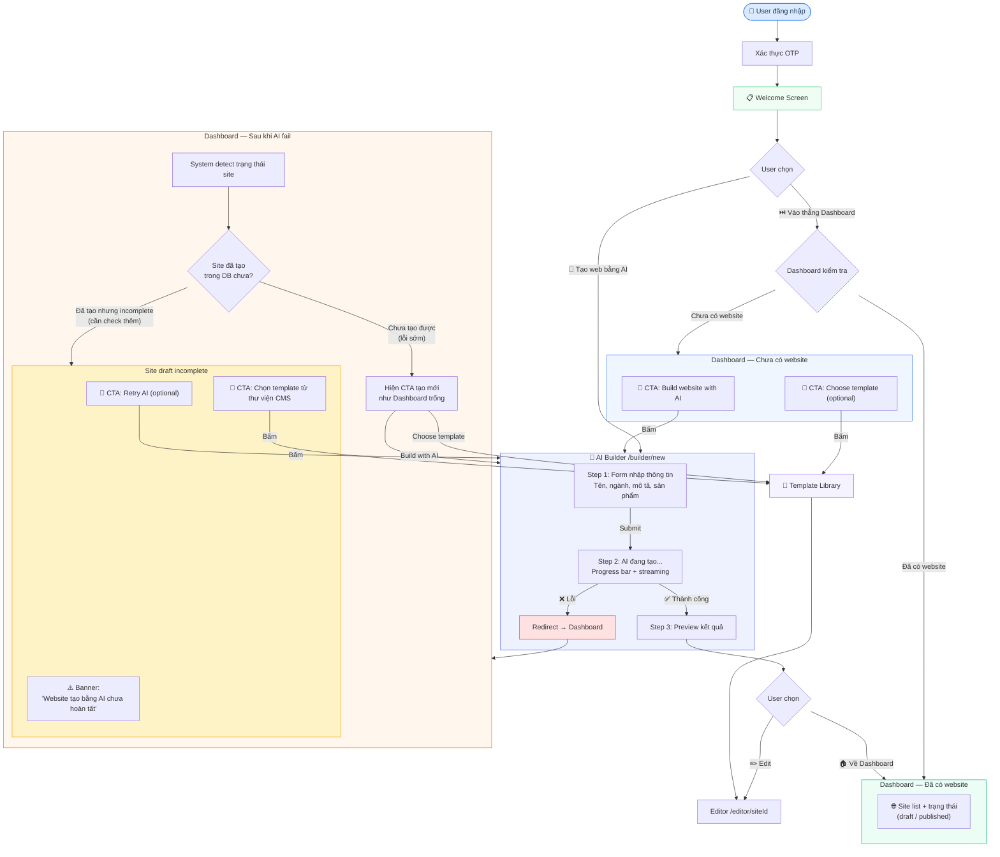
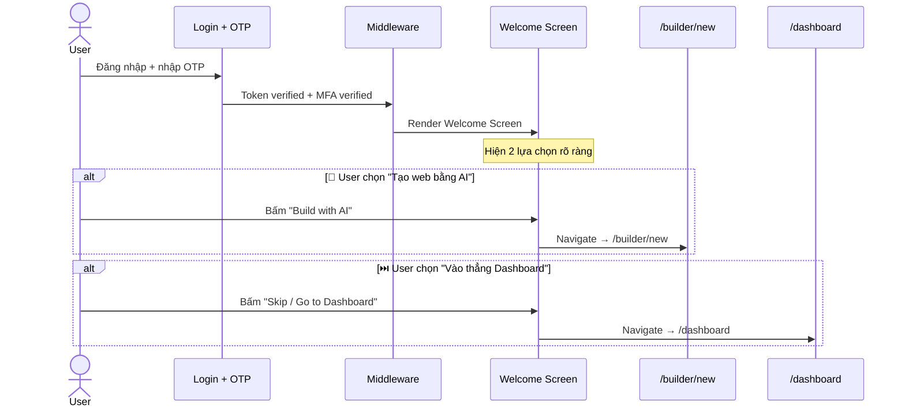
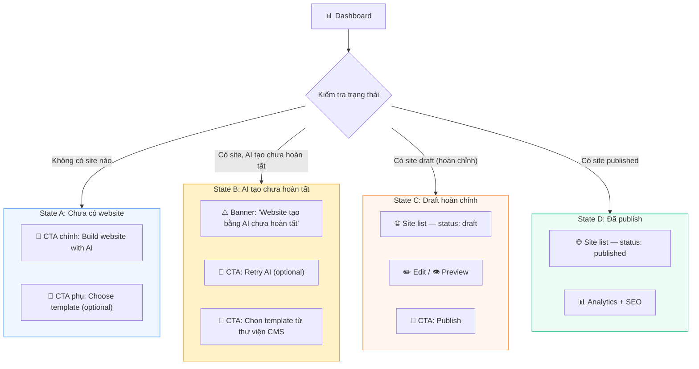
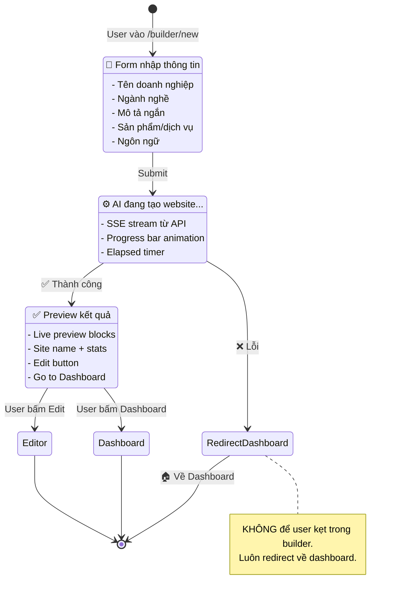
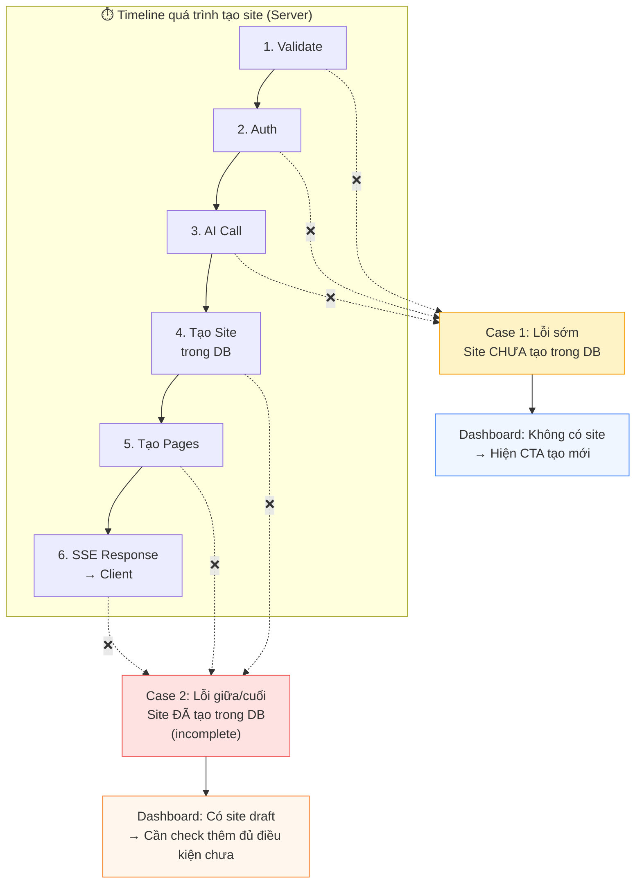
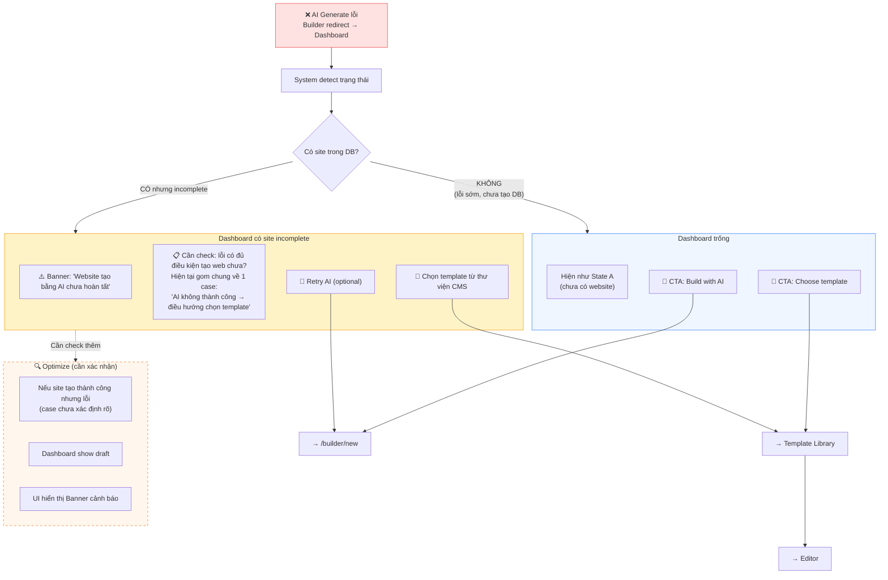
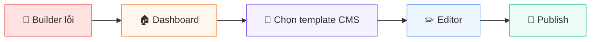
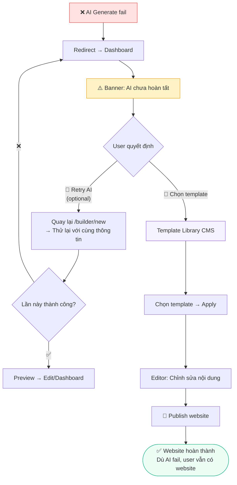

# User Flow: Luồng tạo Website lần đầu (F01)

> **Phiên bản:** 2.0  
> **Ngày cập nhật:** 2026-04-14  
> **Trạng thái:** Draft — Đang review  
> **Liên quan:** F01 (Builder), F06 (Onboarding), F05 (Editor)

---

## 1. Tổng quan

Tài liệu mô tả **toàn bộ luồng** từ lúc user đăng nhập đến khi có website hoàn chỉnh.

### Nguyên tắc UX

> [!IMPORTANT]
> 1. **Không bao giờ để user dead-end** — Mọi màn hình đều có "next action"
> 2. **AI chỉ là 1 option, không phải duy nhất** — Luôn có fallback = Template CMS
> 3. **AI fail → user vẫn hoàn thành website** bằng CMS template (không bị kẹt)
> 4. **Luôn có đường đi tiếp** — Dù bất kỳ lỗi nào xảy ra

---

## 2. Master Flow — Toàn bộ luồng

---

## 3. Luồng chi tiết từng bước

### 3.1 Sau Login + OTP → Welcome Screen

### 3.2 Dashboard — Phân nhánh theo trạng thái

### 3.3 AI Builder — Generate Flow

---

## 4. Error Flow — Xử lý khi AI Generate lỗi

### 4.1 Phân loại lỗi theo thời điểm

### 4.2 Dashboard sau khi AI fail

---

## 5. Fallback Flow — AI fail → Template CMS

> [!IMPORTANT]
> **Nguyên tắc:** AI fail → user vẫn hoàn thành website bằng CMS template (không bị kẹt)

**Luồng chi tiết:**

---

## 6. Tổng hợp Dashboard States

| State | Điều kiện | UI hiển thị | CTA chính |
|-------|-----------|-------------|-----------|
| **A — Trống** | `totalSites = 0` | Empty state + CTA nổi bật | 🤖 Build with AI / 📄 Choose template |
| **B — AI incomplete** | Site có nhưng incomplete | ⚠️ Banner cảnh báo | 🔄 Retry AI / 📄 Chọn template CMS |
| **C — Draft** | Site draft hoàn chỉnh | Site card (draft badge) | ✏️ Edit / 🚀 Publish |
| **D — Published** | Site đã publish | Site card (published badge) + Analytics | 📊 View stats / ✏️ Edit |

> [!WARNING]
> **State B cần check thêm:** Hiện đang gom chung mọi lỗi AI về 1 case "AI không thành công → điều hướng chọn template". Cần xác nhận cụ thể case nào site đã tạo thành công trong DB nhưng lỗi ở phía client — để quyết định hiện draft hay hiện banner retry.

---

## 7. Mapping File → Flow Step

| Flow Step | Route | File chính |
|-----------|-------|-----------|
| Login + OTP | `/login`, `/verify-otp` | `(auth)/login/page.tsx`, `(auth)/verify-otp/page.tsx` |
| Auth Guard | — | `middleware.ts` |
| Welcome Screen | `/onboarding` | `(frontend)/onboarding/page.tsx` → `WelcomeScreenClient.tsx` |
| Builder Form | `/builder/new` | `AIBuilderPageClient.tsx` → BusinessInfoForm |
| Builder Generate | `/builder/new` | `AIBuilderPageClient.tsx` → GenerationView |
| Builder Preview | `/builder/new` | `AIBuilderPageClient.tsx` → CompletionView |
| API Generate | `/api/ai/generate-site` | `api/ai/generate-site/route.ts` |
| Dashboard | `/dashboard` | `(dashboard)/dashboard/page.tsx` → `DashboardOnboarding.tsx` |
| Template Library | `/templates` | (CMS template gallery) |
| Editor | `/editor/[siteId]` | `(editor)/editor/[siteId]/page.tsx` |

---

## 8. Open Items — Cần xác nhận

- [ ] **State B detect logic:** Cách phân biệt "site incomplete" vs "site draft hoàn chỉnh" — dùng field nào trong DB? (`status`, page count, hay thêm field mới?)
- [ ] **Banner UI:** Design cụ thể cho banner "Website tạo bằng AI chưa hoàn tất" — vị trí, màu sắc, wording
- [ ] **Retry AI behavior:** Retry sẽ UPDATE site cũ hay tạo site mới? (hiện tại API sẽ UPDATE nếu site đã tồn tại)
- [ ] **Template Library route:** Route `/templates` đã có sẵn chưa hay cần tạo mới?
- [ ] **Case "AI thành công nhưng lỗi client":** Xác nhận rõ các case cụ thể (network timeout, browser close, SSE stream ngắt...) để xử lý đúng
