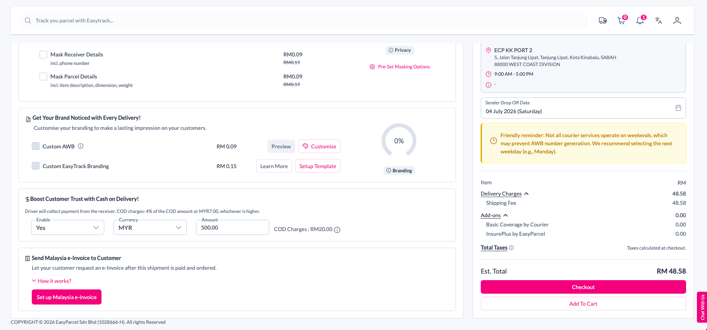
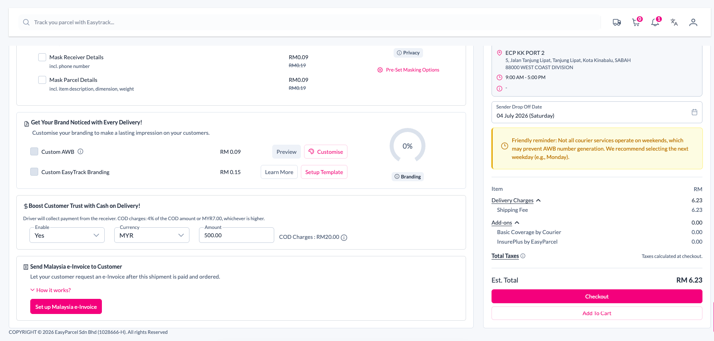
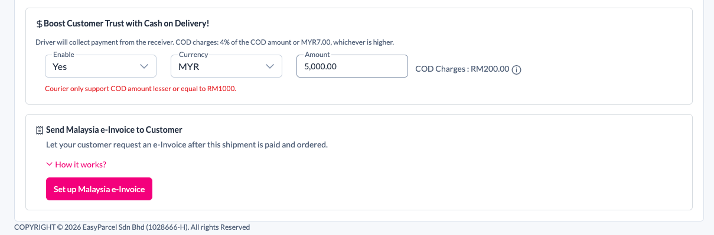
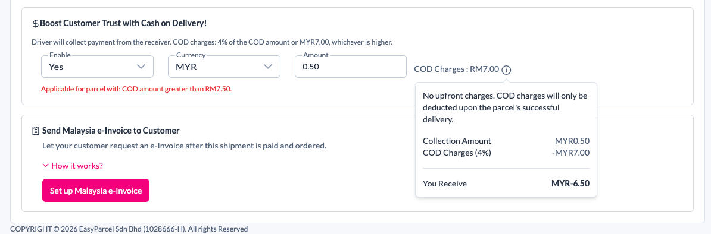
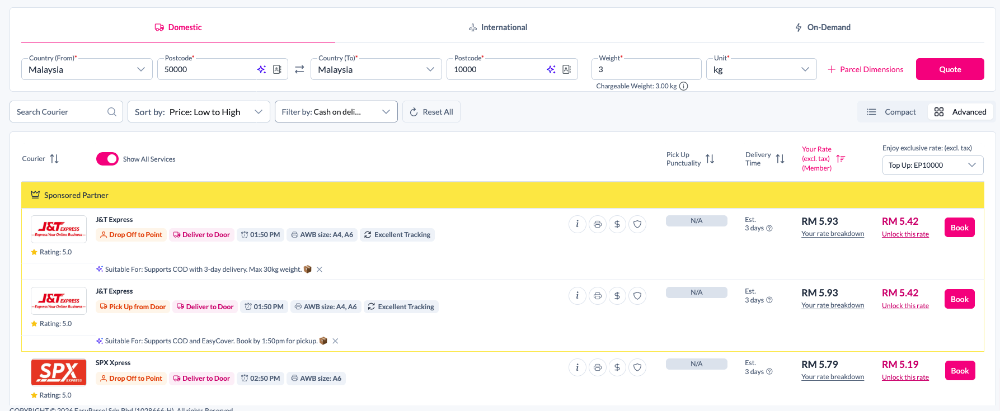
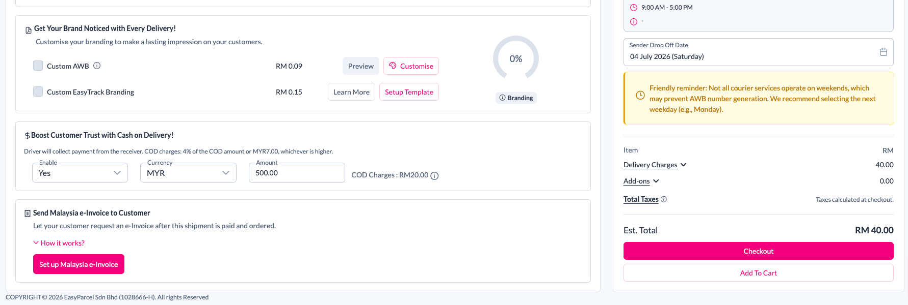

# EasyParcel COD — Verified Rules & UI-vs-API Proof (GH-1333 / F36)

> Generated 2026-07-03 · Account: Prime Commerce EasyParcel **Sandbox**
> Test setup: Route KL 50000 → Penang 10000 · Weight 2kg · Courier **J&T Express**
> Method: manual order creation on the EP portal (empirical — not trusting API/docs)

## Purpose

Learn EasyParcel's **actual** COD rules by testing the portal by hand, prove where
EP enforces them, then apply the same rules to our codebase so our app and EP stay
in sync.

## TL;DR

EasyParcel enforces COD limits **only in the Portal UI (client-side)**. The API
(`submit_orders` / `shipment/quotations`) exposes the limits as metadata but does
**not** reject out-of-range values. → **Our app must enforce COD rules itself; never
trust API acceptance.**

## Where EP enforces (verified)

| Layer | COD min/max | Non-COD courier | Region (East MY) | Evidence |
|---|:--:|:--:|:--:|---|
| **EP Portal UI** | ✅ blocks | ✅ hides | ❌ allows COD | Cases A, B, C, D |
| **EP API** | ❌ accepts | ❌ accepts | ❌ accepts | `ep-cod-matrix-260702.md` |

> **EP does NOT restrict COD by region** — East MY COD is accepted in both UI and API
> (Case D). All 4 direction cases (W→W, W→E, E→W, E→E) have ≥1 COD courier; the
> courier set shrinks as East is involved (see matrix table below).

### COD courier coverage by direction (from `ep-cod-matrix-260702.md`)

| Direction | COD couriers | Count |
|---|---|:--:|
| **W → W** | Aramex, DHL, J&T, Lazada, Pos, Poslaju, SPX | 7 |
| **W → E** | DHL, J&T, Pos, Poslaju, SPX (Labuan: 4) | 4–6 |
| **E → W** | DHL, J&T, Pos, Poslaju | 4 |
| **E → E** | DHL, J&T, Pos, Poslaju (Labuan: 3) | 3–4 |

Common to all routes: **DHL, Pos, Poslaju**; J&T all except Labuan. Origins tested:
West·KL and East·Sabah only (Sarawak/Labuan as *sender* untested; sender = merchant
warehouse, usually fixed).

**Sender East·Sabah — UI verified (2026-07-03):** pickup = Kota Kinabalu 88000,
courier J&T, COD RM500 → order placed on both routes:
E→W (Penang, cước RM6.23) and E→E (Sabah, cước RM48.58), COD fee RM20 (4%) each.
Confirms R4 (no region block) holds for East sender too. Sarawak/Labuan sender still untested.

### DECISION (2026-07-03) — follow EP, self-enforce

Adopt EP's own logic: **no hardcoded region block**. COD eligibility is decided
**per-route, live** from the quotation (`cod.available` + per-courier min/max), and
**enforced by our own code** (never trust API acceptance — verified this session).
Region eligibility becomes emergent: unsupported routes simply return
`cod.available=false` / fewer couriers. **This supersedes the earlier "West-MY
default, East blocked" default** in PRD F36 and `cod-block.ts`.

## Verified COD rules

| # | Rule | Verified value (J&T, this route) | Matches docs? | Status |
|---|------|----------------------------------|:--:|:------:|
| R1 | COD amount ≤ courier **max** | max = **RM1000** | ✅ PRD L92 | ✅ Case A |
| R2 | COD amount ≥ courier **min** | min = **RM7.50** | ✅ PRD L92 | ✅ Case C |
| R3 | Only COD-capable couriers selectable | non-COD couriers hidden | ✅ PRD L72 | ✅ Case B |
| R4 | Region eligibility | EP allows **all** routes with a COD courier | follow EP (no hardcode) | ✅ Case D |
| R5 | COD **fee** = max(4% × amount, flat) | flat = **RM7.00**, rate = 4% | ✅ PRD L92 | ✅ Case A+C |

> **Confirmed vs docs:** `docs/prd/F36-easyparcel-delivery.md` L92 already records
> "J&T 7.5–1000 RM" and "Fee: max(flat, 4%)" — the sandbox UI matches exactly.
> Min/max are **per-courier**, read live from quotations (`cod.available` +
> `min_cod_amount` / `max_cod_amount`). J&T = 7.50–1000; others differ (see matrix).
> R5 flat floor now verified = RM7.00 (fee at RM0.50 was RM7; at RM5000 was RM200 = 4%).

## Case evidence

### Case A — COD above courier max → UI blocks
COD enabled, **Amount = RM 5,000.00** (> J&T max RM1000). UI red error, order blocked:

> **"Courier only support COD amount lesser or equal to RM1000."**

(COD fee shown = RM200 = 4% of 5000, confirming R5.)

### Case C — COD below courier min → UI blocks
COD enabled, **Amount = RM 0.50** (< J&T min RM7.50). UI red error, order blocked:

> **"Applicable for parcel with COD amount greater than RM7.50."**

(COD fee shown = RM7.00 flat floor — 4% of 0.50 is below the floor, confirming R5.)

### Case B — non-COD couriers hidden
With **Filter by: Cash on delivery** applied, couriers without COD support drop out
of the quote list (only J&T, Pos MELPlus remain). Cannot pick a non-COD courier for
a COD shipment.

> Observed: with COD filter on, list = J&T, SPX Xpress (COD-capable); City-Link,
> KEX, Skynet, Best Global, Celsius (no COD) all removed.

### Case D — East MY: EP allows COD
Receiver = Kuching **93000, Sarawak** (East MY), courier J&T, COD **RM500** enabled.
**No error — order can be placed.** COD fee RM20 (4%), delivery RM40 (higher than
West's RM5.93, but accepted). EP imposes **no region restriction** on COD.

> ⇒ Decision: **follow EP** — drop the hardcoded East-MY block; gate COD by live
> `cod.available` per route instead (see DECISION above).

### Contrast — API accepts all of the above
Per `ep-cod-matrix-260702.md`, the API accepted COD orders that were over-limit,
under-limit, on non-COD couriers, and to East MY — **no rejection**. Enforcement is
entirely on the caller.

## Handoff for dev (spec — not implemented in this session)

> This section documents verified rules only. **No code changes made here.** Dev to implement.

1. Read `cod.available` + per-courier `min`/`max` **live** from quotations (already normalized in `get-rates.ts`).
2. Gate COD **server-side** on order creation: enforce R1 (≤ max), R2 (≥ min), R3 (courier must support COD).
3. Mirror the same gate in our order-detail UI for parity.
4. **No hardcoded region block** — eligibility comes from `cod.available` per route (R4 decision above).
5. **Gap today:** `src/lib/shipping/cod-block.ts` does the *wrong* thing — it hardcodes an East-MY block and does **not** enforce R1/R2/R3. Rework: drop the region hardcode, enforce COD via live quotation instead.
6. Fee (R5) = max(4% × amount, RM7) — informational, do not block on it.

## Screenshots (in `./assets/`)

- `j&t-cod-max.png` — RM5000, red "≤ RM1000" error + fee RM200 (Case A) ✅ added
- `j&t-cod-min.png` — RM0.50, red "> RM7.50" error + fee RM7 (Case C) ✅ added
- `couriers-cod-filter.png` — COD-filter quote list (Case B) ✅ added
- `east-cod-j&t.png` — Sarawak 93000, J&T COD RM500 accepted (Case D) ✅ added

## Open items

- All 4 rules (R1–R5) verified on sandbox. Ready to fold into PRD/design F36.
- Confirm whether R1/R2 error text is per-courier dynamic or fixed wording (J&T only tested).
- Region policy (R4) is a product decision — confirm if East MY COD stays blocked
  or opens later (EP supports it either way).
