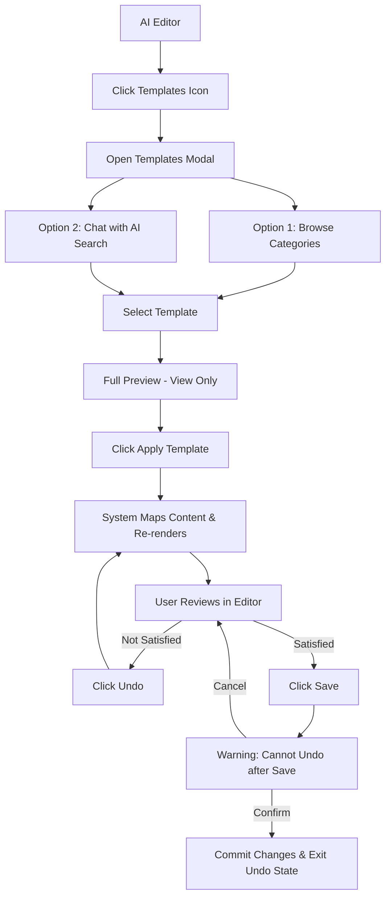

# PRD: Template Gallery — AI Editor Integration (F07)
> **Version:** 2.2 | **Updated:** 2026-03-19 | **Agent:** `Antigravity-BA-Copilot`
> **Priority:** P1 | **Sprint:** Wave 3 | **Size:** L
> **Depends on:** F05 AI Editor, F04 Block Renderer

---

> [!IMPORTANT]
> **Stories-First Rule:**
> PRD này PHẢI được xây dựng dựa trên các User Stories đã tồn tại và được approve.
> - Mọi Acceptance Criteria (Section 11) phải được copy từ file story, KHÔNG tự viết mới.
> - Mọi Functional Requirement (Section 7) PHẢI có Story ID tham chiếu trong cột `Story Ref`.
> - Nếu FR không có story cover → đó là scope chưa approve → tạo story mới trước, sau đó mới update PRD.
> - **Rule:** Stories → PRD. Không bao giờ ngược lại.


---

## 0. Story Traceability

> **[BẮT BUỘC]** Liệt kê đầy đủ các User Stories mà PRD này implement.
> Tham chiếu file stories tại `docs/stories/F07-template-gallery-stories.md`.

| Story ID | Title | File | Status |
|----------|-------|------|--------|
| US-F07-04 | AI-Powered Template Search | [F07-template-gallery-stories.md](../stories/F07-template-gallery-stories.md) | Ready |
| US-F07-05 | Content-Preserving Template Swap | [F07-template-gallery-stories.md](../stories/F07-template-gallery-stories.md) | Ready |
| US-F07-06 | Undo Template Application | [F07-template-gallery-stories.md](../stories/F07-template-gallery-stories.md) | Ready |
| US-F07-07 | Full Preview (View Only) | [F07-template-gallery-stories.md](../stories/F07-template-gallery-stories.md) | Draft |
| US-F07-08 | Mobile Web UX — Touch-Friendly Template Gallery | [F07-template-gallery-stories.md](../stories/F07-template-gallery-stories.md) | Ready |

> ⚠️ **Kiểm tra:** Mọi FR trong Section 7 phải có Story ID ở bảng trên.

---

## 1. Problem Statement

Người dùng đang trong quá trình chỉnh sửa website (AI Editor) có nhu cầu thay đổi toàn bộ phong cách thiết kế (template) mà không muốn mất đi những nội dung (text, image) đã dày công chuẩn bị. Hiện tại gallery chỉ hỗ trợ tạo site mới, gây gián đoạn trải nghiệm và mất dữ liệu nội dung hiện có.

---

## 2. Target User

- SME owner muốn thử nghiệm các giao diện khác nhau cho cùng một nội dung.
- Người dùng muốn tìm kiếm nhanh mẫu thiết kế bằng ngôn ngữ tự nhiên.
- Designer muốn đổi "lớp áo" cho website mà không cần copy paste nội dung thủ công.

---

## 3. Solution Overview

> **What are we building and why?**

Tích hợp Template Gallery vào AI Editor như một module chức năng. Người dùng có thể:
1. **Chat với AI** để tìm mẫu thiết kế phù hợp (AI Search).
2. **Preview** mẫu thiết kế mới với chính nội dung hiện tại của mình.
3. **Apply** template mới bằng cơ chế "Smart Mapping" nội dung (Text/Image).
4. **Undo** nếu không hài lòng trước khi thực hiện Lưu (Save).

---

## 4. Scope

### In Scope
- Template Gallery nằm trong AI Editor (F05) — (US-F07-04, US-F07-07)
- ≥ 10 templates (Ẩm thực, Thể thao, Báo chí, Beauty, Tech, Portfolio...)
- AI Search Modal: 1-line chat input (UI tương tự Gemini) — (US-F07-04)
- Cơ chế Apply & Smart Mapping hình ảnh/text hiện có sang template mới — (US-F07-05)
- Tính năng Undo trạng thái Editor (1 bước) — (US-F07-06)
- Xem trước Full Preview (View only) trong modal/fullscreen — (US-F07-07)
- Hiệu ứng chuyển đổi mượt mà giữa các template — (US-F07-05)

### Out of Scope
- Chỉnh sửa trực tiếp trên chế độ Preview.
- Custom Template Creation từ phía người dùng.

---

## 5. Success Metrics

| Metric | Target | Measured By |
|--------|--------|-------------|
| Template Swap Time | < 2 seconds | Telemetry |
| Data Retention Rate | 100% (cho các block tương ứng) | QA Testing |
| AI Search Accuracy | > 85% relevant results | User Feedback |
| Template Weight | Medium/Optimized | LCP / PageSpeed |

---

## 6. User Story Summary

> AC đầy đủ nằm trong Section 11. Đây là bản tóm tắt để dễ đọc.

```
AS A  user đang trong AI Editor
I WANT TO tìm và áp dụng template mới bằng AI search với nội dung được giữ lại
SO THAT tôi có thể thay đổi thiết kế mà không mất công nhập lại nội dung
```

> Source Stories: [US-F07-04](../stories/F07-template-gallery-stories.md#us-f07-04) | [US-F07-05](../stories/F07-template-gallery-stories.md#us-f07-05) | [US-F07-06](../stories/F07-template-gallery-stories.md#us-f07-06) | [US-F07-07](../stories/F07-template-gallery-stories.md#us-f07-07)

---

## 7. Functional Requirements

> **[BẮT BUỘC]** Cột Story Ref PHẢI được điền. FR không có story tham chiếu = scope chưa approve.

| FR-ID | Requirement | Story Ref | Priority | Notes |
|-------|-------------|-----------|----------|-------|
| FR-01 | AI Search Popup: 1-line chat input | US-F07-04 | P0 | UI giống chat Gemini |
| FR-02 | Search templates by natural language, trả kết quả trong < 2s | US-F07-04 | P0 | "Tìm mẫu cho phòng gym" |
| FR-03 | List ≥ 10 templates trong editor sidebar/modal | US-F07-04 | P0 | Đồng nhất layout |
| FR-04 | Smart Mapping: Giữ lại Text/Image khi đổi template | US-F07-05 | P0 | Copy blocks content |
| FR-05 | Hiển thị thông báo khi block không có tương ứng ở template mới | US-F07-05 | P1 | Edge case handling |
| FR-06 | Smooth Transition: Hiệu ứng chuyển đổi ≤ 500ms | US-F07-05 | P1 | Fade/Glide animation |
| FR-07 | Full Preview (View Only) dạng modal fullscreen | US-F07-07 | P0 | iframe sandbox |
| FR-08 | Nút "Apply This Template" visible trong Preview mode | US-F07-07 | P0 | Fixed bottom button |
| FR-09 | Undo Mechanism: Hoàn tác trạng thái 1 bước trước khi apply | US-F07-06 | P0 | Editor state stack |
| FR-10 | Undo bị overwrite nếu apply template tiếp theo | US-F07-06 | P0 | Single-step undo |
| FR-11 | Guard Rail: Cảnh báo không thể Undo sau khi Save | US-F07-06 | P0 | Modal confirmation |
| FR-12 | Nút Undo disabled/ẩn sau khi Save thành công | US-F07-06 | P1 | UI clarity |
| FR-13 | **[Mobile]** Giao diện Modal Template Gallery chuyển đổi thành Bottom Sheet (swipe up/down) trên viewport < 768px. | US-F07-08 | P1 | Ergonomics |
| FR-14 | **[Mobile]** Template list hiển thị dưới dạng grid 2 cột để tiết kiệm không gian và tăng số lượng mẫu được xem lướt. | US-F07-08 | P1 | |

> **Priority key:** P0 = must have (blocker) / P1 = important / P2 = nice to have

---

## 8. Business Rules

> Rules that define correct system behavior — independent from UI.

- **BR-01:** Phải có ít nhất 10 templates đa ngành nghề (F&B, Sports, News, Portfolio...).
- **BR-02:** Dữ liệu người dùng (Text/Image) phải được bảo toàn khi đổi template (áp dụng cho các block cùng loại).
- **BR-03:** Tính năng Undo chỉ khả dụng 01 bước duy nhất (revert về trạng thái ngay trước đó). Không hỗ trợ lịch sử (history) nhiều bước.
- **BR-04:** Sau khi bấm SAVE, trạng thái Undo cũ sẽ bị xoá bỏ và ghi đè bằng trạng thái mới.
- **BR-05:** Template phải đạt tiêu chuẩn: Thẩm mỹ cao, layout đa dạng nhưng tối ưu (không bloating), đảm bảo tốc độ load.
- **BR-06:** Nếu hệ thống lỗi trong quá trình swap, bắt buộc rollback về trạng thái cũ — không được để mất dữ liệu content.
- **BR-07:** **[Performance]** Sử dụng cơ chế Cuộn vô cực (Infinite Scroll) thay vì gọi 1 lần toàn bộ danh sách. Bắt đầu fetch thêm Template khi user cuộn gần tới đáy danh sách Grid.
- **BR-08:** **[Security]** Modal Preview nhúng Iframe bắt buộc mang cờ bảo mật `sandbox="allow-scripts allow-same-origin"` để vô hiệu hóa target="_top", ngăn rủi ro Clickjacking.
- **BR-09:** **[UX Auth]** Flow Đăng nhập (Login): Nếu Guest bấm Template, trạng thái Template ID được ghi nhớ truyền qua route Auth. Ngay khi cấp Login/Token thành công hệ thống tự động bắt tiếp luồng tạo Site ngay lập tức, không bắt quay về Dashboard.
- **BR-10:** **[Growth]** Shareability Deep Link: Khi truy cập `domain.com/templates?previewId=XYZ`, hệ thống tự hook ID và Open Overlay Modal Template tức thì.
- **BR-11:** **[UI Rule]** Chức năng "Clear Filter" được ẩn ý qua tab "All" cố định. Click `All` sẽ gỡ nhãn Category/Tag đang ngắm.

---

## 9. User Flow



---

## 10. Screen Layout

> **[Global CMS Constraint]** Tính năng Template Gallery được mở dưới dạng popup/modal hoặc sidebar đè lên AI Editor F05.

> **[BẮT BUỘC]** Liệt kê chi tiết các màn hình (screens) và các state quan trọng (ví dụ: Empty, Loading, Error, Success). Mỗi màn hình cần mô tả UI component chính và luồng hiển thị.

### 10.1. Màn hình chính (Templates Modal / Popup)
- **Mô tả:** Nơi cho phép hiển thị list templates và tương tác tìm kiếm AI.
- **Components chính:**
  - Search Bar: Form nhập liệu văn bản với kiểu Gemini-style chat input.
  - Template Grid: Lưới hiển thị Card cho các templates.
  - Card Item: Thumbnail ảnh, Tiêu đề template, Nút [Apply], [Preview].
- **Wireframe:**
```text
┌─ AI Editor ─────────────────────────────────────────────┐
│  [Templates Icon] → Opens Modal                          │
│                                                          │
│  ┌─ Templates Modal ──────────────────────────────────┐  │
│  │  [🔍 Chat: "tìm mẫu nhà hàng..."]                 │  │
│  │  ─────────────────────────────────────────         │  │
│  │  [Template Card 1] [Template Card 2] [Card 3]      │  │
│  │  [Template Card 4] [Template Card 5] [Card 6]      │  │
│  │                                                    │  │
│  │  [Preview] [Apply Template]  ← per card buttons   │  │
│  └────────────────────────────────────────────────────┘  │
│                                                          │
│  After Apply:                                            │
│  [Undo ↩] button appears in Editor toolbar              │
└──────────────────────────────────────────────────────────┘
```

### 10.2. Màn hình Chi tiết (Full View-Only Preview Mode)
- **Mô tả:** Fullscreen modal để xem trước kết quả áp dụng Template với dữ liệu site hiện tại.
- **Components chính:**
  - Header Navbar (Fixed): Nút tắt chế độ Preview, Nút [Apply This Template] ở trên cùng.
  - Iframe Content Area: Trang web rendered bởi component view-only (disable events).
- **Wireframe:**
```text
Full Preview Mode (fullscreen modal):
┌──────────────────────────────────────────────────────────┐
│  [✕ Close]                    [Apply This Template ▶]   │
│  ──────────────────────────────────────────────────────  │
│  [Template rendered full page — view only]               │
└──────────────────────────────────────────────────────────┘
```

### 10.3. Mobile View (Bottom Sheet Gallery)
- **Mô tả:** Gallery chọn Template được đổi kiểu thành Bottom sheet vuốt từ dưới lên, danh sách Card chia 2 cột.
- **Wireframe:**
```text
┌─ Mobile AI Editor ──────────────────────────┐
│ [≡] Website             [Preview][Publish]  │
│ ─────────────────────────────────────────── │
│ ...                                         │
│                                             │
│ ╭─ Templates (Swipe Up) ──────────────────╮ │
│ │ 🔍 Chat: "tìm mẫu quán cafe..."         │ │
│ │ ─────────────────────────────────────── │ │
│ │  ┌──────────┐      ┌──────────┐         │ │
│ │  │ [ Image] │      │ [ Image] │         │ │
│ │  │ Nhà hàng │      │ Fashion  │         │ │
│ │  └──────────┘      └──────────┘         │ │
│ │  [Apply][👁]      [Apply][👁]         │ │
│ │                                         │ │
│ ╰─────────────────────────────────────────╯ │
└─────────────────────────────────────────────┘
```

### 10.4. Các trạng thái UI (UI States) & Modals
- **Empty State:** Hình khối vector lỗi 404 + text "Không tìm thấy mẫu phù hợp" xuất hiện khi text Search vô nghiệm.
- **Loading State:** Skeleton Image Loader cho các Cards lúc đang fetching.
- **Error State / Edge Cases:** Hiện Toast + "Thử Lại" khi load templates bị timeout.
- **Modals:** (Ngoài Template Preview), hiển thị Guard Rail Warn modal (Confirmation Dialog) chống Undo khi bấm núy Save ở editor.

---

## 11. Acceptance Criteria

> **[BẮT BUỘC]** AC ở đây được copy từ file story đã approve. KHÔNG tự viết AC mới.

### AC-1: AI Search — Happy Path
> 📌 Source: [US-F07-04](../stories/F07-template-gallery-stories.md) — AC-1, AC-2

```gherkin
GIVEN user đang ở trong AI Editor
WHEN  user click vào icon Templates
THEN  Templates Modal mở ra hiển thị 1 dòng nhập liệu chat (Gemini-style)
  AND danh sách template mặc định hiển thị bên dưới dưới dạng thumbnails
```

```gherkin
GIVEN user đang mở Templates Modal với chat input
WHEN  user nhập text tìm kiếm (ví dụ: "mẫu cho shop thể thao")
  AND nhấn Enter hoặc click tìm kiếm
THEN  hệ thống trả về danh sách template liên quan trong < 2 giây
  AND kết quả hiển thị dưới dạng card thumbnails ngay trong popup
  AND nếu không có kết quả phù hợp, hiển thị thông báo "Không tìm thấy mẫu phù hợp"
```

### AC-2: Content-Preserving Swap
> 📌 Source: [US-F07-05](../stories/F07-template-gallery-stories.md) — AC-1

```gherkin
GIVEN user đã chọn 1 template mới trong Templates Modal
WHEN  user click "Apply Template"
THEN  hệ thống thực hiện mapping nội dung hiện tại sang các block tương ứng của template mới
  AND các trường dữ liệu (Header title, Hero text, Image blocks) được bảo toàn 100% nếu template mới có block tương đương
  AND quá trình chuyển đổi có hiệu ứng animation mượt mà (Smooth transition)
  AND template mới được render trong Editor trong < 2 giây
```

### AC-3: Undo & Safety Guard
> 📌 Source: [US-F07-06](../stories/F07-template-gallery-stories.md) — AC-1, AC-3

```gherkin
GIVEN user vừa apply 1 template mới trong Editor
WHEN  user nhìn vào thanh công cụ Editor
THEN  nút Undo xuất hiện rõ ràng và có thể click được
WHEN  user click nút Undo
THEN  Editor quay lại trạng thái ngay trước khi apply template (1 bước duy nhất)
  AND nội dung và template cũ được khôi phục hoàn toàn
```

```gherkin
GIVEN user đang ở trạng thái có thể Undo (sau khi apply template)
WHEN  user click nút SAVE
THEN  hệ thống hiển thị modal cảnh báo xác nhận: "Thay đổi sẽ được lưu vĩnh viễn, bạn không thể hoàn tác sau bước này."
  AND có 2 nút: "Xác nhận Lưu" và "Huỷ"
```

### AC-4: Full Preview — View Only
> 📌 Source: [US-F07-07](../stories/F07-template-gallery-stories.md) — AC-1, AC-2

```gherkin
GIVEN user đang xem danh sách templates trong Templates Modal
WHEN  user click "Preview" trên 1 template cụ thể
THEN  modal full-screen mở ra hiển thị template rendered đầy đủ với nội dung hiện tại của site
  AND người dùng có thể cuộn trang (scroll) để xem toàn bộ
GIVEN user đang ở Full Preview mode
WHEN  user thử click/tap vào các elements trong preview
THEN  không có gì thay đổi — preview chỉ là view-only
```

### AC-5: Trải Nghiệm Khách Hàng Mobile (Touch-Friendly)
> 📌 Source: [US-F07-08](../stories/F07-template-gallery-stories.md)

Khi sử dụng trên điện thoại (< 768px), hệ thống thay thế Modal giữa màn hình bằng Bottom Sheet trượt từ dưới lên (chiếm 90% chiều cao). Giao diện hiển thị các mẫu dưới dạng lưới 2 cột. Các nút "Preview" và "Apply" được làm to (tối thiểu 44x44px) để dễ chạm (Thumb-friendly tap zone).

---

### AC-6: Business Rules & Edge Cases (Security, UX & Growth)
> 📌 Source: Copilot Ambiguities Resolutions

```gherkin
GIVEN user là Guest (Chưa đăng nhập) đang xem xem 1 Template
WHEN  click nút "Use Template"
THEN  bị điều hướng sang trang Login/Register
  AND url chứa tham số `returnUrl` kèm `templateId` (Hoặc persist trong Session storage)
WHEN  đăng nhập thành công
THEN  tự động redirect đến màn hình Setup Web ban đầu có pick sẵn Template đó.

GIVEN designer upload 1 Template Master HTML
WHEN  Template chứa mã độc script đổi hướng top level `window.top.location = "malicious.com"`
THEN  khi mở Modal Preview, thao tác này bị Block ngầm bởi thuộc tính `sandbox` của iframe
  AND hệ thống Editor PrimeWeb an toàn

GIVEN user nhận được đường link chia sẻ có đính URL Query: `/editor?previewId=123`
WHEN  site khởi tạo
THEN  layer Frontend tự đọc Query Parameter và fetch dữ liệu ID 123
  AND tự động Open pop-up Preview của Template đó lập tức
```

---

## 12. Non-Functional Requirements

| Category | Requirement | Notes |
|----------|-------------|-------|
| **Performance** | Template swap re-render < 2s | |
| **Performance** | AI Search response < 2s | |
| **Security** | Preview iframe dùng sandbox để isolate | |
| **Usability** | UI Chat popup đơn giản, không che khuất quá nhiều workspace | |
| **Reliability** | Rollback đảm bảo không mất dữ liệu nếu hệ thống lỗi trong quá trình swap | |
| **Browser support** | Chrome, Safari, Edge latest 2 versions | |
| **Device support** | Desktop 1280px+, Tablet 768px | |

---

## 13. Technical Architecture

### 13.1 Components

| Component | File | Description |
|-----------|------|-------------|
| `AIEditorTemplates` | `components/editor/TemplatesPanel.tsx` | Module tích hợp trong F05-AI-Editor |
| `TemplateAISearch` | `components/editor/TemplateAISearch.tsx` | Popup component với Chat UI |
| `TemplatePreviewModal` | `components/editor/TemplatePreviewModal.tsx` | Full-screen preview modal (iframe) |
| `ContentMapper` | `utils/templateContentMapper.ts` | Utility function để map dữ liệu giữa các template schema |
| `UndoStackManager` | `store/editorUndoStore.ts` | Quản lý history của editor state (1 step) |

### 13.2 API Endpoints

```
POST /api/templates/search
Request: { query: string, locale: "en" | "vi" | "ms" }
Response: { success: boolean, data: { templates: Template[] } }
Auth: Bearer JWT (required)

GET /api/templates
Request: { category?: string, page?: number }
Response: { success: boolean, data: { templates: Template[], total: number } }
Auth: Bearer JWT (required)
```

### 13.3 Data Flow

```
[User types in AI Search] → POST /api/templates/search
  ↓
[AI/Vector Search returns matching templates]
  ↓
[User clicks Preview] → iframe loads template with current site content
  ↓
[User clicks Apply] → ContentMapper.map(currentBlocks, newTemplate.schema)
  ↓
[UndoStackManager.push(previousState)] → Editor re-renders with new template
  ↓
[User Saves] → Guard modal confirmation → Commit to DB → Clear undo stack
```

---

## 14. Dependencies

| Dependency | Status | Action Needed |
|-----------|--------|---------------|
| F05 AI Editor | ✅ | Template panel cần integrate vào editor sidebar |
| F04 Block Renderer | ✅ | ContentMapper cần hiểu block schema |
| Template content in Payload CMS | ⬜ | Cần ≥ 10 templates được chuẩn bị trước launch |
| AI Search API / Vector Search | ⬜ | Dev cần implement endpoint hoặc dùng third-party |

---

## 15. API Contract

> Full details trong Technical Architecture §13.2

```
POST /api/templates/search
Request:  { query: string, locale: string }
Response: { success: boolean, data: { templates: [{ id, name, thumbnail, category, tags }] } }

GET /api/templates
Request:  { category?: string }
Response: { success: boolean, data: { templates: [...], total: number } }
```

---

## 16. Open Questions

| # | Question | Owner | Status |
|---|----------|-------|--------|
| 1 | AI Search dùng giải pháp gì? Vector embedding (OpenAI) hay rule-based tag matching? | Tech Lead | ⬜ Open |
| 2 | Số lượng template tối thiểu để launch là bao nhiêu? (Current target: ≥ 10) | PO | ⬜ Open |
| 3 | Template có support multiple pages hay chỉ single-page trong Phase 1? | BA | ⬜ Open |
| 4 | ContentMapper xử lý conflict thế nào khi template mới có block mà source content không có? | Dev | ⬜ Open |

---

## 17. 9-Point Done Checklist

- [ ] Loading State — Skeleton cards khi đang fetch template list
- [ ] Empty State — "Không tìm thấy mẫu phù hợp" illustration khi search trả về empty
- [ ] Error State — "Không thể tải templates" kèm nút Retry
- [ ] Form Validation — N/A (search input là optional, không bắt buộc)
- [ ] Button States — "Apply Template" disabled trong khi đang swap; "Undo" disabled sau Save
- [ ] Toast Feedback — Toast success khi apply template thành công
- [ ] Auth Redirect — 401 → /login (template API yêu cầu auth)
- [ ] Mobile 375px — Templates Modal responsive, scroll-friendly trên mobile
- [ ] TypeScript Clean — `tsc --noEmit` pass

---

## 18. Definition of Ready

- [ ] User Stories approved và linked ở Section 0
- [ ] AC ở Section 11 đã được copy từ story file
- [ ] FR ở Section 7 có đầy đủ Story Ref
- [ ] Architecture doc exists (`docs/architecture/F07-template-gallery.md`)
- [ ] ≥ 10 templates ready trong Payload CMS
- [ ] AI Search API endpoint defined
- [ ] Content mapping schema logic approved

---

## 19. Definition of Done

- [ ] All FR items implemented và verified
- [ ] All AC in Section 11 pass (traced back to story)
- [ ] 9-Point Checklist all pass
- [ ] QA report written (`docs/qa/F07-template-gallery.md`)
- [ ] Hiệu ứng chuyển đổi đạt yêu cầu "Smooth" (< 500ms)
- [ ] Không xảy ra lỗi mất dữ liệu người dùng khi swap template
- [ ] Mobile responsive verified (375px)
- [ ] Non-Functional Requirements validated
