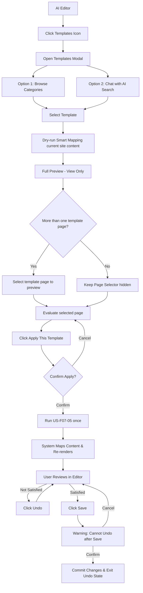

# PRD: Template Gallery — AI Editor Integration (F07)
> **Version:** 2.3 | **Updated:** 2026-09-08 | **Status:** Draft — US-F07-07 BA scope confirmed
> **Priority:** P1 | **Sprint:** Wave 3 | **Size:** L
> **Depends on:** F05 AI Editor, F04 Block Renderer

---

> [!IMPORTANT]
> **Stories-First Rule:**
> PRD này PHẢI được xây dựng dựa trên các User Stories đã tồn tại và được approve.
> - Mọi Acceptance Criteria (Section 11) phải được copy từ file story, KHÔNG tự viết mới.
> - Mọi Functional Requirement (Section 7) PHẢI có Story ID tham chiếu trong cột `Story Ref`.
> - Nếu FR không có story cover → đó là scope chưa approve → tạo story mới trước, sau đó mới update PRD.
> - **Rule:** Stories → PRD. Không bao giờ ngược lại.


---

## 0. Story Traceability

> **[BẮT BUỘC]** Liệt kê đầy đủ các User Stories mà PRD này implement.
> Tham chiếu file stories tại `docs/stories/F07-template-gallery-stories.md`.

| Story ID | Title | File | Status |
|----------|-------|------|--------|
| US-F07-04 | AI-Powered Template Search | [F07-template-gallery-stories.md](../stories/F07-template-gallery-stories.md) | Ready |
| US-F07-05 | Content-Preserving Template Swap | [F07-template-gallery-stories.md](../stories/F07-template-gallery-stories.md) | Ready |
| US-F07-06 | Undo Template Application | [F07-template-gallery-stories.md](../stories/F07-template-gallery-stories.md) | Ready |
| US-F07-07 | Full Preview (View Only) | [F07-template-gallery-stories.md](../stories/F07-template-gallery-stories.md) | Refinement — BA scope confirmed |
| US-F07-08 | Mobile Web UX — Touch-Friendly Template Gallery | [F07-template-gallery-stories.md](../stories/F07-template-gallery-stories.md) | Ready |

> ⚠️ **Kiểm tra:** Mọi FR trong Section 7 phải có Story ID ở bảng trên.

---

## 1. Problem Statement

Người dùng đang trong quá trình chỉnh sửa website (AI Editor) có nhu cầu thay đổi toàn bộ phong cách thiết kế (template) mà không muốn mất đi những nội dung (text, image) đã dày công chuẩn bị. Hiện tại gallery chỉ hỗ trợ tạo site mới, gây gián đoạn trải nghiệm và mất dữ liệu nội dung hiện có.

---

## 2. Target User

- SME owner muốn thử nghiệm các giao diện khác nhau cho cùng một nội dung.
- Người dùng muốn tìm kiếm nhanh mẫu thiết kế bằng ngôn ngữ tự nhiên.
- Designer muốn đổi "lớp áo" cho website mà không cần copy paste nội dung thủ công.

---

## 3. Solution Overview

> **What are we building and why?**

Tích hợp Template Gallery vào AI Editor như một module chức năng. Người dùng có thể:
1. **Chat với AI** để tìm mẫu thiết kế phù hợp (AI Search).
2. **Preview** mẫu thiết kế mới với chính nội dung hiện tại của mình.
3. **Apply** template mới bằng cơ chế "Smart Mapping" nội dung (Text/Image).
4. **Undo** nếu không hài lòng trước khi thực hiện Lưu (Save).

---

## 4. Scope

### In Scope
- Template Gallery nằm trong AI Editor (F05) — (US-F07-04, US-F07-07)
- ≥ 10 templates (Ẩm thực, Thể thao, Báo chí, Beauty, Tech, Portfolio...)
- AI Search Modal: 1-line chat input (UI tương tự Gemini) — (US-F07-04)
- Cơ chế Apply & Smart Mapping hình ảnh/text hiện có sang template mới — (US-F07-05)
- Tính năng Undo trạng thái Editor (1 bước) — (US-F07-06)
- Xem trước Full Preview (View only) trong modal/fullscreen — (US-F07-07)
- Full Preview trong Editor dùng current site content sau Smart Mapping dạng dry-run — (US-F07-07)
- Multi-page Preview với Page Selector nằm ngoài website preview — (US-F07-07)
- Confirmation Dialog trước khi kích hoạt Apply từ Preview — (US-F07-07)
- Hiệu ứng chuyển đổi mượt mà giữa các template — (US-F07-05)

### Out of Scope
- Chỉnh sửa trực tiếp trên chế độ Preview.
- Điều hướng, submit form hoặc thực thi CTA của website bên trong Preview.
- Ghi dữ liệu, tạo revision/Undo point hoặc tính quota Apply trong lúc chỉ Preview.
- Thay đổi bộ device viewport toggle hiện có.
- Mobile-specific Full Preview UX; phạm vi mobile của F07 được quản lý bởi US-F07-08.
- Public/Guest Preview, Auth Resume và Preview Deep Link; các nhu cầu này phải có User Story riêng trước khi đưa vào scope.
- Custom Template Creation từ phía người dùng.

---

## 5. Success Metrics

| Metric | Target | Measured By |
|--------|--------|-------------|
| Template Swap Time | < 2 seconds | Telemetry |
| Data Retention Rate | 100% (cho các block tương ứng) | QA Testing |
| AI Search Accuracy | > 85% relevant results | User Feedback |
| Template Weight | Medium/Optimized | LCP / PageSpeed |
| Preview Content Correctness | 100% đúng site, template và page được chọn | QA / Integration test |
| Preview Side-effect Rate | 0 mutation lên site/content trước khi xác nhận Apply | Audit log / Integration test |

---

## 6. User Story Summary

> AC đầy đủ nằm trong Section 11. Đây là bản tóm tắt để dễ đọc.

```
AS A  user đang trong AI Editor
I WANT TO tìm và áp dụng template mới bằng AI search với nội dung được giữ lại
SO THAT tôi có thể thay đổi thiết kế mà không mất công nhập lại nội dung
```

> Source Stories: [US-F07-04](../stories/F07-template-gallery-stories.md#us-f07-04) | [US-F07-05](../stories/F07-template-gallery-stories.md#us-f07-05) | [US-F07-06](../stories/F07-template-gallery-stories.md#us-f07-06) | [US-F07-07](../stories/F07-template-gallery-stories.md#us-f07-07)

---

## 7. Functional Requirements

> **[BẮT BUỘC]** Cột Story Ref PHẢI được điền. FR không có story tham chiếu = scope chưa approve.

| FR-ID | Requirement | Story Ref | Priority | Notes |
|-------|-------------|-----------|----------|-------|
| FR-01 | AI Search Popup: 1-line chat input | US-F07-04 | P0 | UI giống chat Gemini |
| FR-02 | Search templates by natural language, trả kết quả trong < 2s | US-F07-04 | P0 | "Tìm mẫu cho phòng gym" |
| FR-03 | List ≥ 10 templates trong editor sidebar/modal | US-F07-04 | P0 | Đồng nhất layout |
| FR-04 | Smart Mapping: Giữ lại Text/Image khi đổi template | US-F07-05 | P0 | Copy blocks content |
| FR-05 | Hiển thị thông báo khi block không có tương ứng ở template mới | US-F07-05 | P1 | Edge case handling |
| FR-06 | Smooth Transition: Hiệu ứng chuyển đổi ≤ 500ms | US-F07-05 | P1 | Fade/Glide animation |
| FR-07 | Full Preview dạng modal fullscreen, render template bằng current site content sau Smart Mapping dry-run | US-F07-07 | P0 | Unmatched target chỉ dùng template default với nhãn "Sample content" |
| FR-08 | Preview chỉ cho phép scroll; link, button, form và navigation bên trong website preview không có tác dụng | US-F07-07 | P0 | Preview shell controls vẫn hoạt động |
| FR-09 | Undo Mechanism: Hoàn tác trạng thái 1 bước trước khi apply | US-F07-06 | P0 | Editor state stack |
| FR-10 | Undo bị overwrite nếu apply template tiếp theo | US-F07-06 | P0 | Single-step undo |
| FR-11 | Guard Rail: Cảnh báo không thể Undo sau khi Save | US-F07-06 | P0 | Modal confirmation |
| FR-12 | Nút Undo disabled/ẩn sau khi Save thành công | US-F07-06 | P1 | UI clarity |
| FR-13 | **[Mobile]** Giao diện Modal Template Gallery chuyển đổi thành Bottom Sheet (swipe up/down) trên viewport < 768px. | US-F07-08 | P1 | Ergonomics |
| FR-14 | **[Mobile]** Template list hiển thị dưới dạng grid 2 cột để tiết kiệm không gian và tăng số lượng mẫu được xem lướt. | US-F07-08 | P1 | |
| FR-15 | Multi-page Preview lấy page inventory từ template được chọn; Page Selector nằm ngoài website preview và ẩn nếu chỉ có một page | US-F07-07 | P0 | Yêu cầu đúng một `isHomepage`; source mapping ưu tiên cùng role/normalized slug |
| FR-16 | Page được chọn phải được render chính xác; page không tồn tại/tải lỗi phải hiển thị Error state và không silent fallback | US-F07-07 | P0 | Có hành động Retry/Close |
| FR-17 | Nút "Apply This Template" nằm tại fixed bottom action bar, mở Confirmation Dialog và chỉ kích hoạt US-F07-05 sau khi xác nhận | US-F07-07 | P0 | Disabled/loading khi đang Apply |
| FR-18 | Mở, đóng, scroll hoặc đổi page Preview không mutate/persist site content, tạo revision/Undo point hoặc tính quota Apply | US-F07-07 | P0 | Technical telemetry/audit log vẫn được phép |
| FR-19 | Back/Close/Escape đóng Preview an toàn và trả focus về điểm mở modal | US-F07-07 | P1 | Accessibility |
| FR-20 | Preview phải kiểm tra quyền truy cập site và không hiển thị/fallback sang content của site hoặc tenant khác | US-F07-07 | P0 | Data isolation |
| FR-21 | Initial Preview p95 ≤ 3 giây, page switch p95 ≤ 2 giây; một lần tải quá 10 giây phải chuyển sang Error state | US-F07-07 | P1 | Reference test dataset / supported environment |

> **Priority key:** P0 = must have (blocker) / P1 = important / P2 = nice to have

---

## 8. Business Rules

> Rules that define correct system behavior — independent from UI.

- **BR-01:** Phải có ít nhất 10 templates đa ngành nghề (F&B, Sports, News, Portfolio...).
- **BR-02:** Dữ liệu người dùng (Text/Image) phải được bảo toàn khi đổi template (áp dụng cho các block cùng loại).
- **BR-03:** Tính năng Undo chỉ khả dụng 01 bước duy nhất (revert về trạng thái ngay trước đó). Không hỗ trợ lịch sử (history) nhiều bước.
- **BR-04:** Sau khi bấm SAVE, trạng thái Undo cũ sẽ bị xoá bỏ và ghi đè bằng trạng thái mới.
- **BR-05:** Template phải đạt tiêu chuẩn: Thẩm mỹ cao, layout đa dạng nhưng tối ưu (không bloating), đảm bảo tốc độ load.
- **BR-06:** Nếu hệ thống lỗi trong quá trình swap, bắt buộc rollback về trạng thái cũ — không được để mất dữ liệu content.
- **BR-07:** **[Performance]** Sử dụng cơ chế Cuộn vô cực (Infinite Scroll) thay vì gọi 1 lần toàn bộ danh sách. Bắt đầu fetch thêm Template khi user cuộn gần tới đáy danh sách Grid.
- **BR-08:** **[Security]** Full Preview phải được cô lập với Editor và parent window; giải pháp kỹ thuật do Tech Lead xác nhận nhưng phải đáp ứng hành vi view-only và data isolation của US-F07-07.
- **BR-09:** Matched field/block luôn dùng current site content. Unmatched target field/block/page chỉ được dùng template default content khi có nhãn "Sample content"; không được thay toàn bộ Preview bằng sample content.
- **BR-10:** Multi-page Preview dùng template page inventory và yêu cầu đúng một `isHomepage`. Smart Mapping ưu tiên source page cùng page role hoặc normalized slug; source page không có target tương ứng không hiển thị và không bị Preview thay đổi.
- **BR-11:** Page/template không hợp lệ phải trả lỗi rõ ràng; không silent fallback về Home/page đầu tiên.
- **BR-12:** CTA chuẩn trong Full Preview là "Apply This Template", luôn hiển thị tại fixed bottom action bar.
- **BR-13:** Chỉ thao tác Confirm Apply mới được kích hoạt US-F07-05. Cancel, Back, Close, Escape, scroll và đổi page không làm thay đổi site.
- **BR-14:** CTA Apply phải chống double-submit và không được tạo nhiều yêu cầu Apply cho một lần xác nhận.

---

## 9. User Flow



---

## 10. Screen Layout

> **[Global CMS Constraint]** Tính năng Template Gallery được mở dưới dạng popup/modal hoặc sidebar đè lên AI Editor F05.

> **[BẮT BUỘC]** Liệt kê chi tiết các màn hình (screens) và các state quan trọng (ví dụ: Empty, Loading, Error, Success). Mỗi màn hình cần mô tả UI component chính và luồng hiển thị.

> **[Wireframe & Design Rule]** Không cần dùng ASCII để minh hoạ. Dẫn nguồn trực tiếp từ wireframe ở thư mục design nếu có.
> **[Quy tắc Cập nhật]** Mỗi khi 1 design/wireframe mới được thêm, BẮT BUỘC phải bổ sung ở Screen Layout đường dẫn tới file đó.

### 10.1. Màn hình chính (Templates Modal / Popup)
- **Mô tả:** Nơi cho phép hiển thị list templates và tương tác tìm kiếm AI.
- **Components chính:**
  - Search Bar: Form nhập liệu văn bản với kiểu Gemini-style chat input.
  - Template Grid: Lưới hiển thị Card cho các templates.
  - Card Item: Thumbnail ảnh, Tiêu đề template, Nút [Apply], [Preview].
- **Design / Wireframe:**
  - [Link tới file wireframe/design trong thư mục docs/design/...]

### 10.2. Màn hình Chi tiết (Full View-Only Preview Mode)
- **Mô tả:** Fullscreen modal để xem trước kết quả áp dụng Template với dữ liệu site hiện tại.
- **Components chính:**
  - Header Navbar (Fixed): Back, tên template, Page Selector khi template có nhiều page và nút Close (X). Device viewport toggle hiện có không thay đổi trong US-F07-07.
  - Website Preview Area: Render đúng template, current site content và page được chọn; chỉ cho phép scroll, không cho phép edit/navigation/form action.
  - Bottom Action Bar (Fixed): CTA chuẩn [Apply This Template], luôn nhìn thấy trong mọi trạng thái scroll.
  - Confirmation Dialog: Hiển thị sau khi user click Apply; chỉ khi Confirm mới kích hoạt US-F07-05.
- **Design / Wireframe:**
  - [F07 Template Gallery — Design & Wireframe Report](../design/F07-template-gallery-design.md)

### 10.3. Mobile View (Bottom Sheet Gallery)
- **Mô tả:** Gallery chọn Template được đổi kiểu thành Bottom sheet vuốt từ dưới lên, danh sách Card chia 2 cột.
- **Design / Wireframe:**
  - [Link tới file wireframe/design trong thư mục docs/design/...]

### 10.4. Các trạng thái UI (UI States) & Modals
- **Empty State:** Hình khối vector lỗi 404 + text "Không tìm thấy mẫu phù hợp" xuất hiện khi text Search vô nghiệm.
- **Loading State:** Skeleton Image Loader cho các Cards lúc đang fetching.
- **Error State / Edge Cases:** Hiện Toast + "Thử Lại" khi load templates bị timeout.
- **Modals:** (Ngoài Template Preview), hiển thị Guard Rail Warn modal (Confirmation Dialog) chống Undo khi bấm núy Save ở editor.
- **Preview Loading State:** Hiển thị loader tại Website Preview Area khi mở Preview hoặc đổi page.
- **Preview Error State:** Hiển thị lỗi tại Website Preview Area kèm "Thử lại" hoặc "Đóng"; không hiển thị Home/sample content thay cho page/content bị lỗi.
- **Preview Applying State:** CTA Apply disabled và có loading indicator để chống double-submit.
- **Single-page State:** Không hiển thị Page Selector.
- **Unmatched Mapping State:** Template default content chỉ xuất hiện tại field/block/page không có source tương ứng và phải có nhãn "Sample content".

---


## 11. Acceptance Criteria

> **[BẮT BUỘC]** AC ở đây được copy từ file story đã approve. KHÔNG tự viết AC mới.

### AC-1: AI Search — Happy Path
> 📌 Source: [US-F07-04](../stories/F07-template-gallery-stories.md) — AC-1, AC-2

```gherkin
GIVEN user đang ở trong AI Editor
WHEN  user click vào icon Templates
THEN  Templates Modal mở ra hiển thị 1 dòng nhập liệu chat (Gemini-style)
  AND danh sách template mặc định hiển thị bên dưới dưới dạng thumbnails
```

```gherkin
GIVEN user đang mở Templates Modal với chat input
WHEN  user nhập text tìm kiếm (ví dụ: "mẫu cho shop thể thao")
  AND nhấn Enter hoặc click tìm kiếm
THEN  hệ thống trả về danh sách template liên quan trong < 2 giây
  AND kết quả hiển thị dưới dạng card thumbnails ngay trong popup
  AND nếu không có kết quả phù hợp, hiển thị thông báo "Không tìm thấy mẫu phù hợp"
```

### AC-2: Content-Preserving Swap
> 📌 Source: [US-F07-05](../stories/F07-template-gallery-stories.md) — AC-1

```gherkin
GIVEN user đã chọn 1 template mới trong Templates Modal
WHEN  user click "Apply Template"
THEN  hệ thống thực hiện mapping nội dung hiện tại sang các block tương ứng của template mới
  AND các trường dữ liệu (Header title, Hero text, Image blocks) được bảo toàn 100% nếu template mới có block tương đương
  AND quá trình chuyển đổi có hiệu ứng animation mượt mà (Smooth transition)
  AND template mới được render trong Editor trong < 2 giây
```

### AC-3: Undo & Safety Guard
> 📌 Source: [US-F07-06](../stories/F07-template-gallery-stories.md) — AC-1, AC-3

```gherkin
GIVEN user vừa apply 1 template mới trong Editor
WHEN  user nhìn vào thanh công cụ Editor
THEN  nút Undo xuất hiện rõ ràng và có thể click được
WHEN  user click nút Undo
THEN  Editor quay lại trạng thái ngay trước khi apply template (1 bước duy nhất)
  AND nội dung và template cũ được khôi phục hoàn toàn
```

```gherkin
GIVEN user đang ở trạng thái có thể Undo (sau khi apply template)
WHEN  user click nút SAVE
THEN  hệ thống hiển thị modal cảnh báo xác nhận: "Thay đổi sẽ được lưu vĩnh viễn, bạn không thể hoàn tác sau bước này."
  AND có 2 nút: "Xác nhận Lưu" và "Huỷ"
```

### AC-4: Full Preview — Current Content, Multi-page, View Only và Safe Apply
> 📌 Source: [US-F07-07](../stories/F07-template-gallery-stories.md) — AC-1 đến AC-7

```gherkin
GIVEN user đang chỉnh sửa một site trong AI Editor
  AND site có nội dung hiện tại gồm text, image và các page đã lưu hoặc đang có trong Editor
WHEN  user click "Preview" trên một template cụ thể trong Templates Modal
THEN  Full Preview modal mở ở chế độ full-screen
  AND template được render bằng nội dung hiện tại của chính site đó sau khi chạy Smart Mapping ở chế độ dry-run
  AND người dùng có thể cuộn trang (scroll) để xem toàn bộ
  AND các field/block map được luôn dùng current site content
  AND field/block đích không có source tương ứng chỉ được dùng template default content khi có nhãn "Sample content" rõ ràng
  AND không thay thế toàn bộ Preview hoặc current content đã map được bằng sample/default content
```

```gherkin
GIVEN template được chọn có nhiều hơn một page khả dụng trong template page inventory
  AND user đang ở Full Preview mode
WHEN  Full Preview được tải thành công
THEN  Page Selector hiển thị bên ngoài vùng website preview
  AND liệt kê các page của template được chọn
  AND page được template khai báo `isHomepage` được chọn mặc định
  AND template phải có đúng một page `isHomepage`; nếu thiếu hoặc có nhiều hơn một thì hiển thị lỗi theo AC-6
WHEN  user chọn một page khác
THEN  hệ thống render đúng template page được chọn
  AND ưu tiên map current site page có cùng page role hoặc normalized slug
  AND nếu không có source page tương ứng, chỉ được dùng template default content kèm nhãn "Sample content"
  AND current site page không có target template page tương ứng không xuất hiện trong Page Selector và không bị thay đổi trong quá trình Preview
  AND không tự động fallback về Home hoặc page đầu tiên nếu page được chọn không tồn tại hoặc tải lỗi
  AND hiển thị lỗi tại vùng preview kèm hành động "Thử lại"
```

```gherkin
GIVEN template chỉ có một page khả dụng trong template page inventory
WHEN  Full Preview được tải thành công
THEN  Page Selector không hiển thị
```

```gherkin
GIVEN user đang ở Full Preview mode
WHEN  user click/tap vào link, button, form field hoặc thành phần tương tác bên trong website preview
THEN  dữ liệu và trạng thái Editor không thay đổi
  AND không điều hướng sang page, route hoặc website khác
  AND không submit form hoặc thực thi CTA của website
  AND form control không nhận focus, không cho nhập dữ liệu và không thay đổi local preview state
  AND user vẫn có thể scroll để xem toàn bộ page
  AND không hiển thị editor controls hay hover effects của editor
```

```gherkin
GIVEN user đang ở Full Preview mode và hài lòng với template
WHEN  user click nút "Apply This Template" tại fixed bottom action bar
THEN  hệ thống hiển thị Confirmation Dialog trước khi thay đổi site
WHEN  user xác nhận Apply
THEN  Preview đóng lại
  AND US-F07-05 (Content-Preserving Template Swap) được kích hoạt đúng một lần
```

```gherkin
GIVEN user đang xem Confirmation Dialog của thao tác Apply
WHEN  user chọn Cancel
THEN  Confirmation Dialog đóng
  AND user vẫn ở Full Preview
  AND site không thay đổi
```

```gherkin
GIVEN user đang ở Full Preview mode
WHEN  user click nút Close (X), chọn Back hoặc nhấn phím Escape
THEN  Full Preview đóng lại
  AND focus được trả về Template Card hoặc nút Preview đã mở modal
  AND không có thay đổi nào được ghi vào site
  AND không tạo Undo point hoặc revision mới
```

```gherkin
GIVEN user mở Full Preview hoặc chuyển page trong Preview
WHEN  hệ thống đang chuẩn bị nội dung preview
THEN  hiển thị Loading state tại vùng preview
```

```gherkin
GIVEN session của user hết hạn khi mở Preview
WHEN  hệ thống nhận lỗi Authentication Required (401)
THEN  không hiển thị website content
  AND hiển thị hành động "Đăng nhập lại"
```

```gherkin
GIVEN site/template không tồn tại hoặc user không có quyền truy cập
WHEN  hệ thống nhận lỗi Forbidden (403) hoặc Not Found (404)
THEN  không tiết lộ site/template có tồn tại hay không
  AND không hiển thị content của site/tenant khác hoặc sample content để thay thế
  AND hiển thị thông báo "Preview unavailable" kèm hành động "Quay lại" hoặc "Đóng"
```

```gherkin
GIVEN Preview bị timeout hoặc render failure
WHEN  hệ thống không thể hoàn tất Preview
THEN  hiển thị Error state kèm hành động "Thử lại" hoặc "Đóng"
  AND không silent fallback về Home, page đầu tiên hoặc sample content
```

```gherkin
GIVEN user sử dụng môi trường được hỗ trợ với reference test dataset
WHEN  user mở Full Preview
THEN  Preview sẵn sàng để xem trong p95 không quá 3 giây
WHEN  user chuyển sang một page khác
THEN  page được chọn sẵn sàng để xem trong p95 không quá 2 giây
  AND nếu một lần tải vượt quá 10 giây, hệ thống dừng Loading state và hiển thị Error state theo AC-6
```

### AC-5: Trải Nghiệm Khách Hàng Mobile (Touch-Friendly)
> 📌 Source: [US-F07-08](../stories/F07-template-gallery-stories.md)

Khi sử dụng trên điện thoại (< 768px), hệ thống thay thế Modal giữa màn hình bằng Bottom Sheet trượt từ dưới lên (chiếm 90% chiều cao). Giao diện hiển thị các mẫu dưới dạng lưới 2 cột. Các nút "Preview" và "Apply" được làm to (tối thiểu 44x44px) để dễ chạm (Thumb-friendly tap zone).

---

## 12. Non-Functional Requirements

| Category | Requirement | Notes |
|----------|-------------|-------|
| **Performance** | Template swap re-render < 2s | |
| **Performance** | AI Search response < 2s | |
| **Performance** | Initial Preview p95 ≤ 3s; page switch p95 ≤ 2s trên reference test dataset; hard timeout 10s | Chuyển Error state khi timeout |
| **Security** | Preview được cô lập với Editor/parent window; chặn navigation, form action và truy cập trái phép | Tech Lead chọn giải pháp kỹ thuật |
| **Privacy / Data isolation** | Chỉ hiển thị content của site/tenant mà user có quyền truy cập; không fallback chéo dữ liệu | Blocker |
| **Reliability** | Preview không mutate/persist site content, tạo revision, Undo point hoặc Apply quota trước Confirm Apply | Technical telemetry/audit log vẫn được phép |
| **Usability** | UI Chat popup đơn giản, không che khuất quá nhiều workspace | |
| **Reliability** | Rollback đảm bảo không mất dữ liệu nếu hệ thống lỗi trong quá trình swap | |
| **Accessibility** | Escape đóng modal và focus trở về điểm mở; Preview shell controls hỗ trợ keyboard | |
| **Browser support** | Chrome, Safari, Edge latest 2 versions | |
| **Device support** | Desktop 1280px+, Tablet 768px | |

---

## 13. Technical Architecture Handoff

> Tài liệu Architecture chính thức do Tech Lead/Solution Architect sở hữu tại
> [`docs/architecture/F07-template-gallery.md`](../architecture/F07-template-gallery.md).
> PRD chỉ định nghĩa outcome và constraint nghiệp vụ; không khóa trước component, endpoint hoặc cơ chế sandbox.

Architecture Document cần xác nhận tối thiểu:

1. Cách truyền `site context`, `template` và `selected page` vào Preview dry-run.
2. Cách Smart Mapping tạo preview result mà không persist dữ liệu hoặc tiêu thụ Apply quota.
3. Authorization theo user/tenant/site và biện pháp ngăn cross-tenant data leakage.
4. Cơ chế bảo đảm website preview inert nhưng vẫn cho phép scroll.
5. Hành vi exact-page rendering và error response, không silent fallback về Home/page đầu tiên.
6. Ranh giới transaction giữa Preview, Confirm Apply và US-F07-05; Apply phải idempotent/chống double-submit.
7. Loading, timeout, retry, observability và audit evidence để QA chứng minh không có site/content mutation trước Confirm Apply.

---

## 14. Dependencies

| Dependency | Status | Action Needed |
|-----------|--------|---------------|
| F05 AI Editor | ✅ | Template panel cần integrate vào editor sidebar |
| F04 Block Renderer | ✅ | ContentMapper cần hiểu block schema |
| Template content in Payload CMS | ⬜ | Cần ≥ 10 templates được chuẩn bị trước launch |
| AI Search API / Vector Search | ⬜ | Dev cần implement endpoint hoặc dùng third-party |
| F07 Architecture update | ⬜ | Tech Lead xác nhận dry-run, authorization, isolation, exact-page và Apply boundary |
| F07 Design update | ⬜ | UI/UX đồng bộ Header, Page Selector, fixed bottom CTA, Confirmation và các UI states |
| F07 QA update | ⬜ | QA bổ sung test current content, multi-page, inert behavior, no-write và tenant isolation |

---

## 15. Business Data Contract for Preview

> Endpoint, transport và schema kỹ thuật cuối cùng do Tech Lead chốt trong Architecture Document.

| Input / Output | Business requirement |
|----------------|----------------------|
| Input identity | Phải xác định được user, tenant, site, template và selected page |
| Input content | Current site content dùng cho Smart Mapping dry-run |
| Page inventory | Danh sách page khả dụng để Preview shell tạo Page Selector |
| Preview result | Render result đúng template, current content và page được chọn; không persist |
| Error result | Phân biệt tối thiểu: unauthorized/forbidden, site/template/page not found và render failure |
| Apply command | Chỉ được gửi sau Confirm; một lần xác nhận tạo tối đa một Apply operation |

---

## 16. Open Questions

| # | Question | Owner | Status |
|---|----------|-------|--------|
| 1 | AI Search dùng giải pháp gì? Vector embedding (OpenAI) hay rule-based tag matching? | Tech Lead | ⬜ Open |
| 2 | Số lượng template tối thiểu để launch là bao nhiêu? (Current target: ≥ 10) | PO | ⬜ Open |
| 3 | Template có support multiple pages hay chỉ single-page trong Phase 1? | BA | ✅ Resolved — Multi-page nằm trong scope US-F07-07 |
| 4 | ContentMapper xử lý conflict thế nào khi template mới có block/page mà source content không có? | BA / Tech Lead | ✅ Business outcome resolved tại DEC-F07-07-01; thuật toán mapping do Tech Lead chốt |

### 16.1 BA Decision Log for Issue #193

> **Approved by PO/BA:** 2026-09-08 thông qua plan hoàn thiện BA cho US-F07-07.

| Decision ID | BA confirmation | Business rationale |
|-------------|-----------------|--------------------|
| DEC-F07-07-01 | Editor dùng current site content sau Smart Mapping dry-run. Matched content không bị thay bằng sample; unmatched target chỉ dùng template default với nhãn "Sample content". | User cần đánh giá template bằng dữ liệu thật nhưng vẫn phải nhận biết phần chưa có source. |
| DEC-F07-07-02 | Strict view-only cho website preview; scroll được, interaction/navigation/form action bị chặn. | Ngăn Preview làm thay đổi dữ liệu hoặc đưa user ra khỏi flow đánh giá. |
| DEC-F07-07-03 | "Apply This Template" ở fixed bottom và mở Confirmation Dialog; chỉ Confirm mới chạy US-F07-05. | Giảm Apply nhầm; Save guard của US-F07-06 vẫn là lớp bảo vệ riêng cho thời điểm persist cuối. |
| DEC-F07-07-04 | Multi-page giữ trong scope; selector dùng target template page inventory, yêu cầu đúng một `isHomepage`, mapping source theo role/normalized slug. | Đảm bảo user đánh giá toàn bộ layout của template và Dev có một page source-of-truth duy nhất. |
| DEC-F07-07-05 | Invalid page/template hiển thị lỗi đúng loại; không silent fallback. | Tránh user tưởng đang xem đúng page/content trong khi hệ thống đã thay thế ngầm. |
| DEC-F07-07-06 | Preview không mutate/persist site content, tạo revision, Undo point hoặc Apply quota trước Confirm; telemetry/audit log vẫn được phép. | Tách rõ hành vi đánh giá và hành vi thay đổi site. |
| DEC-F07-07-07 | Public/Guest Preview, Auth Resume, Deep Link và thay đổi device toggle không thuộc US-F07-07. | Tránh hidden scope; cần Story riêng nếu Product muốn triển khai. |

**Delivery status:** `Refinement`. BA scope đã hoàn tất; chưa chuyển `Ready for Development` cho đến khi Architecture, Design, QA handoff được cập nhật/review và Dev re-estimate.

---

## 17. 10-Point Done Checklist

- [ ] Loading State — Skeleton cards cho template list và loader tại Preview Area khi mở/đổi page
- [ ] Empty State — "Không tìm thấy mẫu phù hợp" illustration khi search trả về empty
- [ ] Error State — Template list và Preview có lỗi rõ ràng kèm Retry/Close; không silent fallback sai page/content
- [ ] Form Validation — N/A (search input là optional, không bắt buộc)
- [ ] Button States — "Apply This Template" disabled trong khi đang Apply; chống double-submit; "Undo" disabled sau Save
- [ ] Toast Feedback — Toast success khi apply template thành công
- [ ] Auth Redirect — 401 → /login (template API yêu cầu auth)
- [ ] Mobile 375px — Templates Modal responsive, scroll-friendly trên mobile
- [ ] TypeScript Clean — `tsc --noEmit` pass
- [ ] Tests Pass — Unit, integration và E2E/UAT liên quan đều pass

---

## 18. Definition of Ready

- [x] US-F07-07 BA Confirmed và linked ở Section 0
- [ ] AC ở Section 11 đã được copy từ story file
- [ ] FR ở Section 7 có đầy đủ Story Ref
- [ ] Architecture doc được Tech Lead cập nhật/review theo Section 13
- [ ] Design doc được UI/UX cập nhật/review theo Section 10.2 và US-F07-07
- [ ] QA Spec được QA cập nhật/review theo AC-4 và BA Decisions
- [ ] ≥ 10 templates ready trong Payload CMS
- [ ] AI Search API endpoint defined
- [ ] Content mapping schema logic approved

---

## 19. Definition of Done

- [ ] All FR items implemented và verified
- [ ] All AC in Section 11 pass (traced back to story)
- [ ] 10-Point Checklist all pass
- [ ] QA report written (`docs/qa/F07-template-gallery.md`)
- [ ] Hiệu ứng chuyển đổi đạt yêu cầu "Smooth" (< 500ms)
- [ ] Không xảy ra lỗi mất dữ liệu người dùng khi swap template
- [ ] Mobile responsive verified (375px)
- [ ] Non-Functional Requirements validated
- [ ] US-F07-07 xác nhận đúng current site content, đúng selected page, strict view-only và 0 side effect trước Confirm Apply
