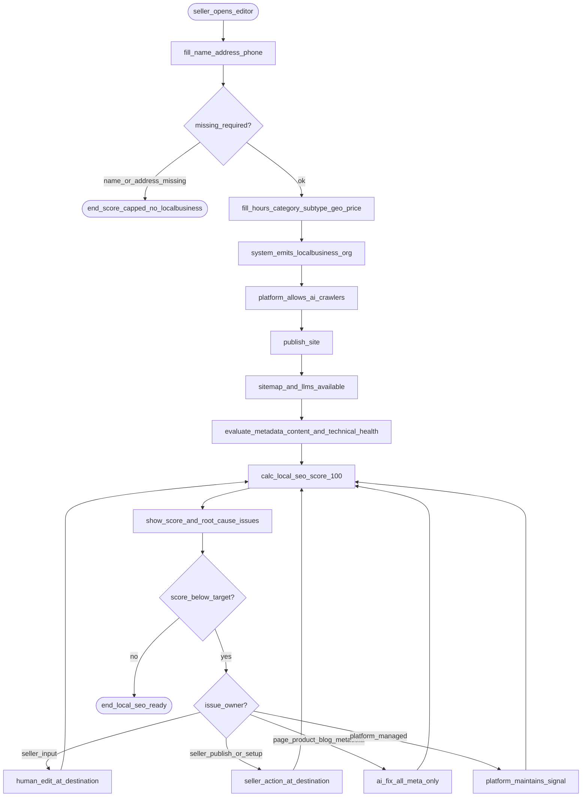

# PRD: Local SEO Score & Storefront Discoverability (F37)

> **Version:** 2.7 | **Status:** Phase 2 — Contact Info address contract reconciled 2026-08-05 | **Priority:** P0 | **Size:** L
> **Depends on:** F03 Dashboard Suite, F02 Auth, F05 Editor  
> **Replaces:** F37 PRD v1.0 (target-state rewrite)

---

## 1. Problem

SME sellers on PrimeCommerce storefronts are hard to discover in local search and AI assistants because structured local business data is incomplete and LocalBusiness JSON-LD is thin. Sellers need a single Local SEO score (0–100) that separates seller-owned inputs from platform-managed discoverability, with clear next steps in the Editor and Dashboard.

## 2. Actors


| Actor             | Type     | Goal                                                                                    |
| ----------------- | -------- | --------------------------------------------------------------------------------------- |
| SME seller (MY)   | Primary  | Complete minimal business facts, raise Local SEO score, get found via schema + crawlers |
| Platform (system) | System   | Emit JSON-LD / robots / sitemap / llms.txt; compute score; surface actionable root causes |
| F03 General SEO   | Adjacent | AI Fix All for page/product/blog meta only — does not write Local Business fields       |


## 3. Scope


### In scope

- Minimal **Business Data** in Editor (name, structured address, phone)
- **Schema completeness** signals that all affect score (LocalBusiness, subtype, hours, geo, telephone, url, priceRange, Organization)
- **AI Discoverability:** platform-managed AI crawler access, sitemap when published, llms.txt
- **Technical Health:** metadata coverage + content quality + search verification + indexability
- One unified SEO Health score 0–100 + actionable root-cause issues on **Dashboard > SEO**
- Tenant storefront only: `/sites/[slug]/*`


### Scope rule

Every criterion listed in §5 appears in the score formula. No decoration-only features.

## 4. Success Metrics


| Metric                                   | Target                                                        | Guardrail                                     |
| ---------------------------------------- | ------------------------------------------------------------- | --------------------------------------------- |
| Sellers with name + full address + phone | ≥ 60% of active sites within 14 days of ship                  | Do not count draft-only sites                 |
| Local SEO score median                   | ≥ 60 within 30 days of first Editor open after ship           | Baseline measured at feature flag on          |
| Score API p95                            | < 2s                                                          | Auth + rate limit preserved                   |
| Human issue CTA → correct destination    | ≥ 40% of sellers who see an actionable issue open its destination within session | [NEED: analytics event name if F22 not ready] |


## 5. Local SEO Score (authoritative)

**Formula:** sum of earned points; clamp 0–100.  
**Engine (target):** `src/lib/seo/local-seo-score.ts` · `GET /api/sites/[siteId]/local-seo-score`


| Bucket                      | Tiêu chí                    | Điểm | Mô tả brief                                                                 | Editable by              | Route / file                                                                                             | Màn hình                                       |
| --------------------------- | --------------------------- | ---- | --------------------------------------------------------------------------- | ------------------------ | -------------------------------------------------------------------------------------------------------- | ---------------------------------------------- |
| **Business Data** (20)      | Name                        | 7    | Tên shop — required for LocalBusiness `name`                                | Human only               | `Sites.name` · `local-seo-score.ts` · `api/sites/[siteId]/local-seo-score/route.ts`                      | Editor → Settings → Global → Brand             |
| Business Data               | Address                     | 8    | PostalAddress: Contact Info street + Local Business city/state/postcode + implicit `MY` | Human only | `Sites.contactInfo.address` + `Sites.localBusiness.{city,state,postcode}`; legacy `streetAddress` is fallback-only | Editor → Global → Contact + Local Business |
| Business Data               | Phone                       | 5    | Contact telephone                                                           | Human only               | `Sites.contactInfo.phone`                                                                                | Editor → Global → Contact                      |
| **Schema** (35)             | LocalBusiness JSON-LD       | 10   | Valid emit when name + address present                                      | Human (data) → auto emit | `src/lib/seo/json-ld.ts` → `generateLocalBusinessSchema`                                                 | Storefront head; data from Local Business form |
| Schema                      | `@type` subtype             | 4    | Compatible specific subtype selected after business category                | Human only               | `localBusiness.schemaSubtype` · versioned category→subtype mapping                                     | Editor → Local Business → Category → Subtype   |
| Schema                      | `openingHoursSpecification` | 5    | ≥1 open day (`opens`+`closes`, not closed)                                  | Human only               | `localBusiness.openingHours[]`                                                                           | Editor → Opening hours                         |
| Schema                      | `geo`                       | 4    | Finite lat + lng → GeoCoordinates                                           | Human only               | `latitude`/`longitude` · `api/local-seo/resolve-maps-link`                                               | Editor → Map / coordinates                     |
| Schema                      | `telephone` in schema       | 3    | Phone emitted on LocalBusiness                                              | Human only               | `contactInfo.phone` → json-ld                                                                            | Editor → Contact                               |
| Schema                      | `url` in schema             | 3    | Domain emitted as `url`                                                     | Human only               | `Sites.domain`                                                                                           | Site domain setup                              |
| Schema                      | `priceRange`                | 3    | Explicit field or derived from category                                     | Human only               | `priceRange` / `priceRangeForLocalBusinessCategory`                                                      | Editor → Price range                           |
| Schema                      | Organization                | 3    | Organization schema for site                                                | Platform auto            | `generateOrganizationSchema`                                                                             | Auto (brand/contact feed fields)               |
| **AI Discoverability** (15) | AI crawlers allowed         | 9    | Platform always allows approved AI assistant crawlers in robots.txt         | Platform auto            | `sites/[slug]/robots.txt/route.ts`                                                                       | Hidden system behavior                         |
| AI Discoverability          | Sitemap present             | 5    | Published site serves sitemap                                               | Human (publish)          | `sites/[slug]/sitemap.xml/route.ts`                                                                      | Editor → Publish                               |
| AI Discoverability          | llms.txt reachable          | 1    | Dynamic `/llms.txt` for storefront                                          | Platform auto            | `sites/[slug]/llms.txt/route.ts`                                                                         | Auto                                           |
| **Technical Health** (30)   | Meta title coverage         | 8    | Coverage across eligible pages, active products, and published blogs        | Human or F03 AI          | `src/lib/dashboard/seo-data.ts`                                                                          | Dashboard → SEO / Editor SEO                   |
| Technical Health            | Meta description coverage   | 8    | Coverage across eligible pages, active products, and published blogs        | Human or F03 AI          | `src/lib/dashboard/seo-data.ts`                                                                          | Dashboard → SEO / Editor SEO                   |
| Technical Health            | Content Quality             | 8    | Scale F03 content score: headings, content depth, image alt text, contact    | Human only               | `src/lib/seo/content-score.ts`                                                                           | Editor canvas / Products                       |
| Technical Health            | Technical SEO               | 6    | Search verification 3 + indexable eligible pages 3                         | Human / platform         | `Sites.seo.googleVerificationToken` · `Pages.seo.noIndex`                                                | Dashboard → SEO / Editor SEO                   |


**Coverage rules**

- Eligible metadata records: visible, non-deleted pages; active products; published blogs.
- Meta title and description each earn `floor(8 × completed / eligible)`; an empty eligible set earns 0.
- Content Quality earns `floor(F03 contentQualityScore × 8 / 100)` after F03 loads real page layouts.
- Technical SEO earns 3 points when Google verification is configured, plus `floor(3 × indexable / eligiblePages)`; an empty eligible page set earns 0.
- AI crawler access is a platform invariant and always earns 9 points; there is no seller setting or issue row.
- Sitemap earns 5 points and llms.txt earns 1 point only when the storefront is published and each route is reachable.

**F03 reuse:** User-triggered AI Fix can raise title and description coverage. It does not change Local SEO Business Data, Schema, or platform-managed signals above.

### LocalBusiness JSON-LD contract

Aligned with [schema.org/LocalBusiness](https://schema.org/LocalBusiness) and [Google Local Business structured data](https://developers.google.com/search/docs/appearance/structured-data/local-business):


| Property                    | Source              | Score link                  |
| --------------------------- | ------------------- | --------------------------- |
| `name`                      | `site.name`         | Business Name 7             |
| `address` (PostalAddress)   | canonical `contactInfo.address` + `localBusiness.{city,state,postcode}` + implicit `MY`; legacy street fallback | Address 8 + LocalBusiness 10 |
| `telephone`                 | `contactInfo.phone` | Phone 5 + telephone 3       |
| `url`                       | `site.domain`       | url 3                       |
| `@type` subtype             | `localBusiness.schemaSubtype` | subtype 4                |
| `openingHoursSpecification` | `openingHours[]`    | hours 5                     |
| `geo`                       | lat/lng             | geo 4                       |
| `priceRange`                | field / derived     | priceRange 3                |
| Organization (separate)     | site brand/contact  | Org 3                       |


**Category → subtype dropdown contract**

- `businessCategory` is the broad seller-facing category; it does not directly set JSON-LD `@type`.
- `schemaSubtype` is a second dropdown directly below Business category and is disabled until a category is selected.
- Options are filtered by a versioned `businessCategory → allowed LocalBusiness subtype[]` mapping built from the current [Google Local Business structured data documentation](https://developers.google.com/search/docs/appearance/structured-data/local-business) and [Schema.org LocalBusiness hierarchy](https://schema.org/LocalBusiness) at implementation time. Do not fetch these sources at runtime.
- Show the most specific compatible types. Example only: `Food & Beverage → Restaurant | Bakery | CafeOrCoffeeShop | FastFoodRestaurant`.
- If a category has one compatible subtype, auto-select it. If it has multiple, require an explicit seller choice.
- Changing category preserves the subtype only when still compatible; otherwise clear it and require a new choice.
- Empty subtype emits generic `LocalBusiness` and earns 0 subtype points. A compatible specific subtype emits exactly that `@type` and earns 4 points.
- Server validation MUST reject a category/subtype pair absent from the same mapping; UI filtering is not the security boundary.
- MVP stores one primary subtype. Multiple `@type` values are out of scope.


Do not emit `aggregateRating` on LocalBusiness.

## 6. Process Flow


### 6.1 Approved flow (SOURCE OF TRUTH)




### 6.2 Node reference


| Node id                                         | Description                                    |
| ----------------------------------------------- | ---------------------------------------------- |
| `seller_opens_editor`                           | Seller opens `/editor/[siteId]`                |
| `fill_name_address_phone`                       | Minimal Business Data (20 pts max)             |
| `missing_required?`                             | Name or address incomplete                     |
| `end_score_capped_no_localbusiness`             | Score without full LocalBusiness schema points |
| `fill_hours_category_subtype_geo_price`         | Remaining schema human inputs                  |
| `system_emits_localbusiness_org`                | JSON-LD generation on storefront               |
| `platform_allows_ai_crawlers`                   | Always allow approved AI assistant crawlers; +9 |
| `publish_site` / `sitemap_and_llms_available`   | Publish unlocks sitemap +5, llms +1            |
| `evaluate_metadata_content_and_technical_health` | F03 metadata, content, and technical signals   |
| `calc_local_seo_score_100`                      | Pure score function                            |
| `show_score_and_root_cause_issues`              | Dashboard > SEO card                           |
| `human_edit_at_destination`                     | Open the exact Editor/settings destination     |
| `seller_action_at_destination`                  | Publish or set up at the owning surface        |
| `ai_fix_all_meta_only`                          | Existing F03 metadata fix flow                 |
| `platform_maintains_signal`                     | No seller issue row or CTA                     |
| `end_local_seo_ready`                           | Seller done for this cycle                     |


## 7. User Stories & AC


### US-F37-01: Minimal business data

**Path:** `seller_opens_editor → fill_name_address_phone → missing_required? → end_score_capped_no_localbusiness | enrich_schema`  
**Story:** As an SME seller, I want to enter name, structured address, and phone in the Editor so that my site has the required local business facts and earns Business Data points.

**AC**

- **Happy — AC-01:** GIVEN seller is on Editor Settings Global WHEN they save name, Contact Info address, Local Business city/state/postcode, and phone THEN Business Data points for those fields are earned on next score calculation with country implicitly `MY` AND fields persist on reload.
- **Edge — AC-02:** GIVEN only name and phone are set WHEN score runs THEN Address points are 0 AND Name and Phone points are earned.
- **Error — AC-03:** GIVEN invalid phone characters WHEN seller blurs phone field THEN save is rejected with validation feedback AND previous valid phone remains.


### US-F37-02: Schema-rich local markup

**Path:** `enrich_schema → system_emits_localbusiness_org`
**Story:** As an SME seller, I want hours, business category, a compatible schema subtype, map coordinates, and price range to power JSON-LD so that search/AI systems receive complete LocalBusiness and Organization markup and I earn Schema points.

**AC**

- **Happy — AC-01:** GIVEN name+address, business category, a compatible specific schema subtype, at least one open hours row, valid lat/lng, and priceRange WHEN storefront homepage is rendered THEN LocalBusiness JSON-LD includes PostalAddress, openingHoursSpecification, geo, priceRange, and the selected `@type` AND corresponding Schema points are earned.
- **Edge — AC-02:** GIVEN all opening-hours rows are closed or incomplete WHEN score and emit run THEN `openingHoursSpecification` is omitted AND opening-hours points are 0 while other valid Schema points remain earned.
- **Error — AC-03:** GIVEN only one of lat/lng is set WHEN score and emit run THEN geo is omitted from JSON-LD AND geo points are 0 (no crash).
- **Error — AC-04:** GIVEN a subtype is incompatible with the selected business category WHEN seller saves THEN save is rejected, the previous valid pair remains, AND invalid `@type` is not emitted.


### US-F37-03: Crawlers, publish, llms.txt

**Path:** `platform_allows_ai_crawlers → publish_site → sitemap_and_llms_available`
**Story:** As an SME seller, I want the platform to maintain AI crawler access automatically and publish to expose sitemap and llms.txt so that discoverability does not require technical settings.

**AC**

- **Happy — AC-01:** GIVEN a published storefront WHEN robots.txt, sitemap.xml, and llms.txt are requested THEN approved AI assistant crawlers are allowed, sitemap returns current URLs, llms.txt returns markdown, AND all 15 AI Discoverability points are earned.
- **Edge — AC-02:** GIVEN a storefront is not published WHEN score is calculated THEN platform crawler access still earns 9 points while sitemap and llms.txt earn 0.
- **Error — AC-03:** GIVEN a published storefront cannot serve sitemap.xml or llms.txt WHEN score is calculated THEN only the unavailable route's points are withheld AND no seller-facing resubmit control is shown.

**Delivery ownership:** #1311 owns the FR-12..14 route behavior and seller-control retirement that produce these discovery facts. #1312 owns the 9/5/1 attribution, failure deductions, and integration into the approved 100-point scorecard. The point clauses remain the end-to-end product outcome, not score-engine scope for #1311.


### US-F37-04: Score, issues, fix loop

**Path:** `evaluate_metadata_content_and_technical_health → calc_local_seo_score_100 → show_score_and_root_cause_issues → fix_loop → human_edit | seller_action | ai_fix_all | platform_auto → calc_score → end_local_seo_ready`
**Story:** As an SME seller, I want one SEO Health score and a compact list of unresolved root causes so that I can use AI only for metadata and reach the exact destination for every seller-owned fix.

**AC**

- **Happy — AC-01:** GIVEN a site with all score criteria met WHEN seller opens Dashboard > SEO THEN the single SEO Health score is 100 AND SEO Issues shows All clear.
- **Edge — AC-02:** GIVEN unresolved metadata and seller-owned issues WHEN score runs THEN each root cause appears once with an `AI` or `You` badge AND its approved CTA and destination.
- **Error — AC-03:** GIVEN score API unauthorized WHEN client requests score THEN 401/403 is returned AND Dashboard shows error state without inventing a score number.
- **Happy — AC-04:** GIVEN an issue for a missing Local Business field WHEN seller clicks Edit THEN Editor opens focused on the owning Settings section.
- **Edge — AC-05:** GIVEN at least one missing title or description WHEN seller runs F03 AI Fix All THEN only those metadata records are proposed/applied AND Local Business fields are unchanged.
- **Edge — AC-06:** GIVEN multiple score metrics depend on one missing source field WHEN issues render THEN the seller sees one root-cause row, not duplicate rows for derived schema metrics.
- **Edge — AC-07:** GIVEN no AI-fixable metadata issue remains WHEN issues render THEN the AI Fix All strip is hidden.


## 8. Traceability


| US        | Path (abbrev)                       | AC        | FR        |
| --------- | ----------------------------------- | --------- | --------- |
| US-F37-01 | fill_minimal → incomplete           | AC-01..03 | FR-01..03 |
| US-F37-02 | enrich_schema → emit_jsonld         | AC-01..04 | FR-04..11 |
| US-F37-03 | crawlers → publish → sitemap/llms   | AC-01..03 | FR-12..14 |
| US-F37-04 | technical → score → dashboard → fix | AC-01..07 | FR-15..21 |


## 9. Functional Requirements


| FR-ID | Requirement                                                                                                                                         | US        | Priority |
| ----- | --------------------------------------------------------------------------------------------------------------------------------------------------- | --------- | -------- |
| FR-01 | Sites MUST store `name` editable in Editor Brand; missing → 0 of 7 Name points                                                                      | US-F37-01 | P0       |
| FR-02 | Sites MUST use `contactInfo.address` as the canonical seller-edited street, combine it with `localBusiness` city/state/postcode, and implicitly emit `MY`; legacy `localBusiness.streetAddress` is fallback-only; complete address → 8 points | US-F37-01 | P0 |
| FR-03 | Sites MUST store `contactInfo.phone`; present → 5 Phone points                                                                                      | US-F37-01 | P0       |
| FR-04 | System MUST emit LocalBusiness JSON-LD when name + address present → 10 points                                                                      | US-F37-02 | P0       |
| FR-05 | Editor MUST filter `schemaSubtype` by `businessCategory`; server validates the pair; compatible specific subtype emits as `@type` → 4 points       | US-F37-02 | P0       |
| FR-06 | System MUST emit `openingHoursSpecification` from open rows → 5 points                                                                              | US-F37-02 | P0       |
| FR-07 | System MUST emit `geo` only when both lat and lng are finite → 4 points                                                                             | US-F37-02 | P0       |
| FR-08 | System MUST emit `telephone` when phone present → 3 points                                                                                          | US-F37-02 | P0       |
| FR-09 | System MUST emit `url` when domain present → 3 points                                                                                               | US-F37-02 | P0       |
| FR-10 | System MUST emit `priceRange` when set or derived → 3 points                                                                                        | US-F37-02 | P0       |
| FR-11 | System MUST emit Organization for valid site → 3 points                                                                                             | US-F37-02 | P0       |
| FR-12 | Platform MUST always allow approved AI assistant crawlers with no seller setting or issue row → 9 points                                            | US-F37-03 | P0       |
| FR-13 | Published site MUST expose sitemap → 5 points when present                                                                                          | US-F37-03 | P0       |
| FR-14 | Storefront MUST expose dynamic llms.txt → 1 point when reachable                                                                                    | US-F37-03 | P0       |
| FR-15 | Eligible metadata records MUST earn up to 8 points for meta title coverage using §5                                                                 | US-F37-04 | P0       |
| FR-16 | Eligible metadata records MUST earn up to 8 points for meta description coverage using §5                                                           | US-F37-04 | P0       |
| FR-17 | F03 Content Quality MUST load real page layouts and scale its 0–100 result to 0–8 points                                                             | US-F37-04 | P0       |
| FR-18 | Technical SEO MUST award 3 points for Google verification plus up to 3 for indexable eligible pages                                                | US-F37-04 | P0       |
| FR-19 | `calculateLocalSeoScore` MUST implement §5 exactly; API returns score + four-bucket breakdown                                                        | US-F37-04 | P0       |
| FR-20 | Existing Dashboard `SeoHealth` MUST show one score, four compact bucket bars, and all unresolved root-cause issues in a two-column desktop grid; no per-issue point values | US-F37-04 | P0       |
| FR-21 | Every issue MUST use the actor, CTA, and destination in §12.3; AI Fix All remains metadata-only and appears only while an AI-fixable issue exists | US-F37-04 | P0       |


## 10. Non-Functional Requirements


| NFR               | Target                                                                 |
| ----------------- | ---------------------------------------------------------------------- |
| Score calculation | Pure function; deterministic for same input                            |
| Score API latency | p95 < 2s                                                               |
| Auth              | Score API requires authenticated tenant access to site                 |
| Rate limit        | Score API rate-limited (existing pattern)                              |
| Mobile Editor     | Local Business + SEO forms usable at 375px width                       |
| Isolation         | Auto-gen (JSON-LD, robots, sitemap, llms) only under `/sites/[slug]/*` |
| Security          | JSON-LD serialized safely for script embed (`serializeJsonLd`)         |


## 11. API Contract


| US / AC       | Method | Path                                                    | Success                         | Errors                                |
| ------------- | ------ | ------------------------------------------------------- | ------------------------------- | ------------------------------------- |
| US-04 / AC-01 | GET    | `/api/sites/[siteId]/local-seo-score`                   | `{ success, score, breakdown }` | 401, 403, 404, 429, 500               |
| US-02 / AC-01 | GET    | storefront page HTML                                    | JSON-LD in page                 | N/A                                   |
| US-03 / AC-01 | GET    | `/sites/[slug]/robots.txt` · `sitemap.xml` · `llms.txt` | 200 bodies                      | 404 when unpublished where applicable |
| US-02 geo     | POST   | `/api/local-seo/resolve-maps-link`                      | `{ latitude, longitude }`       | 400 invalid link                      |


## 12. UI Screens

> **Shell contract (codebase):** Nearly all seller input for F37 lives in  
> `/editor/[siteId]` (`src/app/(editor)/editor/[siteId]/page.tsx`) → right **SettingsPanel**  
> (`src/components/editor/SettingsPanel.tsx`, desktop width `SETTINGS_PANEL_WIDTH = 320`).  
> Compact: same panel inside `EditorToolsSheet` / `CompactEditorLayout`.  
> Dashboard reads score/issues; platform-managed discoverability has no seller-facing settings card.
> Wireframes: low-fi, no score chips inside form chrome, mobile noted where layout changes.


### Editor chrome (context — not a separate product screen)

```text
┌ /editor/[siteId] ─────────────────────────────────────────────────────────┐
│ Toolbar: device · undo · [Publish / Unpublish]                            │
├──────────────┬────────────────────────────┬───────────────────────────────┤
│ Sidebar 360  │ Canvas (PreviewFrame)      │ SettingsPanel 320             │
│ Chat · Comp  │ storefront preview         │ tabs: Global | SEO | Menu     │
│ · Pages      │                            │ (+ Block when block selected) │
└──────────────┴────────────────────────────┴───────────────────────────────┘
```

- **Files:** `EditorToolbar.tsx`, `EditorSidebar.tsx`, `PreviewFrame.tsx`, `SettingsPanel.tsx`  
- **Publish** (sitemap signal): Toolbar → `PrePublishModal` — not a Settings field.

---


### 12.1 Editor — Settings · Global (Brand, Contact, Local Business)


|                                           |                                                                                                      |
| ----------------------------------------- | ---------------------------------------------------------------------------------------------------- |
| **Route**                                 | `/editor/[siteId]` · Settings tab **Global**                                                         |
| **Code**                                  | `SettingsPanel.tsx` → `renderGlobalContent()` · accordions `brand` → `contact` → `localBusiness`     |
| **Local Business order (target)** | Address → Coordinates (+ map) → Category → Schema subtype → Offer → Opening hours → CompletionChecklist |
| **Save**                                  | Per-field `onBlur` → `onSiteSettingsChange` / `handleLocalBusinessChange` (autosave; no Save button) |


**Interactions**

- Blur valid field → autosave + existing success toast path.
- Invalid phone → `toast.error` + skip save (same as today).
- Paste Maps URL → Extract → `POST /api/local-seo/resolve-maps-link` → lat/lng chips + `MapsEmbedPreview`.
- Select Business category → enable and filter Schema subtype. Category change clears an incompatible subtype.
- Opening hours → `OpeningHoursEditor` (+ modal for bulk edit).
- CompletionChecklist (US-01 only): client ✓ for address / hours / category — **not** the Dashboard SEO Health actions.

**Desktop 320px — Local Business open (empty / default)**

```text
┌ SettingsPanel 320 · Global ────────────────────────────┐
│ [ Global ]  [ SEO ]  [ Menu ]                          │
│                                                        │
│ ▾ Brand                                                │
│   Business name                                        │
│   [                                              ]     │
│   Logo / Favicon … (existing)                          │
│                                                        │
│ ▾ Contact                                              │
│   Phone          [                              ]      │
│   Email          [                              ]      │
│   Address        [ canonical street address      ]      │
│                                                        │
│ ▾ Local Business                         ← default open│
│   ADDRESS                                              │
│   State (cascade first)                                │
│   [ select state                              ▾ ]      │
│   City / District          Postcode                    │
│   [ select city         ▾ ] [ select / type   ]        │
│   Country is implicit Malaysia (MY); no input          │
│   ───────────────────────────────────────────          │
│   COORDINATES                                          │
│   Paste Google Maps link                               │
│   [ https://maps…                    ] [Extract]       │
│   ▸ Enter coordinates manually (advanced)              │
│   (map preview hidden until lat+lng valid)             │
│   ───────────────────────────────────────────          │
│   CATEGORY & SCHEMA                                    │
│   Business category  [ select                     ▾ ]  │
│   Schema subtype     [ select compatible type     ▾ ]  │
│   (disabled until Business category is selected)       │
│   ───────────────────────────────────────────          │
│   OFFER                                                │
│   Price range        [ select                     ▾ ]  │
│   Service area       [ textarea                   ]    │
│   ───────────────────────────────────────────          │
│   OPENING HOURS                                        │
│   Day | Closed | Opens | Closes | edit…                │
│   Mo…Su rows (OpeningHoursEditor)                      │
│   ───────────────────────────────────────────          │
│   Checklist (form only)                                │
│   ○ Address saved   ○ Hours saved   ○ Category saved   │
└────────────────────────────────────────────────────────┘
```

**Coordinates success (inline)**

```text
│  ✓ Coordinates extracted                               │
│  Lat 3.1469   Lng 101.6955  (read-only chips)          │
│  ┌──────────────────────────────────────┐              │
│  │     MapsEmbedPreview iframe          │              │
│  └──────────────────────────────────────┘              │
```

**Error (phone / geo) — matches existing validation pattern**

```text
│  Phone  [ bad!! ]                                      │
│  ⚠ invalid phone (toast + field not saved)           │
```

**Mobile / compact (≤ fullWidth sheet)**  
Same field order inside Tools sheet Settings tab; full width; touch targets ≥44px on tabs. No field removed.

**States:** empty (placeholders) · loading (autosave ambient) · error (inline + toast) · success (values persist; Dashboard score updates on next fetch).

---


### 12.2 Editor — Settings · SEO


|           |                                                                                                       |
| --------- | ----------------------------------------------------------------------------------------------------- |
| **Route** | `/editor/[siteId]` · Settings tab **SEO**                                                             |
| **Code**  | `SettingsPanel.tsx` → `renderSeoContent()` · `OgImageEditor`                                      |
| **Scope** | **Active page** slug + meta; site-level OG image                                                      |


**Interactions**

- Slug / meta title / meta description: commit on blur (`handleSeoUpdate`).
- Homepage slug fixed `/`; non-home slug disabled when `siteStatus === 'published'` (lock message).
- OG: upload via `OgImageEditor` → `site.seo.ogImage`.

**Desktop 320px**

```text
┌ SettingsPanel 320 · SEO ───────────────────────────────┐
│ [ Global ]  [ SEO ]  [ Menu ]                          │
│ Active page: (current page title)                      │
│                                                        │
│ URL slug                                               │
│ [ /about                                   ]           │
│ (locked note if published && !homepage)                │
│                                                        │
│ Meta title                              n/60           │
│ [                                              ]       │
│ Meta description                        n/160          │
│ [                                              ]       │
│ ┌ Google preview (white SERP mock) ───────────┐        │
│ │ site name · https://domain/path             │        │
│ │ Title                                       │        │
│ │ Description snippet…                        │        │
│ └─────────────────────────────────────────────┘        │
│ Social image (OG)                                      │
│ [ OgImageEditor: preview | upload | change ]           │
└────────────────────────────────────────────────────────┘
```

**Mobile:** same stack in Tools → Settings → SEO tab.

---


### 12.3 Dashboard — unified SEO Health card (target US-F37-04)


|                   |                                                                                                                                              |
| ----------------- | -------------------------------------------------------------------------------------------------------------------------------------------- |
| **Route**         | `/dashboard` — existing SEO section                                                                                                          |
| **Code (target)** | Replace the contents of existing `SeoHealth`; §5 score from `GET /api/sites/[siteId]/local-seo-score` is the only displayed SEO score       |
| **Reuse**         | Keep existing `SeoHealth` route position, gauge primitives, and card shell; extend its data contract instead of adding a second card            |


**Interactions**

- Load the authoritative §5 score on section render; do not show the old F03 score separately.
- Remove the non-functional Score History placeholder. Use its space for four compact bucket bars in a 2×2 desktop grid; show qualitative status, not bucket point values.
- Show only unresolved root causes. Hide completed checks and deduplicate derived metrics that share one source field.
- Desktop issues use the existing two-column row pattern; mobile collapses to one column. Sort by score impact internally without showing point gain/loss.
- Each row shows one owner badge: `AI` for metadata or `You` for seller-owned data/actions.
- Metadata `Fix` opens the existing F03 AI Fix modal filtered to the affected field. Show `Fix all with AI` only when at least one AI-fixable metadata issue exists.
- `Edit`, `Set up`, and `Publish` use the destination contract below. Platform-managed signals do not create seller issue rows.
- Retry on error. Never invent a score number.

**Success**

```text
┌ SEO Health ───────────────────────────────────────────────────────────┐
│  ┌─────────┐   Business Data        ██████░░  Needs work             │
│  │   67    │   Schema               ████░░░░  Needs work             │
│  │  /100   │   AI Discoverability   ████████  Good                   │
│  └─────────┘   Technical Health     █████░░░  Needs work             │
├──────────────────────────────────────────────────────────────────────┤
│ ✦ AI can fix 2 issues automatically              [ Fix all with AI ] │
├──────────────────────────────────────────────────────────────────────┤
│ SEO issues                                                   5 open  │
│ [AI]  3 meta descriptions missing [Fix] │ [YOU] Address incomplete [Edit] │
│ [AI]  2 meta titles missing       [Fix] │ [YOU] Opening hours      [Edit] │
│ [YOU] Map location missing       [Edit] │                               │
└──────────────────────────────────────────────────────────────────────┘
```

#### Root-cause action contract

| Score metric(s) | Root-cause issue | Owner | CTA | Destination / behavior |
|---|---|---|---|---|
| Name | Store name missing | You | Edit | `/editor/[siteId]?settingsTab=global&section=brand` |
| Address + LocalBusiness JSON-LD | Business address incomplete | You | Edit | `/editor/[siteId]?settingsTab=global&section=contact&focus=address` |
| Phone + schema telephone | Phone number missing | You | Edit | `/editor/[siteId]?settingsTab=global&section=contact&focus=phone` |
| Schema subtype | Business subtype missing | You | Edit | `/editor/[siteId]?settingsTab=global&section=localBusiness&focus=schemaSubtype` |
| Opening hours | Opening hours missing | You | Edit | `/editor/[siteId]?settingsTab=global&section=localBusiness&focus=openingHours` |
| Geo | Map location missing | You | Edit | `/editor/[siteId]?settingsTab=global&section=localBusiness&focus=map` |
| URL | Primary domain missing | You | Set up | `/settings/domains` |
| Price range | Price range missing | You | Edit | `/editor/[siteId]?settingsTab=global&section=localBusiness&focus=priceRange` |
| Organization | No separate issue | System | — | Auto-emitted from valid Brand data; missing Brand remains the root issue |
| AI crawlers | No seller issue | System | — | Platform always allows approved AI assistant crawlers and awards 9 points |
| Sitemap + llms.txt | Store unpublished | You | Publish | `/editor/[siteId]?publish=1`; do not create two derived issue rows |
| Meta title | Meta titles missing | AI | Fix | Existing AI Fix modal filtered to title |
| Meta description | Meta descriptions missing | AI | Fix | Existing AI Fix modal filtered to description |
| Content headings / depth / contact | Content needs improvement | You | Edit | `/editor/[siteId]?pageId=[pageId]` → affected page canvas |
| Image alt | Product images missing alt text | You | Edit | `/products/[productId]` |
| Google verification | Search verification missing | You | Set up | **NEW field:** `/editor/[siteId]?settingsTab=seo&section=searchVerification` |
| Indexability | No seller issue | System | — | Platform maintains indexability; platform failure is operational, not a seller task |

`pageId` and `publish=1` reuse existing Editor query behavior. `settingsTab`, `section`, and `focus` are the target extension of the current `requestedTab` mechanism; an issue CTA MUST NOT ship until its destination opens and focuses correctly.

**Empty (new site)** — earned score + all unresolved root-cause issues.
**Loading** — skeleton for gauge, four bars, AI strip, and issues; no number.
**Error** — message + Retry; no score or stale breakdown.
**Complete (100)** — four full bars + “All clear”; no AI strip or issue rows.
**Mobile 375** — gauge → four bars → conditional AI strip → one-column issues; each CTA full width and ≥44px height.

## 13. Risks & Open Questions

| Item | Note |
|------|------|
| Rewire `local-seo-score.ts` | Engine must match §5 point-for-point before Dashboard surfaces score |
| F03 Content Quality wiring | `getSeoData()` must load real page layouts before scaling `contentQualityScore`; the current page query omits layout data |
| Subtype mapping freshness | Keep the category→subtype mapping as a versioned code snapshot; refresh it against Google + Schema.org during implementation and future SEO maintenance, never at request time |
| Domain setup UX | Schema `url` points depend on existing `Sites.domain` flows |
| Dual-list confusion | Editor `CompletionChecklist` (address / hours / category only) ≠ Dashboard SEO Issues (unresolved score root causes). Copy and placement must stay distinct |
| Deep-link targets | Issue CTA → the exact destination in §12.3. Extend the existing `requestedTab` pattern with stable section/focus targets; never land the seller at a generic Editor home |
| Google verification destination | Add the approved seller field at Editor → Settings → SEO → Search verification; do not ship its issue row before the destination exists |
| Platform-managed metrics | Organization, indexability, and AI crawler access never create seller tasks; monitor platform failures operationally |
| F22 events | Funnel metric for issue CTA→destination if event pipeline ready; else measure later |


## 14. Delivery Gates


### Definition of Ready

- [x] Mermaid approved (2026-07-21)
- [x] Score table locked (§5)
- [x] Scope locked: one SEO Health score + Editor data + Dashboard root-cause issues/tools on tenant storefront path
- [x] Actor/CTA/destination contract locked in §12.3
- [ ] Eng capacity for score rewire + existing Dashboard `SeoHealth` replacement

### Definition of Done

- [ ] Every AC in §7 passes (manual or automated)
- [ ] Unit tests: `calculateLocalSeoScore` matches §5 point-for-point
- [ ] E2E: unified Dashboard SEO Health card loads score; every issue CTA reaches or performs the §12.3 destination/behavior
- [ ] Storefront emits LocalBusiness / Org per FR-04..11
- [ ] Category→subtype dropdown filters correctly; invalid pairs fail server validation; emitted `@type` matches the saved subtype
- [ ] robots / sitemap / llms per FR-12..14
- [ ] Dashboard score + root-cause issues per FR-19..21
- [ ] AI Fix All hidden when no metadata issue is AI-fixable
- [ ] Derived metrics deduplicated; Organization/indexability create no seller issue rows
- [ ] Editor checklist and Dashboard SEO Issues copy remain distinct
- [ ] NFRs §10 met
- [ ] Behavior matches §6.1 Mermaid
- [ ] Docs/stories aligned with this PRD v2.6

---


## Refactor Contract (v1 → v2 target state)


| Area                   | Target state                                                                       |
| ---------------------- | ---------------------------------------------------------------------------------- |
| Score buckets          | Business 20 · Schema 35 · AI Discover 15 · Technical 30                            |
| Business fields scored | name, address, phone only                                                          |
| Schema                 | Every emitted property in §5 has points                                            |
| Technical              | Meta title 8 · meta description 8 · Content Quality 8 · Technical SEO 6           |
| Surfaces               | Editor for data; one Dashboard `SeoHealth` card for score/root-cause issues; no SEO Action Tools card |
| Engine files           | `local-seo-score.ts`, `seo-data.ts`, `content-score.ts`, `technical-score.ts`      |
|                        |                                                                                    |
