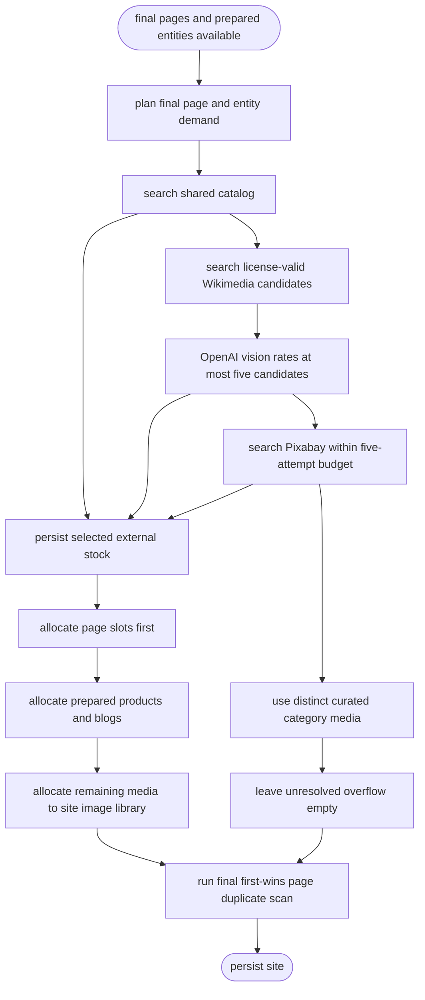

# PRD: Local-First Multi-Source Image Selection (F38)

> **Status:** Implemented; staging verification pending
> **Consumer:** F01 AI Builder image pipeline
> **Scope:** Backend generation pipeline; no UI

## 1. Decision

F38 resolves generated-site images through one local-first pipeline:

1. shared stock catalog
2. Wikimedia Commons
3. Pixabay
4. curated category media
5. empty slot

Runtime AI image generation is disabled for F38. OpenAI is used only to rate a
bounded set of license-valid Wikimedia candidates. The rating task uses
`AI_MODEL_IMAGE_RATING`; its current default is `gpt-5.4-mini`.

All F38 consumers share one resolver call during site generation. The resolver
enforces a maximum of five actual Pixabay search attempts, including key failover.
The final site pages are built before page image demand is planned.

## 2. Target Flow



## 3. Shared Reservoirs

| Reservoir | Consumers | Shape | Maximum demand |
|---|---|---|---:|
| `landscape` | Hero, about, gallery, property, carousel, video poster, site library | Landscape | 12 |
| `square` | Portfolio and gallery-style square media, site library | Square-compatible | 6 |
| `people` | Team, testimonial, social-proof portraits, site library | Square-compatible | 6 |
| `products` | Menu-food blocks and prepared sample products | Square-compatible | 6 |
| `blogs` | Prepared blog thumbnails | Landscape | 3 |

Reservoirs are processed in the fixed order shown above. Zero-demand reservoirs
are skipped. A catalog or Wikimedia hit can eliminate a Pixabay request.

Under F38, `PIXABAY_BLOCKS` does not control page slot discovery. The final-page
planner uses its own persisted Media-field map and excludes logos and URL-only
fields.

## 4. Final-Page Planning and Allocation

The planner runs after generated pages have been normalized, cloned, and finalized.
It scans only persisted numeric Media slots:

| Block | Reservoir | Persisted slot |
|---|---|---|
| `hero` | `landscape` | `image` / `backgroundImage` as one logical slot |
| `about` | `landscape` | `image` |
| `gallery` | `landscape` | `images[].image` |
| `portfolio-grid` | `square` | `projects[].image` |
| `team` | `people` | `members[].image` |
| `testimonials` | `people` | `testimonials[].avatar` |
| `property-card` | `landscape` | `properties[].image` |
| `carousel` | `landscape` | `items[].image` |
| `social-proof` | `people` | `reviews[].avatar` |
| `video` | `landscape` | `posterImage` |
| `menu-food` | `products` | `categories[].items[].image` |

Existing values in planned slots are cleared before assignment so cloned pages
cannot retain the same image. Assignment order is fixed:

1. final page slots in final page/block order
2. prepared canonical sample-product images
3. prepared canonical blog thumbnails
4. remaining site image-library slots

An image is never recycled to fill a shortage. Any unfilled page, product, blog, or
library slot remains empty. Persisting an empty F38 library mapping replaces the
site's previous mapping with an empty object so stale assignments cannot survive.

## 5. Source Selection

### 5.1 Shared catalog

The catalog is searched before external providers. Eligible rows must be active,
license-valid, category-compatible, aspect-compatible, linked to a Media record,
and backed by an existing object.

Catalog search returns at most 200 candidates. Deterministic local relevance scoring
selects winners by:

- exact normalized subject phrase: `+5`
- partial-token or approved synonym match: `+3`
- exact requested aspect: `+2`

Candidates below score `5` are rejected. Mood-only matches and category conflicts
cannot pass.

### 5.2 Wikimedia Commons

Wikimedia search requires a configured `WIKIMEDIA_USER_AGENT`. Candidates must have:

- provider image ID
- Wikimedia file-page URL
- allowlisted preview and download URLs
- creator
- reusable license name and URL
- attribution
- dimensions and compatible aspect

At most 20 candidates enter the reservoir result. OpenAI vision receives at most
five license-valid candidates per rating call and returns strict structured JSON:

```json
{
  "winnerId": "string|null",
  "relevant": true,
  "alt": "string",
  "reason": "string"
}
```

The rater uses `OPENAI_API_KEY` and `selectModel('image-rating')`, configured through
`AI_MODEL_IMAGE_RATING` with current default `gpt-5.4-mini`.

Empty results, `429`, timeout, `5xx`, invalid response, unavailable OpenAI rating,
invalid rating JSON, unknown winner, or no relevant winner are non-fatal. Wikimedia
is not retried for that reservoir; only the unresolved deficit advances to Pixabay.

### 5.3 Pixabay

`PIXABAY_API_KEYS` is a comma-separated key list. If it has no valid entry, F38
falls back to `PIXABAY_API_KEY`. Keys rotate round-robin within one warm process.

One request-scoped `PixabayAttemptBudget(limit=5)` covers every reservoir and key
failover:

- an attempt is counted immediately before an actual fetch
- a cache hit consumes no attempt
- Wikimedia requests and image-byte downloads consume no attempt
- pass 1 preserves one primary attempt for each later unresolved reservoir
- pass 2 uses only remaining attempts for eligible key failover
- `401` and `403` disable only the selected key for the process lifetime
- `429` cools only the selected key
- three consecutive `5xx` responses cool only the selected key

Successful Pixabay JSON, including valid empty results, is cached for 24 hours in
the warm process. Concurrent misses for the same canonical request are single-flight
coalesced. API keys are excluded from cache identity.

### 5.4 Curated and empty fallback

If stock sources do not fill a slot, F38 requests one distinct curated category
Media item. Runtime F38 does not invoke AI image generation. If curated media is
unavailable or duplicates an existing selection, the slot stays empty and site
generation continues.

## 6. Generation-Wide Exact Identity

One generation-wide exact-identity ledger prevents reuse across reservoirs and
downstream consumers. A candidate is rejected when any known identity has already
been claimed:

- stock provider identity: `(provider, providerImageId)`
- Payload Media ID
- DigitalOcean object key
- canonical curated URL with fragment removed and query parameters sorted

Page assignment, prepared products, prepared blogs, and image-library allocation
also share a claimed Media-ID set. After page allocation, a final first-wins scan
keeps the earliest logical page slot and clears every later duplicate Media ID.
`hero.image` and `hero.backgroundImage` represent one logical slot.

## 7. Persistence and Provenance

External stock is downloaded, validated, stored, and committed before assignment.
Permanent generated-site usage never hotlinks a provider URL.

### 7.1 Stock catalog

| Field | Rule |
|---|---|
| `provider` + `providerImageId` | Composite unique stock identity |
| `mediaId` | Required global Payload Media relationship |
| `objectKey` | Required unique DigitalOcean Spaces object key |
| `sourceUrl` | Original provider page |
| `creator` | Required for Wikimedia |
| `licenseName` / `licenseUrl` | Required reusable license |
| `attribution` | Required normalized attribution |
| `tags` / `normalizedTerms` | Local search and scoring input |
| `category` | Normalized composer category |
| `width` / `height` / `aspect` | Shape filters |
| `active` | Excludes inactive candidates from new selection |
| `useCount` / `lastUsedAt` | Observational reuse metadata |

The object key is deterministic:
`stock/{provider}/{providerImageId}.{validatedExtension}`.

### 7.2 Payload Media

Stock Media stores `sourceProvider`, `sourceUrl`, `licenseName`, `licenseUrl`, and
`attribution`. Schema changes are additive. Catalog Media is globally reusable and
system-write; tenant users cannot update or delete it.

## 8. Functional Requirements

| ID | Requirement |
|---|---|
| FR-01 | Search the shared catalog before external providers and reuse its global Media/object records. |
| FR-02 | Use the fixed fallback order catalog → Wikimedia → Pixabay → curated → empty. |
| FR-03 | Rate bounded Wikimedia candidates with OpenAI vision through the configured image-rating model. |
| FR-04 | Use `OPENAI_API_KEY` and the configured `AI_MODEL_IMAGE_RATING` task model for Wikimedia rating. |
| FR-05 | Disable runtime AI image generation for every F38 demand. |
| FR-06 | Enforce one five-attempt Pixabay budget across all reservoirs and key failover. |
| FR-07 | Plan persisted page image slots only after final pages are built and ignore `PIXABAY_BLOCKS` in this planner. |
| FR-08 | Allocate distinct media to final pages, then prepared products/blogs, then the library remainder. |
| FR-09 | Enforce generation-wide uniqueness by provider identity, Media ID, object key, and canonical curated URL. |
| FR-10 | Leave overflow empty and clear stale site library mappings when no library media remain. |
| FR-11 | Run a final first-wins duplicate Media-ID scan across final page layouts. |
| FR-12 | Persist complete stock provenance and validate external bytes before permanent use. |
| FR-13 | Keep provider, persistence, rating, and observability failures non-fatal to site generation. |

## 9. Acceptance Criteria

### AC-1 — Source order and OpenAI rating

```gherkin
GIVEN an F38 image demand is unresolved by the catalog
WHEN Wikimedia returns license-valid candidates
THEN OpenAI vision rates at most five candidates per call
AND the configured image-rating model is used
AND `OPENAI_API_KEY` authorizes rating
AND unresolved demand advances to Pixabay, curated media, then empty
```

### AC-2 — Runtime AI image disable

```gherkin
GIVEN catalog, Wikimedia, and Pixabay cannot resolve an F38 slot
WHEN runtime fallback executes
THEN AI image generation is not invoked
AND distinct curated category media is attempted
AND the slot remains empty when curated media is unavailable
```

### AC-3 — Final-page planner

```gherkin
GIVEN generated pages have been normalized and finalized
WHEN F38 image demand is planned
THEN every supported persisted non-logo slot is planned in final page order
AND PIXABAY_BLOCKS does not change the F38 plan
AND cloned values are cleared before assignment
```

### AC-4 — Allocation priority and overflow

```gherkin
GIVEN the resolver returns fewer distinct images than total demand
WHEN final allocation runs
THEN final page slots consume images first
AND prepared products and blogs consume the next distinct images
AND the site library receives only the remainder
AND no image is recycled into overflow
AND stale library assignments are cleared when the remainder is empty
```

### AC-5 — Exact uniqueness and final guard

```gherkin
GIVEN two results share a provider identity, Media ID, object key, or canonical curated URL
WHEN one generation resolves and allocates images
THEN only the first exact identity is retained
AND the final page scan keeps the first logical slot
AND every later duplicate Media ID is cleared
```

### AC-6 — Pixabay budget

```gherkin
GIVEN multiple reservoirs and failing Pixabay keys
WHEN F38 searches Pixabay
THEN no more than five actual HTTP requests occur
AND cache hits consume no attempt
AND key failover cannot consume a later reservoir's reserved primary attempt
```

### AC-7 — Persistence and reuse

```gherkin
GIVEN a selected external stock candidate passes license and byte validation
WHEN it is persisted
THEN one deterministic object and one catalog identity are committed
AND complete provider provenance is stored
AND later sites may reuse the same Media ID and object
```

## 10. Environment

| Variable | F38 use |
|---|---|
| `F38_IMAGE_PIPELINE` | Enables the F38 path |
| `WIKIMEDIA_USER_AGENT` | Required for Wikimedia requests |
| `OPENAI_API_KEY` | Authorizes Wikimedia vision rating |
| `AI_MODEL_IMAGE_RATING` | Optional rating-model override; default `gpt-5.4-mini` |
| `PIXABAY_API_KEYS` | Preferred comma-separated Pixabay key list |
| `PIXABAY_API_KEY` | Legacy fallback when the list has no valid key |

`PIXABAY_BLOCKS` is a legacy-pipeline control and is ignored by F38 final-page
planning.

## 11. Deterministic QC Contract

### 11.1 Catalog ownership, query, and assignment

- Each catalog row has one required `mediaId` relationship to one global,
  system-owned Payload Media row. Generated blocks reference that shared Media ID;
  no per-tenant Media copy is created.
- The Media row and catalog row point to the same DigitalOcean object. Cross-site
  reuse creates neither a new Media row nor a new object.
- Search filters `active=true`, complete license metadata, normalized category,
  compatible aspect, non-null `mediaId`, and non-null `objectKey` before local
  ranking.
- The object store is checked before a catalog winner is assigned. A missing object
  rejects the candidate for the current generation and emits an object-validation
  event.
- PostgreSQL full-text search OR-matches normalized subject terms and returns at
  most 200 rows, ordered by text rank descending, `useCount` ascending,
  `lastUsedAt` ascending with null first, then provider and provider image ID.
- A partial catalog result is retained. Only the unresolved deficit advances to
  Wikimedia.
- Organic warming occurs only when an approved generation selects an external
  stock candidate. F38 does not implement provider harvesting or bulk download.

### 11.2 Reservoir demand and request shape

Reservoirs are normalized once and processed in this order:

1. `landscape`
2. `square`
3. `people`
4. `products`
5. `blogs`

| Reservoir | Cap | Subject | Provider request |
|---|---:|---|---|
| `landscape` | 12 | First trusted site/product subject; otherwise category base | `per_page=200`, horizontal |
| `square` | 6 | Same site subject | `per_page=200`, all orientations |
| `people` | 6 | Literal `professional portrait` | `per_page=200`, all orientations, category `people` |
| `products` | 6 | First prepared product keyword; otherwise site subject | `per_page=200`, all orientations |
| `blogs` | 3 | First prepared blog keyword; otherwise site subject | `per_page=200`, horizontal |

Landscape compatibility is aspect ratio `>=1.25`. Square compatibility is
`0.80–1.25`, inclusive. Zero-demand reservoirs issue no catalog or provider request.
Wikimedia receives the same subject and requested aspect as the reservoir.

### 11.3 Local relevance

- Normalize with Unicode NFC, lowercase, punctuation-to-space, trim, and collapsed
  whitespace. Vietnamese diacritics are retained.
- Singular/plural and semantic equivalents exist only in the version-controlled
  `IMAGE_RELEVANCE_SYNONYMS` map. No runtime-generated synonyms are allowed.
- Category compatibility is an exact normalized category match, except the people
  reservoir requires category `people`.
- Exact subject phrase scores `+5`. Otherwise an explicit synonym or complete
  subject-token match scores `+3`. Subject scores do not stack.
- Exact aspect scores `+2`: landscape ratio `>=1.50`, or square ratio
  `0.90–1.10`. Merely compatible aspect scores zero.
- A candidate passes at score `>=5`.
- Mood-only matches, category conflicts, inactive records, invalid licenses,
  incompatible aspects, and already-claimed exact identities are rejected before
  selection.
- Winner order is score descending, `useCount` ascending, `lastUsedAt` ascending
  with null first, then provider and provider image ID.

### 11.4 Pixabay budget, cache, and single-flight

- One request-scoped `PixabayAttemptBudget` starts with `limit=5`.
- An actual attempt is counted immediately before `fetch`. HTTP errors, aborts,
  timeouts, and connection loss remain counted.
- Catalog search, Wikimedia search/rating, Pixabay cache lookup, and image-byte
  download consume no Pixabay search attempt.
- Pass 1 preserves one primary attempt for every later unresolved reservoir.
- Pass 2 retries only eligible network/auth/rate failures, in reservoir order, using
  unused budget.
- A failed reservation or exhausted budget performs no fetch.
- Successful Pixabay JSON, including a valid empty result, is cached in process for
  24 hours. Errors, aborted responses, and invalid JSON are not cached.
- The canonical SHA-256 cache key covers normalized query, image type, orientation,
  category, language, safe-search, `per_page`, and page. API keys are excluded.
- Concurrent same-key misses coalesce within one process. Only the owner performs
  and counts the fetch.
- The cache is intentionally process-local. Cold starts, redeploys, and other
  serverless instances may miss.

### 11.5 Pixabay key parsing and health

- Parse `PIXABAY_API_KEYS` by comma, trim entries, remove empty and duplicate
  values while preserving first order, and reject entries shorter than 10
  characters.
- If the list has no valid entry, validate `PIXABAY_API_KEY` by the same rule.
- Selection starts at the process cursor, chooses the first healthy key, and advances
  the cursor after selection even when the request fails.
- `401` and `403` disable only that key until process restart.
- `429` cools only that key for the positive integer seconds in
  `X-RateLimit-Reset`; invalid reset values use 60 seconds.
- Three consecutive `5xx` responses cool only that key for 60 seconds. A non-5xx
  response resets the consecutive count.
- Health uses an injectable clock. A key becomes healthy at
  `now >= cooldownUntil`.
- If every key is unhealthy, Pixabay returns unavailable without a fetch or budget
  use.
- Logs expose only safe key indexes, never key values.

### 11.6 Wikimedia license and rating

- Wikimedia requests use a configured, non-empty User-Agent.
- Search runs once per unresolved reservoir and returns at most 20 mapped candidates.
- Download and preview hosts must be `upload.wikimedia.org`; the source page must be
  HTTPS on `commons.wikimedia.org`; the license URL must be HTTPS.
- Creator, reusable license name/URL, attribution, dimensions, and compatible
  aspect are required before rating.
- OpenAI receives at most five validated low-detail previews in Wikimedia search
  order.
- The request uses `selectModel('image-rating')`, so
  `AI_MODEL_IMAGE_RATING` overrides the current `gpt-5.4-mini` default.
- Rating timeout is five seconds. The response must satisfy the strict
  `winnerId`, `relevant`, `alt`, and `reason` schema.
- A winner is accepted only when `relevant=true` and `winnerId` identifies an input
  candidate.
- Each accepted winner is removed before another bounded rating call.
- Empty search, `429`, timeout, `5xx`, invalid provider response, missing OpenAI
  configuration, preview failure, invalid rating output, unknown winner, or no
  relevant winner produces no Wikimedia retry. The unresolved deficit advances to
  Pixabay without consuming its budget.
- Accepted Wikimedia winners remain assigned when another candidate or reservoir
  fails.

### 11.7 Persistence, provenance, and licenses

- Wikimedia and Pixabay normalize into the same stock candidate contract before
  persistence.
- Pixabay provenance uses `Pixabay Content License` and
  `https://pixabay.com/service/license-summary/`.
- Wikimedia creator and attribution are mandatory. Pixabay creator may be empty,
  but normalized attribution remains required.
- External bytes are downloaded only from the allowlist and validated for content
  type, maximum size, magic bytes, and extension before object storage.
- Object keys are deterministic and path-safe:
  `stock/{provider}/{providerImageId}.{validatedExtension}`.
- Persistence serializes the stock identity with an advisory transaction lock,
  writes the global Media record and catalog row, and returns the committed winner.
- A concurrent loser re-reads the committed catalog row rather than creating a
  duplicate Media/object.
- Assignment occurs only after commit and object existence validation.
- Upload failure writes no Media/catalog row. A database failure after object upload
  assigns nothing and leaves the deterministic object available for retry or
  cleanup.
- Empty optional Media provenance is stored as null.
- Catalog identity is unique on `(provider, providerImageId)`; `objectKey` is unique.

### 11.8 Final planner, ledger, and failure behavior

- Page planning runs only after final page layouts exist. It does not call the
  legacy `getImageEnabledBlocks()` path and therefore ignores `PIXABAY_BLOCKS`.
- The planner clears every supported persisted slot before assignment. Logos and
  URL-only fields are outside F38 planning.
- Every route-generated demand sets `aiEligible=false`. The runtime resolver has no
  `generateAi` dependency.
- Final pages claim distinct Media IDs first, followed by prepared canonical
  products, prepared canonical blogs, and the image-library remainder.
- Resolver selection rejects a repeat by provider identity, Media ID, object key,
  or canonical curated URL. Canonical URL comparison removes fragments and sorts
  query parameters.
- Assignment uses one claimed Media-ID set across pages, products, blogs, and
  library.
- A shortage leaves later slots empty. Images are never padded, cycled, or reused.
- Persisting an empty library assignment replaces the previous JSON mapping with
  `{}`.
- The final page scan is first-wins. It preserves the first logical slot and clears
  later duplicate Media IDs.
- Provider, rating, download, persistence, curated, and observability failures are
  non-fatal. Already accepted winners remain available and site generation
  continues.
- Setting a catalog row inactive excludes it from new searches but does not remove
  existing site references or stored objects.

### 11.9 Schema and migration safety

- `stock_image_catalog` is created with `CREATE TABLE IF NOT EXISTS`.
- Unique and search indexes use `CREATE INDEX IF NOT EXISTS`.
- Media provenance columns are added with
  `ALTER TABLE ... ADD COLUMN IF NOT EXISTS`.
- `sites.image_library` remains the per-site slot mapping; F38 does not add a
  separate response-cache table.
- Migrations contain no `DROP TABLE`, destructive rebuild, or existing-data reset.
- Existing Media rows remain readable because new provenance fields are nullable.

## 12. Observability

Emit structured, secret-safe events and one generation summary covering:

- catalog hit, miss, rejection, and object validation
- reservoir and requested/resolved counts
- local relevance score or rejection reason
- selected provider
- Pixabay attempts used
- safe Pixabay key index and health transition
- Wikimedia search and rating failure reason
- fallback stage
- final resolved providers per reservoir

Metrics are observational and never block generation:

- Pixabay attempts per generation; hard maximum 5
- generations with zero Pixabay attempts
- catalog reservoir hit rate and slot fill rate
- selected-provider distribution
- Wikimedia empty/rate/timeout/server/rating-failure counts
- catalog reuse and within-generation duplicate rejection
- object-validation failure and inactive-asset exclusion
- unresolved and curated-filled slots

Secrets, authorization query values, full rating inputs, and business subject prompts
must not be logged.

## 13. Dependencies and Rollout

| Dependency | Required action |
|---|---|
| PostgreSQL | Apply additive catalog, index, provenance, and `sites.image_library` migration statements |
| DigitalOcean Spaces | Reuse the configured S3-compatible store and deterministic stock object keys |
| Wikimedia Commons | Configure a compliant `WIKIMEDIA_USER_AGENT` |
| OpenAI | Configure `OPENAI_API_KEY`; optionally override `AI_MODEL_IMAGE_RATING` |
| Pixabay | Configure `PIXABAY_API_KEYS` or legacy fallback `PIXABAY_API_KEY` |
| Payload Media | Keep global stock Media system-write and tenant mutation denied |
| Runtime | Enable through `F38_IMAGE_PIPELINE=true` only after staging verification |

Staging must verify source order, complete provenance, object persistence, the
five-attempt cap, distinct final allocation, empty overflow, stale library cleanup,
and graceful provider failure. Disabling the flag restores the pre-F38 compatibility
path. Source inspection and unit tests do not prove a staging or production cutover.

## 14. Non-Goals

- Runtime AI image generation under F38.
- A user-facing image-source selector or tenant setting.
- A bulk stock crawler or systematic provider downloader.
- Global round-robin coordination across serverless instances.
- Redis or database coordination solely for the key cursor or response cache.
- Embeddings, pgvector, or LLM catalog scoring.
- Replacing URL-only or logo fields with F38 Media assignments.
- A catalog-size or hit-rate rollout gate.
- Physical deletion of inactive shared stock objects.

## 15. Definition of Done

- [x] Catalog search precedes Wikimedia and Pixabay.
- [x] Wikimedia rating uses OpenAI vision and the configured image-rating model.
- [x] Runtime F38 image generation is disabled.
- [x] The shared Pixabay budget cannot exceed five actual requests.
- [x] Multi-key health and process cache are bounded and secret-safe.
- [x] Final-page demand is planned after page finalization and ignores
  `PIXABAY_BLOCKS`.
- [x] Page slots allocate before prepared products/blogs and library remainder.
- [x] Exact provider, Media, object, and canonical curated URL identities do not
  repeat within one resolver run.
- [x] Overflow stays empty and stale image-library mappings are replaced.
- [x] A final first-wins page duplicate scan clears later Media-ID repeats.
- [x] Stock objects and provenance persist through additive schema changes.
- [ ] Manual staging scenarios in the QA plan pass.
- [ ] Production enablement is separately approved.

## 16. Verification

Automated coverage and manual staging scenarios are maintained in
[the F38 QA plan](../qa/F38-image-provider-multi-source.md).
