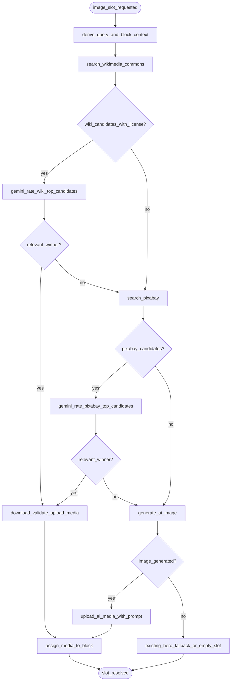

# PRD: Multi-Source Image Selection (F38)

> **Status:** Ready for implementation | **Updated:** 2026-07-20 | **Priority:** P2
> **Consumer:** F01 AI Builder image pipeline | **No UI:** backend pipeline only

## 1. Decision

Replace the obsolete Pixabay + Unsplash-router proposal with an ordered, license-aware image-selection pipeline:

1. **Wikimedia Commons**
2. **Pixabay**
3. **AI image generation**

For each stock provider, collect its top candidates and ask **`gemini-3.1-flash-lite`** to select the best image for the requested block. The first provider that returns a license-valid candidate that Gemini marks relevant wins. The selected image then uses the existing download, Payload upload, and media-assignment pipeline.

This is deliberately a source-priority fallback, not a random cross-provider pool: a valid Wikimedia result is preferred over a valid Pixabay result.

## 2. Current State (verified 2026-07-20)

- The production code is **Pixabay-only** for search: `src/lib/ai/pixabay-client.ts` is used by the image pool, per-block media pipeline, image-library seeding, sample products, and blog thumbnails.
- Existing query quality controls must remain: raw business-language keywords, optional English translation for the pool, category filtering, relevance gates, relaxed and category fallback tiers, rate-limit short-circuiting, and pool pre-upload.
- `PIXABAY_API_KEY`, `PIXABAY_BLOCKS`, and `PIXABAY_FALLBACK_ONLY` already exist. There is no `IMAGE_PROVIDER_PRIMARY`, provider router, Wikimedia client, or Gemini Vision rating step.
- Existing AI generation is an OpenAI/DALL-E hero-only rollback path behind `ENABLE_DALLE_HERO=true`. F38 extends AI generation to the final fallback for any unresolved eligible image slot.
- Payload `media` currently stores alt text and AI-generation fields only. It cannot retain stock-image source URL, license, or attribution; F38 therefore requires an additive Media schema migration.
- Curated static Unsplash fallback URLs remain an existing resilience path. They are not a searchable provider and are outside the new priority order.

## 3. Problem

Pixabay provides a working stock-image pipeline but has uneven coverage for niche businesses and multilingual searches. Reusing an image without durable provenance is also insufficient when the source has attribution or license conditions. The builder needs more relevant images while preserving a deterministic, auditable license path and the existing generation performance safeguards.

## 4. Target Flow



### Selection contract

- A candidate is eligible only when its image URL is downloadable from an allowlisted host, its image bytes pass the existing validation, and its source metadata is complete.
- Wikimedia candidates require a verified original license and attribution data before Gemini may select them.
- Gemini receives the block context, business context, and a bounded top-N candidate set from **one source at a time**. It returns structured JSON: `winnerId`, `relevant`, `alt`, and `reason`.
- Invalid JSON, timeout, unavailable Gemini key, or no relevant winner means that source does not win; continue to the next source. Gemini never authorizes a license exception.
- The selected candidate's source URL, provider, license, and attribution are stored with the uploaded Media record. AI media stores `aiGenerated=true` and its prompt.

## 5. User Stories

| ID | User story | Outcome |
|---|---|---|
| US-F38-01 | As a site owner, I receive a relevant licensed stock image for each eligible generated block. | Better visual relevance without manual sourcing. |
| US-F38-02 | As an operator, I can trace every selected stock image back to its provider, original URL, license, and attribution. | License auditability. |
| US-F38-03 | As the generation system, I fall through the approved source order without blocking site generation. | Resilient image completion. |
| US-F38-04 | As a site owner, I receive an AI-generated image only after neither stock source produced a relevant, license-valid candidate. | Spend AI credits only as final fallback. |

## 6. Functional Requirements

| ID | Requirement | Priority |
|---|---|---|
| FR-01 | Preserve the current Pixabay client and all current query/relevance safeguards. Do not regress existing Pixabay behavior. | P0 |
| FR-02 | Add a Wikimedia Commons adapter that returns normalized image candidates plus original file-page URL, creator, license name/URL, and attribution text. Reject candidates without this metadata. | P0 |
| FR-03 | Keep Pixabay second in the order and normalize its existing result shape into the shared candidate contract. Retain provider URL and photographer metadata. | P0 |
| FR-04 | Implement a provider-independent candidate contract: ID, provider, preview/download URL, original source URL, creator, license name, license URL, attribution text, dimensions, and alt seed. | P0 |
| FR-05 | Rate a bounded top-N set from each provider with stable `gemini-3.1-flash-lite`. Require schema-validated JSON and select only a candidate marked relevant. | P0 |
| FR-06 | Continue to the next provider on empty results, failed license verification, download/validation failure, Gemini failure, or no relevant candidate. Preserve existing timeout and rate-limit handling. | P0 |
| FR-07 | Use AI image generation only after Wikimedia and Pixabay fail to yield a winner. Persist the existing AI prompt and `aiGenerated=true`. | P0 |
| FR-08 | Add `sourceProvider`, `sourceUrl`, `licenseName`, `licenseUrl`, and `attribution` to Payload Media. Add the matching safe, additive SQL migration in `scripts/db-setup.js`. | P0 |
| FR-09 | Add `GEMINI_API_KEY` to both `.env.staging.example` and `.env.production.example`. Do not add a Wikimedia secret unless its selected API path requires one. | P0 |
| FR-10 | Extend the download SSRF allowlist only for verified Wikimedia hosts. Never download arbitrary result URLs. | P0 |
| FR-11 | Emit structured logs for source attempted, rejection reason, selected provider, and fallback stage. Never log keys or full Gemini prompts. | P1 |

## 7. Business Rules

1. Source order is fixed: Wikimedia Commons → Pixabay → AI generation.
2. A later source cannot replace an eligible winner from an earlier source.
3. All stock media must retain provenance in the Media record; alt text is not a license record.
4. The existing Pixabay pipeline remains the fallback-compatible baseline during rollout.
5. If all sources and AI generation fail, preserve current behavior: category hero fallback where available; otherwise leave the image slot empty and complete site generation.
6. F38 does not create a user-facing provider selector, a cache, a new endpoint, or a new tenant setting.

## 8. Acceptance Criteria

### AC-1 — Wikimedia winner

```gherkin
GIVEN Wikimedia returns candidates with complete license and attribution metadata
WHEN Gemini marks one Wikimedia candidate relevant for the requested block
THEN that candidate is downloaded, validated, uploaded, and assigned
AND its provider, original URL, license, and attribution are saved on Media
AND no lower-priority provider is queried for that slot
```

### AC-2 — Wikimedia rejection falls through

```gherkin
GIVEN Wikimedia returns no candidate with complete reusable-license metadata
WHEN the slot is resolved
THEN Pixabay is queried next
AND site generation does not fail
```

### AC-3 — Pixabay safeguards persist

```gherkin
GIVEN a Pixabay query uses current raw keywords, category filtering, and relevance gates
WHEN F38 is enabled
THEN the same safeguards still run before Pixabay candidates are rated
AND existing Pixabay unit and regression tests pass unchanged
```

### AC-4 — Gemini rating is bounded and safe

```gherkin
GIVEN Wikimedia or Pixabay returns more candidates than the configured top-N
WHEN rating runs
THEN Gemini receives only the top-N candidate images and their context
AND an invalid response, timeout, or no relevant winner advances the fallback order
AND no image is selected solely from Gemini output without prior license validation
```

### AC-5 — AI final fallback

```gherkin
GIVEN Wikimedia and Pixabay have no relevant license-valid winner
WHEN the image slot is eligible for AI generation
THEN an AI image is generated and uploaded with aiGenerated=true and its prompt
AND generation continues if AI generation fails
```

### AC-6 — Provenance schema migration

```gherkin
GIVEN F38 adds stock-image provenance fields to Media
WHEN the deployment migration runs
THEN the fields are added without dropping existing Media data
AND existing Media records remain readable
```

### AC-7 — No site-generation regression

```gherkin
GIVEN a normal site generation with valid Pixabay credentials
WHEN Wikimedia is unavailable or returns no usable result
THEN the existing Pixabay path still resolves images
AND a failed provider or rating step does not crash generation
```

## 9. Data and Security Contract

| Media field | Stock image | AI image |
|---|---|---|
| `sourceProvider` | `wikimedia` or `pixabay` | `ai` |
| `sourceUrl` | Original source page URL | N/A |
| `licenseName` / `licenseUrl` | Required before selection | N/A |
| `attribution` | Required where source license requires it; store normalized text | N/A |
| `aiGenerated` | `false` | `true` |
| `aiPrompt` | Empty | Required existing prompt |

- The Media collection change is additive only. `scripts/db-setup.js` must use `ALTER TABLE ADD COLUMN IF NOT EXISTS`; never drop or rebuild the Media table.
- The downloader must validate URL host, response type, file size, and image magic bytes before upload.
- Gemini receives candidate image URLs or image bytes only after a candidate passes source and license validation.

## 10. Dependencies and Rollout

| Dependency | Required action |
|---|---|
| Wikimedia Commons API | Use the public API with a compliant User-Agent; confirm requested fields cover file license and attribution. |
| Gemini API | Provision `GEMINI_API_KEY`; use stable `gemini-3.1-flash-lite` structured JSON output. |
| Payload Media | Add provenance fields and matching database migration. |
| Existing tests | Keep F38 Pixabay tests as regression coverage; add source-adapter, license-rejection, rating, provenance, and full-fallback coverage. |

Roll out behind a server-side F38 flag. Start with a small staging batch, inspect selected-provider logs and stored provenance, then enable for normal generation. Roll back by disabling F38; the current Pixabay-only pipeline remains available.

## 11. Non-Goals

- Replacing existing curated Unsplash static fallback URLs.
- A user-facing image-source picker.
- Caching, image marketplace billing, or provider-specific multi-key rotation.
- Changing unrelated block layout, image assignment, or tenant authorization behavior.

## 12. Definition of Done

- [ ] Wikimedia, Pixabay, Gemini rating, and AI fallback follow the exact approved order.
- [ ] Existing Pixabay behavior and regression tests remain green.
- [ ] Every selected stock image has persisted provenance; every AI image has `aiGenerated` and prompt data.
- [ ] Media schema fields have a non-destructive migration and env variables exist in both example files.
- [ ] SSRF, Wikimedia-license rejection, rating-failure, and full-fallback paths are covered by automated tests.
- [ ] A staging generation demonstrates stock selection, provenance storage, and graceful fallback without a generation crash.

## 13. References

- [Wikimedia Developer Portal: use wiki content](https://developer.wikimedia.org/use-content/content/)
- [Gemini API: image understanding](https://ai.google.dev/gemini-api/docs/image-understanding)
- [Gemini API: structured outputs](https://ai.google.dev/gemini-api/docs/structured-output)
