# PRD: Studio Live Error Inbox (F39)
> **Version:** 4.0 | **Status:** Phase 2 — flow approved 2026-07-28 | **Priority:** P1 | **Delivery:** One-day baseline
> **Existing surface:** `/studio/issues`
> **Depends on:** F02 Auth, Sentry integration, Vercel Runtime Logs, Prime Studio

## 1. Problem

Production errors are split between Sentry and Vercel. Developers must open both providers, identify the affected tenant or subdomain, understand the failure, and manually turn the finding into tracked work.

F39 enhances the existing `/studio/issues` page with a read-on-demand Live Errors inbox. It gives the technical team safe evidence and deterministic investigation guidance, then lets a super-admin promote a selected provider error into the existing issue workflow.

## 2. Actor

| Actor | Goal |
|---|---|
| Technical operator with `super-admin` access | Review live provider errors, identify the affected tenant, inspect safe evidence, and promote actionable errors into tracked issues |

The existing Studio authorization boundary remains unchanged. F39 does not introduce another developer role or a seller-facing view.

## 3. Scope

### In scope

- Enhance `/studio/issues` with `Tracked issues` and `Live errors` views.
- Read unresolved Sentry issues and current-production-deployment Vercel Runtime Logs on demand.
- Fetch Sentry and Vercel independently so one provider failure does not block the other.
- Normalize both sources into one safe UI contract.
- Show source, severity, occurrence time, hostname, matched tenant when available, route, status, error summary, release or deployment, and provider link.
- Display deterministic `Suggested next checks` based on observable evidence.
- Let a super-admin manually create a tracked runtime issue with sanitized evidence prefilled.
- Reuse the existing status, assignee, comments, and timeline workflow.
- Prevent exact duplicate promotion of the same provider error.

### Out of scope

- Cron, scheduled polling, provider webhooks, Vercel Log Drains, queues, or background synchronization.
- Automatic issue creation or automatic assignment.
- LLM analysis, Sentry Seer, AI root-cause claims, or AI usage auditing.
- New telemetry tables or persistent raw-log storage.
- Fuzzy deduplication or inferred cross-provider correlation.
- Changes to `/studio/generations`.
- A new `/studio/logs` route or separate incident dashboard.
- Mutating, resolving, or suppressing records in Sentry or Vercel.
- Automatic code changes, repository access, pull requests, deployments, or fixes.

## 4. Success Metrics

| Metric | Target | Guardrail |
|---|---:|---|
| Provider result availability after manual refresh | p95 ≤ 10 seconds per available source | Each provider has an independent timeout and error state |
| Tenant attribution honesty | 100% | Show `Unknown` when the provider evidence cannot identify a hostname; never guess |
| Exact promotion deduplication | 100% | Re-promoting the same provider key returns the existing tracked issue |
| Investigation guidance coverage | 100% of displayed errors | Guidance is labeled as suggested checks, never as a confirmed root cause |
| Sensitive-data leakage | 0 confirmed cases | Only allowlisted normalized fields reach the browser or tracked issue |
| Unauthorized access | 0 | Existing super-admin authorization applies to page and API |

This baseline has no background freshness SLA. The UI must show the provider timestamp and the time of the latest manual fetch.

## 5. Approved Process Flow

This Mermaid diagram is the product source of truth.

```mermaid
flowchart LR
    provider_sources["Sentry issues + Vercel runtime logs"] --> fetch_live_errors["Fetch sources independently on demand"]
    fetch_live_errors --> normalize_evidence["Normalize and sanitize evidence"]
    fetch_live_errors -. "One source fails" .-> degraded_source["Show unavailable source state"]
    degraded_source --> live_error_list["Live errors list"]
    normalize_evidence --> live_error_list
    live_error_list --> review_error["Review safe error details"]
    review_error --> resolve_tenant["Resolve hostname to tenant when possible"]
    resolve_tenant --> suggested_checks["Show suggested next checks"]
    suggested_checks --> promotion_decision{"Create tracked issue?"}
    promotion_decision -- "Yes" --> create_runtime_issue["Create or open exact runtime issue"]
    create_runtime_issue --> tracked_issue_workflow["Existing issue lifecycle"]
    promotion_decision -- "No" --> end_reviewed["Keep provider error untracked"]
```

### Product interpretation

- `Live errors` is a temporary provider inbox, not another issue database.
- Provider data is fetched only when the operator opens or refreshes the view.
- A provider error becomes durable Prime work only after manual promotion.
- `Suggested next checks` helps investigation but does not claim a proven root cause.

## 6. User Stories and Acceptance Criteria

### US-F39-01 — Review live provider errors

**Path:** `provider_sources → fetch_live_errors → normalize_evidence → live_error_list`

**Story:** As a technical operator, I want recent Sentry and Vercel errors in the existing Issues page so that I can review production failures from one place.

**AC**

- **Happy — AC-01:** GIVEN both provider credentials are valid WHEN the operator opens or refreshes Live Errors THEN available Sentry and Vercel errors appear with source, severity, occurrence time, summary, and any hostname, route, or status already supplied by that source.
- **Edge — AC-02:** GIVEN Sentry and Vercel evidence share the same exact request or trace identifier WHEN the list is normalized THEN the UI may show them as related evidence; otherwise they remain separate.
- **Edge — AC-03:** GIVEN no qualifying errors are returned WHEN a source finishes loading THEN that source displays an empty state and its fetch time.
- **Error — AC-04:** GIVEN one provider is unavailable, rate-limited, unauthorized, or times out WHEN Live Errors loads THEN the failed source displays an unavailable state while the other source remains usable.
- **Error — AC-05:** GIVEN both providers fail WHEN Live Errors loads THEN Tracked Issues remains usable and the operator can retry each provider independently.

### US-F39-02 — Identify tenant and investigation steps

**Path:** `live_error_list → review_error → resolve_tenant → suggested_checks`

**Story:** As a technical operator, I want safe evidence, tenant context, and suggested checks so that I know where to investigate without treating speculation as fact.

**AC**

- **Happy — AC-06:** GIVEN an error contains a hostname WHEN its details open THEN F39 displays the hostname and the matching tenant when the existing domain resolver finds one.
- **Edge — AC-07:** GIVEN the hostname is a platform subdomain WHEN it is resolved THEN F39 displays the corresponding tenant slug.
- **Edge — AC-08:** GIVEN the hostname is missing or cannot be mapped WHEN details open THEN tenant is displayed as `Unknown` without an inferred value.
- **Happy — AC-09:** GIVEN a supported error category WHEN details open THEN F39 displays a likely investigation area, the next two checks, and an escalation condition derived from deterministic rules.
- **Error — AC-10:** GIVEN no guidance rule matches WHEN details open THEN F39 displays a generic provider-first investigation checklist and does not assert a root cause.
- **Error — AC-11:** GIVEN provider evidence contains disallowed sensitive data WHEN it is normalized THEN the data is excluded before browser display or issue promotion.

### US-F39-03 — Promote an error into tracked work

**Path:** `suggested_checks → promotion_decision → create_runtime_issue → tracked_issue_workflow`

**Story:** As a technical operator, I want to promote an actionable provider error into the existing issue workflow so that the team can assign and track its resolution.

**AC**

- **Happy — AC-12:** GIVEN an untracked provider error WHEN the operator creates an issue THEN title, severity, safe evidence, tenant context, provider link, and suggested checks are prefilled and the issue enters the existing workflow.
- **Edge — AC-13:** GIVEN the same provider key already belongs to an issue WHEN the operator promotes it again THEN F39 opens or identifies the existing issue instead of creating a duplicate.
- **Edge — AC-14:** GIVEN related Sentry and Vercel evidence have an exact shared request or trace identifier WHEN one is promoted THEN both safe evidence references may be included in the tracked issue.
- **Error — AC-15:** GIVEN issue creation fails WHEN the operator submits the promotion THEN no partial issue is treated as created, the provider error remains reviewable, and retry is available.
- **Error — AC-16:** GIVEN the operator chooses not to promote an error WHEN review ends THEN no provider telemetry is persisted by F39.

## 7. Traceability

| User story | Flow path | AC | Functional requirements |
|---|---|---:|---|
| US-F39-01 | Provider fetch through Live Errors list, including degraded source | 5 | FR-01–FR-06 |
| US-F39-02 | Error review through tenant attribution and guidance | 6 | FR-07–FR-10 |
| US-F39-03 | Promotion decision through existing tracked workflow | 5 | FR-11–FR-14 |

## 8. Functional Requirements

| ID | Requirement | Traces to |
|---|---|---|
| FR-01 | Extend `/studio/issues`; do not introduce another Studio route | All |
| FR-02 | Preserve the existing `requireSuperAdmin()` and API authorization boundary | All |
| FR-03 | Fetch Sentry and Vercel independently with server-only credentials and bounded timeouts | US-F39-01 |
| FR-04 | Read unresolved Sentry production issues sorted by latest activity; fetch the latest event only when details are requested | US-F39-01 |
| FR-05 | Read error, fatal, and HTTP 5xx logs from the current production Vercel deployment only after the delivery gate passes | US-F39-01 |
| FR-06 | Keep Tracked Issues available when either or both providers fail | US-F39-01 |
| FR-07 | Return only the normalized evidence allowlist defined in Section 10 | US-F39-01, US-F39-02 |
| FR-08 | Resolve Vercel `domain` or Sentry request hostname through the existing tenant/domain resolver; otherwise return `Unknown` | US-F39-02 |
| FR-09 | Generate deterministic guidance for 5xx, timeout, auth, not-found, rate-limit, and application-exception categories | US-F39-02 |
| FR-10 | Label guidance as suggested checks and never as confirmed root cause | US-F39-02 |
| FR-11 | Persist provider evidence only after explicit issue promotion | US-F39-03 |
| FR-12 | Use `relatedType=runtime` and a stable provider key for exact promotion deduplication | US-F39-03 |
| FR-13 | Reuse existing issue title, severity, assignee, status, comments, description, and timeline behavior | US-F39-03 |
| FR-14 | Correlate sources only through an exact shared request or trace identifier | US-F39-01, US-F39-03 |

## 9. UI Contract

| View | Existing route | Purpose | Required states |
|---|---|---|---|
| Tracked issues | `/studio/issues` | Preserve the current internal issue tracker | Loading, empty, success, update failure |
| Live errors | `/studio/issues` | Read Sentry and Vercel errors with `All`, `Sentry`, and `Vercel` filters | Loading, empty, success, partial-source failure, total-source failure |
| Live error detail | Existing Issues detail drawer | Show safe evidence, tenant attribution, suggested checks, provider link, and promotion action | Loading, success, unknown tenant, unavailable detail, promotion failure |

No new Studio page is introduced.

## 10. Provider, API, and Data Contract

### Provider behavior

- **Sentry:** read unresolved production issues, sorted by latest activity, with a bounded result count. Request the latest event only when the operator opens an error.
- **Vercel:** resolve the current production deployment, open its Runtime Logs stream, keep at most 50 qualifying rows, and abort the read after 5 seconds.
- Vercel is not promised a one-hour historical window because its official Runtime Logs contract does not expose documented `since`, `until`, `level`, or `limit` parameters.

### Studio API

| Method | Path | Request | Success | Errors |
|---|---|---|---|---|
| `GET` | `/api/admin/issues/providers` | `source=sentry\|vercel`, optional provider item ID | Sanitized provider list or detail | `400`, `401`, `403`, provider-specific `502/504` |
| `POST` | Existing `/api/admin/issues` | Existing issue payload with `relatedType=runtime` and stable provider key | Created issue or exact existing match | Existing validation, authorization, and write errors |

The UI calls each provider independently. A source error must not be represented as an empty successful result.

### Normalized evidence allowlist

`source`, `providerId`, `occurredAt`, `severity`, `message` capped at 1,000 characters, `host`, `tenantMatch`, route without query string, request method, status code, release or deployment ID, request or trace ID, top five in-application frames, and provider URL.

F39 excludes cookies, authorization headers, query parameters, request and response bodies, prompts, user email or IP, breadcrumbs, stack locals, frame variables, and raw provider JSON.

### Persistence and exact identity

- Sentry provider key: stable Sentry issue/group ID.
- Vercel provider key: deterministic hash of domain, method, path, status, and the exact sanitized message.
- Tracked relation: `relatedType=runtime`, `relatedId=<source>:<provider-key>`.
- Only the promoted sanitized snapshot and provider link are written into the existing issue model.
- Adding the `runtime` select option must be checked against the live database schema before implementation; no new field or table is planned.

## 11. Deterministic Guidance Contract

| Evidence category | Likely investigation area | Required checks | Escalation condition |
|---|---|---|---|
| HTTP 500–503 | Application route, dependency, or recent deployment | Inspect top application frame; compare the first occurrence with the latest deployment | Escalate when the application frame is unavailable or the deployment comparison is inconclusive |
| HTTP 504 or timeout | Database, external provider, or function duration | Inspect external calls and database latency; inspect Vercel function duration | Escalate when the timed-out dependency cannot be identified or the timeout repeats during manual verification |
| HTTP 401/403 | Authentication, role, tenant isolation, or environment | Verify session and role; verify tenant and environment configuration | Escalate when the session, role, tenant, and environment are correct but access still fails |
| HTTP 404 | Domain mapping, middleware, route, or rewrite | Verify tenant-domain mapping; verify middleware and route resolution | Escalate when domain mapping and route resolution are both correct but the route still returns 404 |
| HTTP 429 | Provider quota or application rate limit | Inspect provider quota; inspect retry and rate-limit behavior | Escalate when provider quota and application rate-limit state do not explain the rejection |
| Application exception | Application frame or release regression | Inspect the first in-application frame; compare affected release or deployment | Escalate when no in-application frame exists or the release comparison is inconclusive |
| Unmatched | Provider evidence requires manual investigation | Open the provider event; inspect route, timestamp, and adjacent logs | Escalate when the provider event lacks the route, status, or application frame needed to classify it |

## 12. Non-Functional Requirements

| Area | Requirement |
|---|---|
| Security | Page and APIs deny non-super-admin users; provider tokens never reach the browser |
| Privacy | Sanitization happens before rendering or persistence; raw provider payloads are never stored |
| Reliability | Each provider has an independent timeout and visible error state |
| Performance | Each provider request returns or terminates within 10 seconds; the Vercel stream is bounded to 5 seconds and 50 accepted rows |
| Idempotency | Re-promoting the same stable provider key cannot create another tracked issue |
| Honesty | Unknown tenant attribution and unproven causes remain explicitly unknown |
| Provider safety | F39 performs read-only provider operations |

## 13. Risks and Hard Gates

| ID | Risk | Decision |
|---|---|---|
| R-01 | Vercel Runtime Logs is deployment-scoped, streaming, and has no documented historical filters | Run the Vercel delivery spike before implementation; a failed spike blocks the two-source acceptance criteria |
| R-02 | Sentry does not guarantee tenant tags in the current instrumentation | Resolve from request hostname when available; otherwise display `Unknown` |
| R-03 | Vercel messages may contain dynamic values or sensitive text | Cap, sanitize, and hash normalized message text; do not perform fuzzy grouping |
| R-04 | Provider rate limits or credentials may fail at runtime | Isolate source states and preserve Tracked Issues |
| R-05 | Technical team members without `super-admin` cannot use Studio | Access-model expansion is outside this baseline |

## 14. One-Day Delivery Plan

| Timebox | Deliverable | Verification |
|---|---|---|
| Hour 0–1 | Vercel credential and Runtime Logs spike against the current production deployment | Receive qualifying rows with domain, path, status, and timestamp; stop safely after 5 seconds or 50 rows |
| Hour 1–3 | Provider adapters, normalized DTO, server-only API, independent failure handling | Contract tests with provider fixtures and authorization failures |
| Hour 3–4 | Tenant resolution, sanitization, and deterministic guidance | Unit tests cover custom domain, platform subdomain, `Unknown`, and excluded fields |
| Hour 4–6 | Live Errors list/detail and manual Create Issue promotion | Browser flow covers success, empty, degraded, detail, and promotion states |
| Hour 6–7 | Runtime relation, exact deduplication, and existing issue integration | Repeated promotion opens the exact existing issue |
| Hour 7–8 | Typecheck, focused tests, staging provider smoke, and buffer | Both real sources verified or the two-source delivery is reported blocked |

Cut order if time is lost: cross-source related-evidence display, then custom-domain tenant-name enrichment while preserving the hostname. Authorization, sanitization, source isolation, manual promotion, honest tenant attribution, and the Vercel gate are not cuttable.

## 15. Delivery Gates

### Definition of Ready

- The approved Mermaid flow in Section 5 remains unchanged.
- Sentry organization, project, `event:read` token, and production environment are confirmed.
- The Vercel token can resolve the current production deployment and passes the bounded Runtime Logs spike.
- The provider evidence allowlist and guidance rules in this PRD are accepted.
- The existing `related_type` database column is verified to accept `runtime`.
- Test fixtures contain no production secrets or personal data.

### Definition of Done

- AC-01 through AC-16 pass.
- `/studio/issues` contains Tracked Issues and Live Errors without introducing `/studio/logs`.
- Sentry and Vercel are fetched independently through server-only credentials.
- Tenant or subdomain is displayed when supported by evidence; missing attribution is `Unknown`.
- Suggested checks are deterministic and never presented as confirmed root cause.
- Raw telemetry and excluded sensitive fields do not reach the browser or database.
- Manual promotion reuses the existing issue lifecycle and exact duplicate promotion is prevented.
- `/studio/generations` remains unchanged.
- The new API route has Playwright coverage and the normalizer has focused unit coverage.
- Staging smoke testing verifies both real provider contracts, RBAC, sanitization, degraded-source behavior, and issue promotion.
