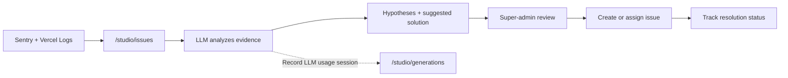

# PRD: Studio AI-Assisted Issue Tracking (F39)
> **Version:** 3.0 | **Status:** Phase 2 — flow approved 2026-07-27 | **Priority:** P1
> **Existing surfaces:** `/studio/issues`, `/studio/generations`
> **Depends on:** F02 Auth, Sentry integration, Vercel Runtime Logs, Prime Studio

## 1. Problem

Production errors are split between Sentry and Vercel, so a super-admin must manually correlate events, determine the likely cause, and turn the finding into work for the technical team.

Prime Studio already has an internal issue tracker at `/studio/issues` and an LLM usage-session monitor at `/studio/generations`. F39 enhances these existing surfaces instead of creating a separate logs page or business tracking system.

## 2. Actors

| Actor | Goal |
|---|---|
| Super-admin | Review production incidents, inspect evidence and AI suggestions, then assign and track resolution |
| Technical assignee | Investigate an assigned issue, update its status, and record the resolution |

Both surfaces remain internal, English-only, and restricted by the existing `super-admin` guard.

## 3. Scope

### In scope

- Enhance `/studio/issues` as the single incident-triage and issue-lifecycle surface.
- Read errors from Sentry and Vercel Runtime Logs without mutating either provider.
- Normalize, sanitize, correlate, and deduplicate provider evidence.
- Use an LLM to produce a concise symptom summary, likely causes, supporting evidence, and suggested next actions.
- Clearly distinguish evidence-backed facts from hypotheses.
- Let a super-admin review the suggestion before creating or assigning technical work.
- Reuse the existing issue statuses, assignee, comments, and timeline.
- Record F39 LLM calls as ordinary usage sessions visible in `/studio/generations`.
- Show source freshness and partial-provider failures without making the whole Issues page unavailable.

### Out of scope

- Any external business-team issue intake or tracking system.
- A new `/studio/logs` route or separate incident dashboard.
- Replacing `/studio/generations` with an incident-analysis page.
- Sentry Seer.
- Automatic code changes, repository access, shell access, pull requests, deployments, or automatic fixes.
- Automatic acceptance of an LLM conclusion.
- Mutating, resolving, or suppressing records in Sentry or Vercel.
- Seller-facing monitoring or access to raw telemetry.

## 4. Success Metrics

| Metric | Target | Guardrail |
|---|---:|---|
| New provider incident visible in `/studio/issues` | p95 ≤ 5 minutes | No duplicate issue for the same provider fingerprint |
| Initial triage time | Median ≤ 5 minutes | Measured from issue creation to first super-admin review |
| AI claim traceability | 100% | Every factual claim links to sanitized evidence; unsupported causes remain hypotheses |
| Sensitive-data leakage | 0 confirmed cases | Secrets, auth headers, cookies, prompts, request bodies, payment data, and unnecessary PII are excluded |
| Partial-source availability | 100% | One provider failure does not cause a full-page failure |
| Unauthorized access | 0 | Existing super-admin authorization applies to page and APIs |

## 5. Approved Process Flow

This Mermaid diagram is the product source of truth.

### Product interpretation

- `/studio/issues` owns incident evidence, AI-assisted triage, assignment, discussion, and resolution.
- `/studio/generations` continues to show LLM usage sessions. It does not own incident analysis or resolution.
- An LLM suggestion is advisory. A super-admin remains the decision-maker.

## 6. User Stories and Acceptance Criteria

### US-F39-01 — Consolidate provider incidents

**Path:** `source_logs → studio_issues`

**Story:** As a super-admin, I want Sentry and Vercel incidents available in the existing Issues page so that I can start triage from one place.

**AC**

- **Happy — AC-01:** GIVEN valid Sentry and Vercel credentials WHEN synchronization runs THEN new sanitized incidents appear in `/studio/issues` with source, severity, occurrence time, fingerprint, and available tenant or request context.
- **Edge — AC-02:** GIVEN matching evidence from both providers WHEN correlation uses an exact shared request or trace identifier THEN the evidence is attached to one issue rather than creating two issues.
- **Edge — AC-03:** GIVEN a repeated provider fingerprint WHEN synchronization runs again THEN the existing issue receives updated occurrence metadata without losing its assignee, comments, status, or timeline.
- **Error — AC-04:** GIVEN one provider is unavailable or rate-limited WHEN synchronization runs THEN available provider data remains usable and the failed source displays its last successful sync and error state.
- **Error — AC-05:** GIVEN evidence contains disallowed sensitive data WHEN it is processed THEN the data is removed before storage, display, or LLM submission.

### US-F39-02 — Generate evidence-bound triage guidance

**Path:** `studio_issues → llm_analysis → suggested_resolution`

**Story:** As a super-admin, I want the LLM to analyze sanitized incident evidence so that I receive useful hypotheses and next actions without treating speculation as fact.

**AC**

- **Happy — AC-06:** GIVEN sufficient sanitized evidence WHEN analysis completes THEN the issue shows a symptom summary, likely cause, cited evidence, and suggested next action.
- **Edge — AC-07:** GIVEN evidence supports multiple plausible causes WHEN analysis completes THEN the causes are ranked as hypotheses and each cites the evidence that supports it.
- **Edge — AC-08:** GIVEN only occurrence count or last-seen time changed WHEN the issue synchronizes THEN the existing analysis is reused rather than starting another LLM session.
- **Error — AC-09:** GIVEN evidence is insufficient WHEN analysis completes THEN the issue states `Needs investigation`, lists the missing evidence, and does not assert a root cause.
- **Error — AC-10:** GIVEN the LLM request fails or returns an invalid result WHEN the issue loads THEN raw sanitized evidence remains reviewable and analysis can be retried by a super-admin.

### US-F39-03 — Review, assign, and resolve

**Path:** `suggested_resolution → superadmin_review → assign_ticket → track_resolution`

**Story:** As a super-admin, I want to review the proposed diagnosis before assigning the issue so that technical work begins from a human-approved decision.

**AC**

- **Happy — AC-11:** GIVEN an analyzed issue WHEN a super-admin accepts or edits the triage notes and selects an assignee THEN the issue enters the existing tracked workflow with the decision recorded in its timeline.
- **Edge — AC-12:** GIVEN the super-admin rejects the suggestion WHEN the issue is assigned THEN the rejected suggestion remains auditable and is not presented as the approved resolution.
- **Edge — AC-13:** GIVEN an existing unresolved issue receives new evidence WHEN it is reviewed THEN its current owner and status are preserved unless the super-admin changes them.
- **Error — AC-14:** GIVEN no assignee is selected WHEN the super-admin saves triage notes THEN the issue remains unassigned and visibly open rather than being silently treated as assigned.
- **Error — AC-15:** GIVEN the issue update fails WHEN the super-admin submits a change THEN the previous issue state remains intact and the failure is visible for retry.

### US-F39-04 — Audit LLM usage sessions

**Path:** `llm_analysis → studio_generations`

**Story:** As a super-admin, I want F39 analysis calls recorded as LLM usage sessions so that usage, cost, latency, and failures remain auditable in the existing Generations page.

**AC**

- **Happy — AC-16:** GIVEN F39 starts an LLM analysis WHEN the call completes or fails THEN one corresponding usage session is visible in `/studio/generations` with endpoint/category, status, duration, cost when available, and timestamps.
- **Edge — AC-17:** GIVEN a super-admin opens an F39 usage session WHEN its detail is displayed THEN it links back to the related issue without turning Generations into an incident-analysis surface.
- **Error — AC-18:** GIVEN usage-session recording fails WHEN incident analysis finishes THEN the issue displays the analysis result and an observable usage-audit warning; the issue workflow is not lost.

## 7. Functional Requirements

| ID | Requirement | Traces to |
|---|---|---|
| FR-01 | Extend the existing `/studio/issues` route; do not create `/studio/logs` | US-F39-01 |
| FR-02 | Preserve the existing `requireSuperAdmin()` and API authorization boundary | All |
| FR-03 | Fetch Sentry and Vercel independently using server-side credentials | US-F39-01 |
| FR-04 | Normalize provider events into one sanitized evidence contract | US-F39-01 |
| FR-05 | Deduplicate by stable provider fingerprint and correlate sources only through exact shared identifiers | US-F39-01 |
| FR-06 | Preserve manually managed issue lifecycle fields during automated recurrence updates | US-F39-01, US-F39-03 |
| FR-07 | Exclude secrets and unnecessary personal or product-prompt data before storage or LLM processing | US-F39-01, US-F39-02 |
| FR-08 | Produce structured analysis containing summary, hypotheses, evidence references, missing evidence, and suggested next action | US-F39-02 |
| FR-09 | Label unsupported causes as hypotheses or `Needs investigation` | US-F39-02 |
| FR-10 | Trigger analysis for a new issue, materially changed causal evidence, or explicit super-admin retry | US-F39-02 |
| FR-11 | Require super-admin review before an AI suggestion becomes approved triage guidance | US-F39-03 |
| FR-12 | Reuse existing assignee, status, comments, and timeline behavior for issue resolution | US-F39-03 |
| FR-13 | Record every attempted F39 LLM analysis as a usage session in the existing generation-monitoring system | US-F39-04 |
| FR-14 | Keep `/studio/generations` focused on LLM session telemetry and link back to the related issue | US-F39-04 |
| FR-15 | Expose per-source freshness and recoverable degraded states on `/studio/issues` | US-F39-01 |

## 8. UI Contract

| Surface | Existing source | F39 enhancement | Required states |
|---|---|---|---|
| Issues list and detail | `src/app/studio/issues` | Provider/source context, sync freshness, evidence, AI analysis, review decision, and linkable issue lifecycle | Loading, empty, success, partial-source failure, analysis failure, update failure |
| Generations list and detail | `src/app/studio/generations` | Identify F39 analysis sessions and link to their related issue | Loading, empty, success, failed session |

No new Studio route is introduced.

## 9. Data and Integration Contract

The existing `template-issues` model remains the issue-lifecycle owner. Any new fields required for provider fingerprints, sanitized evidence, AI analysis, review decisions, or related generation-session identifiers must extend that model and follow the repository migration rules.

The existing `ai-generation-records` capture path remains the usage-session audit mechanism. F39 records must use a distinct endpoint or category and carry a safe relation back to the issue; raw provider logs and secrets must never be stored in prompts or snapshots.

Sentry and Vercel are read-only evidence providers. Provider credentials are server-only and must be represented in both staging and production environment templates.

## 10. Non-Functional Requirements

| Area | Requirement |
|---|---|
| Security | Page and APIs deny non-super-admin users; provider tokens never reach the browser |
| Privacy | Sanitization occurs before persistence, rendering, and LLM submission |
| Reliability | Sentry, Vercel, LLM, and usage-audit failures remain isolated and observable |
| Performance | Cached `/studio/issues` initial response p95 ≤ 3 seconds under the agreed production incident volume |
| Idempotency | Reprocessing the same fingerprint does not create another issue or another analysis unless causal evidence changed |
| Auditability | Automated evidence changes, AI results, human review, assignment, and status changes remain attributable and time-stamped |

## 11. Related Existing Documents

| Document | Relationship |
|---|---|
| `docs/architecture/F99-cicd-monitoring.md` | Defines the broader Sentry monitoring and alerting direction; F39 owns super-admin application incident triage inside Prime Studio |
| `docs/qa/monitoring.md` | Covers current Sentry SDK and environment verification; F39 adds product workflow coverage rather than replacing those tests |
| `docs/prd/F40-ai-credit-system.md` | Owns AI credit accounting; F39 only records its LLM usage through the existing monitoring mechanism |

## 12. Risks and Open Questions

| ID | Item | Gate |
|---|---|---|
| R-01 | Vercel Runtime Logs API retention, pagination, and rate limits must support the chosen sync window | Resolve before implementation |
| R-02 | Sentry events may lack tenant/request context, reducing correlation quality | Define required instrumentation fields before implementation |
| R-03 | Provider evidence may exceed safe LLM context limits | Define deterministic evidence limits before implementation |
| Q-01 | Exact sync trigger and frequency | `[NEED: scheduled polling, provider webhook, or hybrid]` |
| Q-02 | Exact ticket creation behavior | `[NEED: auto-create an open issue after deduplication, or require super-admin confirmation before first persistence]` |
| Q-03 | Retention period for sanitized provider evidence | `[NEED]` |

## 13. Delivery Gates

### Definition of Ready

- Approved Mermaid remains unchanged.
- Q-01 through Q-03 are resolved.
- Sentry and Vercel read credentials and production projects are confirmed.
- Required provider context, sanitization allowlist, and evidence limits are agreed.
- Collection-field changes have matching SQL migration and environment-template updates.
- QA maps automated cases to the final acceptance criteria.

### Definition of Done

- AC-01 through AC-18 pass.
- `/studio/issues` is the only F39 incident workflow and `/studio/logs` does not exist.
- `/studio/generations` remains a usage-session monitor with working issue backlinks.
- Provider and LLM failures are independently recoverable and visible.
- Sanitization tests prove excluded data never reaches persistence, UI, or LLM input.
- New routes are not introduced; modified user-facing behavior has Playwright coverage.
- Production smoke testing confirms Sentry and Vercel evidence, RBAC, deduplication, analysis, review, assignment, and usage-session auditing.
