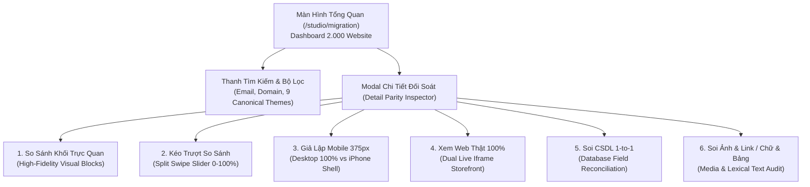

# PRD — F40 QA Control Center

## 1. Vấn đề

Tester hiện phải ghép thủ công issue, PR, thay đổi code, test file, kết quả CI và bug report. Chạy cả dự án vừa chậm vừa làm nghẽn QC, trong khi chạy một test đơn lẻ không cho biết còn dependency nào bị ảnh hưởng.

## 2. Mục tiêu sản phẩm

Tại `/studio/qa`, tester quan sát **sức khỏe toàn bộ CMS**, nhận kết quả test tự động sau khi PR được deploy lên QC và chỉ chạy/retest thủ công những target có rủi ro. Mỗi pack trả về automated result, manual checklist, evidence, coverage gap và finding để tester review trước khi chủ động tạo GitHub ticket.

`/studio/qa` chỉ là workspace nội bộ để điều phối QA trong MVP; **Studio admin không nằm trong product surface cần test**. Target catalog chỉ cover CMS seller, Editor/Builder, public storefront, checkout và các platform integration phục vụ CMS.

### Chỉ số thành công MVP

| Chỉ số | Mục tiêu sau pilot 4 tuần |
|---|---:|
| Thời gian chọn và khởi tạo pack | ≤ 3 thao tác, ≤ 1 phút |
| Target pilot có pack hợp lệ | 3/3 |
| Run có summary được ingest | ≥ 95% |
| Run lỗi do fixture conflict | < 5% |
| Finding có trace PR/test/evidence | 100% |
| PR deploy QC có impact snapshot hoặc coverage gap | 100% |
| Tester tự chạy lại full regression hằng ngày | 0 lần mặc định |

## 3. Người dùng và Jobs-to-be-done

| Người dùng | Khi | Muốn | Để |
|---|---|---|---|
| Tester | Dev bàn giao một màn hình/flow | Chạy đúng regression pack | Không bỏ sót API/function/dependency liên quan |
| QA lead | Chuẩn bị release | Xem coverage gap, block và finding | Đưa quyết định dựa trên evidence |
| Developer | Nhận bug | Trace về PR/SHA/TC-ID/evidence | Sửa và verify nhanh |
| BA/UX | Thay đổi AC hoặc UX flow | Thấy impact đến test pack | Cập nhật scope/test trước khi release |

## 4. Phạm vi MVP

### Trong phạm vi

- Studio route `/studio/qa` chỉ cho super-admin trong MVP.
- Project Health hiển thị toàn bộ 67 target CMS ngay từ MVP, grouped theo domain và trạng thái Healthy/Watch/Needs attention/Critical/Unknown.
- Target registry cho `screen`, `user_flow`, `feature`; mỗi target luôn công khai mức coverage: automated, partial, manual-only hoặc unknown.
- Sau deploy QC, tự tạo change-impact và tự chạy Smoke pack đã map; Regression rộng chỉ chạy theo lịch/release hoặc khi QA chủ động chọn.
- Kết quả UI/E2E, API/unit, manual, visual/quality, health/performance khi pack khai báo.
- Change impact từ PR/SHA sang target/test pack; `coverage_gap` rõ ràng khi chưa map.
- Project Health, Feature Health Detail, QA Inbox và finding lifecycle; GitHub ticket chỉ tạo sau hành động xác nhận của tester.

### Ngoài phạm vi MVP

- Chạy full-project bằng nút mặc định, chạy command tự do từ browser, test trên production.
- Tự tạo/đóng bug, tự approve release, thay thế GitHub Actions/Sentry/Studio Issues.
- Lưu raw log, cookie, request body, PII, screenshot/trace nhạy cảm vào Payload.
- Role tester riêng trước khi có RBAC policy và acceptance test.
- Kiểm thử tính năng Studio admin (templates, blocks, packs, generations, Studio analytics/settings) như target product.

## 5. Nguyên tắc nghiệp vụ

1. Một run luôn gắn `targetId`, `packId`, `packVersion`, profile, environment và SHA.
2. `passed` chỉ áp dụng cho test thực sự chạy và pass. `skipped`, `blocked`, `unmapped`, `manual_pending` không được hiển thị là pass.
3. Health không được suy diễn chỉ từ lần test pass gần nhất. Nó kết hợp test outcome, open finding, coverage, flakiness, change risk và độ mới của lần chạy.
4. `Healthy` chỉ hiển thị khi không có finding nghiêm trọng, run cần thiết pass và coverage đạt ngưỡng; dữ liệu thiếu là `Unknown`, không phải xanh.
5. Visual diff hoặc test fail chỉ tạo finding nội bộ; tester review expected/actual/evidence trước khi tạo GitHub ticket.
6. Target chỉ chạy trên QC environment đã được phép; performance/full regression là release-only activity.
7. Test pack có precondition, fixture lease, dependency và cleanup contract; không chạy nếu không thỏa.
8. Mọi finding phải có fingerprint, owner/status và safe evidence; việc tạo GitHub ticket luôn do người dùng xác nhận.

## 6. User stories và Acceptance Criteria

### US-QA-01 — Nhận kết quả tự động sau deploy QC

**Là tester**, tôi muốn Studio tự chạy smoke pack liên quan sau khi PR được deploy QC để không phải lặp lại regression thủ công.

```gherkin
GIVEN một PR đã deploy thành công lên QC với SHA xác định được
WHEN changed paths được resolve qua coverage map
THEN hệ thống tạo impact snapshot và tự dispatch Smoke pack cho target đã map
AND path chưa map tạo coverage gap trong QA Inbox, không tự coi là covered

GIVEN Smoke pack không có fixture/capacity hợp lệ
WHEN dispatcher đánh giá precondition
THEN run được ghi blocked với lý do và không làm bẩn QC data
```

### US-QA-02 — Xem Project Health và QA Inbox

**Là tester**, tôi muốn nhìn tổng quan feature nào khỏe, cần theo dõi hoặc đang lỗi để ưu tiên đúng việc trong ngày.

```gherkin
GIVEN tôi mở `/studio/qa`
WHEN dữ liệu health được tải
THEN tôi thấy QA Inbox ưu tiên Critical, Needs attention, Watch và coverage gap
AND Project Health nhóm target theo CMS domain với last run, coverage, open finding và change risk

GIVEN một target thiếu dữ liệu hoặc chưa có pack
WHEN health được tính
THEN target hiển thị Unknown, không hiển thị Healthy
```

### US-QA-03 — Xem Feature Health Detail và evidence

**Là tester**, tôi muốn mở một feature để biết chính xác scenario nào lỗi và cần retest gì.

```gherkin
GIVEN target Product Grid có test variant fail
WHEN tôi mở Feature Health Detail
THEN tôi thấy TC-ID, fixture, expected/actual, run/PR/SHA, screenshot hoặc trace an toàn và action retest
AND finding được phân loại product, infrastructure, flaky hoặc blocked

GIVEN visual comparison vượt threshold
WHEN tôi xem finding
THEN tôi thấy baseline/current/diff để xác nhận thay đổi hợp lệ hay là UI regression
```

### US-QA-04 — Chọn target và chạy/retest pack

**Là tester**, tôi muốn tìm màn hình/flow/feature và xem trước test sẽ chạy để không khởi tạo workload không cần thiết.

```gherkin
GIVEN tôi là super-admin và QC đang khả dụng
WHEN tôi chọn một target đang active và profile Smoke hoặc Regression
THEN tôi thấy TC-ID, loại test, manual checklist, precondition, fixture, ước lượng thời gian và environment
AND tôi chỉ có thể xác nhận khi mọi precondition/capacity đều hợp lệ

GIVEN target chưa có pack hoặc pack đã deprecated
WHEN tôi mở target
THEN hệ thống hiển thị coverage gap và không cho chạy một command tùy ý
```

### US-QA-05 — Nhận gợi ý impact từ PR

```gherkin
GIVEN một PR có head/base SHA và changed path hợp lệ
WHEN change-impact snapshot được tạo
THEN tester thấy target/test pack liên quan, mức độ tin cậy và path chưa map
AND snapshot không đổi khi PR được cập nhật; commit mới tạo snapshot mới
```

### US-QA-06 — Theo dõi run và kết quả

```gherkin
GIVEN tester đã dispatch một pack
WHEN GitHub/QC đang xử lý
THEN Studio hiển thị queued/running, vị trí queue hoặc lý do capacity blocked
WHEN run hoàn tất, fail, cancel hoặc timeout
THEN Studio hiển thị summary, TC-ID, evidence an toàn và status phân loại
```

### US-QA-07 — Triage và verify bug

```gherkin
GIVEN một test result fail
WHEN tester review và tạo finding hoặc GitHub ticket
THEN finding lưu fingerprint, status, owner, run/PR/TC-ID/evidence và không tạo duplicate cho cùng lỗi đã biết
AND GitHub ticket không được tạo tự động bởi test runner
WHEN developer sửa lỗi và tester chạy lại cùng target pack
THEN finding được verify-fix hoặc reopen theo kết quả mới
```

### US-QA-08 — Bảo mật và vận hành

```gherkin
GIVEN người dùng không có QA capability
WHEN truy cập page hoặc API QA
THEN hệ thống từ chối và không lộ run, artifact hay GitHub credential
GIVEN GitHub delivery bị sai chữ ký, quá hạn hoặc replay
WHEN endpoint ingestion nhận payload
THEN hệ thống từ chối write và ghi audit metadata an toàn
```

## 7. Quyết định chờ duyệt

| Quyết định | Đề xuất MVP | Owner duyệt |
|---|---|---|
| Quyền sử dụng | Super-admin-only; QA Lead: Ary – Phạm Thị Thảo Ngân | Engineering Lead + QA Lead |
| Phạm vi Project Health | Tất cả 67 target CMS; Studio admin loại trừ | QA Lead |
| Nhóm kiểm chứng automation đầu tiên | Product Grid variants, Order payment verification, Checkout payment | QA Lead |
| Môi trường chạy tự động | Staging/QC, tuyệt đối không production | QA Lead + Engineering Lead |
| Kết nối GitHub runtime | GitHub App/token server-side riêng; MCP chỉ phục vụ phiên làm việc của trợ lý | Engineering Lead |
| QC capacity | 1 Regression + 2 Smoke runs; fixture lease bắt buộc | DevOps/Engineering Lead |
| Retention summary | 90 ngày; raw artifact theo policy GitHub hiện có | Engineering Lead |
| Release gate | Advisory trong pilot; override phải audit | QA Lead + Engineering Lead |

## 8. Rollout

MVP đưa toàn bộ 67 target CMS lên Project Health với coverage và trạng thái trung thực. Trong 2 tuần đầu, kiểm chứng automation sau deploy QC trên Product Grid variants, Order payment verification và Checkout payment; quan sát dispatch, queue time, flake, false-positive visual diff và ingestion. Sau đó mở rộng automation theo risk tier, không phải mở rộng catalog.

## 9. Story source of truth

Backlog delivery, Acceptance Criteria và Definition of Done theo từng đơn vị PR nằm tại [`F40-qa-control-center-stories.md`](../stories/F40-qa-control-center-stories.md). Mỗi `US-F40-xx` tương ứng đúng một GitHub Issue, branch và PR vào `staging`.

---

## 10. Phân Hệ Đối Soát & Kiểm Thử Di Chuyển Dữ Liệu 2.000 Website (Migration Reconciliation Studio)

### 10.1. Bối cảnh & Bài toán kinh doanh

Dự án Prime Web v2 thực hiện di chuyển dữ liệu (data migration) của **2.000 website bán hàng đang hoạt động** từ nền tảng cũ **PW1 (Laravel + MySQL)** sang nền tảng mới **PW2 (Next.js 15 + Payload CMS 3 + PostgreSQL Neon)**.

Do sự khác biệt căn bản về cấu trúc schema (từ RDBMS bảng phẳng sang Document / Lexical AST / Blocks), quá trình chuyển đổi đối mặt với nhiều rủi ro nghiêm trọng:
1. **Mất mát dữ liệu thương mại (E-commerce Data Loss):** Rớt biến thể size/màu (Variants), mất SKU, lệch giá bán hoặc số lượng tồn kho.
2. **Hỏng liên kết & Hình ảnh (Broken Assets):** Ảnh banner không tải được, kích thước lệch aspect ratio, link CTA bị 404.
3. **Biến dạng nội dung văn bản (RichText Degraded):** Bảng biểu `<table>` bị mất cấu trúc cột, format in đậm/nghiêng/danh sách bị rớt khi chuyển đổi từ raw HTML sang Lexical Node AST.
4. **Sai lệch bố cục & Thiếu trang (Layout & Page Gaps):** Trang phụ (About, Contact, Policy) chưa được migrate, iframe bản đồ hoặc video nhúng bị rớt.

Để đảm bảo an toàn tuyệt đối trước khi trỏ tên miền chính thức (Cutover), phân hệ **Migration Reconciliation Studio** tại route `/studio/migration` được xây dựng để cung cấp công cụ đối soát tự động, phát hiện lỗi lệch CSDL và nghiệm thu trực quan 1-to-1 trên quy mô 2.000 website.

---

### 10.2. Mục tiêu sản phẩm & Success Metrics

| Chỉ số (KPIs) | Mục tiêu nghiệm thu | Cơ chế đo lường |
|---|---:|---|
| **Độ phủ đối soát 2.000 website** | 100% (2.000/2.000 stores) | Dashboard tự động tổng hợp metric từ CSDL |
| **Độ khớp trường CSDL 1-to-1** | $\ge 99.0\%$ | So sánh chi tiết từng trường theo `legacy_id` |
| **Phát hiện lỗi P0 Blocker tự động** | 100% | Cảnh báo đỏ ngay khi rớt biến thể, thiếu trang hoặc link 404 |
| **Thời gian tải & render Storefront Thật** | $\le 2$ giây | Endpoint API `/api/qa/template-preview/[code]` |
| **Độ chính xác giả lập Mobile (375px)** | 100% Pixel-Perfect | Khung iPhone 375px có Dynamic Island, loa thoại & Home Bar |

---

### 10.3. Kiến trúc Tính Năng & Các Chế Độ So Sánh (6 Lớp Đối Soát)



#### 1. Dashboard Tổng Quan 2.000 Website (`US-F40-09`)
* Thanh đo đếm thời gian thực: Tổng số web, Tỷ lệ Đạt chuẩn (Pass), Cần xem lại (Warning), Lỗi P0 Blocker (Fail).
* Bộ lọc đa năng: Tìm kiếm tức thì theo **Email Chủ Store** hoặc **Tên Miền (Domain)**.
* Dropdown lọc theo **9 Bộ Theme Giao Diện Gốc**:
  * `FB101`: OrganicNest Farm (Nông sản & Thực phẩm sạch)
  * `C101`: BeautyStore (Mỹ phẩm & Chăm sóc da)
  * `C102`: GlowBeauty (Spa & Làm đẹp)
  * `F102`: FashionEase (Thời trang nam nữ)
  * `FN101` / `FN102` / `FN104`: SofaDecor, FurnitureHub, Minimalist (Nội thất & Gia dụng)
  * `FN103`: Viora (Thời trang cao cấp)
  * `PA101`: EcoGarden (Cây cảnh & Hoa tươi)

#### 2. So Sánh Khối Trực Quan Sinh Động (`US-F40-12`)
* Render các Component giao diện mô phỏng chân thực: Hero Banners, Thẻ sản phẩm kèm biến thể và giá tiền, Thanh lọc danh mục, Thẻ cam kết chất lượng, Chân trang 4 cột.
* Highlight viền đỏ phát sáng (`ring-2 ring-rose-500`) và gạch ngang giá tiền ngay tại nơi xảy ra lỗi (ví dụ: mất biến thể Can 1L trên PW2).

#### 3. Thanh Trượt Kéo Trượt So Sánh (Split Swipe Slider — `US-F40-12`)
* Sử dụng CSS `clipPath: polygon(...)` tăng tốc phần cứng (GPU Accelerated) cho phép QA kéo thanh trượt từ 0% đến 100% mượt mà 60 FPS để đối chiếu độ sai lệch bố cục giữa 2 phiên bản.

#### 4. Chế Độ Xem Storefront Web Thật 100% (Live Webview Iframe — `US-F40-12`)
* Nhúng trực tiếp mã nguồn HTML/CSS/JS Storefront hoàn chỉnh thông qua endpoint `/api/qa/template-preview/[code]`.
* Hỗ trợ đầy đủ tương tác cuộn trang, click xem sản phẩm, thử nghiệm Responsive ở cả 2 kích thước: **Desktop Màn Hình Lớn** và **Khung iPhone Mobile chuẩn 375px**.

#### 5. Đối Soát CSDL 1-to-1 Từng Trường (Field-by-Field Reconciliation — `US-F40-11`)
* Đối chiếu từng trường dữ liệu chi tiết theo 7 nhóm:
  * 🛍️ **Sản Phẩm (Products):** Tên, SKU, Giá bán, Giá khuyến mãi, Tồn kho.
  * 🏷️ **Biến Thể (Variants):** Size, Màu sắc, Dung tích, Giá theo biến thể.
  * 🖼️ **Banners & Link:** Ảnh desktop/mobile, Tiêu đề, Link CTA, Thứ tự hiển thị.
  * 📝 **RichText & Bảng Biểu:** Độ dài văn bản, định dạng bảng biểu, AST JSON.
  * 🧭 **Menu Điều Hướng:** Cây danh mục cha/con, link URL, vị trí Header/Footer.
  * 📂 **Danh Mục (Categories):** Tên danh mục, slug, ảnh thumbnail.
  * ⚙️ **Cài Đặt Shop:** Tên cửa hàng, Hotline, Email, Địa chỉ, Tọa độ bản đồ.

#### 6. Soi Ảnh & Link / Chữ & Bảng (`US-F40-10`)
* **Media Audit:** Kiểm tra HTTP Status (200 vs 404), Alt Text, Kích thước pixel gốc.
* **Text Format Audit:** Đếm số đoạn văn, kiểm tra format Đậm/Nghiêng/Danh sách, phát hiện bảng biểu bị phẳng thành text thường.

---

### 10.4. Danh Mục User Stories & Liên Kết PR

| User Story ID | Tiêu đề User Story | Pull Request | Trạng thái |
| :--- | :--- | :---: | :---: |
| **US-F40-09** | Dual-Mode Store Ingestion & Aggregate Reconciliation Dashboard | [PR #1792](https://github.com/primeproduction/ech-prime-web-v2/pull/1792) | ✅ Merged/Approved |
| **US-F40-10** | Deep Visual Block Tree, Media & RichText Formatting Audit | [PR #1793](https://github.com/primeproduction/ech-prime-web-v2/pull/1793) | ✅ Merged/Approved |
| **US-F40-11** | Field-by-Field Database Entity Diff Inspector & Fix Recommendations | [PR #1794](https://github.com/primeproduction/ech-prime-web-v2/pull/1794) | ✅ Merged/Approved |
| **US-F40-12** | Visual & Layout Parity Inspector (Swipe Slider, 375px Mobile & Live Webview) | [PR #1795](https://github.com/primeproduction/ech-prime-web-v2/pull/1795) | ✅ Merged/Approved |
| **US-F40-13** | 1-Click Ticket Export & QC Provenance Sign-Off | Out-of-Scope / Backlog | ⏸️ Deprecated |

---

### 10.5. Quy trình Nghiệm Thu & Chứng Thực QC (Cutover Readiness Gate)

1. **Bước 1 — Quét CSDL & Lọc Web Lỗi:** QA mở `/studio/migration`, chọn bộ lọc `Cần Xem Lại` hoặc `Lỗi P0 Blocker`.
2. **Bước 2 — Soi Lỗi CSDL & Trực Quan:** Bấm `[ So Sánh > ]`, kiểm tra nguyên nhân lỗi tại tab `So Sánh Khối`, `Soi CSDL 1-to-1` hoặc `Xem Web Thật (Live Iframe)`.
3. **Bước 3 — Dev Sửa ETL Script & Quét Lại:** Dev cập nhật migration script, QA bấm `[ Quét Lại CSDL ]` để re-sync dữ liệu tức thì.
4. **Bước 4 — Đóng Dấu QC Pass:** Khi đạt Parity Score $\ge 99.0\%$ và 0 lỗi P0, QA bấm **`[ Duyệt QC Pass ]`** để đưa website vào danh sách sẵn sàng chuyển đổi tên miền (Cutover Certified).

