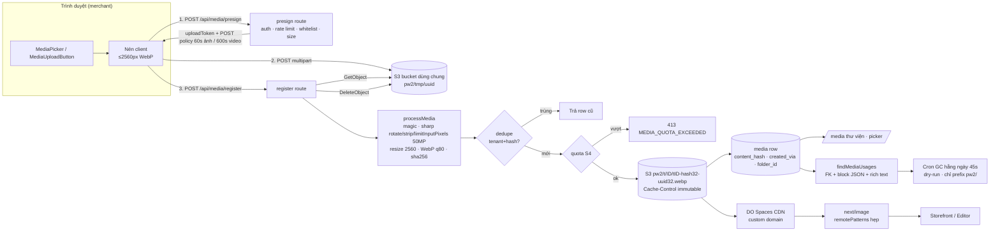
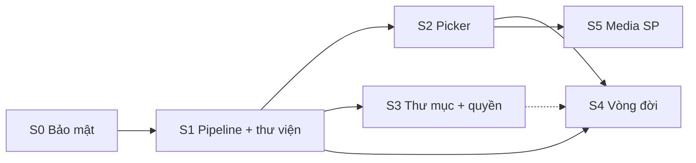

# PRD: Media Management — Tổng quan (F48)

> **Version:** 1.0 | **Created:** 2026-11-09 | **Agent:** `docs-engineer`
> **Priority:** P0 (S0–S2) / P1 (S3–S5) | **Sprint:** 6 sprint (S0–S5) | **Size:** XL
> **Depends on:** F01 Builder, F05 Editor, F08 Products, F17 Blog, F19 Store config, F15 Plans (PlanFeatures) | **Blocks:** —
> **Nguồn:** brainstorm brief `plans/reports/brainstorm-261109-1538-F48-media-management.md` (D1–D88 đã chốt — D55–D67 sau review độc lập, D68–D80 sau review lần 3, 2026-11-09 — PO trả lời 2026-11-10 (D88): D11/D13 chốt, D9 chốt số sau S4, D74 hoãn; quyết định sau thay quyết định trước), scout `plans/reports/scout-261109-1519-media-library-pw1-vs-pw2.md`, scout `plans/reports/scout-261110-0930-rewrite-v1-dam-vs-f48.md` (D81–D86, 2026-11-10). Code tham chiếu: staging `5c3e3bdca`.
> **Tương thích DAM Commerce OS (#1812):** [F48-media-management-dam-alignment.md](../architecture/F48-media-management-dam-alignment.md) — S0–S4 thuộc PW (Payload Media giữ binary, G-08); S5 làm theo D84/D85 để migrate 1-1 sang `product_asset_links`.

---

> [!IMPORTANT]
> **Stories-First Rule:** mọi FR có Story Ref (US-F48-01..16). Story file `docs/stories/F48-media-management-stories*.md` (Status Draft) là nguồn AC; PRD sprint copy nguyên văn AC + TC-ID `TC-F48-<story>-<nn>` (`docs/qa/F48-media-management.md`). Quyết định D21–D62 (bổ sung sau khi viết story) đã được đưa thẳng vào story/AC; PRD sprint chỉ ghi chú khi cần giải thích.
>
> **Tài liệu F48:** [Stories 1](../stories/F48-media-management-stories.md) · [Stories 2](../stories/F48-media-management-stories-2.md) · [Stories 3](../stories/F48-media-management-stories-3.md) · [Stories 4](../stories/F48-media-management-stories-4.md) · [Architecture](../architecture/F48-media-management.md) · [Design](../design/F48-media-management-design.md) · [QA](../qa/F48-media-management.md)
>
> **Migration PW1→PW2 đã xong.** F48 không migrate/backfill dữ liệu PW1. PW1 chỉ là tham chiếu tính năng + số liệu.

---

## 0. Story Traceability

| Story ID | Tiêu đề | Sprint | Ưu tiên | Size | File | Status |
|---|---|---|:-:|:-:|---|---|
| US-F48-01 | Khoá field hệ thống của media + chỉ ghi qua API an toàn (SEC-1, SEC-8) | S0 | P0 | M | [stories](../stories/F48-media-management-stories.md) | Draft |
| US-F48-02 | Cứng hoá upload: whitelist, magic check mọi đường, rate limit, header, remotePatterns, sharp | S0 | P0 | M | [stories](../stories/F48-media-management-stories.md) | Draft |
| US-F48-03 | Vận hành: xoay key S3, key riêng PW2, kiểm listing bucket, CDN + cache header | S0 | P0 | S | [stories](../stories/F48-media-management-stories.md) | Draft |
| US-F48-04 | Pipeline upload hợp nhất: client nén → tmp → register xử lý server, quota per-file | S1 | P0 | L | [stories](../stories/F48-media-management-stories.md) | Draft |
| US-F48-05 | Thư viện /media: phân trang server, tìm/lọc/sắp xếp, chi tiết, sửa metadata, xoá nhiều, kéo thả | S1 | P0 | L | [stories](../stories/F48-media-management-stories.md) | Draft |
| US-F48-06 | MediaPicker dùng chung (Upload / Thư viện / URL), chọn 1 hoặc nhiều | S2 | P0 | M | [stories-2](../stories/F48-media-management-stories-2.md) | Draft |
| US-F48-07 | Gắn picker vào 18 điểm upload; block mới lưu `{mediaId,url}` | S2 | P0 | L | [stories-2](../stories/F48-media-management-stories-2.md) | Draft |
| US-F48-08 | Import ảnh từ URL an toàn | S2 | P1 | S | [stories-2](../stories/F48-media-management-stories-2.md) | Draft |
| US-F48-09 | Thư mục lồng nhau: tạo/đổi tên/di chuyển/xoá | S3 | P1 | M | [stories-2](../stories/F48-media-management-stories-2.md) | Draft |
| US-F48-10 | Quyền `media` cho staff + mục sidebar | S3 | P1 | S | [stories-2](../stories/F48-media-management-stories-2.md) | Draft |
| US-F48-11 | "Đang dùng ở đâu" + chặn/cảnh báo khi xoá + bộ lọc "Chưa dùng" | S4 | P0 | M | [stories-3](../stories/F48-media-management-stories-3.md) | Draft |
| US-F48-12 | Dọn rác tự động có dry-run + dọn khi regenerate | S4 | P1 | M | [stories-3](../stories/F48-media-management-stories-3.md) | Draft |
| US-F48-13 | Quota dung lượng theo gói + đồng hồ dung lượng | S4 | P1 | M | [stories-3](../stories/F48-media-management-stories-3.md) | Draft |
| US-F48-14 | Gallery SP 10 ảnh, kéo sắp xếp, ảnh chính | S5 | P1 | S | [stories-4](../stories/F48-media-management-stories-4.md) | Draft |
| US-F48-15 | Ảnh cho biến thể chọn từ gallery + storefront đổi ảnh theo biến thể | S5 | P1 | M | [stories-4](../stories/F48-media-management-stories-4.md) | Draft |
| US-F48-16 | Ảnh danh mục | S5 | P2 | S | [stories-4](../stories/F48-media-management-stories-4.md) | ⏸ Hoãn (D88) |

---

## 1. Problem Statement

Media của PW2 đang chạy trên 4 đường ống upload khác nhau, không có thư viện dùng lại được, không có vòng đời, và có một lỗ hổng cho phép xoá object tuỳ ý trong bucket dùng chung với PW1.

- **Lỗ hổng bảo mật mức Cao (SEC-1):** `src/collections/Media.ts` không khoá các field hệ thống (`filename`, `prefix`, `mimeType`, `filesize`, `url`) khi update. Adapter `plugin-cloud-storage` xoá object theo `prefix + filename` của row. Kết hợp lại, một thành viên shop bất kỳ có thể khiến hệ thống xoá object không thuộc về shop mình — kể cả object của **PW1** trong bucket dùng chung. Ngoài ra còn 10 điểm yếu khác (SEC-2..SEC-11: proxy ảnh mở `https://**`, EXIF/GPS không bị xoá, thiếu rate limit ở 6 route, key S3 lộ ngày 2026-04-15 chưa xoay…).
- **Upload phân mảnh:** 18 điểm upload, 4 đường ống (A `/api/media/upload` qua server — vướng giới hạn body 4,5 MB của Vercel; B presign + register; C server action `uploadMediaAction`; D route riêng). Giới hạn 2/5/10 MB khác nhau, nén ở 5/11 chỗ, alt 5 kiểu, i18n lẫn tiếng Anh/Việt cứng. Logic input file lặp ở ≥ 15 file.
- **Không dùng lại được ảnh:** không điểm nào chọn được ảnh đã có → merchant upload lại cùng ảnh cho mỗi SP/block. Trang `/media` (372 dòng) cap cứng 200 file (`MEDIA_LIBRARY_LIMIT`), không phân trang, không sửa alt, không xoá nhiều, không thư mục, không nằm ở sidebar, không có permission `media` cho staff (`src/lib/permissions.ts:4`).
- **Không có vòng đời & chi phí không kiểm soát:** không hook/cron dọn, regenerate site giữ media cũ (`src/lib/ai/generate-site-service.ts:1533`), không quota theo gói, không dedupe. Mẫu local: PNG chiếm 74% byte, trung bình ~600 KB/file, 42/472 ảnh > 2000px. Không có ảnh phái sinh (imageSizes gỡ ở #1284) → lưới và editor tải ảnh gốc.
- **Thiếu tính năng so với PW1 (snapshot prod 2026-10-28, 2.919 store live):** thư mục (130 store dùng, max 20 folder/store, độ sâu thực tế ≤ 2 ở 99%), ảnh SKU (8.273/43.592 SKU = 19% có ảnh, ~1,08 ảnh/SKU), ảnh danh mục (267/50.927 = 0,5%), gallery SP không giới hạn (max 8, 98,7% ≤ 5 ảnh) — PW2 giới hạn 5 ảnh (`MAX_PRODUCT_IMAGES`), không sắp xếp, không ảnh biến thể/danh mục.

---

## 2. Target User

- **Merchant owner/admin** (SME Malaysia, kỹ năng kỹ thuật thấp, dùng en hoặc ms, nhiều người dùng mobile): upload ảnh SP, logo, ảnh block, blog; muốn chọn lại ảnh đã có.
- **Staff** của shop (quyền tuỳ chỉnh `products`, `blog`, `builder`…): cần chọn/upload ảnh trong màn hình mình có quyền; staff có quyền `media` quản lý thư viện.
- **Người mua** (storefront): upload biên lai chuyển khoản (private), xem ảnh SP/biến thể/danh mục.
- **Ops/Dev nội bộ:** xoay key, CDN, cron dọn rác, giám sát chi phí.

---

## 3. Solution Overview

Một **dịch vụ media thống nhất**: mọi file ảnh/video của merchant đi qua 1 pipeline (client nén → presign → S3 `pw2/tmp/` → `register` xử lý trên server: kiểm magic, sharp re-encode WebP, xoá EXIF, giới hạn pixel, hash, dedupe theo tenant, quota → key cuối `pw2/t/{tenantId}/t{tenantId}-{hash32}-{uuid32}.webp`). Một **MediaPicker** dùng chung (Upload | Thư viện | URL) thay cho 18 input file rời. Một **thư viện** có phân trang server, thư mục, sửa metadata, xoá nhiều, biết media đang dùng ở đâu. **Vòng đời** có dọn rác có dry-run (chỉ đụng prefix `pw2/`) và quota theo gói. Bổ sung parity PW1: quyền `media`, gallery 10 ảnh có sắp xếp, ảnh biến thể, ảnh danh mục.

Nguyên tắc: **không bật lại Payload imageSizes** (D4, #1284) — lưu 1 bản WebP chuẩn hoá (cạnh dài ≤ 2560, q80), hiển thị qua `next/image` với `remotePatterns` hẹp + CDN cache immutable (key theo hash).

---

## 4. Scope

### In Scope
- S0: sửa SEC-1..SEC-11 (code + ops) — US-F48-01..03.
- S1: pipeline hợp nhất, key theo hash, dedupe, nguồn giới hạn duy nhất; thư viện `/media` mới + API list/sửa/xoá nhiều — US-F48-04..05.
- S2: MediaPicker + tích hợp 18 điểm upload + import URL — US-F48-06..08.
- S3: thư mục lồng nhau (≤ 5 cấp, ≤ 200/tenant), quyền `media`, sidebar (PO đồng ý, D88) — US-F48-09..10.
- S4: quét usage, xoá có kiểm tra, "Chưa dùng", GC có dry-run, quota theo gói — US-F48-11..13.
- S5: gallery SP 10 ảnh (PO đồng ý), ảnh biến thể — US-F48-14..15. Ảnh danh mục (US-F48-16) hoãn — D88.

### Out of Scope
- Chỉnh ảnh nâng cao (filter, AI edit, xoá nền), crop/focal point.
- Xử lý video (transcode, poster).
- Quét virus ClamAV (để sau).
- Collection Brand, review sản phẩm có ảnh.
- Chuyển dữ liệu block cũ (URL string) sang `{mediaId,url}` — **không backfill** (D3).
- Migrate/backfill dữ liệu PW1; xử lý 12.232 ảnh SP PW1 trỏ bucket dev `tm-prime-web-dev` (ghi nhận rủi ro R-09).
- Stock search cho merchant (chỉ AI copilot có).

---

## 5. Success Metrics

| Metric | Baseline (2026-11-09) | Target | Đo bằng |
|---|---|---|---|
| Lỗ hổng SEC mức Cao còn mở | 1 (SEC-1) | 0 sau S0 | Test tái hiện SEC-1 xanh + review bảo mật |
| Số đường ống upload ảnh merchant | 4 (A/B/C/D) | 1 pipeline (D giữ riêng cho avatar/proof/feedback/studio/AI nhưng dùng chung validator) | grep `fetch('/api/media/upload'`, `uploadMediaAction(` = 0 ở UI merchant |
| Điểm upload có "chọn ảnh có sẵn" | 0/18 | 12/18 (điểm 1–12 theo US-F48-07; /media dùng pipeline; 5 điểm luồng riêng) | Checklist tích hợp S2 |
| Byte lưu trữ ảnh mới / file | ~600 KB TB (PNG 74%) | giảm ≥ 50% (NFR-04) | Benchmark bộ ảnh mẫu 472 file |
| Object có EXIF/GPS trong ảnh mới | chưa đo (không strip) | 0% | Test exiftool trên 50 ảnh mẫu |
| Giới hạn thư viện | 200 file cứng | không giới hạn, phân trang 50/lần, p95 < 500 ms (NFR-02) | k6/load test 5.000 file/tenant |
| Object ngoài `pw2/` bị GC xoá | — | 0 (NFR-05) | Test bắt buộc + log dry-run |
| Tenant có quota theo gói | 0 | 100% tenant | Báo cáo `tenants.media_bytes_used` |
| i18n en/ms phần media | lẫn tiếng Anh/Việt cứng | 100% (NFR-06) | Test manifest i18n |

---

## 6. Kiến trúc tổng

**Thành phần chính (đích)** — tên file chuẩn ở [Architecture §6](../architecture/F48-media-management.md#6-module--file-layout-đích) (D75); bảng dưới chỉ tóm tắt:

| Thành phần | Vị trí | Sprint |
|---|---|---|
| Field lock + guard + route xoá | `src/collections/Media.ts`, `src/lib/media/media-field-guards.ts`, `media-field-lock-plugin.ts`, `src/app/api/media/library/[id]/route.ts` (D68) | S0 |
| Validator + lỗi + rate limit + CSRF | `src/lib/media/media-upload-policy.ts`, `image-signature.ts`, `media-errors.ts`, `media-rate-limit.ts`, `media-csrf-guard.ts` | S0 |
| Pipeline server | `src/lib/media/register-upload-service.ts`, `ingest-media-buffer.ts`, `normalize-image.ts`, `media-row-repository.ts`, `media-upload-token.ts`, `media-object-key.ts` | S1 |
| Hook client | `src/hooks/use-media-upload.ts`, `src/components/media/media-upload-button.tsx` | S1 |
| API thư viện | `src/app/api/media/library/**`, `src/lib/media/media-library-query.ts` | S1 |
| MediaPicker | `src/components/media/media-picker*.tsx`, `media-field-control.tsx` | S2 |
| Thư mục | `src/collections/MediaFolders.ts`, `src/lib/media/media-folder-service.ts` | S3 |
| Usage scan + GC | `src/lib/media/usage/*`, `src/lib/media/gc/*`, `src/app/api/cron/media-gc/route.ts` | S4 |
| Quota | `src/lib/media/media-quota-service.ts` | S4 |

---

## 7. Roadmap 6 sprint

| Sprint | Mục tiêu | Story | FR | Ước lượng | Phụ thuộc | Điều kiện xong |
|---|---|---|---|---|---|---|
| **S0** Bảo mật & nền | Đóng SEC-1..11 | US-F48-01..03 | FR-01..09 | 4–5 ngày dev + ops | Ops: quyền DO Spaces; domain CDN tuỳ chọn; MinIO trong CI (D42); spike storage-s3 3.91 | Test tái hiện SEC-1 đỏ→xanh; 0 lỗ hổng Cao |
| **S1** Pipeline & thư viện | 1 pipeline + `/media` mới | US-F48-04..05 | FR-10..18 | 8–10 ngày | S0 xong; lifecycle `pw2/tmp/` (FR-31d) bật trong S1 (D36) | NFR-01, NFR-02, NFR-04 đạt |
| **S2** Picker | Picker ở 18 điểm, import URL | US-F48-06..08 | FR-19..22 | 7–9 ngày | S1 (API list + pipeline) | 12 điểm merchant dùng picker |
| **S3** Thư mục & quyền | Folder lồng nhau, quyền `media` | US-F48-09..10 | FR-23..27 | 4–5 ngày | S1 (API list có `folder`), PO D13 ✅ | Picker + `/media` lọc theo folder |
| **S4** Vòng đời | Usage, xoá an toàn, GC, quota | US-F48-11..13 | FR-28..33 | 7–8 ngày | S1 (`created_via`, `content_hash`), S2 (`{mediaId,url}`), PO D9 (số chốt sau S4) | NFR-03, NFR-05 đạt; dry-run 2 tuần sạch |
| **S5** Media sản phẩm | Gallery 10, ảnh biến thể (danh mục hoãn — D88) | US-F48-14..15 | FR-34..36 | 4–5 ngày | S2 (picker multi), PO D11 ✅ | Storefront đổi ảnh theo biến thể |

S3 và S5 có thể chạy song song với S4 nếu đủ người (file sở hữu tách biệt: S3 `MediaFolders` + permissions; S5 `Products`/`Categories`).

---

## 8. Traceability Story → FR → Sprint

> Liệt kê đủ FR theo đúng ID trong PRD sprint (80 FR, kể cả FR con). FR-23..FR-36 chỉ còn dạng con (a, b…) trừ FR-27, FR-32.

| FR | Mô tả ngắn | Story Ref | Sprint | Ưu tiên |
|---|---|---|---|:-:|
| FR-01 | Khoá field hệ thống gồm `_objectKey` (field access + plugin sau `s3Storage` D55; `beforeOperation` reject giá trị khác bản gốc D22/D58, bulk update field khoá bị chặn D65) + guard xoá `isDeletableStorageKey` trên key ghép đầy đủ (D21, D64) | US-F48-01 | S0 | P0 |
| FR-01a | Script chỉ đọc liệt kê row có key bất thường | US-F48-01 | S0 | P0 |
| FR-02 | Ẩn `aiPrompt`/`sourceUrl` khỏi read public; quyền route private biên lai theo `orders` (D79) | US-F48-01 | S0 | P0 |
| FR-03 | Whitelist MIME tường minh + magic check mọi đường (D23) | US-F48-02 | S0 | P0 |
| FR-04 | Rate limit upload/register/proof/avatar/QR (D32) | US-F48-02 | S0 | P0 |
| FR-04a | CSRF: `Origin`/`Sec-Fetch-Site` same-origin + SameSite (D43) | US-F48-02 | S0 | P0 |
| FR-05 | `remotePatterns` allowlist + `minimumCacheTTL` (`NEXT_PUBLIC_MEDIA_CDN_URL`) | US-F48-02, US-F48-03 | S0 | P0 |
| FR-06 | Header `nosniff` + `Content-Disposition` + `Cache-Control` | US-F48-02, US-F48-03 | S0 | P0 |
| FR-07 | Presign: expiry ảnh 60s / video 600s (D35), min 1 byte, key chặt | US-F48-02 | S0 | P0 |
| FR-08 | Nâng sharp + `npm audit` gate | US-F48-02 | S0 | P0 |
| FR-09 | Ops: xoay key, key riêng PW2, kiểm listing, CDN + custom domain | US-F48-03 | S0 | P0 |
| FR-10 | `useMediaUpload` / `MediaUploadButton` duy nhất (`accept` tường minh, `blob.type` — M7) | US-F48-04 | S1 | P0 |
| FR-10a | `ingestMediaBuffer` + bảng caller đầy đủ, `created_via` mọi caller; NFR-08 (D59) | US-F48-04 | S1 | P0 |
| FR-11 | Register xử lý server (magic, WebP, strip EXIF, 50MP, ICO favicon D37, ảnh động D38, dọn object khi INSERT lỗi D39) | US-F48-04 | S1 | P0 |
| FR-12 | Key hash `pw2/`, filename `t{tenantId}-`/`u{userId}-` (D56), chỉ ghi `prefix`, `_objectKey` NULL (D64), avatar `pw2/u/`, `uploadToken` HMAC (D36), flag `MEDIA_PIPELINE_V2_ENABLED` (off → hợp đồng cũ, M8) | US-F48-04 | S1 | P0 |
| FR-13 | Dedupe (tenant, hash byte đã xử lý), chỉ row không private (D57), xact lock (M5) | US-F48-04 | S1 | P0 |
| FR-14 | `media-upload-policy.ts` nguồn duy nhất (thay `upload-limits.ts`, re-export tạm — D75) | US-F48-04 | S1 | P0 |
| FR-14a | `createdVia` bắt buộc trên mọi row mới | US-F48-04 | S1 | P0 |
| FR-15 | API list cursor/sort/filter/search server | US-F48-05 | S1 | P0 |
| FR-16 | API sửa metadata an toàn | US-F48-05 | S1 | P0 |
| FR-17 | Xoá nhiều ≤ 100 sau flag `MEDIA_BULK_DELETE_ENABLED` (D34) | US-F48-05 | S1 | P0 |
| FR-18 | Trang `/media` mới | US-F48-05 | S1 | P0 |
| FR-19 | MediaPicker (tabs, đơn/đa) | US-F48-06 | S2 | P0 |
| FR-19a | Lọc theo `accept`/`purpose` (favicon D37) | US-F48-06 | S2 | P0 |
| FR-19b | Upload trong picker; đóng giữa chừng (D40) | US-F48-06 | S2 | P0 |
| FR-19c | Quyền theo `context` (D14, D26) | US-F48-06 | S2 | P0 |
| FR-19d | A11y + mobile picker | US-F48-06 | S2 | P0 |
| FR-20 | Tích hợp 18 điểm + `MediaFieldControl` | US-F48-07 | S2 | P0 |
| FR-20a | Luồng riêng dùng validator chung; biên lai private | US-F48-07 | S2 | P0 |
| FR-20b | Từ chối `mediaId` tenant khác (`MEDIA_INVALID_REFERENCE`) | US-F48-07 | S2 | P0 |
| FR-20c | ImageToolbar iframe ↔ picker cửa sổ cha | US-F48-07 | S2 | P0 |
| FR-21 | Block mới lưu `{mediaId,url}` | US-F48-07 | S2 | P0 |
| FR-22 | Import URL an toàn (SSRF guard) | US-F48-08 | S2 | P1 |
| FR-23a | Collection `media-folders` riêng (D54) | US-F48-09 | S3 | P1 |
| FR-23b | Quy tắc tên/độ sâu/giới hạn 200 | US-F48-09 | S3 | P1 |
| FR-23c | `Media.folder` + lọc `folder` ở API list | US-F48-09 | S3 | P1 |
| FR-23d | `GET /api/media/folders` | US-F48-09 | S3 | P1 |
| FR-24a | `POST /api/media/move` ≤ 100 item | US-F48-09 | S3 | P1 |
| FR-24b | Chống vòng lặp + độ sâu khi di chuyển | US-F48-09 | S3 | P1 |
| FR-24c | Di chuyển không đổi URL/key | US-F48-09 | S3 | P1 |
| FR-25a | Xoá thư mục rỗng | US-F48-09 | S3 | P1 |
| FR-25b | Chuyển nội dung lên cha rồi xoá; trùng tên "(2)" (D51) | US-F48-09 | S3 | P1 |
| FR-26a | Permission `media` + StaffDrawer, chỉ owner cấp (D27) | US-F48-10 | S3 | P1 |
| FR-26b | `canManageMedia` một nguồn; `viewer` chỉ xem (D52) | US-F48-10 | S3 | P1 |
| FR-26c | Staff không `media`: sửa metadata file của mình (D26) | US-F48-10 | S3 | P1 |
| FR-27 | Mục sidebar "Media" (PO đồng ý D13) | US-F48-10 | S3 | P1 |
| FR-28a | `findMediaUsages` đường FK | US-F48-11 | S4 | P0 |
| FR-28b | Đường JSON/HTML/URL; page bản chính + nháp mới nhất (D48) | US-F48-11 | S4 | P0 |
| FR-28c | Đơn hàng là tham chiếu chỉ-đọc (D29) | US-F48-11 | S4 | P0 |
| FR-28d | `GET /api/media/library/:id/usages` | US-F48-11 | S4 | P0 |
| FR-29a | Xoá: đang dùng → 409 `MEDIA_IN_USE` | US-F48-11 | S4 | P0 |
| FR-29b | Force chỉ owner, từng file; cấm khi đơn hàng tham chiếu (D28, D44) | US-F48-11 | S4 | P0 |
| FR-29c | Xoá nhiều giữ item đang dùng | US-F48-11 | S4 | P0 |
| FR-30a | `refreshTenantUnusedFlags` + `tenants.media_gc_checked_at` | US-F48-11 | S4 | P0 |
| FR-30b | Bộ lọc "Chưa dùng" + badge Legacy | US-F48-11 | S4 | P0 |
| FR-31a | Cron GC hằng ngày, ngân sách 45 s, theo tenant + checkpoint (D61), chỉ tenant có ứng viên chọn bằng SQL, phủ ≤ 7 ngày (D66); dry-run mặc định (`MEDIA_GC_ENABLED`, D33) | US-F48-12 | S4 | P1 |
| FR-31b | An toàn xoá: khoá lượt Redis (lỗi ⇒ bỏ lượt) + lease theo tenant `UPDATE tenants … RETURNING` (D77), breaker tỉ lệ (D61), recheck, `isDeletableStorageKey`, id bị cờ audit không xoá object (D78) | US-F48-12 | S4 | P1 |
| FR-31c | Báo cáo JSON private `pw2/reports/gc/`, giữ 8 (D41/D47) | US-F48-12 | S4 | P1 |
| FR-31d | Lifecycle `pw2/tmp/` — triển khai từ S1 (D36, D45) | US-F48-12 | S4 (bật ở S1) | P1 |
| FR-31e | Object mồ côi `pw2/t/` (D39); đợt đầu chỉ `pw2/` (D46) | US-F48-12 | S4 | P1 |
| FR-32 | Regenerate đánh dấu media cũ | US-F48-12 | S4 | P1 |
| FR-33a | `media_storage_mb` theo gói, thiếu → free (D25) | US-F48-13 | S4 | P1 |
| FR-33b | Kiểm + cộng `tenants.media_bytes_used` trong transaction (D53); trừ khi xoá đúng 1 lần — `afterDelete` (Local API) hoặc cùng transaction (SQL force/GC), D67 | US-F48-13 | S4 | P1 |
| FR-33c | Biên lai không tính quota (D24); hạ gói không xoá | US-F48-13 | S4 | P1 |
| FR-33d | `GET /api/media/quota` + đồng hồ dung lượng | US-F48-13 | S4 | P1 |
| FR-33e | Đối soát quota | US-F48-13 | S4 | P1 |
| FR-34a | `MAX_PRODUCT_IMAGES = 10` (PO đồng ý D11) | US-F48-14 | S5 | P1 |
| FR-34b | Gallery sortable + ảnh chính | US-F48-14 | S5 | P1 |
| FR-34c | Thêm ảnh qua picker đa chọn | US-F48-14 | S5 | P1 |
| FR-34d | Validate gallery ở server | US-F48-14 | S5 | P1 |
| FR-34e | Ảnh chính dùng mọi nơi; Halal cert chỉ ảnh (D30) | US-F48-14 | S5 | P1 |
| FR-35a | `variants[].image` phải thuộc gallery | US-F48-15 | S5 | P1 |
| FR-35b | Gỡ ảnh gallery → biến thể về ảnh chính | US-F48-15 | S5 | P1 |
| FR-35c | Cột ảnh trong `VariantsEditor` | US-F48-15 | S5 | P1 |
| FR-35d | PDP đổi ảnh theo chip biến thể, kể cả hết hàng (D50) | US-F48-15 | S5 | P1 |
| FR-35e | `resolveProductLine` → giỏ hàng | US-F48-15 | S5 | P1 |
| FR-35f | Snapshot `orders_items.image_url` + email (D49) | US-F48-15 | S5 | P1 |
| FR-36a | `categories.image` + picker — ⏸ hoãn (D88) | US-F48-16 | S5 | P2 |
| FR-36b | Header block products-grid khi lọc đúng 1 `categoryId` (ảnh 4:1 desktop / 2:1 mobile + tên + mô tả; không ảnh → chỉ chữ) — D74; ⏸ hoãn (D88) | US-F48-16 | S5 | P2 |
| FR-36c | Registry usage cho variant + snapshot order; category chỉ bật cùng migration US-F48-16 khi mở lại (D88) | US-F48-15; US-F48-16 hoãn | S5 | P1 |

Kiểm tra phủ: 16/16 story có ≥ 1 FR; 80/80 FR (kể cả FR con) có Story Ref.

---

## 9. Non-Functional Requirements (toàn feature)

| ID | Hạng mục | Yêu cầu | Sprint kiểm |
|---|---|---|---|
| NFR-01 | Performance | `register` ảnh 5 MB: p95 < 3 s (gồm GetObject + sharp + PutObject + INSERT) | S1 |
| NFR-02 | Performance | `GET /api/media/library` 50 item: p95 < 500 ms với tenant 5.000 file | S1 |
| NFR-03 | Performance | `findMediaUsages` 1 media: p95 < 1,5 s với tenant 20 site / 500 page / 2.000 SP | S4 |
| NFR-04 | Chi phí | Giảm ≥ 50% byte lưu ảnh mới so với hiện tại (benchmark bộ PNG/JPEG mẫu) | S1 |
| NFR-05 | An toàn dữ liệu | 0 object ngoài prefix `pw2/` bị GC xoá (test bắt buộc, dry-run trước khi bật) | S4 |
| NFR-06 | i18n | 100% chuỗi media en/ms (không chuỗi Việt/Anh cứng) | S1–S2 |
| NFR-07 | Accessibility | WCAG 2.1 AA cho picker/thư viện: bàn phím đầy đủ, focus trap trong dialog, `aria-*`, tương phản ≥ 4.5:1 | S1–S2 |
| NFR-08 | Performance | Thời gian generate site p95 không tăng > 10% sau khi AI/seed dùng `ingestMediaBuffer` (D59) | S1 |

Mỗi PRD sprint bổ sung NFR riêng có số đo (NFR-S{n}-xx). Giới hạn chung (D32): alt ≤ 250, caption ≤ 500, displayName ≤ 120 ký tự; rate limit theo bảng D32.

---

## 10. Data model tổng (db-setup MIGRATIONS)

| Bảng | Thay đổi | Sprint |
|---|---|---|
| `media` | + `content_hash varchar(64)`, unique partial `(tenant_id, content_hash) WHERE private = false AND content_hash IS NOT NULL` (D57); + `created_via varchar(20)` (không default; NULL = row trước F48); + `display_name varchar(120)`; + `uploaded_by_id integer REFERENCES users(id) ON DELETE SET NULL`. Đã có sẵn (D56): `prefix`, `_objectkey`, `width`, `height`, unique `media_filename_idx(filename)` | S1 |
| `media` | + `folder_id integer REFERENCES media_folders(id) ON DELETE SET NULL` | S3 |
| `media_folders` (mới) | `id serial`, `tenant_id`, `name varchar(60)`, `parent_id` self-FK `ON DELETE NO ACTION DEFERRABLE` (M3), `depth smallint`, timestamps; unique `(tenant_id, coalesce(parent_id,0), lower(name))` | S3 |
| `media` | + `unused_since timestamptz` | S4 |
| `tenants` | + `media_bytes_used bigint NOT NULL DEFAULT 0`, + `media_gc_checked_at timestamptz` (không dùng lại `settings.storageUsed` — D53); cột SQL thuần, **không** khai field Payload (D78) | S4 |
| `plan_features` | bản ghi `media_storage_mb = UNLIMITED` theo gói (soft launch; PO chốt số sau báo cáo dung lượng S4 — D88) | S4 |
| `products_variants` | + `image_id integer REFERENCES media(id) ON DELETE SET NULL` | S5 |
| `categories` | + `image_id integer REFERENCES media(id) ON DELETE SET NULL` — cột từng bị xoá ở #1587 (`categories.drop_image_id`, 02a6b024be); entry mới tên khác, đặt sau entry drop (D74) — ⏸ hoãn (D88) | S5 |
| `orders_items` | + `image_url varchar` (snapshot, không FK — D49) | S5 |

Quy tắc: mọi cột/bảng mới phải có entry `scripts/db-setup.js` `MIGRATIONS` (CI `scripts/check-migrations.js` chặn PR). Không `DROP TABLE`. **Tên entry migration/index chuẩn: [Architecture §4.2](../architecture/F48-media-management.md#42-migrations-scriptsdb-setupjs) (D75)** — PRD sprint không đặt tên riêng.

---

## 11. Quyết định đã chốt (D1–D88, tóm tắt)

| # | Quyết định | Trạng thái |
|---|---|---|
| D1 | 1 feature F48, 6 sprint (S0–S5), PRD tách theo sprint | Chốt |
| D2 | Thư mục `media-folders` lồng nhau ≤ 5 cấp, ≤ 200 folder/tenant | Chốt |
| D3 | Dữ liệu block MỚI lưu `{ mediaId, url }`; usage scan đọc FK + id + URL; không backfill | Chốt |
| D4 | Không bật lại imageSizes; 1 bản WebP ≤ 2560px q80; `next/image` host hẹp | Chốt |
| D5 | Pipeline: client nén → presign → S3 `pw2/tmp/` → register xử lý server; video chỉ magic + size; PDF chỉ proof | Chốt |
| D6 | **Thay phần key bằng D87:** public `pw2/t/{tenantId}/t{tenantId}-{sha256[0..31]}-{uuid32}.webp`; private/tmp giữ prefix cũ; key đã cấp không tái sử dụng | Chốt theo D87 |
| D7 | Dedupe theo (tenant, contentHash); không dedupe chéo tenant | Chốt |
| D8 | "Chưa dùng" cho merchant; cron (hằng ngày — D61) xoá ai/stock/seed không dùng > 30 ngày; regenerate đánh dấu; lifecycle tmp 1 ngày; dry-run bắt buộc | Chốt |
| D9 | Quota `media_storage_mb` + `tenants.media_bytes_used`; per-file ảnh 10 MB, video 100 MB, PDF proof 5 MB (biên lai không tính quota — D24; gói chưa cấu hình → hạn mức free — D25) | **Số theo gói: soft launch `UNLIMITED`, PO chốt sau báo cáo dung lượng S4 (D88)** (đề xuất free 500 MB, starter 2 GB, pro 5 GB, business 20 GB) |
| D10 | `variants[].image` = 1 ảnh chọn từ gallery SP, mặc định ảnh chính | Chốt |
| D11 | Gallery SP 5 → 10 ảnh, kéo sắp xếp, ảnh đầu = ảnh chính | Chốt — PO đồng ý 2026-11-10 (D88; sửa PRD F08) |
| D12 | `categories.image` (FK media), P2 | Chốt |
| D13 | Mục "Media" trong sidebar nhóm nội dung (đảo quyết định 2026-06-11) | Chốt — PO đồng ý 2026-11-10: nhóm Online Store, sau Blog (D88) |
| D14 | Permission `media`; staff không có quyền vẫn dùng picker trong màn hình họ có quyền, không vào `/media`, không xoá/sửa của người khác | Chốt |
| D15 | Field hệ thống chỉ server ghi; REST update chỉ `alt, caption, displayName, folder` | Chốt |
| D16 | DO Spaces CDN + custom domain cookieless, `Cache-Control: immutable`, `nosniff`, `remotePatterns` hẹp. CDN tuỳ chọn, không chặn: chưa có domain thì giữ URL path-style (PW1 cũng chỉ dùng link gốc bucket, chưa từng bật CDN; ảnh storefront đã được cache qua `next/image`) | Chốt (CDN tuỳ chọn) |
| D17 | Giữ route private `/api/media/private/[id]`; rate limit upload proof; key `pw2/private/` | Chốt |
| D18 | Tab URL: server tải về với SSRF guard rồi đi chung pipeline | Chốt |
| D19 | Xoá media đang dùng → cảnh báo nơi dùng, mặc định chặn, owner "Vẫn xoá" (FK null, URL block giữ nguyên) | Chốt |
| D20 | Chỉ xoá thư mục rỗng, hoặc chuyển nội dung lên cha rồi xoá | Chốt |
| D21 | Chỉ xoá object khi key bắt đầu `pw2/`, hoặc key phẳng đúng `filename` của chính row PW2. Row PW1 (`filename` null) → chỉ xoá row, badge "Legacy". GC chỉ quét `pw2/` + row PW2 key phẳng | Chốt (bổ sung) |
| D22 | Client gửi field hệ thống (create/update) → 400 `MEDIA_FIELD_READONLY`, không lặng lẽ bỏ qua | Chốt (bổ sung) |
| D23 | GIF/SVG/AVIF/HEIC/TIFF bị từ chối; thông báo gợi ý đổi sang PNG/WebP/JPEG | Chốt (bổ sung) |
| D24 | Biên lai người mua (private, `pw2/private/`) không tính quota; thanh toán không bao giờ bị chặn vì quota | Chốt (bổ sung) |
| D25 | Gói chưa cấu hình `media_storage_mb` → dùng hạn mức gói free | Chốt (bổ sung) |
| D26 | Staff không có `media`: sửa alt/caption media do chính họ upload trong màn hình có quyền; không xoá; không vào `/media` | Chốt (bổ sung) |
| D27 | Chỉ owner cấp quyền `media` | Chốt (bổ sung) |
| D28 | "Vẫn xoá" (force) chỉ owner, từng file (không bulk force) | Chốt (bổ sung) |
| D29 | Usage scan tính cả đơn hàng (ảnh item snapshot + `Orders.paymentProofImage`) = tham chiếu chỉ-đọc; GC không xoá media đơn hàng còn tham chiếu | Chốt (bổ sung) |
| D30 | Halal cert: chỉ ảnh, không PDF | Chốt (bổ sung) |
| D31 | Ngoài phạm vi: gán 1 ảnh cho mọi biến thể cùng màu. Trong S5: giỏ hàng + email/đơn snapshot ảnh biến thể | Chốt (bổ sung) |
| D32 | alt ≤ 250, caption ≤ 500, displayName ≤ 120. Rate limit (user/tenant mỗi phút): presign 60/120, register 60/120, import-url 10/30, bulk delete 10/20; upload-proof 5/đơn/giờ + 20/IP/giờ; avatar/QR 10/user/giờ | Chốt (bổ sung) |
| D33 | Cron GC trả JSON báo cáo (dry-run/real, row/object/byte theo tenant) + log có cấu trúc + Sentry khi lỗi; không bảng mới. Bật xoá thật bằng env `MEDIA_GC_ENABLED=true` (mặc định dry-run). Nơi lưu báo cáo: xem D41/D47 | Chốt (bổ sung) |
| D34 | Xoá nhiều (FR-17) chỉ bật sau khi S4 có usage scan; S1 làm UI sau flag `MEDIA_BULK_DELETE_ENABLED` (mặc định off) | Chốt (bổ sung 2) |
| D35 | Hạn presign: ảnh 60 s, video 600 s | Chốt (bổ sung 2) |
| D36 | `media.uploaded_by_id` (S1); lifecycle `pw2/tmp/` dời lên S1; mã lỗi 415/422 tách; dedupe theo hash byte đã xử lý; `uploadToken` HMAC (HKDF từ `PAYLOAD_SECRET`); avatar `pw2/u/{userId}/`; favicon chuẩn hoá PNG; QR WebP lossless; AI/seed tính quota nhưng không chặn; env `MEDIA_PIPELINE_V2_ENABLED`, `MEDIA_GC_ENABLED`, `NEXT_PUBLIC_MEDIA_CDN_URL`, `MEDIA_BULK_DELETE_ENABLED` | Chốt (bổ sung 2) |
| D37 | ICO chỉ cho purpose `favicon`, passthrough (magic + ≤ 256×256); favicon PNG/JPEG/WebP → PNG; purpose khác từ chối ICO | Chốt (bổ sung 2) |
| D38 | WebP/PNG động → lấy khung đầu + UI cảnh báo "ảnh động sẽ thành ảnh tĩnh" | Chốt (bổ sung 2) |
| D39 | **Cập nhật D87/B1:** SAVEPOINT sau hash lock trước quota/INSERT; SQL exception ROLLBACK TO trước SELECT. Allocation intent trước Put, cleanup kiểm DB primary; orphan sweep độc lập tenant có row, không xoá key row dedupe | Thay chi tiết bằng D87 |
| D40 | Đóng picker khi đang upload → upload chạy tiếp vào thư viện + toast; không gán vào field đang mở | Chốt (bổ sung 2) |
| D41 | Báo cáo GC: JSON private `pw2/reports/gc/{yyyy-mm-dd}.json`, giữ 8 bản, không tạo bảng | Chốt (bổ sung 2) |
| D42 | MinIO service trong job CI integration (S0) — điều kiện cho TC SEC-1 và NFR-05 | Chốt (bổ sung 2) |
| D43 | CSRF: mọi route media đổi trạng thái kiểm `Origin`/`Sec-Fetch-Site` same-origin + cookie SameSite | Chốt (bổ sung 2) |
| D44 | Media được đơn hàng tham chiếu: không force xoá (kể cả owner), chỉ hiển thị nơi dùng | Chốt (bổ sung 2) |
| D45 | Lifecycle rule DO: ops QA sau 48h trên bucket staging, không chặn release S1 | Chốt (bổ sung 2) |
| D46 | GC đợt đầu chỉ xoá object `pw2/`; nhánh key phẳng (D21b) mở sau 4 báo cáo dry-run sạch liên tiếp | Chốt (bổ sung 2) |
| D47 | Lưu báo cáo GC theo D41; Sentry chỉ để cảnh báo lỗi | Chốt (bổ sung 2) |
| D48 | Usage scan tính bản chính + bản nháp mới nhất của page (`_pages_v` latest/autosave); version cũ hơn không tính | Chốt (bổ sung 2) |
| D49 | US-F48-15 AC-6: snapshot ảnh biến thể ở giỏ, `orders_items.image_url`, email xác nhận; TC-F48-15-06 | Chốt (bổ sung 2) |
| D50 | Storefront đổi ảnh khi chọn chip biến thể (kể cả hết hàng qua `onPreview`); phần ảnh danh mục **thay bằng D74** | Chốt (bổ sung 2) |
| D51 | Move-up trùng tên → tự đổi "Tên (2)", "(3)"… | Chốt (bổ sung 2) |
| D52 | Role legacy `viewer`: chỉ xem, không có `media` | Chốt (bổ sung 2) |
| D53 | Quota dùng cột mới `tenants.media_bytes_used`; không dùng lại `settings.storageUsed/storageLimitBytes`; seed `media_storage_mb = UNLIMITED` khi soft launch | Chốt (bổ sung 2) |
| D54 | Collection riêng `media-folders`, không dùng folders thử nghiệm của Payload | Chốt (bổ sung 2) |
| D55 | `_objectKey` là field hệ thống (INV-1, FR-01); plugin-cloud-storage ghi đè access → khoá trong plugin chạy **sau** `s3Storage` | Chốt (review) |
| D56 | `media_filename_idx` vẫn unique toàn bảng; tenant public filename `t{tenantId}-{hash32}-{uuid32}.{ext}` theo D87; avatar `u{userId}-{uuid32}`, global/private UUID như D71/D63. `prefix`/`_objectKey` theo D64; không filenameCompoundIndex | Chốt, key cập nhật D87 |
| D57 | Không dedupe row private (proof): `content_hash` NULL; unique partial `(tenant_id, content_hash) WHERE private = false AND content_hash IS NOT NULL` | Chốt (review) |
| D58 | Guard D22 duy nhất ở `beforeOperation`: chặn khi field hệ thống khác `originalDoc` (create: có mặt), request có user không phải super-admin; Local API hệ thống qua; super-admin sửa alt `/admin` được. REST collection → 403, route F48 → 404 | Chốt (review) |
| D59 | FR-10a `ingestMediaBuffer` + bảng caller (mọi caller set `created_via`); NFR-08 generate site p95 ≤ +10%; bỏ mutex chỉ khi TC thay thế pass (cập nhật TC-GENPERF-W2-07); `sharp.concurrency` thấp chỉ trong route register | Chốt (review) |
| D60 | DB qua Neon `-pooler` (PgBouncer transaction) → chỉ `pg_advisory_xact_lock` trong transaction ngắn hoặc Redis lock TTL; transaction quota/register trên `pool.connect()` + BEGIN/COMMIT | Chốt (review) |
| D61 | GC hằng ngày, ngân sách 45 s/lượt, theo tenant (quét usage 1 lần) + checkpoint `media_gc_checked_at`, đối soát cùng lượt; breaker tỉ lệ (> 50% media tenant hoặc > 3× TB 4 lượt trước) | Chốt (review) |
| D62 | M1 scan toàn doc site + tên cột thật; M2 force delete 1 transaction (xoá dòng `products_images`, gồm `_pages_v`), xoá object sau commit, index FK; M3 `parent_id` không RESTRICT; M4 dedupe nâng `created_via='upload'`; M5 xact lock register; M6 row PW1 không tính quota, đối soát xong trước khi chặn, trừ quota ở `afterDelete`; M7 `blob.type` + `accept` tường minh; M8 flag off giữ hợp đồng cũ (`pipeline: v1|v2`), đổi CDN cần rebuild. Low: register kiểm `ContentLength ≥ 1`; Redis `pending` 90 s/`done` 900 s; tìm kiếm ILIKE (bỏ `unaccent`); `orders_items.image_url` trong migration; key `.png/.ico`; guard tên `isDeletableStorageKey`; audit key bất thường trước khi bật xoá; `minimumCacheTTL` 1 ngày | Chốt (review) |
| D63 | Row private dùng filename `t{tenantId}-{uuid32}.{ext}`, `content_hash` NULL; bảng caller thêm `picture-ingest`, pw1-json/writer, pw1-batch | Chốt (review) |
| D64 | Pipeline v2 chỉ ghi `prefix` (`pw2/t/{tenantId}`, `pw2/private/t/{tenantId}`, avatar `pw2/u/{userId}`), `_objectKey` = NULL; storage key chuẩn = join phần khác rỗng của `[prefix, _objectKey, filename]` cho URL đọc, xoá, `isDeletableStorageKey`, quét mồ côi GC, usage. Khoá `_objectKey` (D55) giữ nguyên | Chốt (review 2) |
| D65 | `beforeOperation` lấy `originalDoc`: update theo id → `findByID` `overrideAccess` cùng `req`; update bulk theo `where` có field hệ thống → chặn 400 `MEDIA_FIELD_READONLY` | Chốt (review 2) |
| D66 | GC/đối soát: đầu lượt SQL chỉ chọn tenant có ứng viên (sweep đến hạn / media mới hoặc `media_gc_checked_at` NULL / site đổi sau checkpoint), ưu tiên checkpoint cũ nhất; tenant sạch bỏ qua; lệch quota xử lý ở pha đối soát rẻ đầu lượt; không thêm cột; NFR-S4-05 phủ ≤ 7 ngày | Chốt (review 2) |
| D67 | Trừ quota khi xoá: đường Local API → hook `afterDelete`; đường SQL trực tiếp (force, GC) → trừ trong cùng transaction, không gọi hook ⇒ không trừ đôi | Chốt (review 2) |
| D68 | S0 sửa route `DELETE /api/media/library/[id]` (`route.ts:55` đang `overrideAccess: false`) → `assertCanManageMedia` + kiểm tenant + `overrideAccess: true`; TC-PERF-187/188/191..193 (`docs/qa/F-security-perf-upgrade.md`) cập nhật kỳ vọng khi S0 triển khai | Chốt (review 3) |
| D69 | Field hệ thống chỉ khoá `update`; `create` không đặt access false (Payload `generateFileData` chạy trước `beforeValidate`); REST create bị collection access + guard D70 chặn | Chốt (review 3) |
| D70 | Guard `rejectSystemFieldWrites` chỉ áp REST/GraphQL (`req.payloadAPI !== 'local'`), gồm cả chặn bulk D65; Local API miễn guard hoàn toàn (carton placeholder, save-product, actions/media) — lý do tin cậy và luật input client: D82 | Chốt (review 3) |
| D71 | Mọi row tenant NULL (avatar, carton global…) không dedupe: filename `u{userId}-{uuid32}` / `g-{uuid32}` (prefix `pw2/g`), `content_hash` NULL — như biên lai D57/D63 | Chốt (review 3) |
| D72 | `ingestMediaBuffer` trả `{ doc, deduped }`; caller cấm xoá bù khi `deduped = true` (avatar route, apply-avatar-state, actions/media, save-product) | Chốt (review 3) |
| D73 | Kiểm quyền QR thanh toán: `media.tenant === tenantId && !private && image/*` thay `alt === qr-{tenantId}` (S1, vùng payment; mã lỗi theo D80) | Chốt (review 3) |
| D74 | Ảnh danh mục hiển thị ở header block products-grid khi lọc đúng 1 `categoryId` (4:1 desktop / 2:1 mobile, không ảnh → chỉ chữ); bỏ "thẻ danh mục có sẵn" và PLP `?category=`; field từng bị xoá ở #1587 | Chốt hướng; **⏸ hoãn (D88)** chờ câu 9 (cutover Commerce OS) |
| D75 | Architecture là nguồn chuẩn duy nhất cho tên migration/index (§4.2), claims `uploadToken` (§3.3), danh sách file (§6), seed `plan_features` | Chốt (review 3) |
| D76 | **SUPERSEDED — D87 thay toàn bộ thứ tự register/key/cleanup của D76.** Không còn Put hash-key trước dedupe hay repair key cũ; đọc DTO primary vẫn bắt buộc | Lịch sử review 3; không dùng để triển khai |
| D77 | GC: khoá lượt Redis (lỗi ⇒ bỏ lượt) + lease theo tenant `UPDATE tenants SET media_gc_checked_at = $runStart … RETURNING id` | Chốt (review 3) |
| D78 | Audit D62 là gate trước deploy S0 (id bị cờ không xoá object ở mọi đường xoá); `ingestMediaBuffer` dùng chung flag `MEDIA_PIPELINE_V2_ENABLED`; QR thanh toán đang bật không force delete; `media_bytes_used`/`media_gc_checked_at` là cột SQL thuần | Chốt (review 3) |
| D79 | Route private `/api/media/private/[id]` (biên lai): owner tenant, super-admin hoặc staff cùng tenant có quyền `orders` → 200; staff cùng tenant không có `orders` → 403 `MEDIA_FORBIDDEN`; tenant khác hoặc id không private → 404 `MEDIA_NOT_FOUND`; anonymous → 401 `MEDIA_UNAUTHORIZED`. Đổi code so với staging (`canReadPrivateMedia` hiện cho mọi thành viên) → FR S0 | Chốt (review 3) |
| D80 | QR thanh toán bị từ chối (D73): media tenant khác → 404 `MEDIA_NOT_FOUND`; media private hoặc không phải `image/*` → 400 `MEDIA_UNSUPPORTED_TYPE` (mã có sẵn, không thêm mã mới) | Chốt (review 3) |
| Low (review 3) | Thêm `MEDIA_NOT_FOUND` vào ma trận lỗi arch §3.8; `isRestMediaRequest` giữ loại trừ `params.filename`; ghi rõ `vercel.json` glob `src/app/api/**/*.ts` = 120 vs route 60 (thiết kế không phụ thuộc giá trị thắng); cập nhật số dòng code; staging tham chiếu `5c3e3bdca`; QR đang bật dùng lại `MEDIA_FORCE_DELETE_FORBIDDEN` | Chốt (review 3) |
| D81 | **D87 §8.7 thay fallback chỉ key phẳng:** registry revision authoritative (§8.8 conditional PUT/ETag CAS) thiếu/lỗi/incomplete/revision không khớp ⇒ không DeleteObject mọi prefix, kể cả pw2/; trước xoá row phải giữ row/quota nếu chưa có exclusion durable. Idlist legacy không đủ authorize; audit bootstrap trước đường xoá | Chốt, tăng bảo vệ theo P1 D87 |
| D82 | Local API mặc định `overrideAccess:true` ⇒ field access không áp; Local API được tin vì không đường nào đưa input client vào field hệ thống. Luật: ghi media qua Local API có mang input client phải dùng `overrideAccess:false` hoặc allowlist field | Chốt (review 3, N1) |
| D83 | Register video: giữ `ETag` từ `HeadObject`; `GetObject` với `IfMatch`, `CopyObject` với `CopySourceIfMatch`; lệch ⇒ xoá tmp + 409 `MEDIA_KEY_INVALID` (mã có sẵn). TC-F48-04-33 | Chốt (review 3, N2) |
| D84 | Chính sách ảnh SP/SKU khớp DAM Commerce OS (`product-media-policy-provider.ts:17-34`): tối đa 10 (PO đồng ý D11); đầu vào chỉ jpeg/png/webp; bản lưu sau chuẩn hoá ≤ 3 MB (WebP ≤2560 q80, vượt thì hạ chất lượng rồi kích thước tới ≤ 3 MB, không từ chối); ảnh đầu = ảnh chính, phải là ảnh. Validator từ chối gif/avif/svg/> 3 MB khi thêm mới → 400 `PRODUCT_IMAGES_INVALID` (mã có sẵn); ảnh lịch sử giữ. TC-F48-14-10, 14-11 | Chốt (DAM, 2026-11-10) |
| D85 | Ảnh SKU = biến thể chọn từ gallery của chính SP (D10), tương đương strategy `own` của DAM cho SP con; không copy ảnh; SP chỉ lưu media id + thứ tự | Chốt (DAM, 2026-11-10) |
| D86 | Tài liệu [F48-media-management-dam-alignment.md](../architecture/F48-media-management-dam-alignment.md): bối cảnh #1812 / ech-mig-01 D-04 / ech-mig-07 G-08, ánh xạ khái niệm + field Payload Media ↔ DAM, quy tắc giữ để migrate (D84, D85, id media ổn định, không nhúng URL vào JSON SP, UI qua adapter `media-source`), rủi ro, câu hỏi owner migration | Chốt (DAM, 2026-11-10) |
| D87 | **User chọn 1B (2026-11-10):** key public có hash32 + UUID, không tái sử dụng. DB dedupe tenant + full SHA: hit giữ row/key cũ và Head dưới hash lock; missing trả 404, không repair. Miss cấp key mới sau dedupe, allocation intent trước Put; SAVEPOINT xử lý SQL lỗi. Mọi delete cùng hash/key lock, deletion intent bền vững trước COMMIT xoá row/quota, DeleteObject key cũ sau COMMIT; 503/timeout retry độc lập, không giữ/khôi phục row, không chặn upload chờ Ops. Replay không hồi sinh row/key. Registry publish dùng conditional PUT If-Match/ETag CAS, revision UUID không reuse, có capability gate Spaces trước rollout, clearance gắn đúng blockRevision; Sentry/health/backlog/watchdog theo lifecycle §8.8–§8.9 (TC12-25/-26). Audit flagged có exclusion exact key durable trước row mất; mọi enqueue/delete/retry/watch/orphan đọc registry kể cả tenant 0 row, chỉ explicit Ops clearance bỏ chặn; metadata unknown fail-closed mọi prefix (lifecycle §8.7). Protocol [lifecycle §8.6](../architecture/F48-media-management-lifecycle.md#86-d87--key-phiên-bản-và-cleanup-bền-vững-thay-d76); thay D6/D39/D56/D76 và AC GC giữ row khi S3 lỗi | Chốt theo 1B; QA 04-13, 04-34..36, 12-07, 12-20..22 |
| D88 | PO review 2026-11-10 (comment PR #2431): D9 giữ soft launch `UNLIMITED` (D53), chốt số theo gói sau báo cáo dung lượng thực ở S4; D11 đồng ý 10 ảnh; D13 đồng ý (nhóm Online Store, sau Blog); bản dịch ms rà trước release S1, PO sắp xếp người rà; D74 / US-F48-16 (ảnh danh mục) **hoãn** chờ câu 9 (cutover Commerce OS) — không làm trong S5, giữ tài liệu để mở lại | Chốt (PO, 2026-11-10) |

---

## 12. Câu hỏi chờ PO / ops

| # | Câu hỏi | Owner | Ảnh hưởng | Đề xuất | Status |
|---|---|---|---|---|---|
| 1 | Quota từng gói (D9) | PO | FR-33, S4 | free 500 MB, starter 2 GB, pro 5 GB, business 20 GB | ✅ Soft launch `UNLIMITED`; chốt số sau báo cáo dung lượng S4 (D88) |
| 2 | Gallery SP 10 ảnh (D11) — sửa PRD F08 | PO | FR-34, S5 | 10 (PW1 max 8, 98,7% ≤ 5) | ✅ Đồng ý 10 (D88) |
| 3 | Mục "Media" ở sidebar (D13) | PO | FR-27, S3 | Thêm vào nhóm Online Store, sau Blog (`sidebar-nav.ts`); khi chưa chốt: vào /media qua link "Manage library" ở picker + mục trong Settings | ✅ Đồng ý — Online Store, sau Blog (D88) |
| 4 | Domain CDN cookieless + quyền tạo key Spaces riêng (D16, SEC-9) | Ops | FR-09, FR-05 | `media.<domain chính>`; CDN không chặn release (D16) | ⬜ Chờ ops |
| 5 | Bucket có bật listing công khai không | Ops | FR-09 | Phải 403 với anonymous | ⬜ Chờ ops |
| 6 | Bản dịch ms: native speaker rà toàn bộ chuỗi F48 | PO/Content | NFR-06 | Rà trước khi release S1 | ✅ Rà trước release S1; PO sắp xếp người rà (D88) |
| 7 | Spike `@payloadcms/storage-s3` 3.91: cơ chế bỏ qua xoá object + `generateFileURL` với prefix (FR-01) | Dev/Arch | S0 | Làm đầu S0 | ⬜ Open (spike S0) |
| 8 | Đảo quyết định #1587: thêm lại `categories.image` (đã xoá vì "stored but never rendered"), lần này hiển thị ở header products-grid khi lọc 1 danh mục (D74) — sửa PRD F08 | PO | FR-36, S5 | Đồng ý (bề mặt hiển thị là điều kiện AC) | ⏸ Hoãn, chờ câu 9 (D88) |
| 9 | Commerce OS (#1812): ngày cutover rewrite/v1; sau cutover ai làm ảnh SKU + ảnh danh mục (ECH portal hay PW); DAM có thêm ảnh danh mục không; role Halal cert + biến thể `own` (D85) | ECH/migration (`minhprimecommerce`) | S5 (FR-34..36), D84–D86 | Hỏi trước khi bắt đầu S5; S5 giữ dữ liệu migrate 1-1 sang `product_asset_links` | ⬜ Open |

Đã chốt, bỏ khỏi danh sách: key avatar (D36), presign video (D35), unique `filename` + cột `prefix` (D56), DB pooler (D60).

---

## 13. Rủi ro toàn feature

| ID | Rủi ro | Xác suất | Ảnh hưởng | Giảm thiểu |
|---|---|:-:|:-:|---|
| R-01 | Xoá nhầm object PW1 trong bucket dùng chung (GC, xoá row, SEC-1) | TB | Rất cao | FR-01 guard xoá theo key hợp lệ + khoá `_objectKey` (D55); GC chỉ prefix `pw2/`; NFR-05 test bắt buộc; dry-run 2 tuần; audit key bất thường trước khi bật xoá (D62) |
| R-02 | Sharp trên Vercel timeout/treo với ảnh lớn (tái diễn #1284) | TB | Cao | Nén client trước; `limitInputPixels` 50MP; không xử lý video; deadline nội bộ 25 s (route 60 s, `vercel.json` glob 120 s — Low review 3); NFR-01 |
| R-03 | Thu hẹp `remotePatterns` làm vỡ ảnh site cũ dùng host lạ | Cao | TB | Audit host đang dùng trước khi đổi; fallback `unoptimized` cho host ngoài allowlist |
| R-04 | Key S3 cũ (lộ 2026-04-15) bị dùng trước khi xoay | Thấp | Rất cao | FR-09 ưu tiên đầu S0; audit access log DO |
| R-05 | Dedupe làm 2 nơi dùng chung 1 row → xoá ở một nơi làm vỡ nơi kia | TB | TB | Xoá chủ động qua usage scan (FR-29); xoá bù của caller cấm khi `deduped = true` (D72); dedupe chỉ trong tenant, row tenant NULL không dedupe (D71) |
| R-13 | Đổi kiểm quyền QR thanh toán (D73) — vùng payment | TB | Cao | Kiểm `tenant` + `!private` + `image/*`; TC tenant chéo/private; QR đang bật không force delete (D78); PR riêng có review payment |
| R-14 | Thêm lại ảnh danh mục lặp lỗi #1587 (lưu mà không hiển thị) | TB | TB | D74: bề mặt header products-grid là AC bắt buộc; ⏸ hoãn (D88) |
| R-06 | Quota ước sai làm chặn merchant đang hoạt động | TB | Cao | Soft launch `UNLIMITED`, PO chốt số sau S4 (D88); chạy báo cáo dung lượng thực trước khi bật chặn; grace 30 ngày |
| R-07 | Tích hợp 18 điểm gây hồi quy UI editor | Cao | TB | Làm theo thứ tự ưu tiên, mỗi điểm 1 PR có test; giữ đường cũ sau feature flag 1 sprint |
| R-08 | Dữ liệu block cũ (URL string) không quét được bằng id | Chắc chắn | TB | Usage scan đọc cả URL (D3); không backfill |
| R-09 | 12.232 ảnh SP PW1 trỏ bucket dev | Đã xảy ra | TB | Ghi nhận, ngoài phạm vi F48; báo PO |
| R-10 | Presign 60s không đủ cho video 100 MB mạng chậm | Thấp | TB | **Đã chốt D35:** ảnh 60 s, video 600 s |
| R-11 | Key DO Spaces không giới hạn được theo prefix → key PW2 vẫn có quyền trên object PW1 | Cao | Cao | Guard `isDeletableStorageKey` (D21) ở mọi đường xoá; GC chỉ `pw2/`; audit log DO |
| R-12 | Xoá media mà đơn hàng cũ còn tham chiếu làm mất bằng chứng | Thấp | Cao | D29 + D44: đơn hàng là tham chiếu chỉ-đọc, không force xoá được, GC không đụng |

---

## 14. Danh sách PRD theo sprint

| Sprint | File |
|---|---|
| S0 | [F48-media-management-sprint0.md](./F48-media-management-sprint0.md) |
| S1 | [F48-media-management-sprint1.md](./F48-media-management-sprint1.md) |
| S2 | [F48-media-management-sprint2.md](./F48-media-management-sprint2.md) |
| S3 | [F48-media-management-sprint3.md](./F48-media-management-sprint3.md) |
| S4 | [F48-media-management-sprint4.md](./F48-media-management-sprint4.md) |
| S5 | [F48-media-management-sprint5.md](./F48-media-management-sprint5.md) |

Tài liệu liên quan: [Architecture](../architecture/F48-media-management.md) · [Design](../design/F48-media-management-design.md) · [QA](../qa/F48-media-management.md) (TC-ID cho mọi AC) · Stories [1](../stories/F48-media-management-stories.md), [2](../stories/F48-media-management-stories-2.md), [3](../stories/F48-media-management-stories-3.md), [4](../stories/F48-media-management-stories-4.md).

---

## 15. Definition of Ready (toàn feature)

- [ ] Story F48 approve (hiện Draft)
- [ ] PO trả lời câu hỏi 1–3 và 8; ops trả lời 4–5; spike S0 (câu 7) xong
- [ ] Audit key bất thường (FR-01a) đã chạy trên production trước deploy S0 (D78)
- [ ] Architecture doc F48 (chốt chi tiết key/prefix, avatar, HMAC uploadToken)
- [ ] QA doc F48 có TC-ID cho mọi AC

## 16. Definition of Done (toàn feature)

- [ ] 80 FR (36 FR gốc, kể cả FR con) implement + verify; mọi AC có TC-ID xanh
- [ ] NFR-01..08 đo đạt
- [ ] Bilingual en/ms; mobile 375px; WCAG AA picker/thư viện
- [ ] `docs/CHANGELOG.md`, `docs/architecture/F48-*.md`, PRD F08 (gallery) cập nhật
