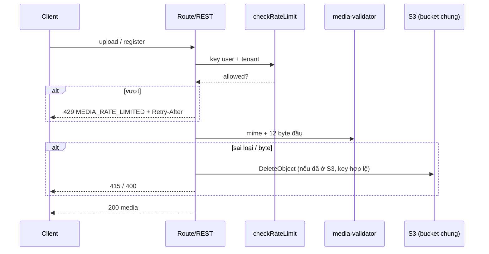
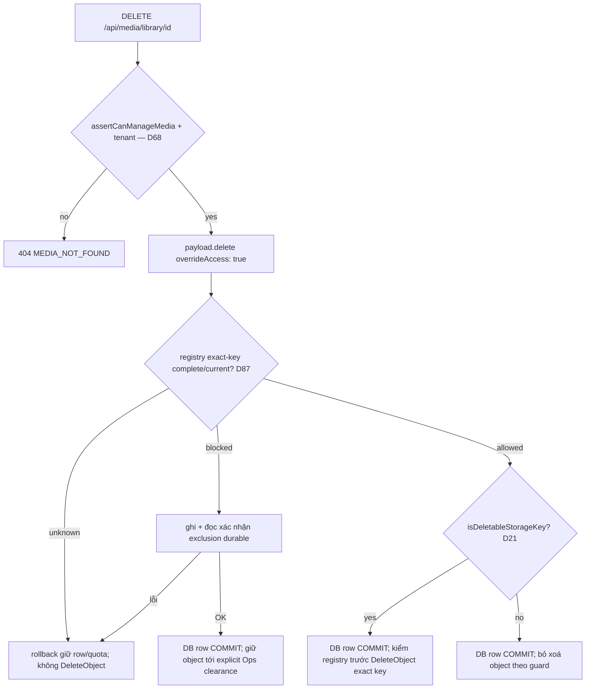

# PRD: Media Management — Sprint 0: Bảo mật & nền (F48-S0)

> **Version:** 1.0 | **Created:** 2026-11-09 | **Agent:** `docs-engineer`
> **Priority:** P0 | **Sprint:** F48 — S0 | **Size:** M (4–5 ngày dev + việc ops)
> **Depends on:** — | **Blocks:** F48-S1 (pipeline), mọi sprint sau
> **Overview:** [F48-media-management-overview.md](./F48-media-management-overview.md) · **Stories:** [F48-media-management-stories.md](../stories/F48-media-management-stories.md) · **Architecture:** [F48-media-management.md](../architecture/F48-media-management.md) · **Design:** [F48-media-management-design.md](../design/F48-media-management-design.md) · **QA:** [F48-media-management.md](../qa/F48-media-management.md) · Code tham chiếu: staging `5c3e3bdca`

---

> [!CAUTION]
> **SEC-1 là P0 và phải sửa ĐẦU TIÊN trong sprint.** Quy trình bắt buộc: viết test tái hiện (đỏ) trước → sửa → test xanh → review bảo mật. PRD này chỉ mô tả **hành vi phải bị chặn**, không mô tả cách khai thác. Không đưa chi tiết tái hiện vào issue/PR công khai; test tái hiện đặt tên trung tính.

> [!IMPORTANT]
> AC ở Section 11 copy nguyên văn từ `docs/stories/F48-media-management-stories.md` (đã đồng bộ D1–D67). Sửa AC thì sửa story trước rồi copy lại.

---

## 0. Story Traceability

| Story ID | Tiêu đề | File | Status |
|---|---|---|---|
| US-F48-01 | Khoá field hệ thống của media + chỉ ghi qua API an toàn (SEC-1, SEC-8) | [stories](../stories/F48-media-management-stories.md#us-f48-01) | Draft |
| US-F48-02 | Cứng hoá upload: whitelist định dạng, magic check mọi đường, rate limit, header, remotePatterns hẹp, nâng sharp (SEC-2,4,5,7,10,11) | [stories](../stories/F48-media-management-stories.md#us-f48-02) | Draft |
| US-F48-03 | Vận hành: xoay key S3, key riêng PW2, kiểm listing bucket, CDN + cache header (SEC-9, D16) | [stories](../stories/F48-media-management-stories.md#us-f48-03) | Draft |

### 0.1 Hiện trạng (audit code staging `1248713`, đối chiếu lại `5c3e3bdca`)

| File | Hiện trạng | SEC |
|---|---|---|
| `src/collections/Media.ts:195-288` | Field `tenant`, `private` đã khoá (super-admin); provenance `sourceProvider/sourceUrl/license*/attribution` khoá create/update. **Không** khoá `filename`, `prefix`, `_objectKey`, `mimeType`, `filesize`, `url`, `width`, `height`. `aiPrompt` đọc công khai. | SEC-1, SEC-8 |
| `src/collections/Media.ts:182` | `mimeTypes: ['image/*', 'video/*', 'application/pdf']` | SEC-5 |
| `src/app/api/media/library/[id]/route.ts:55` | `DELETE` (GH-2187) xoá bằng `payload.delete({ user, overrideAccess: false })` — collection access quyết định. Khi S0 đổi collection access sang super-admin, merchant sẽ không xoá được (D68) | SEC-1 (hệ quả) |
| `src/lib/media/carton-placeholder.ts:150-163` | Local API `payload.create` truyền `tenant` (`:154`) + `user` (`:162`) — guard field hệ thống không được chặn luồng này (D70) | SEC-1 (hồi quy) |
| `src/collections/Media.ts:134-160` | Hook magic: chỉ kiểm khi MIME `image/*` hoặc `video/mp4|webm`; video khác và PDF qua REST không kiểm byte | SEC-5 |
| `src/collections/Media.ts:86-95` | Handler local trả `Cache-Control` nhưng không `nosniff`/`Content-Disposition` cho file public | SEC-7 |
| `src/lib/media/media-access.ts:83-89` | `mediaReadAccess`: row non-private đọc công khai theo id | SEC-8 |
| `next.config.ts:88-107` | `remotePatterns: [{ protocol: 'https', hostname: '**' }]`, không `minimumCacheTTL` | SEC-2 |
| `src/app/api/media/upload/route.ts` | Không rate limit; dùng tên file gốc | SEC-4, SEC-6 |
| `src/app/api/media/register/route.ts:58-66` | Không rate limit; chấp nhận mọi key bắt đầu `u{userId}-` | SEC-4, SEC-10 |
| `src/lib/media/s3-presign.ts:7,35` | `EXPIRES_SECONDS = 300`, `content-length-range` min 0 | SEC-10 |
| `src/app/(dashboard)/actions/media.ts:9` | Server action `uploadMediaAction` không rate limit | SEC-4 |
| `/api/users/me/avatar`, `settings/payments/actions.ts` (`uploadQrMedia`), `/api/orders/[id]/upload-proof-direct` | Không rate limit | SEC-4 |
| `package.json` sharp 0.35.x | Advisory libvips/libheif (GHSA-f88m-g3jw-g9cj, CVE-2026-84383 — xác minh lại) | SEC-11 |
| `docs/tracking/OPEN_BLOCKERS.md` | Key DO Spaces lộ 2026-04-15 chưa xoay; 1 key toàn quyền bucket dùng chung | SEC-9 |

---

## 1. Problem Statement

- **SEC-1 (Cao):** các field mô tả vị trí object lưu trữ của một media (`filename`, `prefix`) có thể bị thay đổi qua API update bởi thành viên shop sở hữu row. Vì adapter lưu trữ xoá object theo giá trị hiện tại của các field này khi row bị xoá, hệ thống có thể bị điều khiển để xoá object **không thuộc row** — gồm object của PW1 trong bucket dùng chung. Đây là rủi ro mất dữ liệu không đảo ngược cho cả hai hệ thống.
- **SEC-8:** `GET /api/media/:id` trả `aiPrompt`, `sourceUrl` cho khách vô danh theo id tuần tự → lộ prompt nội bộ và nguồn ảnh.
- **SEC-2/4/5/7/10/11:** proxy ảnh mở (`https://**`) đốt chi phí Vercel Image Optimization; 6 đường upload không rate limit; video/PDF không kiểm byte; thiếu `nosniff`; presign tái dùng được 300 s và chấp nhận object rỗng; sharp có advisory.
- **SEC-9:** 1 key toàn quyền bucket dùng chung đã lộ 7 tháng chưa xoay.

---

## 2. Target User

- **Merchant/staff** (gián tiếp): không thấy thay đổi UI, chỉ thấy thông báo lỗi rõ hơn khi upload sai/ quá nhanh (en/ms).
- **Người mua**: upload biên lai bị giới hạn tần suất hợp lý.
- **Ops/Dev**: xoay key, cấu hình CDN, header.

---

## 3. Solution Overview

Đóng các lỗ hổng ở **tầng server** trước khi làm UI:
1. Khoá field hệ thống media ở 3 lớp: field access (**chỉ `update: false`** — D69; `_objectKey`/`prefix` khoá trong plugin chạy sau `s3Storage` — D55), hook `beforeOperation` cho request REST/GraphQL từ chối giá trị khác bản gốc (D58, D70), và **guard trước khi xoá object** (chỉ xoá khi key hợp lệ theo mẫu PW2). Ẩn field nội bộ khỏi read public.
2. Một **validator chung** (`validateMediaBytes` trong `media-upload-policy.ts` — tên file theo arch §6, D75): whitelist MIME tường minh + magic bytes, dùng ở mọi đường A/B/C/D + REST.
3. Rate limit theo user + tenant (+ IP cho người mua) bằng `checkRateLimit` sẵn có.
4. `remotePatterns` allowlist, header bảo mật, presign chặt.
5. Ops: xoay key, key riêng cho PW2, xác minh listing, CDN.

Không có migration DB trong S0. Sửa route `DELETE /api/media/library/[id]` cho khớp collection access mới (D68). **Gate deploy:** audit key bất thường (FR-01a) chạy trên production trước khi deploy S0 (D78).

---

## 4. Scope

### In Scope
- FR-01..FR-09 (US-F48-01..03).
- Script **chỉ đọc** liệt kê row media có `filename`/`prefix`/`_objectkey` bất thường (phát hiện row đã bị sửa trước khi vá).
- Thông điệp lỗi en/ms cho mọi mã lỗi mới.

### Out of Scope
- Pipeline re-encode, key theo hash (S1 — FR-11, FR-12).
- Strip EXIF (SEC-3) — giải quyết bằng re-encode ở S1.
- Tắt hẳn Payload REST write cho media (cân nhắc sau S2 khi mọi UI dùng route riêng — D15).
- Quét virus.

---

## 5. Success Metrics

| Metric | Target | Đo bằng |
|---|---|---|
| Test tái hiện SEC-1 | đỏ trước sửa, xanh sau sửa | CI (vitest integration) |
| Field hệ thống đổi được qua REST bởi non-super-admin | 0/12 field | Test tham số hoá 12 field (gồm `_objectKey`, D55) |
| Route upload không có rate limit | 0/7 (upload, register, presign, action, avatar, QR, proof) | Test 429 mỗi route theo ngưỡng D32 |
| `/_next/image` với host ngoài allowlist | 400 | Test e2e |
| `npm audit --audit-level=high` trên CI | 0 high/critical liên quan sharp | CI job |
| Key S3 cũ còn hiệu lực | 0 | Ops xác nhận + thử key cũ bị 403 |

---

## 6. User Story Summary

```
AS A chủ shop
I WANT  file của shop khác và của hệ thống cũ không thể bị xoá thông qua tài khoản của bất kỳ ai
SO THAT ảnh website của tôi không biến mất do lỗi hoặc do người khác
```
```
AS A nền tảng
I WANT  mọi đường upload kiểm loại file thật, giới hạn tần suất và không làm proxy ảnh mở
SO THAT tránh file độc hại, lạm dụng và chi phí ngoài dự kiến
```
```
AS A ops
I WANT  key S3 mới, phạm vi hẹp, có CDN và cache header
SO THAT rủi ro key lộ và chi phí băng thông giảm
```

---

## 7. Functional Requirements

| FR-ID | Requirement | Story Ref | Priority | Notes |
|---|---|---|:-:|---|
| FR-01 | Field hệ thống `filename, prefix, _objectKey, mimeType, filesize, url, width, height, contentHash, tenant, private, createdVia` (+ provenance `sourceProvider, sourceUrl, license*, attribution`) **chỉ server ghi**. (a) **D69:** field access **chỉ `update: false`** (kể cả super-admin với `filename/prefix/_objectKey/url`; super-admin vẫn đổi được `tenant/private` qua công cụ nội bộ) — khớp [arch §4.3](../architecture/F48-media-management.md#43-field-access-matrix-chặn-sec-1-sec-8--fr-01-fr-02-d15). **Không** đặt `create: false`: Payload `generateFileData` gán `filename/mimeType/filesize/width/height/url` trước `beforeValidate`, `create: false` sẽ gỡ chúng ⇒ upload `/admin` và Local API `payload.create({ file })` mất `filename`. Client REST tạo row đã bị collection access (super-admin) + guard (b) chặn. TC upload `/admin` (QA F48). **D55:** plugin-cloud-storage tự thêm và **ghi đè** field `_objectKey`/`prefix` → access của 2 field này phải đặt trong plugin chạy **sau** `s3Storage` (mở rộng `privateMediaAclPlugin` hoặc plugin mới); (b) **D22 + D58 + D70:** guard duy nhất ở `beforeOperation` (create/update) cho request **REST/GraphQL** (`req.payloadAPI !== 'local'`) có `req.user` **không phải super-admin**; Local API (kể cả mang `user`, vd carton placeholder) là code server tin cậy, đi qua — **D82:** tin cậy vì không đường nào đưa input client vào field hệ thống; Local API mặc định `overrideAccess: true` nên field access **không** áp; Local API ghi media có input client phải `overrideAccess: false` hoặc chỉ chép allowlist `alt/caption/displayName/folder`; route F48 áp cùng rule bằng schema strict: create có mặt field hệ thống, hoặc update có field hệ thống với giá trị **khác `originalDoc`** → 400 `MEDIA_FIELD_READONLY`, không lặng lẽ bỏ qua. **D65:** update theo `id` lấy `originalDoc` bằng `req.payload.findByID({ collection: 'media', id, depth: 0, overrideAccess: true, req })`; update **bulk theo `where`** qua REST/GraphQL có field hệ thống trong `data` → chặn luôn 400 `MEDIA_FIELD_READONLY` (không so từng doc; Local API bulk không qua guard — theo luật D82); log `media.readonly_rejected` {userId, tenantId, mediaId, fields}. Super-admin sửa alt trong `/admin` thành công; (c) update kèm file mới (thay file) bị từ chối; (d) **guard xoá object (D21):** `isDeletableStorageKey(row)` — tính trên key ghép đầy đủ `storageKey(row)` = join phần khác rỗng của `[prefix, _objectKey, filename]` (D64, đúng key adapter xoá); chỉ cho adapter xoá object khi key đó bắt đầu `pw2/`, **hoặc** key phẳng (không chứa `/`, tức `prefix`/`_objectKey` rỗng) và đúng `filename` server đã ghi của chính row đang xoá (`filename` not null). Row migrate PW1 (`filename` null, URL trỏ PW1) hoặc key không khớp → xoá row, **không** xoá object, log `media.skip_foreign_key`; id bị cờ audit (FR-01a) → cũng không xoá object (D78); (e) **D68:** route `DELETE /api/media/library/[id]` (`route.ts:55` đang `overrideAccess: false`) đổi sang `assertCanManageMedia(user, row)` + kiểm `row.tenant` = tenant đang chọn + `payload.delete({ overrideAccess: true })`; row tenant khác / global / private → 404 `MEDIA_NOT_FOUND` (M9). **Khi S0 triển khai** cập nhật kỳ vọng TC-PERF-187/188/191..193 trong `docs/qa/F-security-perf-upgrade.md` (191: `overrideAccess: true` sau `assertCanManageMedia`; 192: tenant khác/global/private → 404 thay 403; 187/188: `canDelete` tính bằng `canManageMedia` thay `canWriteMedia`) — việc của PR S0, tài liệu F48 chỉ ghi chú | US-F48-01 | P0 | SEC-1. Test đỏ trước. D68–D70 |
| FR-01a | Ops audit trước/sau deploy S0 và trước bật GC/bulk; script chỉ đọc DB/S3 media, ghi metadata audit private (không sửa/xoá row/object). Bootstrap/merge `pw2/reports/audit/protected-storage-keys.json` qua conditional PUT/ETag CAS bắt buộc + Spaces capability gate (§8.8) theo [lifecycle §8.7](../architecture/F48-media-management-lifecycle.md#87-d87--audit-exclusion-theo-exact-storage-key-p1-post-review), gắn exact key + mediaIds/lý do/revision complete; idlist legacy không đủ. Flagged row chỉ được xoá sau exclusion ghi/đọc lại xác nhận durable; entry tồn tại độc lập row/intent tới explicit Ops clearance. D81/D87: registry thiếu/lỗi/incomplete ⇒ rollback trước row/quota DELETE và không DeleteObject **mọi prefix**, kể cả pw2/; worker mất snapshot giữ retry, không xoá mù. Audit rerun/TTL/report retention không clear entry. TC-F48-12-23..26 (publish race + Ops alerts §8.8–§8.9) | US-F48-01 | P0 | D78/D81/D87; guard/quyền không đổi |
| FR-02 | `aiPrompt`, `sourceUrl` chỉ đọc được bởi thành viên active của tenant sở hữu hoặc super-admin (field access `read`). `alt`, `caption`, `attribution`, `licenseName`, `licenseUrl` giữ công khai (storefront + nghĩa vụ ghi nguồn). **(b) D79 — route `/api/media/private/[id]` (biên lai):** owner tenant, super-admin, hoặc staff cùng tenant có quyền `orders` → 200; staff cùng tenant không có `orders` → 403 `MEDIA_FORBIDDEN`; tenant khác hoặc id không private → 404 `MEDIA_NOT_FOUND`; anonymous → 401 `MEDIA_UNAUTHORIZED`. **Đổi code** so với staging (`canReadPrivateMedia` — `media-access.ts:46` — cho mọi thành viên active, `route.ts:73` trả 404 khi không đủ quyền); kiểm TC-PERF-145 khi triển khai | US-F48-01 | P0 | SEC-8, D79 |
| FR-03 | Whitelist MIME tường minh thay `image/*, video/*`: ảnh `image/jpeg, image/png, image/webp, image/x-icon, image/vnd.microsoft.icon`; video `video/mp4, video/webm`; `application/pdf` **chỉ** luồng payment proof (private). **D23:** GIF/SVG/AVIF/HEIC/TIFF (và txt/html/video khác) bị từ chối, thông báo gợi ý đổi sang PNG/WebP/JPEG. Magic check bắt buộc ở **mọi** đường: A `/api/media/upload`, B `register`, C `uploadMediaAction`, D (avatar, QR, proof, feedback, studio evidence), REST `POST /api/media`. PDF kiểm `%PDF-` tại offset 0. MIME ngoài whitelist → 415 `MEDIA_UNSUPPORTED_TYPE`; byte không khớp MIME khai báo → 415 `MEDIA_CONTENT_MISMATCH` và xoá object tạm (nếu có, key hợp lệ) | US-F48-02 | P0 | SEC-5 |
| FR-04 | Rate limit theo **D32** (dùng `checkRateLimit`, Upstash): presign 60/user/phút + 120/tenant/phút; register 60/user/phút + 120/tenant/phút; `/api/media/upload` + `uploadMediaAction` (fallback, sẽ gỡ khỏi UI ở S2) dùng chung ngưỡng presign; avatar 10/user/giờ; QR 10/user/giờ; `upload-proof-direct` 5/đơn/giờ + 20/IP/giờ (người mua: theo đơn + IP, không theo tenant). Ngưỡng S1/S2: import-url 10/30 mỗi phút, bulk delete 10/20 mỗi phút. Vượt → 429 `MEDIA_RATE_LIMITED` + `Retry-After` | US-F48-02 | P0 | SEC-4. Thay 60/user/giờ hiện tại ở presign |
| FR-04a | **CSRF (D43):** mọi route media thay đổi trạng thái (presign, register, upload, metadata, xoá, thư mục, import-url) kiểm `Origin` (hoặc `Sec-Fetch-Site`) là same-origin; cookie phiên SameSite. Khác origin → 403 `MEDIA_FORBIDDEN`, không thay đổi gì | US-F48-02 | P0 | TC-F48-05-18 |
| FR-05 | `next.config.ts` `images.remotePatterns` thay `https://**` bằng allowlist: host S3 public (từ `NEXT_PUBLIC_S3_ENDPOINT`, pathname `/{bucket}/**`), host CDN PW2 (env mới `NEXT_PUBLIC_MEDIA_CDN_URL`, lấy hostname; nếu có), host PW1 cũ, `cdn.pixabay.com`, `upload.wikimedia.org`; `minimumCacheTTL: 86400` (1 ngày — D62: ảnh đã gỡ không bị optimizer giữ lâu); `formats: ['image/webp']`; `dangerouslyAllowSVG: false`. Component ảnh dùng chung render `unoptimized` cho URL ngoài allowlist thay vì lỗi | US-F48-02, US-F48-03 | P0 | SEC-2. Audit host trước khi đổi (R-S0-02) |
| FR-06 | Header: (a) toàn cục `X-Content-Type-Options: nosniff` qua `headers()` của Next; (b) handler local `mediaFileFallbackHandler` + route private thêm `Content-Disposition: inline` cho ảnh/video, `attachment` cho loại khác, luôn `nosniff`; (c) object S3 mới ghi `Cache-Control: public, max-age=31536000, immutable` + `Content-Disposition` (field presign + điều kiện policy; S1 ghi khi PutObject); (d) `nosniff` trên object S3/CDN: spike xác minh DO Spaces/CDN có trả được không (S3 chỉ nhận một số header metadata chuẩn) — nếu không, ghi rủi ro R-S0-07 và bù bằng Content-Type pin + re-encode S1 | US-F48-02, US-F48-03 | P0 | SEC-7 |
| FR-07 | Presign: `Expires` ảnh 60 s, video 600 s (D35); `content-length-range` min **1** (không dựa vào điều kiện này — register vẫn kiểm `ContentLength ≥ 1`, D62); register chỉ chấp nhận key khớp regex chặt `^u\d+-[a-z0-9-]{1,60}-[0-9a-f-]{36}\.(jpg|png|webp|ico|mp4|webm)$` **và** tiền tố đúng user hiện tại; key đã được đăng ký bởi row khác → 409 `MEDIA_KEY_INVALID` | US-F48-02 | P0 | SEC-10. Regex thay bằng `uploadToken` ở S1 |
| FR-08 | Nâng `sharp` lên bản 0.35.x mới nhất vá advisory; thêm bước CI `npm audit --omit=dev --audit-level=high` (fail PR khi có high/critical ở dependency runtime); không bật AVIF/SVG ở image optimizer | US-F48-02 | P0 | SEC-11. Sửa `.github/workflows/ci.yml` → đọc `.claude/rules/vercel-deploy.md` |
| FR-09 | Ops: (a) xoay key DO Spaces lộ 2026-04-15, vô hiệu key cũ; (b) tạo key riêng cho PW2 (Spaces per-bucket key, quyền tối thiểu có thể); (c) xác nhận listing bucket anonymous trả 403; (d) tuỳ chọn, không chặn S0 (D16): bật DO Spaces CDN + custom domain cookieless; (e) cập nhật env Vercel (staging + production) + `.env.staging.example`, `.env.production.example` | US-F48-03 | P0 | SEC-9, D16. Không commit secret |

---

## 8. Business Rules

- **BR-01:** Chỉ code server (Local API — có hoặc không `user`, D70 —, SQL trong `register-media.ts` (S1: `media-row-repository.ts`), hook storage) được ghi field hệ thống. Super-admin qua REST chỉ được đổi `tenant`, `private`; field lưu trữ do field access giữ nguyên.
- **BR-02 (D22, D58):** Request create/update media từ client (non-super-admin) chỉ được đổi `alt`, `caption` (S1 thêm `displayName`, S3 `folder`). Create có mặt field hệ thống, hoặc update gửi field hệ thống với giá trị **khác bản gốc** → 400 `MEDIA_FIELD_READONLY` (gửi lại đúng giá trị cũ không bị chặn, để form Payload admin lưu được). Form admin vẫn đặt `admin.readOnly` cho các field này.
- **BR-02a:** Giới hạn độ dài (D32): `alt` ≤ 250, `caption` ≤ 500, `displayName` ≤ 120 ký tự; vượt → 400 `MEDIA_VALIDATION` (áp từ S0 cho alt/caption).
- **BR-03 (D21):** Chỉ xoá object khi key bắt đầu `pw2/` hoặc là key phẳng đúng `filename` server đã ghi của chính row. Row PW1 (`filename` null) → chỉ xoá row; UI hiển thị badge "Legacy" (S1). Không bao giờ xoá object ngoài 2 trường hợp trên.
- **BR-03a:** Sửa/xoá media của tenant khác hoặc media global (tenant null: stock, carton placeholder) qua **route F48** → **404** (không tiết lộ tồn tại); qua Payload REST/GraphQL (collection access chỉ super-admin) → **403** Forbidden (M9). Cả hai: không thay đổi gì.
- **BR-04:** PDF chỉ chấp nhận ở luồng payment proof; row PDF luôn `private = true`.
- **BR-05 (D23):** SVG, GIF, AVIF, HEIC, TIFF không được chấp nhận ở bất kỳ đường upload nào; thông báo gợi ý đổi sang PNG/WebP/JPEG. (PW1 prod: gif 5, svg 3, txt 2 file — ảnh hưởng không đáng kể.)
- **BR-06:** Rate limit đếm theo user id cho người đăng nhập, theo order id + IP cho người mua vô danh; tenant limit đếm theo tenant active của user. Vượt ngưỡng của tenant A không ảnh hưởng tenant B.
- **BR-06a (D24):** Biên lai người mua (private, `pw2/private/`) không tính quota merchant; luồng thanh toán không bao giờ bị chặn vì quota (chỉ bị rate limit theo đơn/IP).
- **BR-07:** Khi Upstash lỗi, rate limit fail-open sang bộ nhớ (theo `checkRateLimit` hiện tại) — trừ khi sau này có yêu cầu `failClosed`.
- **BR-08:** Thông điệp lỗi trả về client không lộ key S3, bucket, endpoint hay stack trace.
- **BR-09:** Key/secret mới chỉ nằm ở Vercel Dashboard; GitHub Secrets không chứa key S3 (theo `.claude/rules/env-vars.md`).

---

## 9. User Flow

### 9.1 Update media (sau S0)
```
Client gửi PATCH/REST update media {alt, caption, filename?...}
  ↓
Access collection: Payload REST/GraphQL → chỉ super-admin (member → 403); route F48 → assertCanManageMedia + tenant của row (rồi Local API overrideAccess: true — D68)
  ├── Route F48: không thuộc tenant / media global → 404 MEDIA_NOT_FOUND (không tiết lộ tồn tại)
  ↓
rejectSystemFieldWrites (beforeOperation create + update, REST/GraphQL, req.user không phải super-admin — D58, D70; route F48: schema strict):
  ├── Create có mặt field hệ thống / update field hệ thống KHÁC originalDoc → 400 MEDIA_FIELD_READONLY + log (D22)
  ├── Có req.file (thay file) → 400 MEDIA_FIELD_READONLY
  ├── alt > 250 / caption > 500 → 400 MEDIA_VALIDATION
  ↓
Field access (update: false — D69; `_objectKey`/`prefix` khoá trong plugin sau s3Storage — D55) — lớp phòng thủ thứ 2
  ↓
Lưu alt/caption → 200
```

### 9.2 Xoá media
```
DELETE /api/media/library/{id}            (Payload REST DELETE: chỉ super-admin, member → 403)
  ↓
assertCanManageMedia(user, row) + row.tenant = tenant đang chọn, không private? ── không → 404 MEDIA_NOT_FOUND
  ↓
payload.delete({ overrideAccess: true })    (D68 — route.ts:55 hiện overrideAccess: false)
  ↓
registry exact-key complete/current? (D87 §8.7) ── unknown/lỗi → rollback giữ row/quota, không DeleteObject mọi prefix
  ├── flagged id/key → ghi + đọc xác nhận exclusion durable; lỗi → rollback; OK → xoá row, giữ object tới explicit Ops clearance
  └── allowed → isDeletableStorageKey(row)? (D21)
       ├── pw2/ hoặc key phẳng đúng filename → DB row/quota COMMIT rồi guard/registry lại trước DeleteObject exact key (D87)
       └── filename null (PW1) / key khác → xoá row, BỎ QUA object, log "skip-foreign-key"
```

### 9.3 Upload qua mọi đường
```
Request upload (A/B/C/D/REST)
  ↓ auth → rate limit (429?) → MIME whitelist (415 MEDIA_UNSUPPORTED_TYPE?) → size (413?) → magic (415 MEDIA_CONTENT_MISMATCH?)
  ↓ hợp lệ → tạo row như hiện tại
```



---

## 10. Screen Layout

S0 không có màn hình mới. Thay đổi UI duy nhất: toast/inline error ở các điểm upload hiện tại hiển thị thông điệp theo mã lỗi (Section 15.3) bằng locale hiện tại (en/ms), thay chuỗi cứng.

---

## 11. Acceptance Criteria (copy từ story — Status Draft)

> Nguồn: [F48-media-management-stories.md](../stories/F48-media-management-stories.md). TC-ID: `TC-F48-<story>-<nn>` trong `docs/qa/F48-media-management.md`. Quyết định áp vào AC: D21 (AC-3 US-01), D22 + D55 + D58 (AC-2, AC-6 US-01: từ chối 400 khi giá trị khác bản gốc; `_objectKey` khoá), M9 (AC-4: route 404 / REST 403), D23 + D37 (AC-1 US-02), D32 + D43 (AC-3 US-02), D35 (AC-6 US-02).

### AC-01 (US-F48-01 AC-1): Sửa metadata được phép — TC-F48-01-01
```gherkin
GIVEN chủ shop A đăng nhập, có media M thuộc tenant A
WHEN  gửi cập nhật M chỉ với alt, caption, displayName, folder (folder thuộc tenant A)
THEN  4 field được lưu
  AND filename, prefix, _objectKey, mimeType, filesize, url, width, height, contentHash, tenant, private, createdVia giữ nguyên
```
> S0 chỉ có `alt`, `caption`; `displayName` thêm ở S1, `folder` ở S3 — TC-F48-01-01 mở rộng theo sprint.

### AC-02 (US-F48-01 AC-2): Từ chối ghi field hệ thống (mọi đường ghi) — TC-F48-01-02
```gherkin
GIVEN chủ shop A có media M
WHEN  gửi cập nhật M đặt giá trị KHÁC bản gốc cho bất kỳ field nào trong: filename, prefix, _objectKey, mimeType, filesize, url, width, height, contentHash, tenant, private, createdVia
  (qua Payload REST /api/media/:id, GraphQL hoặc route media riêng; Local API không qua guard — D70, nhưng field access `update` vẫn giữ nguyên giá trị khi `overrideAccess: false`)
THEN  request bị từ chối 400 với mã lỗi "MEDIA_FIELD_READONLY", không field nào của M thay đổi
  AND sự kiện được ghi log kèm userId, tenantId, mediaId, danh sách field bị từ chối
```

### AC-03 (US-F48-01 AC-3): Xoá row chỉ xoá đúng object của chính row đó — TC-F48-01-03
```gherkin
GIVEN media M thuộc tenant A, key lưu trữ do server sinh khi tạo
WHEN  chủ shop A xoá M
THEN  chỉ xoá object khi key bắt đầu bằng `pw2/`, HOẶC key phẳng (không có `/`) và đúng bằng `filename` khác null của chính row M (D21)
  AND mọi trường hợp khác (vd row PW1, filename null) → chỉ xoá row, bỏ qua object, ghi log "skip-foreign-key"; UI gắn nhãn "Legacy"
  AND key bị audit chặn phải có exclusion exact key ghi/đọc xác nhận durable trước khi row mất; giữ object tới explicit Ops clearance (D87 §8.7)
  AND metadata registry thiếu/lỗi/incomplete ⇒ rollback giữ row/quota và không xoá object mọi prefix; row/intent mất không bỏ qua kiểm exact key
```
> Key phẳng (D21b) = không chứa `/`, bằng đúng `filename` của chính row (`u{id}-{slug}-{uuid}.{ext}` từ `buildMediaKey`, hoặc tên Payload sinh ở đường A/C). Test tái hiện SEC-1 (đỏ trước) thuộc TC này.

### AC-04 (US-F48-01 AC-4): Tenant isolation khi sửa/xoá — TC-F48-01-04
```gherkin
GIVEN user thuộc tenant A
WHEN  gửi sửa hoặc xoá media thuộc tenant B, hoặc media global (tenant null: stock, carton placeholder)
THEN  route media F48 trả 404 (không tiết lộ media có tồn tại), Payload REST/GraphQL trả 403 (M9); không thay đổi gì
  AND không object S3 nào bị xoá
```

### AC-05 (US-F48-01 AC-5): Đọc public không lộ dữ liệu nội bộ (SEC-8) — TC-F48-01-05
```gherkin
GIVEN media non-private N có aiPrompt và sourceUrl
WHEN  khách chưa đăng nhập gọi GET /api/media/:id hoặc list /api/media (kể cả duyệt id tuần tự)
THEN  response không chứa aiPrompt, sourceUrl
  AND media private (payment proof) trả 403/404 qua /api/media; chỉ đọc được qua /api/media/private/[id]
  AND /api/media/private/[id] (D79): owner, super-admin hoặc staff cùng tenant có quyền `orders` → 200; staff cùng tenant không có `orders` → 403 "MEDIA_FORBIDDEN"; user tenant khác hoặc id không phải private → 404 "MEDIA_NOT_FOUND"; chưa đăng nhập → 401 "MEDIA_UNAUTHORIZED"
  AND owner tenant của N vẫn xem đủ aiPrompt/sourceUrl trong dashboard
```

### AC-06 (US-F48-01 AC-6): Tạo mới không nhận giá trị field hệ thống từ client — TC-F48-01-06
```gherkin
GIVEN client gửi tạo media kèm tenant của shop khác, private=false cho file proof, hoặc createdVia="seed"
WHEN  server xử lý
THEN  request bị từ chối 400 "MEDIA_FIELD_READONLY", không tạo row (D22) — qua route F48 (register, upload proof); Payload REST `POST /api/media` của merchant bị 403 trước vì collection access chỉ super-admin (INV-3, D69)
  AND tenant lấy theo session, private/createdVia do luồng server quyết định
```

### AC-07 (US-F48-02 AC-1): Whitelist MIME tường minh — TC-F48-02-01
```gherkin
GIVEN chủ shop upload qua bất kỳ đường A/B/C/D hoặc Payload REST POST /api/media
WHEN  file là jpeg, png, webp (ảnh) hoặc mp4, webm (video) và nội dung khớp định dạng; ico chỉ với purpose `favicon` (D37)
THEN  upload được chấp nhận
WHEN  file là svg, gif, avif, heic, tiff, txt, html, video khác mp4/webm, hoặc pdf ngoài luồng payment proof (D23)
THEN  bị từ chối 415 "MEDIA_UNSUPPORTED_TYPE" với thông báo en/ms liệt kê định dạng hợp lệ
```
> D23: thông báo gợi ý đổi sang PNG/WebP/JPEG. D37: ICO ở purpose khác `favicon` → 415 `MEDIA_UNSUPPORTED_TYPE` (áp từ S1 khi có `purpose`).

### AC-08 (US-F48-02 AC-2): File giả mạo đuôi bị chặn ở mọi đường — TC-F48-02-02
```gherkin
GIVEN file tên "banner.jpg", Content-Type image/jpeg nhưng byte đầu là HTML, PDF, SVG hoặc ZIP
WHEN  upload qua A, B (presign + register), C (server action), D (avatar, QR, proof) hoặc REST
THEN  bị từ chối 415 "MEDIA_CONTENT_MISMATCH" ("File content does not match its type" / "Kandungan fail tidak sepadan dengan jenisnya")
  AND không row media nào được tạo, object tạm (nếu có) bị xoá
```

### AC-09 (US-F48-02 AC-3): Rate limit — TC-F48-02-03
```gherkin
GIVEN một user (hoặc một tenant) gửi upload/register/proof/avatar/QR vượt ngưỡng cấu hình trong cửa sổ thời gian
WHEN  request vượt ngưỡng đến
THEN  nhận 429 "MEDIA_RATE_LIMITED" kèm header Retry-After và thông báo i18n "Too many uploads, try again in N seconds"
  AND request trong ngưỡng của tenant khác không bị ảnh hưởng
  AND người mua upload proof bị giới hạn theo IP + order, không theo tenant
```
> Ngưỡng: FR-04 (D32).

### AC-10 (US-F48-02 AC-4): Image optimizer không là proxy mở — TC-F48-02-04
```gherkin
GIVEN remotePatterns chỉ gồm host CDN/S3 của PW2, host PW1 cũ, Pixabay, Wikimedia
WHEN  có request /_next/image?url= tới host ngoài danh sách
THEN  trả 400, không tải ảnh ngoài
  AND ảnh từ host trong danh sách vẫn hiển thị bình thường trên storefront
  AND image optimizer không bật AVIF/SVG, có minimumCacheTTL
```

### AC-11 (US-F48-02 AC-5): Header bảo mật trên file media — TC-F48-02-05
```gherkin
GIVEN một media đã upload (object S3 hoặc handler local)
WHEN  trình duyệt tải file
THEN  response có X-Content-Type-Options: nosniff, Content-Type đúng định dạng đã kiểm
  AND Content-Disposition: inline cho ảnh/video, attachment cho mọi loại khác
  AND Cache-Control theo FR-06
```
> Với object S3/CDN: phụ thuộc spike FR-06(d); nếu DO không hỗ trợ `nosniff`, TC ghi "không áp dụng cho S3" + rủi ro R-S0-07, cần PO/QA chấp nhận.

### AC-12 (US-F48-02 AC-6): Presign chặt — TC-F48-02-06
```gherkin
GIVEN chủ shop xin presign upload
WHEN  dùng presign ảnh sau 60 giây / video sau 600 giây (D35), gửi file 0 byte, hoặc gọi register với key không khớp key tmp đã cấp cho chính user đó
THEN  S3 từ chối (hết hạn / content-length-range min 1) hoặc register trả 400 "MEDIA_KEY_INVALID"
  AND không row nào được tạo
```
> S0: regex key hiện tại `u{userId}-…` (FR-07); S1 chuyển sang key `pw2/tmp/{uuid}` + `uploadToken` (HMAC, D36).

### AC-13 (US-F48-02 AC-7): Sharp an toàn và cổng audit — TC-F48-02-07
```gherkin
GIVEN pipeline CI chạy trên PR
WHEN  sharp thấp hơn bản 0.35.x mới nhất đã vá advisory libvips/libheif, hoặc npm audit có lỗ hổng high/critical ở sharp
THEN  CI báo đỏ
```

### AC-14 (US-F48-03 AC-1): Xoay key bị lộ — TC-F48-03-01
```gherkin
GIVEN key DO Spaces bị lộ ngày 2026-04-15 vẫn còn hiệu lực
WHEN  super-admin tạo key mới, cập nhật Vercel Dashboard (staging, production) rồi thu hồi key cũ
THEN  upload, đọc private, xoá media trên staging và production chạy bình thường với key mới
  AND gọi S3 bằng key cũ nhận AccessDenied
```

### AC-15 (US-F48-03 AC-2): Key riêng cho PW2 — TC-F48-03-02
```gherkin
GIVEN PW1 và PW2 dùng chung bucket
WHEN  cấu hình PW2
THEN  PW2 dùng key riêng (không dùng chung key với PW1), với phạm vi tối thiểu DO Spaces hỗ trợ
  AND nếu DO không giới hạn được theo prefix, rủi ro được ghi trong PRD và bảo vệ bằng guard prefix `pw2/` ở code (NFR-05)
```
> Rủi ro đã ghi: R-S0-08.

### AC-16 (US-F48-03 AC-3): Bucket không cho liệt kê công khai — TC-F48-03-03
```gherkin
GIVEN một client không có chữ ký
WHEN  gửi GET tới gốc bucket (list objects)
THEN  nhận AccessDenied, không trả danh sách key
  AND object public-read vẫn đọc được bằng URL trực tiếp
```

### AC-17 (US-F48-03 AC-4): CDN + cache header cho object mới — TC-F48-03-04
```gherkin
GIVEN CDN DO Spaces được bật với domain cookieless (tuỳ chọn, D16; chưa bật thì giữ URL path-style hiện tại)
WHEN  media mới upload theo key hash (US-F48-04)
THEN  URL lưu trong row dùng host CDN
  AND object có Cache-Control: public, max-age=31536000, immutable và nosniff
  AND request tới domain CDN không mang cookie của dashboard/storefront
```
> Phần "key hash" chỉ kiểm được sau S1; ở S0 kiểm CDN + Cache-Control trên object upload qua presign. `url` là field ảo sinh bởi `generateFileURL` → đổi sang host CDN bằng `s3PublicUrl()`, không ghi URL vào DB.

---

## 12. Non-Functional Requirements

| ID | Category | Requirement | Notes |
|---|---|---|---|
| NFR-S0-01 | Performance | Thêm field guard + validator không tăng p95 route upload/register quá **+50 ms** | Đo trước/sau trên staging |
| NFR-S0-02 | Performance | Rate limit check (Upstash) p95 **< 30 ms**/lần; timeout theo `REDIS_TIMEOUT_MS` | |
| NFR-S0-03 | Security | **0** field hệ thống ghi được bởi non-super-admin (12/12 test pass); **0** lệnh DeleteObject tới key không hợp lệ | |
| NFR-S0-04 | Security | `npm audit` runtime: **0** high/critical tại thời điểm merge | |
| NFR-S0-05 | Chi phí | Số lượt Vercel Image Optimization cho host ngoài allowlist = **0** sau deploy (theo Vercel usage 7 ngày) | SEC-2 |
| NFR-06 | i18n | 100% mã lỗi mới có bản en + ms | Overview NFR-06 |
| NFR-S0-06 | Availability | Xoay key: downtime upload **≤ 5 phút** (cập nhật env + redeploy) | Ops |

---

## 13. Technical Architecture

### 13.1 Components

| Component | File | Thay đổi |
|---|---|---|
| `Media` collection | `src/collections/Media.ts` | Field access `update` (D69), `beforeOperation` guard REST/GraphQL (D58, D70), `beforeDelete` guard, `mimeTypes` tường minh, `nosniff` handler local |
| Route xoá | `src/app/api/media/library/[id]/route.ts` | `assertCanManageMedia` + tenant + `overrideAccess: true`, 404 `MEDIA_NOT_FOUND` (D68) |
| Field guard | `src/lib/media/media-field-guards.ts` (mới) | `SYSTEM_MEDIA_FIELDS`, `rejectSystemFieldWrites`, `isDeletableStorageKey` |
| Validator | `src/lib/media/media-upload-policy.ts` (mới — tên theo arch §6, D75), `image-signature.ts` | `validateMediaBytes(kind, mime, head)`, thêm `hasValidPdfSignature` |
| Error codes | `src/lib/media/media-errors.ts` (mới) | `MediaErrorCode`, `mediaErrorResponse()` |
| Permissions | `src/lib/media/media-permissions.ts` (mới) | `canManageMedia`, `assertCanManageMedia` (S0 dùng cho route xoá; S3 thêm quyền `media`) |
| CSRF | `src/lib/media/media-csrf-guard.ts` (mới) | FR-04a |
| Rate limit | `src/lib/media/media-rate-limit.ts` (mới) | Bọc `checkRateLimit` theo bảng FR-04 |
| Presign | `src/lib/media/s3-presign.ts` | ảnh 60 s / video 600 s, min 1, `Cache-Control` field |
| Next config | `next.config.ts` | `remotePatterns`, `minimumCacheTTL`, header `nosniff` |
| Field lock plugin | `src/lib/media/media-field-lock-plugin.ts` (mới) hoặc mở rộng `privateMediaAclPlugin` | Đặt **sau** `s3Storage` trong `plugins`; khoá `_objectKey`/`prefix` (D55) |
| Audit script | `scripts/media-audit-suspicious-keys.ts` (mới) | Đọc DB/S3 chỉ đọc; ghi metadata audit/registry JSON `pw2/reports/audit/` (ops chạy — D81/D87 §8.7) |

### 13.2 Type definitions — hiện tại (trích code thật)

```ts
// src/lib/media/upload-limits.ts
export const UPLOAD_LIMITS = {
    image: 10 * 1024 * 1024, // 10 MB
    video: 100 * 1024 * 1024, // 100 MB
    pdf: 20 * 1024 * 1024, // 20 MB  → S0 đổi 5 MB (D9, chỉ proof)
} as const
export type UploadKind = keyof typeof UPLOAD_LIMITS

// src/lib/media/image-signature.ts
export const SUPPORTED_IMAGE_MIMES = new Set([
    'image/jpeg', 'image/png', 'image/webp', 'image/x-icon', 'image/vnd.microsoft.icon',
])

// src/lib/rateLimit.ts
export interface RateLimitResult { allowed: boolean; remaining: number; resetAt: number; unavailable?: true }
export async function checkRateLimit(key: string, limit?: number, windowMs?: number, options?: RateLimitOptions): Promise<RateLimitResult>

// src/lib/media/s3-presign.ts
const EXPIRES_SECONDS = 300            // → ảnh 60, video 600 (D35)
['content-length-range', 0, max]       // → [1, max]
```

### 13.3 Type definitions — đích

```ts
// src/lib/media/media-field-guards.ts
export const SYSTEM_MEDIA_FIELDS = [
    'filename', 'prefix', '_objectKey', 'mimeType', 'filesize', 'url', 'width', 'height',
    'contentHash', 'tenant', 'private', 'createdVia', // contentHash/createdVia: cột thêm ở S1, khoá ngay từ S0
    'sourceProvider', 'sourceUrl', 'licenseName', 'licenseUrl', 'attribution',
] as const
export type SystemMediaField = (typeof SYSTEM_MEDIA_FIELDS)[number]

/** beforeOperation (D58, D70): for REST/GraphQL requests (req.payloadAPI !== 'local') by a non-super-admin user, throws
 *  APIError(400, MEDIA_FIELD_READONLY) when create carries any system field, or update sets a system field to a value
 *  different from originalDoc. Local API (trusted server code, with or without `user`) passes.
 *  D65: update by id loads originalDoc via req.payload.findByID({ id, depth: 0, overrideAccess: true, req });
 *  bulk update by `where` whose data carries any system field is rejected outright (MEDIA_FIELD_READONLY). */
export const rejectSystemFieldWrites: CollectionBeforeOperationHook

/**
 * D21: the storage adapter may delete the object only when the key starts with `pw2/`, or the key is flat (no `/`)
 * and equals the filename the server stored for THIS row. PW1 rows (filename null) never delete an object.
 * D64: "key" = storageKey(row) = non-empty parts of [prefix, _objectKey, filename] joined by `/` (same as the plugin).
 */
export function isDeletableStorageKey(row: { _objectKey?: string | null; prefix?: string | null; filename?: string | null }): boolean

// src/lib/media/media-upload-policy.ts (S0 phần validator; S1 thêm bảng policy theo purpose)
// Danh sách purpose chuẩn cho cả F48 (S1 `MediaUploadPurpose` là tập con dùng cho presign/register)
export type MediaPurpose =
    | 'library' | 'product' | 'block' | 'blog' | 'logo' | 'favicon' | 'og'
    | 'payment-qr' | 'avatar' | 'payment-proof' | 'feedback' | 'issue-evidence'
export type ValidationResult =
    | { ok: true; kind: UploadKind; mime: AllowedMime }
    | { ok: false; code: 'MEDIA_UNSUPPORTED_TYPE' | 'MEDIA_CONTENT_MISMATCH' | 'MEDIA_TOO_LARGE'; status: 413 | 415 }
export type AllowedMime =
    | 'image/jpeg' | 'image/png' | 'image/webp' | 'image/x-icon' | 'image/vnd.microsoft.icon'
    | 'video/mp4' | 'video/webm' | 'application/pdf'
export function validateMediaBytes(input: { purpose: MediaPurpose; mime: string; size: number; head: Uint8Array }): ValidationResult
```

### 13.4 Data Flow (guard xoá)



> Ghi chú triển khai: cơ chế "bỏ qua xoá object" phải được xác minh với `@payloadcms/plugin-cloud-storage` 3.91 (ví dụ: `beforeDelete` xoá `filename`/`prefix` khỏi doc được truyền cho afterDelete, hoặc wrap adapter `handleDelete`). Chi tiết chốt ở `docs/architecture/F48-media-management.md`.

---

## 14. Dependencies

| Dependency | Status | Action |
|---|---|---|
| Quyền DO Spaces tạo key mới / per-bucket key | ⬜ | Ops |
| Domain CDN cookieless (`media.<domain>`) + DNS/TLS | Tuỳ chọn | Ops (câu hỏi 4 overview); không chặn release, chưa có thì dùng URL path-style (D16) |
| Danh sách host ảnh đang dùng trên site live (cho allowlist) | ⬜ | Dev chạy query block JSON trước khi đổi FR-05 |
| Upstash Redis (rate limit) | ✅ | Đã có |
| Env mới `NEXT_PUBLIC_MEDIA_CDN_URL` (D36; 3 env còn lại thêm ở S1/S4) | ⬜ | Vercel Dashboard + `.env.*.example` |
| MinIO service trong job CI integration (D42) | ⬜ | Điều kiện tiên quyết cho TC SEC-1 (TC-F48-01-03) và NFR-05 |

---

## 15. API Contract

### 15.1 Envelope lỗi chung (giữ tương thích `{ error }` hiện có)

```ts
export type MediaErrorCode =
    | 'MEDIA_UNAUTHORIZED' | 'MEDIA_FORBIDDEN' | 'MEDIA_NOT_FOUND'
    | 'MEDIA_FIELD_READONLY' | 'MEDIA_VALIDATION' | 'MEDIA_UNSUPPORTED_TYPE' | 'MEDIA_CONTENT_MISMATCH'
    | 'MEDIA_TOO_LARGE' | 'MEDIA_RATE_LIMITED' | 'MEDIA_KEY_INVALID'
    | 'MEDIA_UPLOAD_EXPIRED' | 'MEDIA_STORAGE_UNAVAILABLE'

export interface MediaErrorBody {
    error: string          // thông điệp en (tương thích client cũ)
    code: MediaErrorCode   // client tra i18n theo code
    retryAfterSec?: number // chỉ với MEDIA_RATE_LIMITED
}
```

### 15.2 Endpoint thay đổi

```
POST /api/media/presign                       Auth: required
Request:  { filename: string; contentType: AllowedMime; size: number }
Response: { url: string; fields: Record<string,string>; key: string; publicUrl: string }
Errors:   401 MEDIA_UNAUTHORIZED | 403 MEDIA_FORBIDDEN (CSRF) | 413 MEDIA_TOO_LARGE | 415 MEDIA_UNSUPPORTED_TYPE | 429 MEDIA_RATE_LIMITED | 503 MEDIA_STORAGE_UNAVAILABLE
Thay đổi: rate limit user+tenant; Expires ảnh 60s / video 600s; content-length-range [1, max]; fields thêm Cache-Control; CSRF FR-04a

POST /api/media/register                      Auth: required
Request:  { key: string; alt?: string }
Response: { id: number; url: string; filename: string; mimeType: string; filesize: number }
Errors:   400 MEDIA_KEY_INVALID | 409 MEDIA_KEY_INVALID | 413 MEDIA_TOO_LARGE | 415 MEDIA_UNSUPPORTED_TYPE | 415 MEDIA_CONTENT_MISMATCH | 429 MEDIA_RATE_LIMITED
Thay đổi: regex key chặt; magic cho video; rate limit

PATCH /api/media/{id} (Payload REST)          Auth: super-admin (member → 403, M9)
Request:  { alt?: string; caption?: string }
Errors:   400 MEDIA_FIELD_READONLY khi body có field hệ thống khác bản gốc | 400 MEDIA_VALIDATION | 403 (member)
Ghi chú:  member sửa metadata qua route F48 `PATCH /api/media/library/[id]` (S1); không client nào gọi REST ghi (arch §4.3)

DELETE /api/media/library/{id}                Auth: required (assertCanManageMedia)
Response: { ok: true, id }   (S4 đổi sang hợp đồng §5.2 arch: { id; freedBytes; brokenRefs? })
Errors:   401 MEDIA_UNAUTHORIZED | 403 MEDIA_FORBIDDEN (CSRF) | 404 MEDIA_NOT_FOUND (không tồn tại / tenant khác / global / private)
Thay đổi: D68 — assertCanManageMedia + tenant + payload.delete({ overrideAccess: true }) thay overrideAccess: false (route.ts:55)

GET /api/media/{id} (Payload REST)            Auth: public (non-private)
Thay đổi: aiPrompt, sourceUrl chỉ trả cho thành viên tenant/super-admin

POST /api/media/upload, uploadMediaAction, /api/users/me/avatar, uploadQrMedia, /api/orders/{id}/upload-proof-direct
Thay đổi: validator chung + rate limit FR-04; lỗi theo MediaErrorBody
```

### 15.3 Mã lỗi + thông điệp en/ms

| Code | HTTP | en | ms |
|---|:-:|---|---|
| `MEDIA_UNAUTHORIZED` | 401 | Please sign in again. | Sila log masuk semula. |
| `MEDIA_FORBIDDEN` | 403 | You don't have permission to manage media. | Anda tiada kebenaran untuk mengurus media. |
| `MEDIA_NOT_FOUND` | 404 | File not found. | Fail tidak ditemui. |
| `MEDIA_FIELD_READONLY` | 400 | This field can't be changed. | Medan ini tidak boleh diubah. |
| `MEDIA_UNSUPPORTED_TYPE` | 415 | This file type isn't supported. Please convert it to PNG, WebP or JPEG (images) or use MP4/WebM (videos). | Jenis fail ini tidak disokong. Sila tukar kepada PNG, WebP atau JPEG (imej) atau gunakan MP4/WebM (video). |
| `MEDIA_CONTENT_MISMATCH` | 415 | File content does not match its type. | Kandungan fail tidak sepadan dengan jenisnya. |
| `MEDIA_VALIDATION` | 400 | Alt text must be 250 characters or fewer (caption: 500). | Teks alt mestilah 250 aksara atau kurang (kapsyen: 500). |
| `MEDIA_TOO_LARGE` | 413 | File is too large. Maximum {limit} for {kind}. | Fail terlalu besar. Maksimum {limit} untuk {kind}. |
| `MEDIA_RATE_LIMITED` | 429 | Too many uploads, try again in {seconds} seconds. | Terlalu banyak muat naik, cuba lagi dalam {seconds} saat. |
| `MEDIA_KEY_INVALID` | 400/409 | We couldn't verify this upload. Please try again. | Muat naik ini tidak dapat disahkan. Sila cuba lagi. |
| `MEDIA_UPLOAD_EXPIRED` | 400/403 | The upload link expired. Please try again. | Pautan muat naik telah tamat tempoh. Sila cuba lagi. |
| `MEDIA_STORAGE_UNAVAILABLE` | 503 | Storage is temporarily unavailable. Please try again. | Storan tidak tersedia buat sementara. Sila cuba lagi. |

---

## 16. Data model delta

Không có migration trong S0. (Các cột `content_hash`, `created_via`… thuộc S1.) **Đã xác minh (D56):** bảng `media` có cột `prefix`, `_objectkey`, `width`, `height`; `media_filename_idx` unique toàn bảng trên `filename`; index `media_tenant_storage_identity_idx (tenant_id, prefix, filename)` — quy ước filename ở architecture §3.1.

---

## 17. Risks

| ID | Rủi ro | Xác suất | Ảnh hưởng | Giảm thiểu |
|---|---|:-:|:-:|---|
| R-S0-01 | Guard `beforeOperation` chặn nhầm luồng server hợp lệ (AI ingest, PW1 import, register SQL, private ACL plugin, **carton placeholder** — `carton-placeholder.ts:154,162` truyền `tenant` + `user` vào Local API ⇒ nếu bị chặn, lưu SP lỗi 400) | TB | Cao | **D70:** guard chỉ áp REST/GraphQL (`req.payloadAPI !== 'local'`) có user không phải super-admin, so với `originalDoc` (D58); Local API đi qua; test hồi quy `TC-AIREL-*`, `TC-PERF-144..146` + **TC hồi quy carton** (QA F48) |
| R-S0-10 | Đổi collection access làm route xoá thư viện hiện có trả 403 cho merchant (A-H1) | Cao (nếu bỏ sót) | Cao | D68: sửa route trong cùng PR S0; cập nhật TC-PERF-187/188/191..193 |
| R-S0-11 | Field access `create: false` làm upload `/admin`/Local API mất `filename` | TB | Cao | D69: chỉ khoá `update`; TC upload `/admin` |
| R-S0-02 | Thu hẹp `remotePatterns` làm vỡ ảnh site live dùng host lạ (rich text, block URL) | Cao | TB | Query thống kê host trước; fallback `unoptimized`; deploy staging 3 ngày theo dõi log 400 `/_next/image` |
| R-S0-03 | Presign ngắn làm hỏng upload video 100 MB mạng chậm | Thấp | TB | **Đã chốt D35:** ảnh 60 s, video 600 s (Spaces kiểm policy lúc nhận request) |
| R-S0-04 | Xoay key gây downtime / quên cập nhật môi trường | TB | Cao | Checklist ops: tạo key mới → cập nhật Vercel staging → redeploy → kiểm → production → vô hiệu key cũ |
| R-S0-05 | Row đã bị sửa filename trước khi vá | Thấp | Cao | **Gate D78:** FR-01a chạy trên production trước deploy S0; id bị cờ không xoá object ở mọi đường xoá; guard xoá chặn mọi key bất thường |
| R-S0-06 | Rate limit fail-open khi Upstash lỗi → không chặn lạm dụng | Thấp | TB | Chấp nhận (BR-07); giám sát log `onMemoryFallback` |
| R-S0-07 | DO Spaces/CDN không trả được `X-Content-Type-Options: nosniff` trên object | TB | Thấp | Content-Type pin trong presign; S1 re-encode khử polyglot; ghi ngoại lệ AC-11 nếu spike xác nhận không hỗ trợ |
| R-S0-08 | Key DO Spaces không giới hạn được theo prefix → key PW2 vẫn có quyền trên object PW1 | Cao | Cao | Guard code `isDeletableStorageKey` (D21) + GC chỉ `pw2/` (NFR-05); key riêng giúp xoay/audit độc lập |
| R-S0-09 | D22 (từ chối khi body có field hệ thống) làm hỏng form Payload admin / client cũ gửi kèm `filename`… | TB | TB | **D58:** chỉ chặn giá trị khác `originalDoc`, super-admin không qua guard; TC-F48-01-14 (super-admin sửa alt `/admin`) |

---

## 18. Test Strategy (tóm tắt)

- **Đỏ trước:** test integration tái hiện SEC-1 (mock S3 client ghi lại lệnh DeleteObject) — đỏ trên code hiện tại, xanh sau FR-01. Thuộc `TC-F48-01-03` trong `docs/qa/F48-media-management.md`.
- **Unit:** `isDeletableStorageKey` (bảng: `pw2/…`, key phẳng = filename row, filename null, key có `/` ngoài `pw2/`, `..`), `validateMediaBytes` (mỗi MIME × chữ ký đúng/sai), `rejectSystemFieldWrites` tham số hoá 12 field × create/update × (giá trị giống/khác bản gốc).
- **Route:** 7 route × 429; 4 đường × 415/400.
- **Hồi quy:** `TC-PERF-144..146, 157, 163, 168, 187..193` (187/188/191..193 **đổi kỳ vọng** theo D68 — `docs/qa/F-security-perf-upgrade.md`, cập nhật trong PR S0), `TC-AIREL-133, 216`, TC hồi quy carton placeholder (D70), TC upload `/admin` (D69).
- **E2E staging:** `/_next/image` allowlist; header `nosniff`; upload ảnh/video thật.
- **Ops checklist:** key cũ 403, listing 403, CDN trả `Cache-Control` đúng.

---

## 19. Open Questions

| # | Câu hỏi | Owner | Status |
|---|---|---|---|
| 1 | Spike `@payloadcms/storage-s3` / plugin-cloud-storage 3.91: cơ chế bỏ qua xoá object (hook hay wrap adapter) + `generateFileURL` với prefix | Dev/Arch | ⬜ Open (spike S0) — unique `filename` + cột `prefix`/`_objectkey` đã xác minh (D56) |
| 2 | DO Spaces kiểm expiry presign POST lúc nào? | — | ✅ Đã chốt D35 |
| 3 | Key Spaces riêng cho PW2 + bucket có bật listing công khai không; domain CDN (tuỳ chọn, D16) | Ops | ⬜ Chờ ops |
| 4 | Danh sách host PW1 cũ chính xác cho allowlist | Dev | Việc dev trong FR-05 (query block JSON), không cần PO |
| 5 | Có giữ `image/x-icon` ngoài favicon? | — | ✅ Đã chốt D37 |

---

## 20. 9-Point Done Checklist

- [ ] Loading State — không đổi (S0 không UI mới)
- [ ] Empty State — n/a
- [ ] Error State — toast theo `code` en/ms ở các điểm upload hiện tại
- [ ] Form Validation — n/a
- [ ] Button States — n/a
- [ ] Toast Feedback — 413/415/429/400 hiển thị đúng locale
- [ ] Auth Redirect — 401 giữ hành vi hiện tại
- [ ] Mobile 375px — n/a
- [ ] TypeScript Clean — `npm run verify` pass

## 21. Definition of Done

- [ ] FR-01..09 (kèm FR-01a, FR-04a) xong; AC-01..17 (TC-F48-01-01..06, TC-F48-02-01..07, TC-F48-03-01..04) xanh; TC-F48-01-14 (D58), TC-F48-01-15 (D55) xanh
- [ ] Test tái hiện SEC-1 chứng minh đỏ→xanh trong PR
- [ ] **Trước deploy:** audit script đã chạy trên production (ops chạy; đọc chỉ đọc, ghi metadata audit/registry), revision complete và exclusion exact key durable đã sẵn sàng (D78/D87 §8.7)
- [ ] **Ngay sau deploy:** chạy lại audit, cập nhật danh sách chặn (D81); xác minh registry bootstrap complete; metadata thiếu/lỗi chặn xoá mọi prefix, flagged row cuối chỉ mất sau exclusion durable (D87 §8.7)
- [ ] Route `DELETE /api/media/library/[id]` sửa theo D68; TC-PERF-187/188/191..193 cập nhật kỳ vọng và xanh
- [ ] Key cũ vô hiệu; env cập nhật ở Vercel + `.env.*.example`
- [ ] `docs/tracking/OPEN_BLOCKERS.md` đóng mục key lộ
