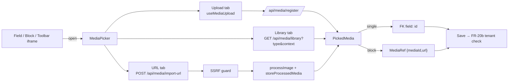

# PRD: Media Management — Sprint 2: MediaPicker & tích hợp 18 điểm upload (F48-S2)

> **Version:** 1.0 | **Created:** 2026-11-09 | **Agent:** `docs-engineer`
> **Priority:** P0 (US-06, US-07) / P1 (US-08) | **Sprint:** F48 — S2 | **Size:** L (7–9 ngày)
> **Depends on:** F48-S1 (pipeline, `GET /api/media/library`, `useMediaUpload`) | **Blocks:** F48-S4 (usage scan đọc `{mediaId,url}`), F48-S5 (gallery/biến thể dùng picker)
> **Overview:** [F48-media-management-overview.md](./F48-media-management-overview.md) · **Stories:** [F48-media-management-stories-2.md](../stories/F48-media-management-stories-2.md) · **Architecture:** [F48-media-management.md](../architecture/F48-media-management.md) · **Design:** [F48-media-management-design.md](../design/F48-media-management-design.md) · **QA:** [F48-media-management.md](../qa/F48-media-management.md) · Code tham chiếu: staging `5c3e3bdca`

---

> [!IMPORTANT]
> AC ở Section 11 copy nguyên văn từ [stories-2](../stories/F48-media-management-stories-2.md) (Status **Draft**). TC-ID `TC-F48-06-xx`, `TC-F48-07-xx`, `TC-F48-08-xx`.

---

## 0. Story Traceability

| Story ID | Tiêu đề | File | Status |
|---|---|---|---|
| US-F48-06 | MediaPicker dùng chung (Upload / Thư viện / URL) + chọn 1 hoặc nhiều | [stories-2](../stories/F48-media-management-stories-2.md#us-f48-06) | Draft |
| US-F48-07 | Gắn picker vào 18 điểm upload; block mới lưu `{mediaId,url}` | [stories-2](../stories/F48-media-management-stories-2.md#us-f48-07) | Draft |
| US-F48-08 | Import ảnh từ URL an toàn | [stories-2](../stories/F48-media-management-stories-2.md#us-f48-08) | Draft |

---

## 1. Problem Statement

- **Không chọn lại được ảnh đã có** ở bất kỳ điểm nào trong 18 điểm upload → merchant upload lại cùng ảnh cho mỗi SP/block; mỗi lần là 1 object mới (trước S1 không dedupe).
- **Logic input file/dropzone lặp ở ≥ 15 file**; `LogoEditor`, `FaviconEditor`, `og-image-editor` gần như giống hệt; giới hạn 2/5/10 MB khác nhau; alt 5 kiểu ("Block image", tên file, cố định, sửa được, không có); chuỗi tiếng Anh/Việt cứng ở `BlockImageEditor`, toast `ImageUploader`, trang confirm người mua, studio.
- **Block JSON lưu URL string** (gallery, before-after, client-logos, hero/video `videoUrl`, content-cards, rich text, custom-html) → không biết media nào đang được dùng; xoá media làm vỡ ảnh im lặng (tiền đề cho S4).
- Không import được ảnh từ URL (trừ rich text dán URL thô, không qua kiểm tra).

---

## 2. Target User

- Chủ shop, staff có `products`/`blog`/`builder`/`settings` (không cần quyền `media` để dùng picker — D14).
- Người mua (chỉ luồng biên lai, giữ route riêng).

---

## 3. Solution Overview

Một `MediaPicker` (dialog, toàn màn hình ở mobile) với 3 tab: **Upload** (dùng `useMediaUpload` S1), **Thư viện** (dùng `GET /api/media/library` S1, lọc theo `accept`), **URL** (FR-22, server tải về + SSRF guard + pipeline S1). Chế độ đơn/đa có `max`. Trả `PickedMedia[]`. Tích hợp lần lượt 12 điểm merchant theo thứ tự giá trị; `/media` dùng pipeline S1; 5 luồng riêng (avatar, biên lai, feedback, studio, AI attachments) giữ route nhưng dùng validator + giới hạn + i18n chung. Block **mới** lưu `{ mediaId, url }`; renderer đọc được cả string cũ.

---

## 4. Scope

### In Scope
- FR-19..FR-22; component `MediaPicker`, `MediaFieldControl` (field ảnh đơn dùng chung cho logo/favicon/OG/footer logo/blog cover/QR/halal cert), `MediaRef` type + `resolveMediaUrl()`.
- Validate server: mediaId gửi kèm khi lưu SP/trang/site/blog phải thuộc tenant (AC-05 US-07).
- i18n en/ms cho mọi điểm upload (kể cả trang confirm người mua theo locale storefront).

### Out of Scope
- Thư mục trong picker (S3 thêm cây thư mục); "Chưa dùng"/usage (S4); quota tenant (S4 — picker chỉ hiển thị lỗi khi API trả `MEDIA_QUOTA_EXCEEDED`).
- Backfill block cũ sang `{mediaId,url}` (D3).
- Gallery 10 ảnh + kéo sắp xếp (S5 — S2 giữ `MAX_PRODUCT_IMAGES = 5`).
- Crop/focal point; stock search cho merchant.

---

## 5. Success Metrics

| Metric | Target | Đo bằng |
|---|---|---|
| Điểm upload merchant có tab Thư viện | 12/12 (điểm 1–12) | Checklist 18 điểm có bằng chứng trong PR |
| `fetch('/api/media/upload'` / `uploadMediaAction(` trong component UI | 0 | grep `src/components src/app src/blocks` |
| Thẻ `<input type="file">` ngoài component media chung | ≤ 5 (chỉ luồng riêng 14–18) | grep |
| Tỉ lệ ảnh mới gắn vào SP/block chọn từ thư viện (tuần thứ 2 sau release) | ≥ 20% | Log `media.picked{source}` |
| Lỗi i18n thiếu khoá ms | 0 | Test manifest localization |

---

## 6. User Story Summary

```
AS A   chủ shop hoặc staff đang sửa sản phẩm, blog, trang
I WANT một hộp chọn media duy nhất: upload mới, chọn ảnh có sẵn hoặc dán URL
SO THAT tôi không phải upload lại cùng một ảnh cho mỗi sản phẩm/block
```
```
AS A   chủ shop
I WANT mọi chỗ cần ảnh dùng cùng cách chọn/upload, cùng giới hạn, cùng ngôn ngữ
SO THAT tôi không gặp giới hạn khác nhau, thông báo lẫn tiếng, và hệ thống biết ảnh nào đang được dùng
```
```
AS A   chủ shop
I WANT dán link ảnh để đưa ảnh vào thư viện
SO THAT tôi lấy ảnh từ website/nhà cung cấp mà không phải tải về máy
```

---

## 7. Functional Requirements

| FR-ID | Requirement | Story Ref | Priority | Notes |
|---|---|---|:-:|---|
| FR-19 | `MediaPicker` dialog: tab Upload / Thư viện / URL; `mode: single|multiple`, `max`; trả `PickedMedia[]` theo thứ tự chọn; tab URL ẩn khi FR-22 chưa bật (feature flag) | US-F48-06 | P0 | |
| FR-19a | Lọc theo `accept` (`image`/`video`) và `purpose`: tab Thư viện truyền `type` cho API; tab Upload chỉ nhận định dạng tương ứng; `purpose=favicon` nhận png/jpeg/webp (chuẩn hoá PNG) hoặc ico ≤ 256×256 passthrough; purpose khác từ chối ico (D37) | US-F48-06 | P0 | D37 |
| FR-19b | Upload trong picker: xong → tự chọn; `deduped` → chọn media có sẵn + báo; lỗi quota/rate limit → hiện lỗi + liên kết, không đóng picker. **D40:** đóng picker khi đang upload → upload tiếp tục nền vào thư viện, toast báo xong, **không** gán vào field đang mở | US-F48-06 | P0 | D40 |
| FR-19c | Quyền: picker gọi API với `context` (`products|blog|builder|settings`); server kiểm user có quyền màn hình đó (owner/admin luôn có); không có → 403. Không có `media`: ẩn Xoá; chỉ sửa alt/caption media `uploaded_by = mình` (D26) | US-F48-06 | P0 | D14, D26 |
| FR-19d | A11y + mobile: focus trap, trả focus về nút mở, phím mũi tên/Space/Enter/Esc, `aria-selected`, `aria-live` khi upload xong; 375px toàn màn hình, nút "Chọn" sticky; lưới dùng thumbnail `next/image` w=256 | US-F48-06 | P0 | NFR-07 |
| FR-19e | Picker, `MediaFieldControl` và gallery SP **chỉ** đọc/ghi media qua adapter `src/lib/media/media-source.ts` (`listMedia`, `getMedia`, `uploadMedia`, `importUrl`, `resolveMediaUrl`); UI không gọi `/api/media/*` trực tiếp, để sau này đổi nguồn sang DAM Commerce OS mà không sửa UI (D86) | US-F48-06 | P1 | D86, xem `docs/architecture/F48-media-management-dam-alignment.md` |
| FR-20 | Tích hợp 18 điểm theo bảng §13.4 và thứ tự ưu tiên; logo/favicon/OG/footer logo/blog cover/QR/halal cert dùng chung `MediaFieldControl` (xem trước, thay, gỡ, alt); gỡ chỉ gỡ tham chiếu | US-F48-07 | P0 | |
| FR-20a | Luồng riêng 14–18 (avatar, biên lai, feedback, studio evidence, AI attachments) giữ route nhưng dùng `validateMediaBytes` + `UPLOAD_LIMITS` + khoá i18n chung; biên lai lưu private `pw2/private/t/{tenantId}/…`, `createdVia='proof'`, không hiện trong thư viện/picker, không tính quota (D24) | US-F48-07 | P0 | D17, D24 |
| FR-20b | Server từ chối lưu SP/trang/site/blog/tenant settings có `mediaId` (FK hoặc `{mediaId}` trong block) không thuộc tenant hiện tại (trừ row global đang được tenant dùng) → 400 `MEDIA_INVALID_REFERENCE` | US-F48-07 | P0 | Tenant isolation |
| FR-20c | ImageToolbar trong iframe preview: nút "Đổi ảnh" gửi `postMessage` ra cửa sổ cha; picker mở ở cửa sổ cha; chọn xong gửi lại `{mediaId,url}` và preview cập nhật | US-F48-07 | P0 | Xem Open Q-1 |
| FR-21 | Block field ảnh/video dạng URL (gallery, before-after, client-logos, hero/video `videoUrl`, content-cards, image block) lưu `MediaRef = { mediaId, url }` khi chọn qua picker; renderer/editor chấp nhận `string | MediaRef` qua `resolveMediaUrl()`; không chuyển đổi dữ liệu cũ; lần sửa kế tiếp lưu dạng mới. Rich text/custom-html: chèn `` | US-F48-07 | P0 | D3 |
| FR-22 | `POST /api/media/import-url`: chỉ `https:`; resolve DNS → chặn IP private/loopback/link-local/CGNAT/metadata (IPv4 + IPv6), kết nối tới đúng IP đã kiểm (chống DNS rebinding); ≤ 3 redirect, kiểm lại mỗi bước; timeout tổng 10 s; ≤ 10 MB (đếm byte khi stream, cắt khi vượt); content-type + magic phải là ảnh whitelist; rồi `processImage` + `storeProcessedMedia` (`createdVia='import-url'`, `sourceUrl` lưu nội bộ); rate limit 10/user + 30/tenant mỗi phút (D32) | US-F48-08 | P1 | D18 |

---

## 8. Business Rules

- **BR-01:** Chọn ảnh có sẵn không tạo object/row mới.
- **BR-02:** Thứ tự trả về của chế độ đa chọn = thứ tự người dùng chọn.
- **BR-03:** `max` do nơi gọi quyết định (gallery SP: `5 − số ảnh hiện có`; S5 nâng 10).
- **BR-04:** Picker không bao giờ liệt kê media private, media tenant khác, media global không được tenant dùng.
- **BR-05:** Alt khi chèn = alt của media; field hỗ trợ alt riêng (block image, gallery item) cho sửa tại chỗ; bỏ alt cố định "Block image".
- **BR-06:** Gỡ ảnh khỏi field chỉ gỡ tham chiếu; xoá media chỉ ở `/media` (S1/S4).
- **BR-07:** Halal cert chỉ nhận ảnh (D30), không PDF.
- **BR-08:** Biên lai người mua: PDF ≤ 5 MB hoặc ảnh ≤ 10 MB; rate limit 5/đơn/giờ + 20/IP/giờ; không bị chặn vì quota (D24).
- **BR-09:** Import URL: lỗi đích (4xx/5xx, hotlink bị chặn) trả thông điệp chung + gợi ý "tải về rồi upload"; không trả status/header/thời gian của đích cho client.
- **BR-10:** URL import trùng hash trong tenant → trả media có sẵn (BR S1 dedupe).

---

## 9. User Flow

```
Field ảnh (vd blog cover) → bấm "Chọn ảnh"
  ↓ MediaPicker mở (tab mặc định: Thư viện nếu tenant có media, ngược lại Upload)
  ├── Thư viện: tìm/lọc → chọn → "Chọn" → field nhận {mediaId,url}
  ├── Upload: thả file → pipeline S1 → tự chọn → "Chọn"
  │     ├── deduped → chọn media có sẵn + toast
  │     └── lỗi (415/413/422/429/quota) → lỗi trong picker, giữ dialog
  └── URL: dán https://… → "Nhập" → server import → tự chọn
        └── lỗi → thông điệp theo mã, ô URL giữ nguyên
  ↓ Lưu form → server kiểm mediaId thuộc tenant (FR-20b)
```



---

## 10. Screen Layout

- **Picker desktop:** dialog 960×640; header (tiêu đề theo nơi gọi, nút đóng), tabs, vùng nội dung (lưới 5 cột / dropzone / ô URL), footer ("Đã chọn n/max", Huỷ, Chọn).
- **Picker 375px:** toàn màn hình, tabs dạng segmented, lưới 3 cột, footer sticky.
- **`MediaFieldControl`:** ô preview (tỉ lệ theo purpose: logo 3:1, favicon 1:1, OG 1.91:1), nút Thay / Gỡ, ô alt (khi hỗ trợ).
- **States:** thư viện rỗng → chuyển sang tab Upload; không kết quả tìm; loading skeleton; lỗi tải + Thử lại; URL đang nhập (spinner trong nút).
- **Design:** [F48-media-management-design.md](../design/F48-media-management-design.md) (màn S3 MediaPicker gồm tab URL, S10 Picker trong editor — ID màn hình, không phải sprint).

---

## 11. Acceptance Criteria (copy từ story — Status Draft)

### AC-01 (US-F48-06 AC-1): Chọn 1 ảnh có sẵn — TC-F48-06-01
```gherkin
GIVEN chủ shop mở picker từ một field ảnh đơn (vd blog cover)
WHEN  chuyển tab "Thư viện", chọn 1 ảnh, bấm "Chọn"
THEN  picker đóng, field nhận { mediaId, url } của ảnh đó, không upload thêm object nào
  AND tab Thư viện dùng chung API phân trang/tìm/lọc của US-F48-05
```

### AC-02 (US-F48-06 AC-2): Chọn nhiều có giới hạn theo nơi gọi — TC-F48-06-02
```gherkin
GIVEN picker mở ở chế độ đa chọn với tối đa N (vd gallery SP còn 3 chỗ)
WHEN  chủ shop chọn đến ảnh thứ N
THEN  các ô còn lại bị vô hiệu, hiện "Đã chọn 3/3"
  AND bấm "Chọn" trả về danh sách theo đúng thứ tự đã chọn
```

### AC-03 (US-F48-06 AC-3): Lọc theo loại chấp nhận — TC-F48-06-03
```gherkin
GIVEN nơi gọi chỉ nhận ảnh (logo) hoặc chỉ nhận video (video block)
WHEN  mở picker
THEN  tab Thư viện chỉ liệt kê loại phù hợp, tab Upload chỉ nhận định dạng phù hợp
  AND favicon nhận png/jpeg/webp (chuẩn hoá về PNG) hoặc ico ≤ 256×256 giữ nguyên (D37)
```

### AC-04 (US-F48-06 AC-4): Upload trong picker — TC-F48-06-04
```gherkin
GIVEN chủ shop ở tab "Upload"
WHEN  thả 1 ảnh mới
THEN  ảnh đi qua pipeline US-F48-04, xong thì tự được chọn
  AND nếu trùng hash với media có sẵn → chọn media có sẵn, báo "Đã dùng ảnh có trong thư viện"
  AND vượt quota (US-F48-13) → báo lỗi "MEDIA_QUOTA_EXCEEDED" + liên kết xem dung lượng, không đóng picker
  AND đóng picker khi đang upload → upload vẫn chạy tiếp vào thư viện kèm toast, field đang mở không được gán (D40)
```
> Nhánh quota chỉ kiểm được sau S4; S2 kiểm bằng mock response `MEDIA_QUOTA_EXCEEDED`.

### AC-05 (US-F48-06 AC-5): Staff không có quyền `media` vẫn dùng được picker — TC-F48-06-05
```gherkin
GIVEN staff có quyền `products`, không có `media`
WHEN  mở picker trong màn sửa sản phẩm
THEN  xem/chọn được media của tenant, upload được ảnh mới
  AND không có nút xoá, không thấy link "Manage library"; không sửa được alt/caption của media do người khác upload
  AND sửa alt của file do chính mình upload ngay tại nơi dùng: popover "Edit alt text" trong gallery SP (`ProductGallery`) và field alt của `MediaFieldControl` (editor, blog, danh mục); file của người khác → field alt disabled + tooltip `mediaLibrary.forbiddenEditOther` "You can only edit files you uploaded…" (D26)
GIVEN staff không có quyền của màn hình gọi picker (vd không có `products`)
THEN  API picker không trả dữ liệu (403 "MEDIA_FORBIDDEN")
```
> Permission `media` thêm ở S3 (FR-26). Ở S2 kiểm theo quyền màn hình hiện có (`products|blog|builder|settings`); phần "không có `media`" xác nhận lại khi S3 xong.

### AC-06 (US-F48-06 AC-6): Bàn phím và mobile — TC-F48-06-06
```gherkin
GIVEN picker đang mở
WHEN  dùng Tab/Shift+Tab, phím mũi tên trong lưới, Space chọn, Enter xác nhận, Esc đóng
THEN  focus bị giữ trong dialog, trở về nút mở sau khi đóng, mỗi ảnh có aria-label (displayName hoặc alt)
  AND ở 375px (design S3) picker là bottom sheet cao 92dvh có tay nắm, tabs full-width, lưới 3 cột (ô ≥ 104 px), footer cố định (safe-area) với nút "Select (n)" luôn thấy
```

### AC-07 (US-F48-07 AC-1): Ảnh sản phẩm chọn từ thư viện — TC-F48-07-01
```gherkin
GIVEN chủ shop sửa sản phẩm, thư viện đã có ảnh "baju-kurung-merah.webp"
WHEN  bấm thêm ảnh, chọn ảnh đó trong tab Thư viện, lưu sản phẩm
THEN  Products.images[] nhận FK tới media có sẵn, không tạo media mới
  AND storefront hiển thị ảnh đó
```

### AC-08 (US-F48-07 AC-2): Block mới lưu `{mediaId,url}`, block cũ vẫn chạy — TC-F48-07-02
```gherkin
GIVEN block gallery/hero/client-logos/before-after/content-cards
WHEN  chủ shop chọn ảnh qua picker và lưu trang
THEN  JSON block lưu { mediaId, url } cho mỗi ảnh
GIVEN block cũ chỉ có URL string
WHEN  render storefront hoặc mở editor
THEN  hiển thị bình thường, không tự chuyển đổi dữ liệu (không backfill)
  AND lần sửa ảnh kế tiếp của block đó lưu theo dạng mới
```

### AC-09 (US-F48-07 AC-3): Một bộ giới hạn, một ngôn ngữ — TC-F48-07-03
```gherkin
GIVEN 18 điểm upload
WHEN  upload file vượt giới hạn hoặc sai định dạng ở bất kỳ điểm nào
THEN  giới hạn và thông báo lấy từ upload-limits.ts + khoá i18n chung
  AND ở locale ms không còn chuỗi tiếng Anh/Việt cứng (BlockImageEditor, toast ImageUploader, trang confirm của người mua, studio)
```

### AC-10 (US-F48-07 AC-4): Luồng riêng vẫn dùng validator chung — TC-F48-07-04
```gherkin
GIVEN người mua upload biên lai ở trang xác nhận đơn
WHEN  gửi file PDF 4 MB hoặc JPEG
THEN  file lưu private dưới `pw2/private/t/{tenantId}/...`, đọc qua /api/media/private/[id]
  AND PDF > 5 MB, file giả mạo đuôi, vượt rate limit → bị chặn với thông báo theo locale storefront (en/ms)
  AND biên lai không xuất hiện trong picker/thư viện của merchant
```

### AC-11 (US-F48-07 AC-5): Tenant isolation khi gắn media — TC-F48-07-05
```gherkin
GIVEN user tenant A gửi lưu sản phẩm/trang/site kèm mediaId thuộc tenant B
WHEN  server lưu
THEN  bị từ chối 400 "MEDIA_INVALID_REFERENCE" ("Invalid media reference"), dữ liệu không đổi
```

### AC-12 (US-F48-07 AC-6): Logo/Favicon/OG dùng chung component — TC-F48-07-06
```gherkin
GIVEN chủ shop đổi logo, favicon, OG image, footer logo
WHEN  dùng từng editor
THEN  cùng một component với cùng hành vi (xem trước, thay, gỡ, alt)
  AND gỡ ảnh chỉ gỡ tham chiếu, không xoá media khỏi thư viện
```

### AC-13 (US-F48-07 AC-7): Ảnh trong iframe editor — TC-F48-07-07
```gherkin
GIVEN chủ shop click ảnh trong preview iframe và mở ImageToolbar
WHEN  bấm "Đổi ảnh"
THEN  picker mở ở cửa sổ cha (không trong iframe), chọn xong ảnh trong preview cập nhật ngay
```

### AC-14 (US-F48-08 AC-1): Import thành công — TC-F48-08-01
```gherkin
GIVEN chủ shop ở tab "URL" của picker
WHEN  dán https://supplier.example/images/kain.jpg (ảnh JPEG 3 MB) và bấm "Nhập"
THEN  server tải ảnh về, đi qua pipeline US-F48-04 (magic, re-encode, strip EXIF, hash)
  AND tạo media createdVia = "import-url", sourceUrl lưu nội bộ, ảnh tự được chọn
```

### AC-15 (US-F48-08 AC-2): URL không hợp lệ — TC-F48-08-02
```gherkin
GIVEN URL là http://, file:, data:, ftp:, hoặc trả về HTML/PDF, > 10 MB, hoặc phản hồi > 10 giây
WHEN  nhập
THEN  báo lỗi cụ thể theo locale, mã theo từng ca (khớp TC-F48-08-02), không tạo media:
  | Ca                                  | Mã                               |
  | http://, file:, data:, ftp:         | 400 "MEDIA_URL_INVALID" ("Only HTTPS image links are supported") |
  | đích trả HTML/PDF (không phải ảnh)  | 415 "MEDIA_UNSUPPORTED_TYPE"     |
  | ảnh > 10 MB                         | 413 "MEDIA_TOO_LARGE"            |
  | phản hồi > 10 giây                  | 504 "MEDIA_URL_TIMEOUT"          |
  | tải lỗi (4xx/5xx, hotlink 403…)     | 422 "MEDIA_URL_FETCH_FAILED"     |
```

### AC-16 (US-F48-08 AC-3): Chặn SSRF — TC-F48-08-03
```gherkin
GIVEN URL có hostname phân giải ra IP private, loopback, link-local, metadata cloud, hoặc redirect sang host như vậy
WHEN  server xử lý
THEN  request bị chặn trước khi kết nối tới IP đó, trả 400 "MEDIA_URL_BLOCKED" với lỗi chung "This link cannot be imported"
  AND không trả về nội dung, header hay thời gian phản hồi của đích cho client
```

### AC-17 (US-F48-08 AC-4): Rate limit, quota và trùng ảnh — TC-F48-08-04
```gherkin
GIVEN chủ shop nhập URL liên tục vượt ngưỡng, hoặc tenant đã hết quota
WHEN  nhập thêm
THEN  nhận 429 "MEDIA_RATE_LIMITED" (10/user, 30/tenant mỗi phút, D32) hoặc 413 "MEDIA_QUOTA_EXCEEDED" (US-F48-13)
GIVEN ảnh tải về trùng hash media có sẵn trong tenant
THEN  trả media có sẵn (US-F48-04 AC-3)
```
> Ngưỡng D32: 10/user + 30/tenant mỗi phút.

---

## 12. Non-Functional Requirements

| ID | Category | Requirement | Notes |
|---|---|---|---|
| NFR-S2-01 | Performance | Mở picker → lưới thư viện hiển thị (50 thumbnail) p95 **< 1,2 s** trên 4G; bundle picker lazy-load **≤ 60 KB gzip** | `dynamic()` import |
| NFR-S2-02 | Performance | `import-url` ảnh 3 MB p95 **< 6 s** (tải + xử lý); hard timeout tải 10 s | |
| NFR-S2-03 | Security | 100% case SSRF trong bộ test (≥ 20 URL: IPv4/IPv6 private, `169.254.169.254`, `[::1]`, `0.0.0.0`, decimal/octal IP, redirect, DNS rebinding) bị chặn | |
| NFR-S2-04 | Tương thích | 0 hồi quy render block cũ (URL string) — snapshot test 100% block có field ảnh | |
| NFR-06 | i18n | 100% chuỗi picker + 18 điểm có en/ms | |
| NFR-07 | A11y | axe 0 lỗi serious/critical trên dialog; tương phản trạng thái chọn ≥ 3:1 (UI component) | |

---

## 13. Technical Architecture

### 13.1 Components

| Component | File (đích) | Mô tả |
|---|---|---|
| `MediaPicker` | `src/components/media/media-picker.tsx` | Dialog + tabs, state chọn |
| `PickerLibraryTab` | `src/components/media/media-picker-tab-library.tsx` | Lưới + tìm/lọc, gọi API S1 |
| `PickerUploadTab` | `src/components/media/media-picker-tab-upload.tsx` | Dropzone + `useMediaUpload` |
| `PickerUrlTab` | `src/components/media/media-picker-tab-url.tsx` | Ô URL + import |
| `MediaFieldControl` | `src/components/media/media-field-control.tsx` | Field ảnh đơn dùng chung |
| `media-ref` | `src/lib/media/media-ref.ts` | `MediaRef`, `resolveMediaUrl`, `toMediaRef` |
| `assertTenantMediaRefs` | `src/lib/media/assert-tenant-media-refs.ts` | FR-20b, gọi trong hook `beforeChange` Products/Pages/Sites/Blogs/Tenants |
| `mediaSource` | `src/lib/media/media-source.ts` | FR-19e, adapter duy nhất UI dùng để truy cập media (D86) |
| `safeFetchImage` | `src/lib/media/import-remote-image.ts` | SSRF guard + stream giới hạn, rồi `ingestMediaBuffer(createdVia='import-url')` |

> Tên file chuẩn: [arch §6](../architecture/F48-media-management.md#6-module--file-layout-đích) (D75).
| Route | `src/app/api/media/import-url/route.ts` | FR-22 |

### 13.2 Type definitions — hiện tại (trích code)

```ts
// src/hooks/use-direct-upload.ts / use-upload-progress.ts
type MediaDoc = { id: string | number; url: string; [key: string]: unknown }

// src/lib/products/image-limit.ts
export const MAX_PRODUCT_IMAGES = 5

// src/components/dashboard/ImageUploader.tsx (props)
maxSizeMB?: number            // mặc định 5 — sẽ bỏ, dùng UPLOAD_LIMITS
description = `Upload up to ${maxImages} images (Max ${maxSizeMB}MB each. JPG, PNG, WEBP)` // chuỗi cứng tiếng Anh
```

### 13.3 Type definitions — đích

```ts
// src/lib/media/media-ref.ts
export interface MediaRef { mediaId: number; url: string }
export type MediaRefValue = string | MediaRef | null | undefined
export function resolveMediaUrl(value: MediaRefValue): string | null
export function isMediaRef(value: unknown): value is MediaRef

// src/components/media/media-picker.tsx (export types)
export type PickerAccept = 'image' | 'video'
export type PickerContext = 'products' | 'blog' | 'builder' | 'settings'
export interface PickedMedia {
    mediaId: number; url: string; alt: string; displayName: string
    mimeType: string; width: number | null; height: number | null
}
export interface MediaPickerProps {
    open: boolean
    onOpenChange(open: boolean): void
    mode: 'single' | 'multiple'
    max?: number                     // multiple only
    accept: PickerAccept[]
    purpose: MediaUploadPurpose      // 'favicon': png/jpeg/webp → PNG, ico passthrough (D37)
    context: PickerContext           // quyền màn hình (FR-19c)
    initialTab?: 'upload' | 'library' | 'url'
    onSelect(items: PickedMedia[]): void
}

// postMessage iframe ↔ parent (FR-20c)
type EditorMediaMessage =
    | { type: 'ech:media-picker:open'; requestId: string; blockIndex: number; fieldPath: string; accept: PickerAccept[] }
    | { type: 'ech:media-picker:result'; requestId: string; value: MediaRef }
```

### 13.4 Bảng 18 điểm upload (FR-20)

Numbering theo US-F48-07. "Đường ống hiện tại": A `/api/media/upload` · B presign+register · C `uploadMediaAction` · D route riêng. `useUploadProgress` = B, fallback A.

| # | Điểm | File:line hiện tại | Đường ống hiện tại | Đích sau F48 | Thứ tự |
|---|---|---|---|---|:-:|
| 1 | Ảnh SP (+ halal cert, chỉ ảnh — D30) | `src/components/dashboard/ImageUploader.tsx:335` (dùng ở `product-form/GeneralInfoSection.tsx`) | B→A (`useUploadProgress`), giới hạn 5 MB, toast tiếng Anh cứng | Picker `multiple`, `max = 5 − n` (S5: 10); halal cert `MediaFieldControl` | 1 |
| 2 | Block overlay (~10 block) | `src/blocks/shared/media-upload-overlay.tsx:303, :311` | Ảnh: `compressImage` + B→A; video: B (`useDirectUpload` :95) | Picker single `image`/`video`; lưu `MediaRef` (FR-21) | 2 |
| 3 | BlockImageEditor | `src/components/editor/BlockImageEditor.tsx:54` | `compressImage` + B→A; alt cố định, chuỗi cứng | Picker single; alt từ media | 2 |
| 4 | ImageToolbar (iframe) | `src/components/editor/ImageToolbar.tsx:41` | `processImageFile` → callback `onImageSelect` (staging: **chỉ test gọi**, chưa thấy caller production) | Nút "Đổi ảnh" → postMessage → picker ở cửa sổ cha (FR-20c) | 2 (xác minh trước) |
| 5 | Blog cover | `src/app/(dashboard)/blog/[id]/BlogEditorPageClient.tsx:1025` (upload :661) | C | `MediaFieldControl` | 3 |
| 6 | Blog body | `src/app/(dashboard)/blog/_components/BlogRichEditor.tsx:52` | C | Picker single → chèn `` | 3 |
| 7 | Logo | `src/components/editor/LogoEditor.tsx:83` | `processImageFile` + B→A | `MediaFieldControl` purpose `logo` | 4 |
| 8 | Favicon | `src/components/editor/FaviconEditor.tsx:130` | B→A | `MediaFieldControl` purpose `favicon` (png/jpeg/webp → PNG; ico ≤ 256×256 — D37) | 4 |
| 9 | OG image | `src/components/editor/og-image-editor.tsx:53` | `processImageFile` + B→A | `MediaFieldControl` | 4 |
| 10 | Footer logo | `src/components/editor/SettingsPanel.tsx:1626` (hook :368) | B→A, không nén | `MediaFieldControl` | 4 |
| 11 | Rich text block | `src/components/editor/RichTextBlockEditor.tsx:224` | B→A, accept gồm **gif** (bị chặn từ S0) | Picker single → `` | 5 |
| 12 | QR chuyển khoản | `src/app/(dashboard)/settings/payments/PaymentsFormClient.tsx:911` → `uploadQrMedia` (`settings/payments/actions.ts`) | D (server action riêng), 2 MB png/jpeg | `MediaFieldControl` (owner/admin, TC-PERF-179). Chọn QR từ thư viện chỉ hợp lệ khi kiểm quyền QR đã đổi ở S1 (D73 — `tenant` + `!private` + `image/*`; từ chối: 404 `MEDIA_NOT_FOUND` / 400 `MEDIA_UNSUPPORTED_TYPE` — D80) | 6 |
| 13 | Trang `/media` | `src/app/(dashboard)/media/page.tsx:173` (fetch :93) | A | Pipeline S1 (FR-18) — đã xong ở S1 | S1 |
| 14 | Avatar | `src/app/(dashboard)/settings/profile/_components/avatar-upload.tsx:75` → `/api/users/me/avatar` (:48) | D | Giữ D + validator/giới hạn/i18n chung, rate limit 10/user/giờ | 7 |
| 15 | Biên lai người mua | `src/app/sites/[slug]/order/[orderId]/confirm/ConfirmClient.tsx:584` → `/api/orders/[id]/upload-proof-direct` (:426) | D (private) | Giữ D, key `pw2/private/t/{tenantId}/…`, `createdVia='proof'`, i18n storefront | 7 |
| 16 | Feedback screenshot | `src/components/dashboard/feedback/screenshot-field.tsx:70` → `/api/v1/feedback/screenshots` (→ Lark) | D | Giữ D + validator chung | 8 |
| 17 | Studio issue evidence | `src/app/studio/issues/_components/issue-detail-drawer.tsx:259`, `src/app/studio/_components/modals/create-issue-modal.tsx:248` → `issue-evidence-media.ts:27` | C (`uploadMediaAction`) | Giữ luồng riêng nội bộ (ảnh + mp4/webm) qua `storeProcessedMedia`, validator chung, i18n | 8 |
| 18 | AI chat attachments | `src/lib/ai-platform/attachments.ts:65` (`POST /agent/attachments` tới AI platform) | D (ra AI platform) | Giữ D + validator chung; điểm vào UI cần xác minh | 8 |

---

## 14. Dependencies

| Dependency | Status | Action |
|---|---|---|
| S1: `useMediaUpload`, `GET /api/media/library`, `storeProcessedMedia` | ⬜ | Merge trước |
| Quyền màn hình `products|blog|builder|settings` (`src/lib/permissions.ts`) | ✅ | Dùng cho `context` |
| Permission `media` (S3 FR-26) | ⬜ | AC-05 xác nhận lại sau S3 |
| Renderer block đọc `MediaRef` | ⬜ | Cùng PR với điểm 2 |
| Thư viện DNS/IP check (Node `dns.lookup` all + `net.isIP`, `undici` dispatcher connect hook) | ⬜ | Không thêm dependency nếu tránh được |

---

## 15. API Contract

```
GET /api/media/library?…&type=image|video&context=products|blog|builder|settings   (mở rộng S1)
Errors thêm: 403 MEDIA_FORBIDDEN (không có quyền context)

POST /api/media/import-url                              Auth: required · RL 10/user, 30/tenant mỗi phút
Request:  { url: string; alt?: string; displayName?: string; context: PickerContext }
Response: StoredMedia                                    // deduped=true khi trùng
Errors:   400 MEDIA_URL_INVALID | 400 MEDIA_URL_BLOCKED | 413 MEDIA_TOO_LARGE | 415 MEDIA_UNSUPPORTED_TYPE
          | 422 MEDIA_URL_FETCH_FAILED | 422 MEDIA_INVALID_FILE | 429 MEDIA_RATE_LIMITED | 504 MEDIA_URL_TIMEOUT
          | 413 MEDIA_QUOTA_EXCEEDED (S4)

Save hooks (Products / Pages / Sites / Blogs / Tenants)
Errors:   400 MEDIA_INVALID_REFERENCE { error, code, field }
```

### 15.1 Mã lỗi + thông điệp en/ms

| Code | HTTP | en | ms |
|---|:-:|---|---|
| `MEDIA_URL_INVALID` | 400 | Only HTTPS image links are supported. | Hanya pautan imej HTTPS disokong. |
| `MEDIA_URL_BLOCKED` | 400 | This link cannot be imported. | Pautan ini tidak boleh diimport. |
| `MEDIA_URL_FETCH_FAILED` | 422 | We couldn't download an image from this link. Try downloading it and uploading instead. | Kami tidak dapat memuat turun imej daripada pautan ini. Cuba muat turun dan muat naik sendiri. |
| `MEDIA_URL_TIMEOUT` | 504 | The link took too long to respond. | Pautan mengambil masa terlalu lama untuk bertindak balas. |
| `MEDIA_INVALID_REFERENCE` | 400 | Invalid media reference. | Rujukan media tidak sah. |
| `MEDIA_PICKER_MAX` (client) | — | You can select up to {max} files. | Anda boleh memilih sehingga {max} fail. |
| `MEDIA_PICKER_TYPE` (client) | — | This file type can't be used here. | Jenis fail ini tidak boleh digunakan di sini. |
| (toast) dedupe | — | Used the image already in your library. | Menggunakan imej yang sudah ada dalam pustaka. |
| (counter) | — | Selected {n}/{max} | Dipilih {n}/{max} |

---

## 16. Data model delta

- **Không có migration DB** trong S2. `MediaRef` nằm trong JSON block (cột JSON hiện có của `pages`/`sites`).
- `media.source_url` (đã có) lưu URL nguồn của import; `created_via='import-url'`.
- Type block: các field `image: string` → `image: MediaRefValue`; Zod/validator block chấp nhận cả 2 dạng.

---

## 17. Risks

| ID | Rủi ro | Xác suất | Ảnh hưởng | Giảm thiểu |
|---|---|:-:|:-:|---|
| R-S2-01 | Thay 12 điểm gây hồi quy editor/SP/blog | Cao | TB | 1 PR/nhóm theo thứ tự §13.4; feature flag `mediaPicker` 1 sprint; test hồi quy F05/F08/F17/F19 |
| R-S2-02 | Renderer quên đọc `MediaRef` ở 1 block → ảnh trắng storefront | TB | Cao | `resolveMediaUrl` bắt buộc; snapshot test mọi block có field ảnh với 2 dạng dữ liệu (NFR-S2-04) |
| R-S2-03 | SSRF bypass (DNS rebinding, IPv6 mapped, redirect) | TB | Cao | Kết nối theo IP đã kiểm; chặn IPv4-mapped IPv6; kiểm mỗi redirect; bộ test NFR-S2-03 |
| R-S2-04 | Hotlink-protection của Shopee/Lazada/Instagram làm import thất bại nhiều → merchant bực | Cao | Thấp | Thông điệp gợi ý tải về rồi upload (BR-09) |
| R-S2-05 | postMessage iframe bị trang khác giả mạo | Thấp | TB | Kiểm `event.origin` + `requestId`; chỉ nhận `MediaRef` có `mediaId` thuộc tenant (FR-20b khi lưu) |
| R-S2-06 | ImageToolbar không có caller production → làm thừa | TB | Thấp | Xác minh trước khi làm (Open Q-1) |

---

## 18. Test Strategy (tóm tắt)

- **Unit:** `resolveMediaUrl` (string/MediaRef/null), `assertTenantMediaRefs`, `safeFetchImage` (bộ ≥ 20 URL SSRF), reducer chọn đơn/đa có `max`.
- **Component:** `MediaPicker` (tabs, max, accept, a11y axe), `MediaFieldControl`.
- **Integration:** import-url (server test HTTPS giả lập: ảnh hợp lệ, HTML, 11 MB, chậm 11 s, redirect sang `127.0.0.1`).
- **E2E:** 12 điểm merchant chọn từ thư viện; biên lai PDF 4 MB/6 MB ở storefront ms; iframe ImageToolbar.
- **Hồi quy:** snapshot block cũ URL string; `TC-PERF-179` (QR owner-only).
- TC-ID: `TC-F48-06-01..06`, `TC-F48-07-01..07`, `TC-F48-08-01..04`.

---

## 19. Open Questions

| # | Câu hỏi | Owner | Status |
|---|---|---|---|
| 1 | `ImageToolbar` còn được dùng ở production? — nếu không, AC-13 áp vào điểm vào thay thế nào | Dev | Việc dev xác minh đầu S2 (grep caller), không cần PO |
| 2 | AI chat attachments (điểm 18): component UI gọi `attachments.ts` ở đâu | Dev | Việc dev xác minh đầu S2, không cần PO |
| 3 | Rich text: `data-media-id` có bị sanitizer F17/F05 loại bỏ không | Dev | Việc dev: thêm vào allowlist sanitizer nếu bị loại |
| 4 | Gallery SP trong S2 giữ 5 ảnh; nâng 10 ở S5 (D11) | PO | ✅ PO đồng ý 10 (D88) |

---

## 20. 9-Point Done Checklist

- [ ] Loading — skeleton lưới picker; spinner nút Nhập URL
- [ ] Empty — thư viện rỗng → tab Upload; không kết quả tìm
- [ ] Error — lỗi trong picker theo mã, dialog không đóng
- [ ] Form Validation — URL https; alt ≤ 250
- [ ] Button States — "Chọn" disabled khi chưa chọn; ô vô hiệu khi đạt `max`
- [ ] Toast — dedupe, import xong
- [ ] Auth Redirect — 401 → /login; 403 context
- [ ] Mobile 375px — picker toàn màn hình, nút Chọn sticky
- [ ] TypeScript Clean — `npm run verify`

## 21. Definition of Done

- [ ] FR-19..22 xong; AC-01..17 xanh
- [ ] Checklist 18 điểm có bằng chứng (screenshot/test) trong PR
- [ ] grep: không còn A/C trong component UI
- [ ] Screenshot en/ms desktop + 375px
