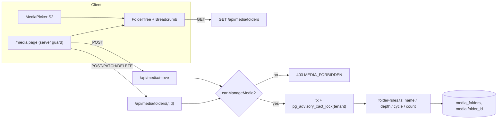

# PRD: Media Management — Sprint 3: Thư mục & quyền (F48-S3)

> **Version:** 1.0 | **Created:** 2026-11-09 | **Agent:** `docs-engineer`
> **Priority:** P1 | **Sprint:** F48 — S3 | **Size:** M
> **Depends on:** F48-S1 (US-F48-05 thư viện + API list), F48-S2 (US-F48-06 picker), F18 CMS Layout (sidebar), F11 Staff (StaffDrawer) | **Blocks:** F48-S4 (bộ lọc "Chưa dùng" dùng chung API list theo thư mục)
> **Nguồn quyết định:** brainstorm F48 2026-11-09 (staging `1248713`; số dòng đối chiếu lại `5c3e3bdca`) — D2, D13 (**PO đồng ý 2026-11-10, D88**), D14, D20; bổ sung D26 (staff không `media`), D27 (chỉ owner cấp `media`), D28 (force delete chỉ owner, từng file), D32 (giới hạn độ dài metadata), D51 (move-up trùng tên), D52 (`viewer` chỉ xem), D54 (collection riêng `media-folders`).
> **Overview:** [F48-media-management-overview.md](./F48-media-management-overview.md) · **Stories:** [F48-media-management-stories-2.md](../stories/F48-media-management-stories-2.md) · **Architecture:** [F48-media-management.md](../architecture/F48-media-management.md) · **Design:** [F48-media-management-design.md](../design/F48-media-management-design.md) · **QA:** [F48-media-management.md](../qa/F48-media-management.md)

---

> [!IMPORTANT]
> **Stories-First:** AC ở §11 copy từ [F48-media-management-stories-2.md](../stories/F48-media-management-stories-2.md) (US-F48-09, US-F48-10, trạng thái Draft). FR tách con (FR-23a…) để đủ chi tiết nhưng giữ số gốc FR-23..FR-27 của brief.

## 0. Story Traceability

| Story ID | Title | File | Status |
|----------|-------|------|--------|
| US-F48-09 | Thư mục lồng nhau — tạo/đổi tên/di chuyển/xoá (D2, D20) | [F48-media-management-stories-2.md](../stories/F48-media-management-stories-2.md#us-f48-09-thư-mục-lồng-nhau--tạođổi-têndi-chuyểnxoá) | Draft |
| US-F48-10 | Quyền `media` cho staff + mục sidebar (D13 ✅ D88, D14) | [F48-media-management-stories-2.md](../stories/F48-media-management-stories-2.md#us-f48-10-quyền-media-cho-staff--mục-sidebar) | Draft |

---

## 1. Problem Statement

- PW2 không có thư mục: `/media` là một danh sách phẳng (cap 200 trước S1). Shop có vài trăm ảnh (PW1 p90 = 31, max 298 file/store) không phân nhóm được theo mùa / dòng SP / chiến dịch.
- PW1 có cây thư mục (130 store dùng, max 20 thư mục/store) nhưng **xoá thư mục = xoá đệ quy file** → mất ảnh đang dùng trên storefront. PW2 không được lặp lại.
- Không có quyền `media` (`src/lib/permissions.ts` chỉ có `products | orders | blog | builder | settings`). Hiện mọi member active của tenant — kể cả staff `custom` chỉ có `orders` — mở `/media` bằng URL và xoá được mọi file của shop (`mediaWriteAccess` chỉ kiểm tenant).
- `/media` cố ý không nằm trên sidebar (quyết định 2026-06-11, `src/config/sidebar-nav.ts`) → khi đã có thư viện + picker thì merchant thiếu lối vào.

## 2. Target User

- **Chủ shop (owner)** — SME Malaysia, dashboard en/ms, thường dùng điện thoại; tạo thư mục, phân quyền.
- **Staff có quyền `media`** — người phụ trách nội dung, dọn thư viện.
- **Staff không có `media`** — có `products`/`blog`/`builder`/`settings`, chỉ cần chọn/upload ảnh trong màn hình của họ.

## 3. Solution Overview

Thêm collection Payload `media-folders` (tenant-scoped, cây tối đa 5 cấp, ≤ 200 thư mục/tenant, tên duy nhất không phân biệt hoa thường trong cùng cha) và cột `media.folder_id`. Mọi thao tác ghi thư mục đi qua route `/api/media/folders*` và `/api/media/move` chạy trong **một transaction có advisory lock theo tenant** để chặn đua (đếm 200, tên trùng, vòng lặp). Xoá thư mục chỉ có 2 đường: thư mục rỗng, hoặc "chuyển nội dung lên cha rồi xoá" — FK `parent_id ON DELETE RESTRICT` làm hàng rào cuối ở DB. Quyền `media` được thêm vào `PermissionId`; server kiểm bằng một helper duy nhất `canManageMedia()`; staff không có `media` vẫn dùng picker (đọc + upload + sửa metadata file của chính mình). Mục sidebar "Media" nằm sau "Blog" trong nhóm Online Store, **PO đã xác nhận D13 ngày 2026-11-10 (D88), triển khai cùng S3**.



## 4. Scope

### In Scope
- Collection `media-folders` + `Media.folder`; dùng `Media.uploadedBy` (S1) cho luật quyền (US-F48-09, US-F48-10).
- CRUD thư mục, di chuyển file/thư mục (đơn + nhiều, ≤ 100 item/lần), chống vòng lặp, kiểm độ sâu cây con (US-F48-09).
- Xoá thư mục an toàn theo D20 (US-F48-09).
- Lọc thư viện theo thư mục (mở rộng API list FR-15 của S1) và duyệt cây trong picker (US-F48-09 AC-1).
- Permission `media` + StaffDrawer + guard server cho `/media` và mọi API quản lý (US-F48-10).
- Mục sidebar "Media" — PO đồng ý (D88): nhóm Online Store, sau Blog (US-F48-10 AC-4).

### Out of Scope
- Xoá đệ quy thư mục kèm file (cố ý không làm — D20).
- Thư mục dùng chung giữa tenant, thư mục "thông minh"/tag, chia sẻ thư mục.
- Cấp quyền chi tiết theo thư mục (ACL per folder).
- "Vẫn xoá" media đang dùng — thuộc S4 (US-F48-11, chỉ owner).
- Migrate cây thư mục PW1 (migration đã xong; không backfill).

## 5. Success Metrics

| Metric | Target | Measured By |
|--------|--------|-------------|
| Không mất file do xoá thư mục | 0 media bị xoá theo thao tác xoá thư mục | Test TC-F48-09-05 + audit `SELECT count(*)` media trước/sau |
| Chặn quyền ở server | 100% API quản lý trả 403 cho staff không `media` | Ma trận test TC-F48-10-03 (6 endpoint × 3 vai) |
| Tính toàn vẹn cây | 0 thư mục có `depth` > 5 hoặc chu trình | Query kiểm định kỳ (§13.4) chạy trong test integration |
| Áp dụng | ≥ 10% tenant có ≥ 50 media tạo ít nhất 1 thư mục sau 60 ngày | SQL `media_folders` group by tenant |
| Tốc độ duyệt | Cây 200 thư mục render < 300 ms p95 | NFR-S3-01 |

## 6. User Story Summary

```
AS A   chủ shop có nhiều ảnh
I WANT sắp xếp media vào thư mục (vd "Raya 2026 / Baju")
SO THAT tôi tìm ảnh nhanh theo mùa, dòng sản phẩm hoặc chiến dịch
```
> Source: [US-F48-09](../stories/F48-media-management-stories-2.md)

```
AS A   chủ shop có nhân viên
I WANT cấp riêng quyền quản lý thư viện media cho staff, và có lối vào Media trên sidebar
SO THAT người phụ trách nội dung dọn được thư viện mà staff khác vẫn chọn/upload ảnh trong việc của họ
```
> Source: [US-F48-10](../stories/F48-media-management-stories-2.md)

## 7. Functional Requirements

| FR-ID | Requirement | Story Ref | Priority | Notes |
|-------|-------------|-----------|----------|-------|
| FR-23a | Collection `media-folders` (`tenant`, `name`, `parent`, `depth`, timestamps); access đọc = member active của tenant; ghi chỉ qua route server (`overrideAccess` sau khi kiểm `canManageMedia`). Payload REST create/update/delete của collection trả `false` cho mọi user trừ super-admin. Collection riêng, **không** bật tính năng folders thử nghiệm của Payload (D54) | US-F48-09 | P1 | D2, D54 |
| FR-23b | Quy tắc: `name` trim, 1–60 ký tự, không chứa `/ \ < >` và ký tự điều khiển; duy nhất **không phân biệt hoa thường** trong cùng (tenant, parent); `depth` 1..5 (thư mục gốc = 1); ≤ 200 thư mục/tenant. Kiểm ở `folder-rules.ts` + unique index + CHECK ở DB | US-F48-09 | P1 | AC-2, AC-3 |
| FR-23c | `Media.folder` (relationship `media-folders`, nullable, `maxDepth: 0`) — `null` = gốc. API list thư viện (FR-15, S1) nhận `folder=<id>\|root\|all`; mặc định `root` ở `/media`, `all` khi tìm kiếm | US-F48-09 | P1 | Mở rộng S1 |
| FR-23d | `GET /api/media/folders` trả toàn bộ cây phẳng của tenant (≤ 200 dòng, kèm `mediaCount`, `childCount`) cho `/media` và picker; mọi member active đọc được | US-F48-09 | P1 | AC-1 |
| FR-24a | `POST /api/media/move` di chuyển tối đa 100 item (media + thư mục) vào `targetFolderId` (hoặc `null` = gốc) trong 1 transaction; mọi id phải thuộc tenant hiện tại, nếu có id lạ → 404 toàn bộ, không đổi gì | US-F48-09 | P1 | AC-4, AC-6 |
| FR-24b | Di chuyển/đổi cha thư mục: từ chối nếu đích là chính nó hoặc con cháu (đi ngược tổ tiên của đích ≤ 5 bước); từ chối nếu `depth(đích) + chiềuCao(cây con) > 5`; tên trùng ở cha mới → `MEDIA_FOLDER_NAME_TAKEN`; cập nhật lại `depth` cho toàn cây con trong cùng transaction | US-F48-09 | P1 | AC-4 |
| FR-24c | Di chuyển không đổi `url`, `filename`, key S3 của media; nơi đang dùng ảnh không bị ảnh hưởng (folder chỉ là metadata DB) | US-F48-09 | P1 | AC-4 |
| FR-25a | `DELETE /api/media/folders/:id?mode=empty` — chỉ xoá khi không có media và thư mục con; ngược lại 409 `MEDIA_FOLDER_NOT_EMPTY` kèm `mediaCount`, `childCount` | US-F48-09 | P1 | D20 |
| FR-25b | `DELETE /api/media/folders/:id?mode=move-up` — trong 1 transaction: media trực tiếp → `folder = parent`; thư mục con → `parent = parent`, `depth - 1` cả cây con; tên con trùng ở cha → tự đổi thành `"<tên> (2)"`, `(3)`… (trả danh sách đổi tên); rồi xoá thư mục. Không xoá file nào | US-F48-09 | P1 | D20, D51 |
| FR-26a | `PermissionId` thêm `'media'`; `ALLOWED_PERMISSIONS` thêm `'media'`; StaffDrawer hiện toggle "Media" kèm mô tả en/ms; **chỉ owner** được bật/tắt `media` (D27 — endpoint invite/update staff trong `Users.ts` đã chỉ cho `requesterTenant.role === 'owner'` (dòng 451, 590); giữ nguyên, thêm test cho `media`); staff hiện có **không** tự được cấp | US-F48-10 | P1 | D14, D27, AC-1, AC-5 |
| FR-26b | Helper `canManageMedia(user, tenantId)` (một nguồn): super-admin, role `owner\|admin\|editor` (legacy full-access), hoặc `custom` có `media`. Role legacy `viewer` **chỉ xem**, không có `media` (D52) — khác `permission-guard.ts` hiện tại, cần test riêng. Dùng cho: trang `/media` (server component gọi `requirePermission('media')`), `PATCH/DELETE /api/media/library/:id`, xoá nhiều (FR-17), mọi API thư mục ghi, `/api/media/move` | US-F48-10 | P1 | AC-2, AC-3 |
| FR-26c | Staff không `media`: vẫn `GET` thư viện + cây thư mục qua picker, upload (pipeline S1), sửa `alt` (≤ 250), `caption` (≤ 500), `displayName` (≤ 120) **chỉ media có `uploadedBy = chính họ`** (D26, D32); không xoá media (kể cả của chính họ), không đổi `folder`, không ghi thư mục. `Media.uploadedBy` do S1 thêm, server gán khi register — field system-only | US-F48-10 | P1 | AC-2, D14 |
| FR-27 | Sidebar: mục `{ label: { en: 'Media', ms: 'Media' }, icon: Images, href: '/media', permissionId: 'media' }` sau "Blog" trong nhóm Online Store của `NAV_SECTIONS` (dùng chung editor drawer). **PO đã xác nhận D13 (D88), merge cùng S3**; giữ link "Mở thư viện" trong picker là lối vào phụ, không thêm mục Settings | US-F48-10 | P1 | PO đồng ý (D88), AC-4 |

> **Priority key:** P0 = blocker / P1 = important / P2 = nice to have. Tổng: 13 FR con thuộc FR-23..FR-27.

## 8. Business Rules

- **BR-01:** Thư mục thuộc đúng 1 tenant; `parent` phải cùng tenant. Id thư mục/media của tenant khác luôn trả **404** (không lộ tồn tại), không phải 403.
- **BR-02:** Độ sâu tối đa 5 (gốc = cấp 1). Thư mục cấp 5 không có con.
- **BR-03:** ≤ 200 thư mục/tenant (đếm cả cây). Không có giới hạn số media trong 1 thư mục.
- **BR-04:** Tên thư mục so sánh bằng `lower(trim(name))`; "Promo" và "promo" trùng nếu cùng cha; khác cha được phép.
- **BR-05:** Không bao giờ xoá media như hệ quả của xoá thư mục (D20). DB: `media_folders.parent_id ON DELETE NO ACTION DEFERRABLE INITIALLY DEFERRED` (M3 — không RESTRICT, để xoá tenant CASCADE được cả cây; route xoá thư mục vẫn tự kiểm rỗng/move-up), `media.folder_id ON DELETE SET NULL`. Transaction + `pg_advisory_xact_lock` chạy trên một client `pool.connect()` (Neon `-pooler`, D60).
- **BR-06:** Media không thư mục (`folder_id IS NULL`) hiển thị ở gốc. Media private (biên lai) không bao giờ được gán thư mục và không xuất hiện trong thư viện.
- **BR-07:** Quyền `media` chỉ **owner** cấp qua StaffDrawer (D27) — admin/staff không tự cấp hay cấp cho người khác; giá trị lạ bị loại khi ghi (`ALLOWED_PERMISSIONS`).
- **BR-08:** Nav ẩn mục chỉ là UX; ranh giới bảo mật là guard server (FR-26b) — giống ghi chú SECURITY trong `filterNavSections`.
- **BR-09:** "Vẫn xoá" media đang dùng chỉ dành cho owner, từng file, không bulk (D28; S4, US-F48-11) — staff có `media` chỉ xoá được media không đang dùng.
- **BR-10:** Mọi thao tác ghi cây (tạo, đổi tên, di chuyển, xoá) chạy dưới `pg_advisory_xact_lock(hashtext('media_folders:' || tenant_id))` để giới hạn 200, tên trùng và kiểm chu trình không bị đua.

## 9. User Flow

```
/media (owner hoặc staff có media)
  ↓ server: requirePermission('media') → không đủ quyền → /forbidden
Cây thư mục (trái, desktop) | breadcrumb + danh sách con (375px)
  ├── "Thư mục mới" → nhập tên → POST → cây cập nhật, focus vào thư mục mới
  │      └── lỗi (trùng / cấp 6 / 200) → lỗi inline dưới ô tên, không đóng dialog
  ├── Chọn file + thư mục → "Di chuyển tới…" (hoặc kéo thả) → chọn đích trong cây
  │      ├── Hợp lệ → POST /api/media/move → toast "Moved N items"
  │      └── Vòng lặp / quá cấp → toast lỗi cụ thể, không đổi gì
  └── Xoá thư mục
         ├── Rỗng → confirm → DELETE ?mode=empty
         └── Có nội dung → dialog 2 lựa chọn: [Huỷ] [Chuyển nội dung lên "<cha>" rồi xoá]
                → DELETE ?mode=move-up → toast + (nếu có) danh sách thư mục đã đổi tên

Picker (mọi màn có upload, mọi vai) → tab Thư viện → cây thư mục chỉ đọc → chọn ảnh
Staff không media → sidebar không có "Media" → gõ /media → /forbidden
```

```mermaid
sequenceDiagram
  participant U as Owner
  participant API as DELETE /api/media/folders/:id?mode=move-up
  participant DB as Postgres
  U->>API: xoá "Raya 2026"
  API->>DB: BEGIN; pg_advisory_xact_lock(tenant)
  API->>DB: SELECT folder (tenant check) → 404 nếu khác tenant
  API->>DB: UPDATE media SET folder_id = parent WHERE folder_id = :id
  API->>DB: UPDATE media_folders SET parent_id = parent (+ đổi tên nếu trùng)
  API->>DB: UPDATE depth = depth - 1 cho cây con (CTE đệ quy)
  API->>DB: DELETE media_folders WHERE id = :id
  API->>DB: COMMIT
  API-->>U: 200 { movedMedia, movedFolders, renamed[] }
```

## 10. Screen Layout

### 10.1 `/media` có cây thư mục
- Desktop ≥ 1024px: panel trái 240px `FolderTree` (`role="tree"`, `aria-expanded`), phải là lưới media S1 + breadcrumb "Media / Raya 2026 / Baju Kurung".
- Header: nút "New folder" / "Folder baharu", "Move to…" / "Pindah ke…" (bật khi có lựa chọn).
- Menu ngữ cảnh thư mục: Rename / Move to… / Delete.
- **Design:** [F48-media-management-design.md](../design/F48-media-management-design.md) (màn S5 Thư mục, sidebar/quyền — ID màn hình, không phải sprint).

### 10.2 375px
- Cây thu thành breadcrumb + hàng chip thư mục con cuộn ngang; "Move to…" mở bottom sheet chứa cây.

### 10.3 UI States & Modals
- **Empty:** thư mục rỗng → "This folder is empty" + nút Upload / "Folder ini kosong".
- **Loading:** skeleton 6 dòng cho cây.
- **Error:** lỗi tải cây → banner + Retry; lỗi ghi → lỗi inline (dialog) hoặc toast.
- **Modal xoá:** 2 nút, nút phá huỷ không phải mặc định focus.
- **Forbidden:** trang `/forbidden` hiện có.

## 11. Acceptance Criteria

> Copy từ stories (Draft). TC-ID theo quy ước `TC-F48-<story>-<nn>`.

### AC-1: Tạo, đổi tên, duyệt thư mục — TC-F48-09-01
> 📌 Source: US-F48-09 — AC-1
```gherkin
GIVEN chủ shop ở /media
WHEN  tạo thư mục "Raya 2026", vào trong và tạo "Baju", đổi tên "Baju" thành "Baju Kurung"
THEN  cây thư mục và breadcrumb hiển thị "Media / Raya 2026 / Baju Kurung"
  AND picker (US-F48-06) duyệt được cùng cây thư mục
```

### AC-2: Giới hạn độ sâu và số lượng — TC-F48-09-02
> 📌 Source: US-F48-09 — AC-2
```gherkin
GIVEN đang ở thư mục cấp 5
WHEN  tạo thư mục con (cấp 6)
THEN  bị từ chối 422 "MEDIA_FOLDER_DEPTH_EXCEEDED" ("Folders can be nested up to 5 levels" / BM tương ứng)
GIVEN tenant đã có 200 thư mục
WHEN  tạo thêm
THEN  bị từ chối 422 "MEDIA_FOLDER_LIMIT_REACHED" với thông báo giới hạn 200
```

### AC-3: Tên trùng — TC-F48-09-03
> 📌 Source: US-F48-09 — AC-3
```gherkin
GIVEN trong cùng thư mục cha đã có "Promo"
WHEN  tạo hoặc đổi tên thành "promo" (khác hoa thường) hoặc tên rỗng / > 60 ký tự
THEN  bị từ chối với lỗi inline (409 "MEDIA_FOLDER_NAME_TAKEN" / 422 "MEDIA_FOLDER_NAME_INVALID")
  AND "Promo" ở thư mục cha khác vẫn được phép
```

### AC-4: Di chuyển file và thư mục, chống vòng lặp — TC-F48-09-04
> 📌 Source: US-F48-09 — AC-4
```gherkin
GIVEN chủ shop chọn 10 file và thư mục "Baju Kurung"
WHEN  kéo vào thư mục khác hoặc dùng "Di chuyển tới…"
THEN  file và thư mục chuyển đúng chỗ, URL media không đổi, nơi đang dùng ảnh không bị ảnh hưởng
WHEN  di chuyển thư mục vào chính nó hoặc thư mục con của nó, hoặc làm cây con vượt cấp 5
THEN  bị từ chối 422 "MEDIA_FOLDER_CYCLE" / "MEDIA_FOLDER_DEPTH_EXCEEDED", không thay đổi gì
```

### AC-5: Xoá thư mục an toàn — TC-F48-09-05
> 📌 Source: US-F48-09 — AC-5
```gherkin
GIVEN thư mục rỗng
WHEN  xoá
THEN  thư mục bị xoá
GIVEN thư mục có file hoặc thư mục con
WHEN  xoá
THEN  hộp thoại chỉ cho 2 lựa chọn: "Huỷ" hoặc "Chuyển nội dung lên thư mục cha rồi xoá"
  AND không file nào bị xoá theo thư mục (không xoá đệ quy)
  AND thư mục con trùng tên ở thư mục cha được đổi thành "Tên (2)", "Tên (3)"… (D51)
```

### AC-6: Tenant isolation — TC-F48-09-06
> 📌 Source: US-F48-09 — AC-6
```gherkin
GIVEN user tenant A
WHEN  gửi tạo/di chuyển với parent hoặc folder id thuộc tenant B
THEN  trả 404 "MEDIA_FOLDER_NOT_FOUND", không thay đổi gì ở cả A và B
```

### AC-7: Owner cấp quyền `media` — TC-F48-10-01
> 📌 Source: US-F48-10 — AC-1
```gherkin
GIVEN owner mở StaffDrawer của staff S
WHEN  bật quyền "Media" và lưu
THEN  S vào được /media, sửa metadata, tạo/di chuyển thư mục, xoá media (trừ "Vẫn xoá" media đang dùng — chỉ owner, US-F48-11)
  AND quyền lưu qua ALLOWED_PERMISSIONS, giá trị lạ bị loại khi ghi
```

### AC-8: Staff không có `media` — TC-F48-10-02
> 📌 Source: US-F48-10 — AC-2
```gherkin
GIVEN staff S chỉ có quyền `products`
WHEN  truy cập /media bằng URL
THEN  thấy trang "Bạn không có quyền" (không lộ dữ liệu), không thấy mục Media trên sidebar
  AND vẫn dùng picker trong màn sản phẩm (US-F48-06 AC-5): chọn, upload; sửa alt được media do chính S upload tại gallery SP / `MediaFieldControl` (file người khác: disabled + tooltip)
```

### AC-9: Chặn ở server, không chỉ ẩn UI — TC-F48-10-03
> 📌 Source: US-F48-10 — AC-3
```gherkin
GIVEN staff không có `media`
WHEN  gọi trực tiếp API xoá, xoá nhiều, sửa metadata media của người khác, tạo/xoá thư mục
THEN  nhận 403 "MEDIA_FORBIDDEN", dữ liệu không đổi
```

### AC-10: Mục sidebar "Media" (PO đồng ý, D88) — TC-F48-10-04
> 📌 Source: US-F48-10 — AC-4
```gherkin
GIVEN PO đã đồng ý đảo quyết định 2026-06-11 (D88)
WHEN  owner hoặc staff có `media` mở dashboard
THEN  sidebar có mục "Media" trong nhóm **Online Store** (sau Blog), khai trong `src/config/sidebar-nav.ts` với label inline `{ en: 'Media', ms: 'Media' }`, icon `Images`, `permissionId: 'media'`, trạng thái active khi ở /media
  AND link "Manage library" ở footer picker vẫn mở /media (lối vào phụ)
```

### AC-11: Staff hiện có không tự được cấp — TC-F48-10-05
> 📌 Source: US-F48-10 — AC-5
```gherkin
GIVEN staff được tạo trước khi có quyền `media`
WHEN  deploy F48
THEN  staff đó chưa có `media` cho tới khi owner bật; owner luôn có đủ quyền
  AND chỉ owner được cấp `media` (D27); role `viewer` cũ chỉ xem, không có `media` (D52)
```

### AC-12: Mobile 375px — TC-F48-09-07
> 📌 Source: US-F48-09 — Additional Criteria
```gherkin
GIVEN màn hình rộng 375px
WHEN  owner mở /media có 3 cấp thư mục
THEN  cây thu thành breadcrumb + danh sách thư mục con, "Move to…" mở bottom sheet
  AND mọi thao tác thư mục dùng được bằng bàn phím (cây role="tree")
```

## 12. Non-Functional Requirements

| ID | Category | Requirement | Notes |
|----|----------|-------------|-------|
| NFR-S3-01 | Performance | `GET /api/media/folders` (200 thư mục + đếm media) p95 < 300 ms; render cây < 100 ms | 1 query + 1 `GROUP BY folder_id` |
| NFR-S3-02 | Performance | `POST /api/media/move` 100 item p95 < 1 s; `DELETE ?mode=move-up` cây 50 thư mục p95 < 1,5 s | CTE đệ quy, 1 transaction |
| NFR-S3-03 | Integrity | 0 trạng thái dở dang khi lỗi giữa chừng (transaction) — test tiêm lỗi sau bước 2/4 của move-up | rollback toàn phần |
| NFR-S3-04 | Concurrency | 20 request tạo thư mục đồng thời khi tenant có 195 → đúng 5 thành công, 15 nhận `MEDIA_FOLDER_LIMIT_REACHED` | advisory lock BR-10 |
| NFR-S3-05 | Security | 100% endpoint ghi trả 403 cho staff không `media` và 404 cho id khác tenant | ma trận TC-F48-10-03 |
| NFR-06 | i18n | 100% chuỗi mới có en + ms (`src/i18n`), không hard-code tiếng Việt/Anh | brief NFR-06 |
| NFR-07 | Accessibility | WCAG 2.1 AA: cây `role="tree"`/`treeitem`, phím ←→↑↓ Enter, focus trả về sau dialog, kéo thả có thay thế bằng menu | brief NFR-07 |
| NFR-S3-06 | Device | 375 / 768 / 1280px; Chrome, Safari, Edge 2 bản mới nhất | F18 |

## 13. Technical Architecture

### 13.1 Code hiện có (trích thật, staging `1248713`)

```ts
// src/lib/permissions.ts — nguồn chung cho Users.ts (sanitize) và StaffDrawer.tsx (UI)
export type PermissionId = 'products' | 'orders' | 'blog' | 'builder' | 'settings'
export const ALLOWED_PERMISSIONS: Set<string> = new Set<PermissionId>([
    'products', 'orders', 'blog', 'builder', 'settings',
])

// src/lib/media/media-access.ts — hiện chỉ kiểm tenant, KHÔNG kiểm permission
export const mediaWriteAccess: Access = ({ req }) => {
    if (!req.user) return false
    if (isSuperAdmin(req.user)) return true
    const tenants = activeTenantIds(req.user)
    if (tenants.length === 0) return false
    return { tenant: { in: tenants } }
}

// src/lib/permission-guard.ts
const FULL_ACCESS_ROLES = new Set(['owner', 'admin', 'editor', 'viewer'])
export async function requirePermission(permission: string): Promise<void> // redirect /login | /forbidden

// src/config/sidebar-nav.ts — dùng chung dashboard Sidebar + EditorMenuDrawer
export interface NavLeaf {
    label: { en: string; ms: string }; icon: LucideIcon; href: string
    permissionId?: string; fullAccessOnly?: boolean; superAdminOnly?: boolean; devOnly?: boolean
    badgeKey?: SidebarBadgeKey
}
// header 'Online Store': Editor (builder), Blog (blog) — "Media intentionally absent (decision 2026-06-11)"
```

`users_tenants_permissions.value` là `varchar` (db-setup `users_tenants_permissions.create_table`) → thêm `'media'` **không cần migration**.

### 13.2 Components & files

| Component | File | Description |
|-----------|------|-------------|
| `MediaFolders` | `src/collections/MediaFolders.ts` (mới) | Collection, access đọc theo tenant, ghi chỉ super-admin qua REST |
| `Media.folder`, `Media.uploadedBy` | `src/collections/Media.ts` | field `folder` mới (`uploadedBy` do S1 thêm, system-only) |
| `folder-rules` | `src/lib/media/media-folder-rules.ts` (mới) | Pure: `normalizeFolderName`, `validateFolderName`, `wouldCreateCycle`, `subtreeHeight`, `nextFreeName` |
| `folder-service` | `src/lib/media/media-folder-service.ts` (mới) | Transaction + advisory lock: create/rename/move/delete |
| `canManageMedia` | `src/lib/media/media-permissions.ts` (S0 tạo cho route xoá — D68; S3 thêm quyền `media`) | Một nguồn quyền (server) |
| Routes | `src/app/api/media/folders/route.ts`, `.../folders/[id]/route.ts`, `src/app/api/media/move/route.ts` | Session app (`getCurrentUser`), `NO_STORE` như `library/[id]` |
| `FolderTree`, `MoveToDialog`, `DeleteFolderDialog` | `src/components/media/media-folder-tree.tsx`, `media-move-dialog.tsx`, `media-folder-delete-dialog.tsx` | Mỗi file < 200 dòng |

> Tên file chuẩn: [arch §6](../architecture/F48-media-management.md#6-module--file-layout-đích) (D75).
| `/media` page | `src/app/(dashboard)/media/page.tsx` → server wrapper + client | Gọi `requirePermission('media')` |
| StaffDrawer | `src/app/(dashboard)/settings/staff/StaffDrawer.tsx` | Tự có toggle khi `ALLOWED_PERMISSIONS` thêm `media`; thêm fallback label |
| Nav | `src/config/sidebar-nav.ts` | FR-27 |

### 13.3 Thuật toán chính

```ts
// folder-rules.ts (pure, unit-test 100%)
export const MAX_FOLDER_DEPTH = 5
export const MAX_FOLDERS_PER_TENANT = 200
export const MAX_FOLDER_NAME = 60

/** Đi ngược tổ tiên của target (≤ MAX_FOLDER_DEPTH bước). true nếu gặp `moving`. */
export function wouldCreateCycle(movingId: number, targetId: number | null, parentOf: Map<number, number | null>): boolean {
    let cur = targetId
    for (let i = 0; cur !== null && i <= MAX_FOLDER_DEPTH; i++) {
        if (cur === movingId) return true
        cur = parentOf.get(cur) ?? null
    }
    return false
}
/** depth mới của gốc cây con + chiều cao cây con − 1 ≤ MAX_FOLDER_DEPTH */
export function fitsDepth(targetDepth: number /* 0 = gốc */, subtreeHeight: number): boolean {
    return targetDepth + subtreeHeight <= MAX_FOLDER_DEPTH
}
```

Cập nhật `depth` cây con (trong transaction):

```sql
WITH RECURSIVE sub AS (
  SELECT id, 0 AS lvl FROM media_folders WHERE id = $1 AND tenant_id = $2
  UNION ALL
  SELECT f.id, sub.lvl + 1 FROM media_folders f JOIN sub ON f.parent_id = sub.id
)
UPDATE media_folders m SET depth = $3 + sub.lvl, updated_at = now()
FROM sub WHERE m.id = sub.id;
```

### 13.4 Query kiểm toàn vẹn (chạy trong test integration)

```sql
SELECT id FROM media_folders WHERE depth NOT BETWEEN 1 AND 5;           -- phải rỗng
SELECT c.id FROM media_folders c JOIN media_folders p ON p.id = c.parent_id
 WHERE p.tenant_id <> c.tenant_id OR c.depth <> p.depth + 1;            -- phải rỗng
SELECT m.id FROM media m JOIN media_folders f ON f.id = m.folder_id
 WHERE f.tenant_id IS DISTINCT FROM m.tenant_id;                         -- phải rỗng
```

## 14. Dependencies

| Dependency | Status | Action Needed |
|-----------|--------|---------------|
| S1 API list `GET /api/media/library` phân trang (FR-15) | ⬜ | Thêm tham số `folder` |
| S1 `media.uploaded_by_id` + register gán từ session | ⬜ | Đã có trong PRD S1 (FR-16, BR-10); S3 dùng cho FR-26c |
| S2 MediaPicker | ⬜ | Tab Thư viện dùng `FolderTree` chế độ chỉ đọc |
| PO xác nhận D13 | ✅ 2026-11-10 (D88) | — |
| QA `docs/qa/F48-media-management.md` | ⬜ | TC-F48-09-01..07, TC-F48-10-01..05 |

## 15. API Contract

### 15.1 Types

```ts
export type MediaFolderDTO = {
    id: number
    name: string
    parentId: number | null
    depth: 1 | 2 | 3 | 4 | 5
    mediaCount: number
    childCount: number
    updatedAt: string
}
// Lỗi dùng envelope chung S0: MediaErrorBody { error, code, details? } — không dùng { ok:false } riêng
export type FolderErrorBody = MediaErrorBody & { code: MediaFolderErrorCode | 'MEDIA_FORBIDDEN'; details?: Record<string, unknown> }

// GET /api/media/folders  → member active của tenant
export type ListFoldersResponse = { folders: MediaFolderDTO[]; limit: 200; canManage: boolean }

// POST /api/media/folders  → canManageMedia
export type CreateFolderRequest = { name: string; parentId: number | null }
export type CreateFolderResponse = { folder: MediaFolderDTO }

// PATCH /api/media/folders/:id → canManageMedia (đổi tên và/hoặc đổi cha)
export type UpdateFolderRequest = { name?: string; parentId?: number | null }

// DELETE /api/media/folders/:id?mode=empty|move-up → canManageMedia
export type DeleteFolderResponse = {
    deletedId: number; movedMedia: number; movedFolders: number
    renamed: Array<{ id: number; from: string; to: string }>
}

// POST /api/media/move → canManageMedia
export type MoveRequest = { mediaIds: number[]; folderIds: number[]; targetFolderId: number | null } // tổng ≤ 100
export type MoveResponse = { movedMedia: number; movedFolders: number }

// PATCH /api/media/library/:id (S1 FR-16) — S3 thêm luật quyền FR-26c
export type UpdateMediaRequest = { alt?: string; caption?: string; displayName?: string; folderId?: number | null }
```

Auth: session app (`getCurrentUser`, same-site Origin cho cookie session), `Cache-Control: private, no-store`. Tenant = workspace đang hoạt động của user.

### 15.2 Error codes

| Code | HTTP | en | ms |
|------|------|----|----|
| `MEDIA_FOLDER_DEPTH_EXCEEDED` | 422 | Folders can be nested up to 5 levels. | Folder hanya boleh bersarang sehingga 5 tahap. |
| `MEDIA_FOLDER_LIMIT_REACHED` | 422 | You can have up to 200 folders. | Anda boleh mempunyai sehingga 200 folder. |
| `MEDIA_FOLDER_NAME_INVALID` | 422 | Folder name must be 1–60 characters and cannot contain / \ < >. | Nama folder mesti 1–60 aksara dan tidak boleh mengandungi / \ < >. |
| `MEDIA_FOLDER_NAME_TAKEN` | 409 | A folder with this name already exists here. | Folder dengan nama ini sudah wujud di sini. |
| `MEDIA_FOLDER_CYCLE` | 422 | A folder cannot be moved into itself or its subfolders. | Folder tidak boleh dipindahkan ke dalam dirinya sendiri atau subfoldernya. |
| `MEDIA_FOLDER_NOT_EMPTY` | 409 | This folder is not empty. Move its contents up first. | Folder ini tidak kosong. Pindahkan kandungannya ke atas dahulu. |
| `MEDIA_FOLDER_NOT_FOUND` | 404 | Folder not found. | Folder tidak ditemui. |
| `MEDIA_MOVE_TOO_MANY` | 422 | You can move up to 100 items at a time. | Anda boleh memindahkan sehingga 100 item pada satu masa. |
| `MEDIA_FORBIDDEN` | 403 | (dùng chung bảng S0) You don't have permission to manage media. | Anda tiada kebenaran untuk mengurus media. |

### 15.3 Data model delta + `scripts/db-setup.js` MIGRATIONS

`media-folders` là collection thường (không phải array/select-hasMany) → bảng `media_folders` id `serial`. Thêm cột rels cho `payload_locked_documents_rels` như mọi collection mới.

Tên entry + SQL chuẩn ở **[arch §4.2](../architecture/F48-media-management.md#42-migrations-scriptsdb-setupjs)** (D75) — PR S3 copy nguyên văn. Entry thuộc S3:

| Entry (`name`) | Nội dung |
|---|---|
| `f48.media_folders.create_table` | `id serial`, `tenant_id` FK CASCADE, `name varchar(60)`, `parent_id` self-FK `ON DELETE NO ACTION DEFERRABLE INITIALLY DEFERRED` (M3), `depth smallint CHECK 1..5`, `updated_at`/`created_at timestamp(3) with time zone` |
| `f48.media_folders.tenant_idx` | `media_folders_tenant_idx (tenant_id)` |
| `f48.media_folders.parent_idx` | `media_folders_parent_idx (parent_id)` |
| `f48.media_folders.name_uidx` | `media_folders_tenant_parent_name_uidx` UNIQUE `(tenant_id, COALESCE(parent_id, 0), lower(name))` |
| `f48.media.folder_id` | `folder_id` FK `media_folders(id) ON DELETE SET NULL` |
| `f48.media.folder_idx` | `media_tenant_folder_idx (tenant_id, folder_id)` — `concurrentIndex`, `CREATE … CONCURRENTLY` |

Cột `payload_locked_documents_rels.media_folders_id`: **không** viết entry riêng — thêm `'media-folders'` vào `COLLECTION_SLUGS[]` để `syncPayloadRelsTables()` tạo (arch §4.2).

- `COALESCE(parent_id, 0)` để unique có hiệu lực ở thư mục gốc (NULL không so trùng trong unique index thường).
- `media.uploaded_by_id` do **S1** thêm (MIGRATIONS + register ghi từ session); S3 chỉ đọc cho FR-26c. Media cũ có `NULL` → staff không `media` không sửa được (chấp nhận).
- Không cần migration cho permission `media` (cột `value varchar`).

## 16. Risks & Mitigation

| # | Risk | Khả năng / Ảnh hưởng | Mitigation |
|---|------|----------------------|------------|
| R1 | Đua khi tạo/di chuyển đồng thời → vượt 200, tên trùng, chu trình | TB / Cao | Advisory lock theo tenant + unique index + CHECK depth; NFR-S3-04 test đồng thời |
| R2 | Đổi hành vi: staff `custom` (không `media`) đang xoá được media qua `/media` sẽ mất quyền | Cao / TB | Ghi CHANGELOG + release note en/ms; owner bật `media` trong StaffDrawer; AC-11 xác nhận không tự cấp |
| R3 | Bug cập nhật `depth` cây con → cây hỏng, vượt 5 cấp | Thấp / Cao | CTE trong cùng transaction + query toàn vẹn §13.4 trong test integration; CHECK constraint chặn ở DB |
| R4 | Payload 3.x có tính năng folders thử nghiệm (collection `payload-folders`) gây nhầm hoặc xung đột tên | Thấp / TB | **Đã chốt D54:** không bật `folders` của Payload; slug riêng `media-folders` |
| R5 | ~~D13 PO chưa trả lời → mục sidebar treo~~ Đã đóng: PO đồng ý (D88) | TB / Thấp | FR-27 tách commit riêng; link "Mở thư viện" trong picker là lối vào thay thế |
| R6 | `canManageMedia` lệch với `filterNavSections` / `requirePermission` (3 nơi định nghĩa full-access) | TB / TB | Helper dùng chung hằng `FULL_ACCESS_ROLES`; test bảng vai × quyền cho cả 3 |

## 17. Test Strategy

| Tầng | Phạm vi | TC-ID |
|------|---------|-------|
| Unit (Vitest) | `folder-rules.ts`: tên (rỗng, 61 ký tự, ký tự cấm, hoa thường), `wouldCreateCycle`, `fitsDepth`, `nextFreeName` | TC-F48-09-02, -03, -04 |
| Unit | `canManageMedia` bảng 6 vai (super-admin, owner, admin, editor, viewer, custom±media) | TC-F48-10-01, -02 |
| Integration (Postgres thật, local API) | create/rename/move/delete; đồng thời 20 request; tiêm lỗi giữa move-up; query §13.4 | TC-F48-09-01..06 |
| API permission matrix | 6 endpoint × {owner, staff+media, staff−media} + id tenant khác → 404 | TC-F48-10-03, TC-F48-09-06 |
| E2E (Playwright) | Tạo cây 3 cấp, kéo thả + "Move to…", xoá move-up; 375px; bàn phím | TC-F48-09-01, -05, -07 |
| Regression | Sidebar snapshot (khi PO bật), StaffDrawer lưu `media`, staff cũ không có `media` | TC-F48-10-04, -05 |

Bug đỏ trước: test "staff `custom` chỉ có `orders` gọi `DELETE /api/media/library/:id` → 200" phải đỏ (hiện tại cho phép) trước khi thêm guard.

## 18. Open Questions

| # | Question | Owner | Đề xuất | Status |
|---|----------|-------|---------|--------|
| 1 | D13: thêm "Media" vào sidebar (đảo quyết định 2026-06-11)? | PO | A: thêm sau "Blog" (khuyến nghị) / B: không, chỉ link trong picker | ✅ A (PO 2026-11-10, D88) |
| 2 | Move-up gặp tên trùng ở cha | — | — | ✅ Đã chốt D51: tự đổi "Tên (2)", "(3)"… |
| 3 | Role legacy `viewer` | — | — | ✅ Đã chốt D52: chỉ xem, không có `media` |

## 19. Definition of Done

- [ ] FR-23a..FR-27 implemented, mỗi FR có test; AC-1..AC-12 pass (TC-F48-09-01..07, TC-F48-10-01..05); TC-F48-09-14 (M3: xoá tenant có cây thư mục, FK `NO ACTION DEFERRABLE`) xanh
- [ ] MIGRATIONS §15.3 có trong `scripts/db-setup.js`; `scripts/check-migrations.js` pass
- [ ] `npm run verify` pass; file code mới < 200 dòng
- [ ] en/ms đủ chuỗi; 375px + bàn phím đã kiểm
- [ ] CHANGELOG ghi thay đổi quyền (R2); `docs/architecture/F48-*.md` cập nhật collection + quyền
- [x] PO xác nhận D13 (2026-11-10, D88) — FR-27 merge cùng S3
