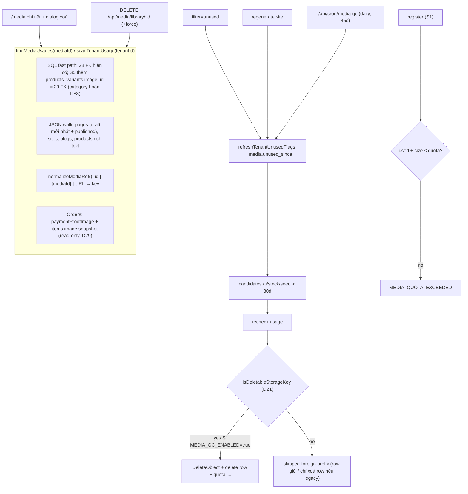

# PRD: Media Management — Sprint 4: Vòng đời (F48-S4)

> **Version:** 1.0 | **Created:** 2026-11-09 | **Agent:** `docs-engineer`
> **Priority:** P0 (US-F48-11) / P1 (US-F48-12, -13) | **Sprint:** F48 — S4 | **Size:** L
> **Depends on:** F48-S0 (khoá field, luật xoá theo prefix), F48-S1 (pipeline register, `created_via`, `content_hash`, API list), F48-S3 (thư mục, `canManageMedia`), F15 Subscriptions (PlanFeatures) | **Blocks:** F48-S5 (usage scan thêm `products_variants.image_id` + snapshot order; category hoãn D88)
> **Nguồn quyết định:** brainstorm F48 2026-11-09 — D8, D9 (**soft launch `UNLIMITED`, PO chốt số sau báo cáo S4 — D88**), D19, D21, D24, D25, D28, D29, D32, D33, D34, D39, D41, D44, D46, D47, D48, D53; review lần 3: D75 (tên migration theo arch), D77 (lease GC), D78 (gate audit, QR đang bật, cột SQL thuần), Low review 3. Code tham chiếu: staging `5c3e3bdca`. GC/vòng đời chi tiết: [arch lifecycle](../architecture/F48-media-management-lifecycle.md).
> **Overview:** [F48-media-management-overview.md](./F48-media-management-overview.md) · **Stories:** [F48-media-management-stories-3.md](../stories/F48-media-management-stories-3.md) · **Architecture:** [F48-media-management.md](../architecture/F48-media-management.md) · **Design:** [F48-media-management-design.md](../design/F48-media-management-design.md) · **QA:** [F48-media-management.md](../qa/F48-media-management.md)

---

> [!IMPORTANT]
> AC ở §11 copy từ [F48-media-management-stories-3.md](../stories/F48-media-management-stories-3.md) (Draft). FR tách con (FR-28a…) giữ số gốc FR-28..FR-33.

> [!WARNING]
> **Bucket DO Spaces dùng chung với PW1.** Không nhánh nào trong S4 được xoá object ngoài luật D21. NFR-05 là test **bắt buộc**, chặn merge.

## 0. Story Traceability

| Story ID | Title | File | Status |
|----------|-------|------|--------|
| US-F48-11 | "Đang dùng ở đâu" + chặn/cảnh báo khi xoá + bộ lọc "Chưa dùng" | [stories-3](../stories/F48-media-management-stories-3.md) | Draft |
| US-F48-12 | Dọn rác tự động có dry-run + dọn khi regenerate | [stories-3](../stories/F48-media-management-stories-3.md) | Draft |
| US-F48-13 | Quota dung lượng theo gói + đồng hồ dung lượng | [stories-3](../stories/F48-media-management-stories-3.md) | Draft — số quota chốt sau báo cáo dung lượng S4 (D88) |

## 1. Problem Statement

- Xoá media hiện **không kiểm nơi dùng**: 28 field `upload` không khai `onDelete`, và block JSON lưu URL string (gallery, before-after, client-logos, carousel, rich text, custom-html…) → xoá một ảnh làm vỡ ảnh SP/trang đang bán, không ai biết.
- **Không có dọn rác**: regenerate site xoá pages (`generate-site-service.ts` ~1533) nhưng giữ toàn bộ media AI/stock cũ; mỗi lần tạo site sinh bản sao ảnh riêng. Không cron, không hook.
- **Không có quota**: chỉ giới hạn mỗi file. `tenants.settings.storageUsed` có cột nhưng không ai ghi (chỉ `account/reset` đặt 0) → không đo được, không chặn được.
- Bucket dùng chung PW1 → mọi cơ chế xoá tự động là rủi ro mất dữ liệu PW1 nếu sai prefix.

## 2. Target User

- **Chủ shop** — dọn thư viện, xem dung lượng, quyết định "Vẫn xoá".
- **Staff có `media`** — dọn ảnh không dùng (không có "Vẫn xoá").
- **Super-admin / hệ thống cron** — vận hành GC, cấu hình quota trong PlanFeatures, đối soát.

## 3. Solution Overview

1. **`findMediaUsages`** — một bộ quét duy nhất: đường nhanh SQL cho 28 FK + FK mới (S3/S5), đường JSON cho block/rich text/custom-html theo **id, `{mediaId}` và URL đã chuẩn hoá**; tính cả đơn hàng như tham chiếu chỉ-đọc (D29). Dùng cho chi tiết media, xoá, bộ lọc "Chưa dùng" và GC.
2. **Xoá có kiểm tra (D19, D28)** — đang dùng → chặn, owner "Vẫn xoá" từng file: 1 transaction SQL (FK set null, xoá dòng `products_images`, gồm `_pages_v` bản mới nhất — M2), URL trong nội dung giữ nguyên, object xoá **sau commit** theo luật D21.
3. **`unused_since`** — cột đánh dấu thời điểm phát hiện không dùng; được làm mới theo tenant (khi mở bộ lọc, sau regenerate, trước GC).
4. **GC cron hằng ngày (D61)** — ngân sách 45 s/lượt, theo tenant + checkpoint, circuit breaker theo tỉ lệ; dry-run mặc định (`MEDIA_GC_ENABLED` ≠ `true`), chỉ `created_via ∈ {ai, stock, seed}` không dùng > 30 ngày, kiểm lại usage ngay trước xoá, chỉ xoá object hợp luật D21, báo cáo JSON private `pw2/reports/gc/` + log; Sentry chỉ cảnh báo lỗi (D41/D47).
5. **Quota** — `media_storage_mb` trong PlanFeatures, `tenants.media_bytes_used` cập nhật trong cùng transaction với tạo/xoá row; biên lai không tính (D24); gói thiếu cấu hình = free (D25).



## 4. Scope

### In Scope
- `findMediaUsages` + API "Đang dùng ở" + dialog xoá + force delete owner (US-F48-11).
- Bộ lọc/nhãn "Chưa dùng", badge "Legacy" cho row PW1 (US-F48-11, D21).
- Cron GC + dry-run + báo cáo + regenerate đánh dấu + lifecycle rule `pw2/tmp/` (US-F48-12).
- Quota theo gói, bộ đếm, chặn upload, đồng hồ 80%/100%, đối soát (US-F48-13).

### Out of Scope
- Sửa tự động nội dung block/rich text khi xoá (URL giữ nguyên — D19).
- Chuyển block URL cũ sang `{mediaId}` (không backfill — D3).
- UI merchant cho GC; bảng lưu báo cáo GC (D33 — không tạo bảng mới).
- Xoá object PW1 hoặc object ngoài `pw2/`. (Object mồ côi **trong** `pw2/t/` cũ > 1 ngày thì GC có quét — D39, FR-31e.)
- Mua thêm dung lượng / add-on quota (thuộc F15).
- Số quota từng gói: PO chốt sau báo cáo dung lượng thực ở S4 (D88).

## 5. Success Metrics

| Metric | Target | Measured By |
|--------|--------|-------------|
| Ảnh vỡ do xoá | 0 xoá media đang dùng không qua cảnh báo | Test TC-F48-11-03, audit log `media.force_delete` |
| An toàn bucket | **0** object ngoài luật D21 bị xoá (NFR-05) | Test bắt buộc + review log GC 4 lần dry-run |
| Byte giải phóng | ≥ 30% byte media `ai/stock/seed` của tenant đã regenerate được giải phóng sau 60 ngày bật GC | Báo cáo GC `bytesFreed` cộng dồn |
| Độ chính xác quota | Lệch `media_bytes_used` vs `SUM(filesize)` < 1% ở ≥ 99% tenant | Đối soát trong lượt GC hằng ngày |
| Không chặn thanh toán | 0 lỗi upload biên lai do quota | Log `MEDIA_QUOTA_EXCEEDED` với `private=true` = 0 |

## 6. User Story Summary

```
AS A chủ shop  I WANT biết mỗi ảnh đang dùng ở đâu trước khi xoá, và lọc ảnh không dùng
SO THAT tôi dọn thư viện mà không làm vỡ ảnh trên website đang bán hàng            (US-F48-11)
AS A super-admin (cron)  I WANT media AI/stock/seed không dùng được tự dọn, có dry-run
SO THAT chi phí lưu trữ không tăng mãi, không bao giờ đụng file merchant hay PW1   (US-F48-12)
AS A chủ shop  I WANT biết dung lượng đã dùng so với hạn mức gói
SO THAT tôi chủ động dọn ảnh hoặc nâng gói trước khi bị chặn upload                 (US-F48-13)
```

## 7. Functional Requirements

| FR-ID | Requirement | Story Ref | Priority | Notes |
|-------|-------------|-----------|----------|-------|
| FR-28a | `findMediaUsages(mediaId)` đường nhanh: 1 truy vấn `UNION ALL` trên toàn bộ cột FK ở §13.2 (dùng **tên cột thật** của DB, vd `payments_qr_image_id` — M1; cột FK hay quét có index — M2) (S4: 28 field; S5: thêm `products_variants.image_id` = 29 FK; `categories.image_id` hoãn D88, không sinh SQL tham chiếu cột này), lọc theo `tenant_id` của media (trừ bảng platform `templates`, `content_packs` — chỉ đếm, không link) | US-F48-11 | P0 | AC-2 |
| FR-28b | Đường JSON: tải tài liệu của tenant (pages: bản published + bản nháp mới nhất `_pages_v` latest/autosave — version cũ hơn **không** tính, D48; **toàn bộ doc site** gồm `header/footer/global_blocks`, `pending_*`, `branding_logo`/`branding_favicon` (text URL) — M1; blogs.content, products.description) `depth: 0`, đi sâu mọi node: số ở key upload đã biết, object `{ mediaId }`, chuỗi URL, HTML (`src`, `srcset`, `href`, `poster`, `url(...)`) → `normalizeMediaRef` → so với `matchKeys(media)` | US-F48-11 | P0 | AC-2, §13.3 |
| FR-28c | Đơn hàng (D29): `orders.payment_proof_image_id` và `orders_items.image_url` snapshot ảnh (S5) → kết quả `kind: 'order'`, `readOnly: true`. Kết quả gộp theo `(kind, docId, path)`, không trùng lặp | US-F48-11 | P0 | D29 |
| FR-28d | `GET /api/media/library/:id/usages` trả danh sách nơi dùng (loại, tên, link màn sửa, `readOnly`); member active của tenant đọc được | US-F48-11 | P0 | AC-1 |
| FR-29a | `DELETE /api/media/library/:id`: chạy usage → có nơi dùng → 409 `MEDIA_IN_USE` kèm `usages`; không dùng → xoá. Staff có `media` (S3) xoá được media không dùng; staff không `media` → 403 | US-F48-11 | P0 | AC-3, D19 |
| FR-29b | `DELETE …/:id?force=true` — **chỉ owner** (D28), **từng file** — **1 transaction SQL** trên client `pool.connect()` lấy cùng hash/key lock với dedupe, đọc lại row/usage rồi ghi deletion intent bền vững (D87, lifecycle §8.6) **trước COMMIT** (M2, D60): `UPDATE … SET <fk> = NULL` cho mọi FK (gồm bảng `_pages_v*` bản mới nhất), **xoá dòng** `products_images` trỏ media (không để NULL trong array table), giữ nguyên URL trong JSON, xoá row, giảm quota trong cùng transaction (không qua hook `afterDelete` — D67); **sau commit** mới xoá exact key cũ theo `isDeletableStorageKey` (D21); lỗi/timeout giữ intent retry, không phục hồi row/quota, không đụng key UUID của upload mới. Intent chưa ghi xác nhận ⇒ rollback giữ row/quota (D87). Staff gọi force → 403 `MEDIA_FORCE_DELETE_OWNER_ONLY`. Media `private` hoặc **có bất kỳ tham chiếu đơn hàng** (biên lai hoặc ảnh item snapshot) → 409 `MEDIA_FORCE_DELETE_FORBIDDEN`, kể cả owner (D44). **D78:** media đang là **QR thanh toán đang bật** (`tenants.payments_qr_image_id` khi `payments.payment_qr = true`; `sites.payment_config_merchant_qr_code_id`) cũng → 409 `MEDIA_FORCE_DELETE_FORBIDDEN` (không set NULL làm hỏng trang thanh toán; merchant đổi QR trước) — dùng lại mã có sẵn, không thêm mã mới. Id/key bị cờ audit (D78/D87 §8.7): chỉ xoá row sau exclusion exact key được ghi/đọc xác nhận durable, không xoá object; registry unknown/ghi lỗi ⇒ rollback giữ row/quota. Ghi log `media.force_delete` (user, mediaId, usages) | US-F48-11 | P0 | AC-4, AC-7 |
| FR-29c | Xoá nhiều (FR-17, ≤ 100, rate limit 10/user + 20/tenant mỗi phút — D32): xoá item không dùng, giữ item đang dùng và trả `kept[]` kèm lý do (`in_use`/`forbidden`/`legacy_shared`/`not_found`/`delete_failed`); `cleanupPending[]` là id đã xoá DB nhưng S3 chờ retry theo D87, không phải `kept`. > 100 → 400 `MEDIA_BULK_LIMIT`; **không** có `force` hàng loạt. Bật flag `MEDIA_BULK_DELETE_ENABLED` khi FR-28/FR-29a xong (D34) | US-F48-11 | P0 | AC-6, D34 |
| FR-30a | `refreshTenantUnusedFlags(tenantId)`: 1 lượt quét tenant → `usedIds` + `usedKeys`; `UPDATE media SET unused_since = COALESCE(unused_since, now())` cho row không dùng, `= NULL` cho row đang dùng. **Không** ghi `tenants.media_gc_checked_at` (cột này chỉ dùng cho checkpoint/lease GC — D77); throttle 5 phút/tenant theo khoá riêng (Redis) | US-F48-11 | P0 | AC-5 |
| FR-30b | API list (FR-15) nhận `filter=unused` (gọi FR-30a nếu quá 5 phút, rồi `WHERE unused_since IS NOT NULL`); ô media hiện nhãn "Unused / Tidak digunakan"; row PW1 (`filename IS NULL`, URL host PW1) hiện badge "Legacy" (D21). Xoá hàng loạt từ bộ lọc này không qua dialog nơi dùng (nhưng server vẫn kiểm lại) | US-F48-11 | P0 | AC-5 |
| FR-31a | Cron `GET /api/cron/media-gc` (Bearer `CRON_SECRET`, `export const maxDuration = 60`; `vercel.json` glob `src/app/api/**/*.ts` = 120 — ngân sách 45 s không phụ thuộc giá trị thắng, Low review 3), lịch **hằng ngày** `0 19 * * *` (03:00 MYT) — D61. `MEDIA_GC_ENABLED !== 'true'` → `mode='gc-dry-run'`: dry-run pha ứng viên GC và dừng retry intent nguồn gc/orphan; retry intent allocation/xoá merchant đã được cho phép vẫn chạy từ S1 theo D87 (gồm allocation watch mọi prefix, giữ source allocation; query `dryRun=1` ép mọi pha chỉ báo cáo, `mode='dry-run'`; flag true và không query ⇒ `mode='enabled'`). **Ngân sách 45 s/lượt** (không cap số ứng viên): xử lý theo tenant (`media_gc_checked_at NULLS FIRST`), mỗi tenant **nhận lease** (`UPDATE tenants SET media_gc_checked_at = $runStart … RETURNING id` — D77, lease = checkpoint) → quét usage **1 lần** → mark → sweep → đối soát; hết ngân sách → lượt sau tiếp. **Chọn trước tenant có ứng viên (D66):** đầu lượt 1 câu SQL chỉ đọc (không thêm cột — [lifecycle §8.3](../architecture/F48-media-management-lifecycle.md#83-lịch-và-an-toàn)) lấy tenant thoả ít nhất 1 điều kiện: (1) có row `ai/stock/seed` non-private `unused_since` quá 30 ngày; (2) có row `created_via IS NOT NULL` mới tạo sau checkpoint hoặc checkpoint NULL (regenerate FR-32, nhánh lỗi D39 đặt NULL); (3) `sites.updated_at` > checkpoint và tenant có media `ai/stock/seed`; thứ tự checkpoint cũ nhất trước. Tenant sạch (gồm mọi tenant chỉ có row trước F48) bỏ qua, không quét usage. Lệch quota xử lý ở pha đối soát đầu lượt (FR-33e), không chiếm chỗ danh sách này. Báo cáo ghi `tenantsRemaining` + `oldestPendingDays` (> 7 → Sentry warning); NFR-S4-05. Ứng viên GC: `created_via IN ('ai','stock','seed')`, `private IS NOT TRUE`, `unused_since < now() - 30 days` | US-F48-12 | P1 | AC-1, AC-2, D33, D61, D66 |
| FR-31b | An toàn xoá: **lock (D60, DB qua Neon `-pooler`)** — **D77:** khoá lượt Redis `SET media-gc:run {runId} NX EX 150` (TTL > cả 60 lẫn 120 s); **Redis lỗi ⇒ bỏ lượt** (báo cáo `skipped: 'lock-unavailable'`); lease theo tenant `UPDATE tenants SET media_gc_checked_at = $runStart WHERE id=$t AND (media_gc_checked_at IS NULL OR media_gc_checked_at < $runStart) RETURNING id` (0 dòng → bỏ tenant) — lease tenant không thay hash/key xact lock chung với register khi xử lý từng row (D87); không dùng advisory lock mức session; **circuit breaker theo tỉ lệ** (sẽ xoá > 50% media của tenant hoặc > 3× trung bình 4 lượt trước → dừng + Sentry, D61); audit key bất thường (FR-01a) là gate trước deploy S0 và chạy lại trước khi bật xoá thật; key bị audit chặn giữ exclusion durable độc lập row/intent tới explicit Ops clearance (D62/D78/D87 §8.7); metadata thiếu/lỗi/incomplete ⇒ không xoá mọi prefix, trước row mất thì rollback giữ row/quota; trước mỗi xoá gọi lại `findMediaUsages` (dùng → `unused_since = NULL`, `skipped-in-use`); object chỉ xoá khi `isDeletableStorageKey(row)` (D21); row PW1 `filename IS NULL` → chỉ xoá row (không bao giờ là ứng viên GC vì `created_via` NULL); D87: dưới cùng hash/key lock đọc lại điều kiện ứng viên/usage, ghi intent bền vững → DELETE row + trừ quota → COMMIT → DeleteObject key cũ; S3 lỗi/timeout không giữ/khôi phục row, giữ intent trong `pendingObjectDeletes`/`errors[]` cho retry; ghi intent lỗi trước COMMIT ⇒ rollback giữ row/quota | US-F48-12 | P1 | AC-3, AC-4, AC-7, NFR-05 |
| FR-31c | Báo cáo (D41/D47): response JSON `MediaGcReport`; ghi bản JSON **private** `pw2/reports/gc/{yyyy-mm-dd}.json`, giữ 8 bản gần nhất (xoá bản cũ hơn); `payload.logger.info({ event: 'media-gc', totals })`. Sentry cảnh báo ngay audit_metadata_unavailable, escalation/heartbeat/last-success/backlog/watchdog theo lifecycle §8.9; metrics không thay JSON báo cáo. Registry publish theo §8.8 (conditional PUT/ETag CAS + Spaces gate, no new env/schema). Không tạo bảng mới | US-F48-12 | P1 | AC-1, AC-7 |
| FR-31d | Ops: lifecycle rule DO Spaces cho prefix `pw2/tmp/` (Expiration 1 ngày + AbortIncompleteMultipartUpload 1 ngày). **Triển khai từ S1 (D36)**; ops QA sau 48h trên bucket staging, không chặn release S1 (D45); bằng chứng đính kèm PR | US-F48-12 | P1 | AC-6 |
| FR-31e | Mồ côi + đợt GC (D39, D46): GC quét thêm object `pw2/t/{tenantId}/` không có row và cũ > 1 ngày (xoá ở chế độ enabled, liệt kê ở dry-run); "có row" so trên key ghép đầy đủ `storageKey(row)` = join phần khác rỗng của `[prefix, _objectKey, filename]` (D64), không so `filename`/`_objectKey` riêng lẻ (TC-F48-12-18). D87: sweep intent/orphan độc lập danh sách tenant D66 (kể cả 0 row), cursor bền vững, phủ ≤7 ngày; trước xoá SELECT primary theo exact key + Head tuổi mới dưới lock, không dùng snapshot LIST làm quyết định cuối; dù không row/intent vẫn kiểm exact-key registry §8.7, blocked/unknown không enqueue/DeleteObject (lifecycle §8.6–§8.7). Đợt đầu chỉ xoá object `pw2/`; nhánh key phẳng (D21b) chỉ mở sau 4 báo cáo dry-run sạch liên tiếp (cấu hình server) | US-F48-12 | P1 | AC-3, NFR-05 |
| FR-32 | Regenerate: sau khi generation hoàn tất (ngoài transaction xoá pages), gọi `refreshTenantUnusedFlags(tenantId, { force: true })` → media `ai/stock/seed` lần trước không còn dùng có `unused_since = now()`; media `upload` cũng được đánh dấu nhưng GC không bao giờ chọn | US-F48-12 | P1 | AC-5 |
| FR-33a | `FEATURE_CODE_OPTIONS` thêm `{ label: 'Media storage (MB)', value: 'media_storage_mb' }`; `getMediaQuotaBytes(tenantId)`: gói đang hoạt động → `getFeatureValue` → `UNLIMITED` = không giới hạn; số = MB×1048576; thiếu bản ghi hoặc không có subscription → giá trị của `FREEMIUM` (D25); FREEMIUM cũng thiếu → hằng `DEFAULT_FREE_MEDIA_MB = 500` | US-F48-13 | P1 | AC-6, D25 |
| FR-33b | Register (S1) và mọi xoá: transaction trên **một client `pool.connect()` + BEGIN/COMMIT** (không `pool.query` rời — D60) `SELECT media_bytes_used FROM tenants WHERE id=$1 FOR UPDATE` → nếu `used + storedBytes > quota` → `MEDIA_QUOTA_EXCEEDED`, xoá tmp, không tạo row; ngược lại tạo row + `media_bytes_used += storedBytes`. Dedupe trùng hash → +0. Xoá → `GREATEST(0, used - filesize)` **đúng 1 lần** mỗi đường xoá (M6, D67): đường Local API (`DELETE` không force, bulk, Payload admin) trừ trong hook `afterDelete`; đường SQL trực tiếp (force FR-29b, GC sweep FR-31) trừ trong **cùng transaction** xoá row và không gọi Payload nên hook không chạy ⇒ không trừ đôi (TC-F48-13-11). Byte = kích thước **sau xử lý**; row PW1 migrate (`filename` null) không tính (M6) | US-F48-13 | P1 | AC-2, AC-3 |
| FR-33c | Biên lai người mua (`private = true`, `pw2/private/`) **không** kiểm và **không** cộng quota (D24); avatar user (tenant null) không tính. Hạ gói không xoá gì, chỉ chặn upload mới | US-F48-13 | P1 | AC-4, AC-5 |
| FR-33d | `GET /api/media/quota` → `{ usedBytes, quotaBytes, percent, level }`; `MediaStorageMeter` ở `/media` + picker: `< 80%` bình thường, `≥ 80%` cảnh báo + link bộ lọc "Chưa dùng", `≥ 100%` "Storage full" + link nâng gói; client chặn sớm khi `file.size(sau nén) > remaining` | US-F48-13 | P1 | AC-1 |
| FR-33e | Đối soát: `reconcileMediaUsage(tenantId?)` đặt `media_bytes_used = SUM(filesize)` row không private, `filename IS NOT NULL` (M6) của tenant; chạy **cùng lượt GC hằng ngày theo lát tenant** (D61) + **pha đầu lượt** cho tenant lệch chọn bằng SQL (`media_bytes_used` vs `SUM(filesize)` vượt dung sai, mỗi tenant 1 transaction `FOR UPDATE` rồi tính lại; ≤ ~10 s/lượt — D66) + route super-admin `POST /api/admin/media/reconcile-usage`; lệch > 1% hoặc > 5 MB → ghi đè + log warn (cùng dung sai INV-5). Phải đối soát xong **mọi** tenant trước khi bật chặn quota (M6) | US-F48-13 | P1 | AC-6 |

> Tổng 20 FR con thuộc FR-28..FR-33. Quota dùng cột mới `tenants.media_bytes_used`, **không** dùng lại `settings.storageUsed/storageLimitBytes` (để nguyên, không xoá — D53). Media AI/seed được đếm quota nhưng không bao giờ bị chặn (D36).

## 8. Business Rules

- **BR-01 (D21 — luật xoá object):** chỉ xoá object khi (a) key bắt đầu `pw2/`, hoặc (b) key phẳng (không chứa `/`) **và** bằng đúng `filename` của chính row PW2 đang xoá (`filename IS NOT NULL`). Mọi trường hợp khác: không gọi S3. Row PW1 (`filename IS NULL`, URL trỏ PW1) → xoá row, không đụng object.
- **BR-02:** GC chỉ chọn `created_via ∈ {ai, stock, seed}`. `upload`, `import-url`, `system`, `NULL` (row trước F48) **không bao giờ** bị tự xoá.
- **BR-03 (D29, D44):** media có tham chiếu từ đơn hàng không bao giờ bị GC xoá và **không** được force delete (kể cả owner); chỉ hiển thị nơi dùng.
- **BR-04 (D28):** "Vẫn xoá" chỉ owner, từng file; staff `media` không có; không force hàng loạt.
- **BR-05:** Media global (`tenant_id IS NULL`), media tenant khác → 404 với merchant; biên lai private không xuất hiện ở thư viện và không bao giờ force delete.
- **BR-06:** Quét usage chỉ trong tenant của media (trừ đếm platform `templates`/`content_packs` cho super-admin).
- **BR-07 (D24):** quota không áp cho biên lai; luồng thanh toán không bao giờ bị chặn vì quota.
- **BR-08 (D25):** gói thiếu `media_storage_mb` dùng hạn mức FREEMIUM, không coi là không giới hạn.
- **BR-09:** Dung lượng = tổng `filesize` sau xử lý của row `private IS NOT TRUE` thuộc tenant; dedupe không tính 2 lần.
- **BR-10:** Ngưỡng cảnh báo 80%, đầy 100% (so `used ≥ quota`).
- **BR-11:** Dry-run là mặc định; chỉ đổi bằng env server `MEDIA_GC_ENABLED=true` (Vercel Dashboard), không qua UI.

## 9. User Flow

```
Chi tiết media (/media) → panel "Used in / Digunakan di" (FR-28d)
Bấm Delete
  ├── không dùng → confirm thường → xoá → toast
  └── đang dùng → dialog: danh sách nơi dùng (link), focus "Cancel"
         ├── staff media: chỉ [Cancel]
         └── owner: [Cancel] [Delete anyway] → confirm lần 2 → force → toast + danh sách nơi sẽ vỡ ảnh
Chọn nhiều → Delete → server xoá phần không dùng → toast "Deleted 16, kept 4 in use" + link xem lý do

Cron hằng ngày 03:00 MYT → Redis lock lượt (lỗi ⇒ bỏ lượt) → lặp tenant (ngân sách 45 s): lease `UPDATE tenants … RETURNING` (D77) → quét usage 1 lần → refresh unused
  → candidates + orphan `pw2/t/` > 1 ngày → breaker tỉ lệ → recheck → D21 key guard (đợt đầu chỉ `pw2/`, D46) → [dry-run: ghi báo cáo] | [enabled: xoá] → đối soát quota
  → JSON private `pw2/reports/gc/{yyyy-mm-dd}.json` (giữ 8) + log; lỗi → Sentry

Upload (S1 register) → quota tx → OK | MEDIA_QUOTA_EXCEEDED (toast "Storage full" + link dọn / nâng gói)
```

## 10. Screen Layout

- **10.1 Chi tiết media:** thêm khối "Used in" (tối đa 20 dòng, "và N nơi khác"), icon theo loại (Package / PenLine / LayoutTemplate / ShoppingCart). Badge "Legacy" cho row PW1.
- **10.2 Dialog xoá:** desktop modal, 375px bottom sheet cuộn được; nút phá huỷ màu destructive, không phải focus mặc định.
- **10.3 Lưới thư viện:** chip lọc "Unused"; nhãn góc ô; `MediaStorageMeter` ở đầu trang (`role="progressbar"`, `aria-valuenow`).
- **10.4 States:** loading usages = skeleton 3 dòng; lỗi quét = "Couldn't check where this file is used" + Retry, **nút xoá bị khoá** khi chưa quét được.
- **Design:** [F48-media-management-design.md](../design/F48-media-management-design.md) (màn S4 Xoá, S6 Quota, S2 "Used in" — ID màn hình, không phải sprint).

## 11. Acceptance Criteria

> Copy từ [stories-3](../stories/F48-media-management-stories-3.md). TC-ID `TC-F48-<story>-<nn>`.

### AC-1: Xem nơi đang dùng — TC-F48-11-01 (US-F48-11 AC-1)
```gherkin
GIVEN ảnh M là ảnh SP "Tudung Bawal", là cover blog "Promo Raya", và nằm trong block gallery trang Home
WHEN  chủ shop mở chi tiết M
THEN  mục "Đang dùng ở" liệt kê 3 nơi, mỗi nơi có loại (Sản phẩm / Blog / Trang – block) và liên kết mở đúng màn sửa
```
### AC-2: Quét đủ mọi kiểu tham chiếu — TC-F48-11-02 (US-F48-11 AC-2)
```gherkin
GIVEN M được tham chiếu qua FK (28 field upload), qua block mới { mediaId }, và qua URL string trong block cũ, rich text, custom-html
WHEN  findMediaUsages(M) chạy
THEN  trả đủ mọi nơi (kể cả đơn hàng, D29), không trùng lặp
  AND chỉ quét dữ liệu thuộc tenant của M
  AND với page chỉ tính bản chính + bản nháp mới nhất (`_pages_v` latest/autosave); version cũ hơn không tính (D48)
```
### AC-3: Xoá media đang dùng bị chặn mặc định — TC-F48-11-03 (US-F48-11 AC-3)
```gherkin
GIVEN M đang được dùng ở ≥ 1 nơi
WHEN  staff có quyền `media` hoặc owner bấm xoá M
THEN  API trả 409 "MEDIA_IN_USE"; hộp thoại liệt kê nơi dùng, nút mặc định là "Huỷ"
  AND chỉ owner thấy nút "Vẫn xoá" (từng file, D28); staff gọi force → 403 "MEDIA_FORCE_DELETE_OWNER_ONLY"
```
### AC-4: Owner "Vẫn xoá" — TC-F48-11-04 (US-F48-11 AC-4)
```gherkin
GIVEN owner chọn "Vẫn xoá" M
WHEN  xác nhận
THEN  trong 1 transaction: các FK trỏ M được đặt null, dòng ảnh gallery SP trỏ M bị gỡ (M2), URL trong block/rich text giữ nguyên
  AND trước COMMIT có deletion intent bền vững; COMMIT xoá row + giảm quota đúng một lần, rồi mới DeleteObject exact key cũ theo guard (D87)
  AND S3 lỗi/timeout giữ intent để GC retry, không hồi sinh row/quota; upload cùng bytes tạo key UUID mới không bị DeleteObject cũ ảnh hưởng
  AND thông báo kết quả liệt kê các nơi sẽ hiển thị ảnh vỡ để owner sửa
```
### AC-5: Bộ lọc và nhãn "Chưa dùng" — TC-F48-11-05 (US-F48-11 AC-5)
```gherkin
GIVEN thư viện có 40 media, 12 không được dùng ở đâu
WHEN  bật bộ lọc "Chưa dùng" / "Tidak digunakan"
THEN  hiện đúng 12 media, mỗi ô có nhãn "Chưa dùng"
  AND chọn tất cả rồi xoá không cần qua hộp thoại cảnh báo nơi dùng
```
### AC-6: Xoá nhiều có media đang dùng — TC-F48-11-06 (US-F48-11 AC-6)
```gherkin
GIVEN chủ shop chọn 20 media, 4 đang dùng
WHEN  xoá
THEN  16 media chưa dùng bị xoá, 4 media đang dùng được giữ lại với danh sách lý do
  AND owner có thể mở từng media giữ lại để "Vẫn xoá" (không có "Vẫn xoá" hàng loạt)
```
### AC-7: Media không thuộc tenant / private — TC-F48-11-07 (US-F48-11 AC-7)
```gherkin
GIVEN media global (tenant null) hoặc biên lai private đính kèm đơn hàng
WHEN  merchant xem hoặc gọi API xoá
THEN  không xoá được (404 hoặc không xuất hiện), biên lai gắn đơn không bao giờ bị "Vẫn xoá"
GIVEN media M được đơn hàng tham chiếu (ảnh item snapshot hoặc biên lai)
WHEN  owner chọn "Vẫn xoá"
THEN  bị từ chối 409 "MEDIA_FORCE_DELETE_FORBIDDEN" (D44); hộp thoại chỉ hiển thị nơi dùng, không có nút "Vẫn xoá"
GIVEN media M đang là QR chuyển khoản của phương thức thanh toán đang bật (D78)
WHEN  owner chọn "Vẫn xoá"
THEN  bị từ chối 409 "MEDIA_FORCE_DELETE_FORBIDDEN", QR giữ nguyên (không set NULL); tooltip `mediaLibrary.deletePaymentQrLocked` hướng dẫn thay QR ở Payments trước
```
### AC-8: Dry-run là mặc định — TC-F48-12-01 (US-F48-12 AC-1)
```gherkin
GIVEN cron hằng ngày, MEDIA_GC_ENABLED thiếu/false, có ứng viên GC và pending allocation/merchant/gc/orphan intent
WHEN  job chạy không có dryRun=1
THEN  báo cáo JSON private có mode=gc-dry-run: không xoá row ứng viên hoặc object nguồn gc/orphan; cleanup allocation/merchant và allocation watch mọi prefix vẫn chạy theo D87
  AND cleanup chỉ dọn exact key không row, không sửa row/quota; watch giữ source allocation kể cả late Put khi GC tắt
WHEN  job chạy với dryRun=1 bất kể flag
THEN  báo cáo mode=dry-run cho toàn worker; media/quota không đổi, không DeleteObject/ack intent hoặc tiến cursor cleanup thật
  AND chỉ MEDIA_GC_ENABLED=true không có dryRun=1 mới mode=enabled, cho phép xoá ứng viên/retry gc/orphan (D33/D87), không qua UI merchant
```
### AC-9: Tiêu chí ứng viên — TC-F48-12-02 (US-F48-12 AC-2)
```gherkin
GIVEN media có createdVia ∈ {ai, stock, seed}, không còn được dùng ở đâu, unused_since > 30 ngày
WHEN  job chạy ở chế độ xoá thật
THEN  row và object bị xoá, dung lượng tenant giảm tương ứng
  AND media createdVia ∈ {upload, import-url, system} không bao giờ bị tự xoá, dù không dùng
```
### AC-10: Chỉ đụng prefix PW2 (NFR-05) — TC-F48-12-03 (US-F48-12 AC-3)
```gherkin
GIVEN ứng viên có key không nằm dưới `pw2/` (vd media seed có key phẳng = filename, hoặc row trỏ object PW1)
WHEN  job xử lý ở đợt đầu
THEN  không xoá object đó, ghi "skipped-foreign-prefix" vào báo cáo (D46: nhánh key phẳng D21b chỉ mở sau 4 báo cáo dry-run sạch liên tiếp)
  AND test bắt buộc chứng minh 0 object ngoài `pw2/` bị xoá trong mọi nhánh của job
  AND flagged exact key vẫn bị chặn sau xoá row cuối/intent, nhiều sweep và restart tới explicit Ops clearance; metadata unknown thì không xoá mọi prefix (D87 §8.7)
```
> D46: đợt đầu GC chỉ xoá `pw2/`; key phẳng đúng `filename` của chính row PW2 (D21b) chỉ được GC xoá sau 4 báo cáo dry-run sạch liên tiếp. Xoá tay của user vẫn theo `isDeletableStorageKey` đầy đủ. Test NFR-05 kiểm cả hai chế độ.
### AC-11: Kiểm lại ngay trước khi xoá — TC-F48-12-04 (US-F48-12 AC-4)
```gherkin
GIVEN media X là ứng viên lúc quét
WHEN  trước lúc xoá, merchant vừa gắn X vào sản phẩm
THEN  job kiểm lại usage ngay trước khi xoá và bỏ qua X, unused_since của X được xoá
```
### AC-12: Regenerate site đánh dấu media cũ — TC-F48-12-05 (US-F48-12 AC-5)
```gherkin
GIVEN chủ shop regenerate site, các page cũ bị thay
WHEN  regenerate hoàn tất
THEN  media AI/stock/seed của lần tạo trước không còn được dùng được đặt unused_since = thời điểm regenerate
  AND media merchant tự upload không bị đánh dấu xoá (chỉ hiện nhãn "Chưa dùng" ở US-F48-11)
```
### AC-13: File tạm và multipart dở dang — TC-F48-12-06 (US-F48-12 AC-6)
```gherkin
GIVEN lifecycle rule bucket cho prefix `pw2/tmp/` (đặt từ S1, D36; ops QA sau 48h, không chặn release S1, D45)
WHEN  object tmp quá 1 ngày hoặc multipart upload bị bỏ dở
THEN  DO Spaces tự xoá/abort
  AND rule đã được kiểm thật trên DO (không chỉ cấu hình), không ảnh hưởng prefix khác
```
### AC-14: Lỗi và chạy chồng — TC-F48-12-07 (US-F48-12 AC-7)
```gherkin
GIVEN job đang chạy, hoặc S3 trả lỗi khi xoá một object
WHEN  lần chạy thứ hai bắt đầu, hoặc lỗi xảy ra
THEN  lần thứ hai thoát nhờ khoá Redis TTL; lease tenant theo D77, mỗi row vẫn dùng hash/key lock chung với register (D87); Redis lỗi ⇒ bỏ lượt
  AND deletion intent đã ghi bền vững trước COMMIT xoá row/quota; S3 lỗi/timeout sau đó giữ intent retry exact key cũ, không giữ/khôi phục row và không cộng lại quota
  AND intent ghi lỗi/chưa xác nhận trước COMMIT thì rollback giữ row/quota; crash sau COMMIT trước DeleteObject vẫn được worker độc lập D66 tìm/dọn
  AND báo cáo tách row/quota đã giải phóng, object đã dọn, object đang chờ retry và lỗi; retry không trừ quota lần hai
```
### AC-15: Đồng hồ dung lượng — TC-F48-13-01 (US-F48-13 AC-1)
```gherkin
GIVEN gói của tenant có media_storage_mb = 2048 và đã dùng 1.2 GB
WHEN  mở /media hoặc picker
THEN  thấy "1.2 of 2 GB used" / "1.2 daripada 2 GB digunakan" (`mediaLibrary.storageUsed`, design S6) kèm thanh tiến trình
  AND ≥ 80% đổi màu cảnh báo + gợi ý dọn "Chưa dùng"; ≥ 100% hiển thị trạng thái đầy + liên kết nâng gói
```
### AC-16: Chặn upload khi vượt quota — TC-F48-13-02 (US-F48-13 AC-2)
```gherkin
GIVEN tenant còn 3 MB
WHEN  upload ảnh mà dung lượng sau xử lý là 4 MB
THEN  register từ chối 413 "MEDIA_QUOTA_EXCEEDED" ("Storage full" / "Storan penuh"), object tmp bị xoá, không tạo row
  AND media tạo bởi AI/seed vẫn được đếm nhưng không bị chặn (D36)
  AND client cũng chặn sớm khi biết chắc file vượt phần còn lại
```
### AC-17: Đếm chính xác, không vượt khi upload song song — TC-F48-13-03 (US-F48-13 AC-3)
```gherkin
GIVEN tenant còn 5 MB, 3 upload 2 MB register đồng thời
WHEN  cả 3 hoàn tất
THEN  tối đa 2 upload thành công, upload còn lại bị từ chối
  AND `tenants.media_bytes_used` cập nhật trong cùng transaction với tạo/xoá row (không dùng `settings.storageUsed`, D53)
  AND upload trùng hash (US-F48-04 AC-3) không làm tăng dung lượng
  AND dung lượng tính theo byte lưu sau xử lý, không theo file gốc
```
### AC-18: Hạ gói khi đang vượt quota — TC-F48-13-04 (US-F48-13 AC-4)
```gherkin
GIVEN tenant dùng 3 GB, hạ từ gói 5 GB xuống 2 GB
WHEN  hạ gói có hiệu lực
THEN  không media nào bị xoá; mọi upload mới bị chặn tới khi dung lượng < hạn mức
  AND ảnh đã có vẫn hiển thị bình thường trên storefront
```
### AC-19: Biên lai người mua không bị chặn — TC-F48-13-05 (US-F48-13 AC-5)
```gherkin
GIVEN tenant đã đầy quota
WHEN  người mua upload biên lai chuyển khoản
THEN  upload thành công (biên lai private không tính vào quota merchant, D24)
  AND luồng thanh toán không bao giờ hỏng vì quota merchant
```
### AC-20: Cấu hình gói và đối soát — TC-F48-13-06 (US-F48-13 AC-6)
```gherkin
GIVEN super-admin sửa PlanFeatures media_storage_mb của một gói
WHEN  lưu
THEN  hạn mức mới áp dụng ngay cho tenant thuộc gói đó
GIVEN gói chưa có bản ghi media_storage_mb
THEN  dùng hạn mức của gói free, không coi là không giới hạn (D25)
GIVEN media_bytes_used lệch so với tổng filesize thực tế
WHEN  super-admin chạy đối soát
THEN  giá trị được tính lại từ các row media của tenant (không tính row private và row PW1 migrate `filename` null — M6)
```

## 12. Non-Functional Requirements

| ID | Category | Requirement | Notes |
|----|----------|-------------|-------|
| NFR-03 | Performance | `findMediaUsages` 1 media p95 < 1,5 s trên tenant cỡ p90 (≈ 31 media, ≤ 30 trang, ≤ 200 SP) | brief NFR-03; FK fast path < 100 ms |
| NFR-05 | Safety (**bắt buộc**) | 0 lệnh `DeleteObject` với key không thoả `isDeletableStorageKey` trong mọi nhánh GC + force delete; test với bucket giả chứa object PW1 (`tm-prime-web` key `product/...`), PW2 `pw2/...`, PW2 phẳng | chặn merge |
| NFR-S4-01 | Performance | `refreshTenantUnusedFlags` p95 < 3 s/tenant p90; mỗi lượt cron dừng nhận tenant mới khi vượt **ngân sách 45 s** và kết thúc < 60 s (`maxDuration`) | checkpoint theo tenant, lượt sau tiếp (D61) |
| NFR-S4-02 | Concurrency | 3 register đồng thời khi còn 5 MB (mỗi 2 MB) → đúng 2 thành công trên Postgres thật | `FOR UPDATE` |
| NFR-S4-03 | Accuracy | Lệch quota < 1% ở ≥ 99% tenant sau đối soát hằng ngày | metric §5 |
| NFR-S4-04 | Observability | 100% lần chạy GC có 1 log `event: media-gc` + 1 file báo cáo `pw2/reports/gc/`; lỗi S3 → Sentry level error | D41, D47 |
| NFR-S4-05 | Coverage | Mọi tenant có ứng viên (sweep đến hạn / media mới / site đổi sau checkpoint) được xử lý ≤ **7 ngày** kể từ khi thoả; câu SQL chọn tenant < 1 s trên ~3k tenant; tenant sạch không bị quét usage | D66; `oldestPendingDays` trong báo cáo; TC-F48-12-19 |
| NFR-06 / NFR-07 | i18n / a11y | 100% chuỗi en/ms; dialog focus "Cancel", đóng bằng Esc, meter `role="progressbar"` | brief |

## 13. Technical Architecture

### 13.1 Code hiện có liên quan (trích thật)

```ts
// src/lib/ai-platform/media-access.ts — đã có bộ gom id theo tenant (tái dùng ý tưởng, mở rộng sang URL)
export async function referencedMediaIds(cms: Cms, tenantId: string, candidates?: readonly string[]): Promise<Set<string>>
//   sites (collectUploadIds), blogs.thumbnail, products.images[].image, pages (draft: true)

// src/lib/ai/media-injector.ts:742 — stripOrphanMediaRefs chỉ biết 5 key upload phổ quát
const UNIVERSAL_UPLOAD_FIELDS = ['image', 'backgroundImage', 'logo', 'avatar', 'ogImage']

// src/lib/media/s3-public-url.ts — URL path-style hiện tại
export function s3PublicUrl(filename: string, prefix?: string): string {
    return `${publicEndpoint}/${bucket}/${prefix ? `${prefix}/` : ''}${filename}`
}

// src/lib/subscriptions/plan-subscription.ts
export async function getFeatureValue(payload: BasePayload, planCode: PlanCode, featureCode: string): Promise<string | null>
export function mapPlanCodeToTier(planCode: PlanCode): 'free' | 'starter' | 'pro' | 'business'
//   FREEMIUM→free, STARTER_*→starter, STANDARD_*→pro, PROFESSIONAL_*→business

// src/collections/Tenants.ts:371 — cột cũ không ai ghi; giữ nguyên, KHÔNG dùng cho quota (D53)
{ name: 'storageUsed', type: 'number', access: PLATFORM_FIELD_ACCESS, defaultValue: 0 }
{ name: 'storageLimitBytes', type: 'number', access: PLATFORM_FIELD_ACCESS, defaultValue: 524288000 }

// src/app/api/cron/payment-expiry/route.ts — mẫu cron
if (!cronSecret || authHeader !== `Bearer ${cronSecret}`) return NextResponse.json({ error: 'Unauthorized' }, { status: 401 })
```

### 13.2 Registry 28 FK (+ FK mới) — đường nhanh FR-28a

| # | Collection.field (Payload) | Bảng.cột DB | Link màn sửa |
|---|---|---|---|
| 1 | `products.images[].image` | `products_images.image_id` | `/products/{id}` |
| 2 | `products.halalCertImage` | `products.halal_cert_image_id` | `/products/{id}` |
| 3 | `blogs.thumbnail` | `blogs.thumbnail_id` | `/blog/{id}` |
| 4 | `orders.paymentProofImage` (read-only, D29) | `orders.payment_proof_image_id` | `/orders/{id}` |
| 5 | `sites.seo.ogImage` | `sites.seo_og_image_id` | `/settings` SEO |
| 6 | `sites.paymentConfig.merchantQrCode` | `sites.payment_config_merchant_qr_code_id` | `/settings/payments` |
| 7 | `tenants.payments.qr_image` | `tenants.payments_qr_image_id` | `/settings/payments` |
| 8 | `users.avatar` | `users.avatar_id` | `/settings/staff` |
| 9 | `templates.thumbnail` (platform) | `templates.thumbnail_id` | — (super-admin) |
| 10 | `content-packs.coverImage` (platform) | `content_packs.cover_image_id` | — |
| 11 | `pages.seo.ogImage` | `pages.seo_og_image_id` | `/editor?page={id}` |
| 12–13 | block `hero.image`, `hero.backgroundImage` | `pages_blocks_hero.image_id`, `.background_image_id` | editor block |
| 14 | `navigation.logo` | `pages_blocks_navigation.logo_id` | editor |
| 15 | `about.image` | `pages_blocks_about.image_id` | editor |
| 16 | `footer.logo` | `pages_blocks_footer.logo_id` | editor |
| 17 | `testimonials.testimonials[].avatar` | `pages_blocks_testimonials_testimonials.avatar_id` | editor |
| 18 | `gallery.images[].image` | `pages_blocks_gallery_images.image_id` | editor |
| 19 | `team.members[].image` | `pages_blocks_team_members.image_id` | editor |
| 20 | `video.posterImage` | `pages_blocks_video.poster_image_id` | editor |
| 21 | `logo-cloud.logos[].logo` | `pages_blocks_logo_cloud_logos.logo_id` | editor |
| 22 | `products-featured.images[].image` | `pages_blocks_products_featured_images.image_id` | editor |
| 23 | `carousel.items[].image` | `pages_blocks_carousel_items.image_id` | editor |
| 24 | `social-proof.reviews[].avatar` | `pages_blocks_social_proof_reviews.avatar_id` | editor |
| 25 | `client-logos.logos[].image` | `pages_blocks_client_logos_logos.image_id` | editor |
| 26 | `menu-food.categories[].items[].image` | `pages_blocks_menu_food_categories_items.image_id` | editor |
| 27 | `portfolio-grid.projects[].image` | `pages_blocks_portfolio_grid_projects.image_id` | editor |
| 28 | `property-card.properties[].image` | `pages_blocks_property_card_properties.image_id` | editor |
| S5 | `products.variants[].image` | `products_variants.image_id` | `/products/{id}` |
| Hoãn D88 — US-F48-16 | `categories.image` | `categories.image_id` — chỉ đăng ký cùng migration category khi mở lại story | `/products/categories` |
| S5 | snapshot ảnh dòng đơn (URL text, không FK — D31) | `orders_items.image_url` → so khớp qua `normalizeMediaRef` (read-only) | `/orders/{id}` |

- Bảng `pages_blocks_*` nối về page qua `_parent_id`; bản nháp nằm ở `_pages_v_blocks_*` → đường nhanh quét **cả hai**, gộp theo page id. Bản version cũ hơn bản mới nhất bị bỏ qua (chỉ `latest = true`).
- Registry là file dữ liệu `src/lib/media/usage/media-reference-sources.ts` (tên theo arch §6, D75); test `TC-F48-11-02` so registry với mọi field `type: 'upload'` trong `src/collections/**` (thêm field mới mà quên registry → test đỏ).

### 13.3 Chuẩn hoá URL — `normalizeMediaRef(raw): MediaRefKey | null`

| Dạng vào | Ví dụ | Khoá chuẩn |
|---|---|---|
| id số / chuỗi số ở key upload | `42`, `"42"` | `id:42` |
| object mới (D3) | `{ mediaId: 42, url }` | `id:42` (+ khoá URL) |
| S3 path-style | `https://sgp1.digitaloceanspaces.com/<bucket>/pw2/t/7/t7-ab12….webp` | `key:pw2/t/7/t7-ab12….webp` |
| S3 virtual-host | `https://<bucket>.sgp1.digitaloceanspaces.com/<key>` | `key:<key>` |
| CDN DO / custom domain (S0, `NEXT_PUBLIC_MEDIA_CDN_URL`) | `https://<bucket>.sgp1.cdn.digitaloceanspaces.com/<key>`, `https://media.<domain>/<key>` | `key:<key>` |
| Handler Payload | `/api/media/file/<filename>` (tương đối hoặc tuyệt đối) | `key:<filename>` |
| next/image | `/_next/image?url=<enc>&w=…` | đệ quy trên `url` |
| Host PW1 cũ | `https://tm-prime-web.sgp1.digitaloceanspaces.com/<path>` (và `-dev`) | `pw1:<path>` |

Quy tắc: bỏ query/hash, `decodeURIComponent`, host lowercase, bỏ `/` đầu; chỉ chấp nhận host trong allowlist (env S3 endpoint, bucket, CDN, origin app, host PW1). `matchKeys(media)` = `{ id:<id>, key:<storageKey(media)> }` (join phần khác rỗng của `[prefix, _objectKey, filename]` — D64) cộng `pw1:<path>` nếu `media.url` trỏ host PW1 (row Legacy). HTML: regex trên thuộc tính `src|srcset|href|poster|data-src` và `url(...)` trong `style`.

### 13.4 Luật xoá object (D21)

```ts
/** Guard D21 của S0 (FR-01d) — `src/lib/media/media-field-guards.ts`; S4 import, KHÔNG viết lại. */
export function isDeletableStorageKey(row: { _objectKey?: string | null; prefix?: string | null; filename?: string | null }): boolean
// key = storageKey(row) = join phần khác rỗng của [prefix, _objectKey, filename] (D64)
// true khi key bắt đầu "pw2/", hoặc key phẳng (không "/") đúng filename server đã ghi; filename null → false
```
Mọi đường xoá (Payload `afterDelete` của storage-s3 đã được S0 bọc, force delete, GC) đi qua hàm này; test grep: không file nào khác trong `src/` import `DeleteObjectCommand` (TC-F48-12-03).

## 14. Dependencies

| Dependency | Status | Action Needed |
|-----------|--------|---------------|
| S0 bọc afterDelete theo D21 (`isDeletableStorageKey`, FR-01d) + khoá field | ⬜ | S4 import guard của S0 |
| S1 `created_via`, `content_hash`, register transaction | ⬜ | FR-33b chèn vào register |
| S3 `canManageMedia`, `media.uploaded_by_id` | ⬜ | FR-29a/b |
| S5 `products_variants.image_id`, `orders_items.image_url` | ⬜ | Registry thêm khi S5 merge; usage/delete/GC phải chạy trên DB không có `categories.image_id` (TC-F48-15-04). Category chỉ thêm cùng migration US-F48-16 khi mở lại (D88) |
| PO số quota (D9) | ⬜ Sau báo cáo S4 (D88) | Chặn bật enforcement (§15.3 seed `UNLIMITED` trước); S4 nộp báo cáo dung lượng thực theo gói cho PO |
| Ops: lifecycle rule `pw2/tmp/` (đã bật ở S1), env `MEDIA_GC_ENABLED`, bật `MEDIA_BULK_DELETE_ENABLED` | ⬜ | Vercel Dashboard + `.env.staging.example` + `.env.production.example` |

## 15. API Contract

### 15.1 Types

```ts
export type MediaUsageKind = 'product' | 'product-variant' | 'category' | 'blog' | 'page-block' | 'page-seo'
    | 'site-settings' | 'tenant-payments' | 'user-avatar' | 'order' | 'platform'
export type MediaUsage = {
    kind: MediaUsageKind
    docId: number | string
    title: string               // tên SP / blog / trang / "#ORD-1024"
    path: string                // 'images[2].image' | 'layout[3](gallery).images[0]' | 'content(html)'
    via: 'fk' | 'media-id' | 'url'
    editHref: string | null
    readOnly: boolean           // true cho order, platform
}
// Lỗi dùng envelope chung S0: MediaErrorBody { error, code, … }
export type MediaUsagesResponse = { mediaId: number; usages: MediaUsage[]; scannedAt: string }

// DELETE /api/media/library/:id[?force=true]
export type DeleteMediaResponse =
    | { id: number; freedBytes: number; cleanupPending: boolean; brokenRefs?: MediaUsage[] }                 // 200; brokenRefs khi force
    | (MediaErrorBody & { code: 'MEDIA_IN_USE'; usages: MediaUsage[]; canForce: boolean }) // 409

// POST /api/media/library/bulk-delete  { ids: number[] }  (≤ 100)
export type BulkDeleteResponse = { deleted: number[]; kept: Array<{ id: number; reason: 'in_use' | 'forbidden' | 'legacy_shared' | 'not_found' | 'delete_failed'; usages?: MediaUsage[] }>; freedBytes: number; cleanupPending: number[] }

// GET /api/media/quota
export type MediaStorageUsage = { usedBytes: number; quotaBytes: number | null; percent: number | null; level: 'ok' | 'warn' | 'full' }

// GET /api/cron/media-gc → MediaGcReport
export type MediaGcReport = {
    mode: 'dry-run' | 'gc-dry-run' | 'enabled'; startedAt: string; durationMs: number; budgetMs: 45000; lockSkipped: boolean
    tenantsProcessed: number; tenantsRemaining: number; oldestPendingDays: number | null /* D66, > 7 → Sentry warning */; breakerTripped: { tenantId: number; reason: 'ratio-50pct' | 'avg-3x' } | null // D61
    totals: { candidates: number; orphans: number; deleted: number; skippedInUse: number; skippedForeignPrefix: number; errors: number; bytesFreed: number; objectsDeleted: number; pendingObjectDeletes: number; orphanBytesDeleted: number } // D87: deleted/bytesFreed theo DB COMMIT, các cột object theo S3
    // mode: dryRun=1 → dry-run toàn worker; flag off → gc-dry-run (allocation/merchant/watch vẫn chạy); còn lại enabled
    flatKeyBranch: boolean      // false ở đợt đầu (D46)
    reportKey: string           // pw2/reports/gc/{yyyy-mm-dd}.json (D41)
    byTenant: Array<{ tenantId: number; candidates: number; bytes: number; keys: string[] /* ≤ 50 */ }>
    reconcile: { tenants: number; drifted: number }
    cleanupBacklog: { count: number; oldestPendingDays: number | null; allocationWatches: number } // gồm tenant 0 row; watch key vắng không tính count/oldestPendingDays, kiểm lại watch ≤7 ngày
    registryHealth: { status: 'ok' | 'unavailable' | 'unknown'; lastSuccessfulCheckAt: string | null; lastSuccessfulPublishAt: string | null; lastAttemptAt: string; blockedCleanupCount: number | null; oldestBlockedDays: number | null; publishConflicts: number } // null=không đo được; timestamps MAX/không false healthy, Ops thresholds §8.9
    errors: Array<{ mediaId: number | null; key: string; phase: 'intent' | 'db' | 'object' | 'audit'; message: string }>
}
```

### 15.2 Error codes

| Code | HTTP | en | ms |
|------|------|----|----|
| `MEDIA_IN_USE` | 409 | This file is in use. Remove it from these places first. | Fail ini sedang digunakan. Alihkan dari tempat berikut dahulu. |
| `MEDIA_FORCE_DELETE_OWNER_ONLY` | 403 | Only the shop owner can delete a file that is in use. | Hanya pemilik kedai boleh memadam fail yang sedang digunakan. |
| `MEDIA_FORCE_DELETE_FORBIDDEN` | 409 | Files used by orders can't be deleted. | Fail yang digunakan oleh pesanan tidak boleh dipadam. |
| `MEDIA_USAGE_SCAN_FAILED` | 503 | We couldn't check where this file is used. Try again. | Kami tidak dapat menyemak di mana fail ini digunakan. Cuba lagi. |
| `MEDIA_QUOTA_EXCEEDED` | 413 | Storage full. Delete unused files or upgrade your plan. | Storan penuh. Padam fail yang tidak digunakan atau naik taraf pelan anda. |

Dùng lại từ S0/S1 (không định nghĩa lại): `MEDIA_BULK_LIMIT` 400, `MEDIA_RATE_LIMITED` 429, `MEDIA_NOT_FOUND` 404, `MEDIA_FORBIDDEN` 403.

Nhãn UI: "Unused" / "Tidak digunakan"; "Legacy" / "Lama"; "Used in" / "Digunakan di"; "Delete anyway" / "Padam juga"; meter `"{used} / {quota}"`.

### 15.3 Data model delta + `scripts/db-setup.js` MIGRATIONS

Tên entry + SQL chuẩn ở **[arch §4.2](../architecture/F48-media-management.md#42-migrations-scriptsdb-setupjs)** (D75) — PR S4 copy nguyên văn. Entry thuộc S4:

| Entry (`name`) | Nội dung | Ghi chú |
|---|---|---|
| `f48.media.unused_since` | `unused_since timestamptz` | |
| `f48.media.unused_idx` | `media_unused_since_idx (unused_since) WHERE unused_since IS NOT NULL` | `concurrentIndex`, `CREATE … CONCURRENTLY` |
| `f48.tenants.media_bytes_used` | `bigint NOT NULL DEFAULT 0` | Cột SQL thuần, **không** khai field Payload (D78) |
| `f48.tenants.media_gc_checked_at` | `timestamptz` | Cột SQL thuần (D78); dùng làm lease/checkpoint GC (D77) |
| `f48.orders.payment_proof_image_idx`, `f48.tenants.payments_qr_image_idx` | Index cột FK hay quét (M2) | |
| `f48.plan_features.media_storage_mb` | Seed `UNLIMITED` 7 gói — `DO $$ … IF NOT EXISTS` (chạy được trên cả 2 dạng bảng `plan_features`) | Cách seed **duy nhất** (D75) |

`scripts/check-migrations.js` chỉ kiểm chiều *field mới → migration*; cột có migration mà không có field (2 cột `tenants` ở trên) được chấp nhận (đã kiểm staging `5c3e3bdca`).

- Seed `UNLIMITED` (theo mẫu seed `ai_budget_usd_daily`) = **soft launch**: bộ đếm + đồng hồ chạy, chưa chặn. Khi PO chốt số (đề xuất FREEMIUM 500, STARTER_* 2048, STANDARD_* 5120, PROFESSIONAL_* 20480 — map tier free/starter/pro/business của `mapPlanCodeToTier`), super-admin sửa trong PlanFeatures — **không cần migration**. Seed chỉ chèn khi chưa có nên không ghi đè.
- Đối soát lần đầu (`reconcileMediaUsage()` toàn bộ) chạy ngay sau deploy qua route super-admin, trước khi đổi số khỏi `UNLIMITED`.
- `media.created_via`, `content_hash` thuộc S1; S4 chỉ đọc. Env mới `MEDIA_GC_ENABLED` (mặc định `false`): thêm Vercel Dashboard + `.env.staging.example` + `.env.production.example`; `vercel.json` thêm cron `{ "path": "/api/cron/media-gc", "schedule": "0 19 * * *" }` (hằng ngày, D61). Index cột FK hay quét (M2) + `media_folders.parent_id` không RESTRICT (M3): xem architecture §4.2.

## 16. Risks & Mitigation

| # | Risk | Khả năng / Ảnh hưởng | Mitigation |
|---|------|----------------------|------------|
| R1 | Xoá nhầm object PW1 hoặc object PW2 không thuộc row (bucket chung) | Thấp / **Rất cao** | `isDeletableStorageKey` duy nhất + NFR-05 test + grep-test `DeleteObjectCommand`; dry-run mặc định; ≥ 2 lần dry-run staging được rà trước khi bật nhánh `pw2/`; nhánh key phẳng sau 4 báo cáo sạch liên tiếp (D46); key S0 riêng PW2 (quyền tối thiểu nếu DO hỗ trợ) |
| R2 | Usage scan bỏ sót kiểu tham chiếu (URL lạ, block mới) → GC/xoá làm vỡ ảnh | TB / Cao | Test registry vs collections; fixture mọi block có URL (`before-after`, `carousel`, `portfolio-grid`, `menu-display`, `footer`, `gallery-masonry`, `content-cards`, `hero`, `video*`, `rich-text`, `custom-html`); GC chỉ chọn `ai/stock/seed` + recheck; lỗi quét → khoá xoá |
| R3 | Key phẳng PW2 trùng tên object PW1 ở gốc bucket (D21b) | Thấp / Cao | Chỉ xoá khi key === `filename` của chính row PW2 và `prefix`/`_objectKey` rỗng (key ghép = `filename`, D64); log từng key phẳng trong báo cáo; nhánh (b) tắt ở đợt đầu (D46) |
| R4 | Bật quota làm tenant đang vượt (PNG cũ lớn) bị chặn upload ngay | Cao / TB | Soft launch `UNLIMITED` + đối soát + báo cáo phân phối dung lượng trước khi PO chốt số; AC-18 không xoá gì |
| R5 | Cron vượt 60 s với tenant lớn; quét tuần tự ~3k tenant mất ~2 tháng | TB / Thấp | Ngân sách 45 s + checkpoint theo tenant + đối soát theo lát; tiếp lượt sau; NFR-S4-01 (D61); chỉ chọn tenant có ứng viên bằng SQL, phủ ≤ 7 ngày NFR-S4-05 (D66) |
| R8 | Advisory lock mức session sai/rò qua PgBouncer transaction mode (Neon `-pooler`); khoá xact nhả khi COMMIT nên không giữ được tenant suốt lúc xử lý | Cao / TB | Khoá lượt Redis TTL 150 s (lỗi ⇒ bỏ lượt) + lease theo tenant `UPDATE tenants … RETURNING` (D60, D77) |
| R8b | Force delete set NULL QR thanh toán đang bật ⇒ trang thanh toán mất QR (vùng payment) | TB / Cao | D78: chặn 409 `MEDIA_FORCE_DELETE_FORBIDDEN` như đơn hàng |
| R6 | Lệch `media_bytes_used` (lỗi giữa chừng, xoá ngoài luồng như `account/reset`, trừ đôi) | TB / Thấp | Cập nhật trong transaction; mỗi đường xoá trừ đúng 1 lần — `afterDelete` (Local API) hoặc cùng transaction (SQL force/GC) (M6, D67); đối soát hằng ngày; `account/reset` đặt cả `media_bytes_used = 0` khi xoá media |
| R7 | Race: merchant gắn ảnh ngay lúc GC xoá | Thấp / TB | Recheck ngay trước xoá (AC-11); cửa sổ còn lại < 1 s; ảnh `ai/stock/seed` hiếm khi được gắn tay sau 30 ngày |

## 17. Test Strategy

| Tầng | Phạm vi | TC-ID |
|------|---------|-------|
| Unit | `normalizeMediaRef` (8 dạng §13.3 + host lạ + `..`), `isDeletableStorageKey` (bảng chân trị), `getMediaQuotaBytes` (UNLIMITED, số, thiếu → FREEMIUM, thiếu cả hai → 500) | TC-F48-11-02, TC-F48-12-03, TC-F48-13-06 |
| Unit (registry) | So `src/lib/media/usage/media-reference-sources.ts` với mọi `type: 'upload'` trong `src/collections/**` | TC-F48-11-02 |
| Integration (Postgres thật) | Fixture tenant có FK + `{mediaId}` + URL trong rich text/custom-html + đơn hàng; force delete set null (DB thật, không mock); quota đồng thời 3×2 MB; đối soát; không trừ quota đôi (D67) | TC-F48-11-01..07, TC-F48-13-02..04, -06, -11 |
| GC (S3 giả lập MinIO/mocked client ghi lệnh) | Bucket chứa key PW1 `product/…`, PW2 `pw2/t/…`, PW2 phẳng, row PW1 `filename NULL`; dry-run; enabled; lock chồng; lỗi S3; recheck; ngân sách + checkpoint; breaker tỉ lệ; audit key; mồ côi theo key ghép (D64); chọn tenant ứng viên + phủ ≤ 7 ngày (D66) | TC-F48-12-01..04, -07, -11, -16..19 (NFR-05, NFR-S4-05) |
| Ops | Lifecycle rule `pw2/tmp/` trên bucket staging: object 1 ngày bị xoá, prefix khác giữ | TC-F48-12-06 |
| E2E | Dialog xoá owner vs staff `media`; bộ lọc Unused; meter 80/100 (seed số nhỏ); biên lai khi tenant đầy | TC-F48-11-03, -05, TC-F48-13-01, -05 |
| Regression | Regenerate site → media cũ có `unused_since`; `stripOrphanMediaRefs` không đổi hành vi | TC-F48-12-05 |

Bug đỏ trước: test "xoá media đang là ảnh SP qua `DELETE /api/media/library/:id` → 200 và SP mất ảnh" phải đỏ trước khi thêm FR-29a.

## 18. Open Questions

| # | Question | Owner | Đề xuất | Status |
|---|----------|-------|---------|--------|
| 1 | Ví dụ US-F48-12 AC-3 | — | — | ✅ Đã chốt D46 (story đã sửa) |
| 2 | Nhánh key phẳng trong GC đợt đầu | — | — | ✅ Đã chốt D46: chỉ `pw2/`, mở sau 4 báo cáo sạch |
| 3 | Cột quota | — | — | ✅ Đã chốt D53: cột mới `media_bytes_used`, không dùng lại `settings.storageUsed` |
| 4 | Số quota từng gói (D9) | PO | Đề xuất FREEMIUM 500 MB, STARTER 2 GB, STANDARD 5 GB, PROFESSIONAL 20 GB; tới khi chốt seed `UNLIMITED` | ⬜ PO chốt sau báo cáo dung lượng S4 (D88) |
| 5 | Nơi lưu báo cáo GC | — | — | ✅ Đã chốt D41/D47: JSON private `pw2/reports/gc/`, giữ 8 bản |
| 6 | Version cũ của page có tính "đang dùng"? | — | — | ✅ Đã chốt D48: chỉ bản chính + nháp mới nhất |

## 19. Definition of Done

- [ ] FR-28a..FR-33e (kèm FR-31e) implemented; AC-1..AC-20 pass (TC-F48-11-01..07, TC-F48-12-01..07, TC-F48-13-01..06); TC-F48-12-11, -16..19, TC-F48-13-10, -11 xanh
- [ ] **NFR-05 test xanh, chặn merge**; ≥ 2 dry-run staging đã rà, bằng chứng lifecycle rule đính kèm PR
- [ ] MIGRATIONS §15.3; `check-migrations.js` + `check-env-vars.js` pass; cron trong `vercel.json`
- [ ] `npm run verify` pass; file < 200 dòng; en/ms đủ
- [ ] `MEDIA_GC_ENABLED` vẫn `false` trên production cho tới khi super-admin bật có ghi chép
- [ ] CHANGELOG + `docs/architecture/F48-*.md` (usage scan, luật D21, quota)
