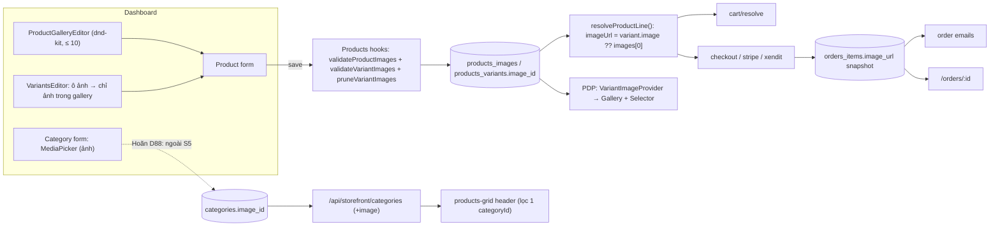
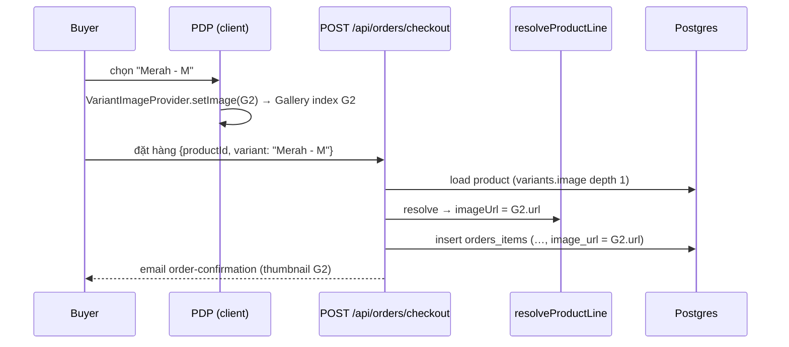

# PRD: Media Management — Sprint 5: Media sản phẩm (F48-S5)

> **Version:** 1.0 | **Created:** 2026-11-09 | **Agent:** `docs-engineer`
> **Priority:** P1 (US-F48-14, -15) / P2 (US-F48-16 — ⏸ hoãn, D88) | **Sprint:** F48 — S5 | **Size:** M
> **Depends on:** F48-S2 (MediaPicker đa chọn), F48-S4 (usage registry, force delete), F08 Products CRUD, F09 Storefront, F10 Orders/Checkout, F32 Order emails | **Blocks:** —
> **Nguồn quyết định:** brainstorm F48 2026-11-09 — D10, D11 (**PO đồng ý 10 ảnh — D88**), D12, D29, D30, D31, D44, D49, D50; review lần 3: **D74** (bề mặt ảnh danh mục — thay phần danh mục của D50; **⏸ hoãn — D88**), D75 (tên migration theo arch); DAM Commerce OS (2026-11-10): **D84** (chính sách ảnh SP khớp DAM), **D85** (ảnh SKU = chọn từ gallery, tương đương strategy `own`) — xem [F48-media-management-dam-alignment.md](../architecture/F48-media-management-dam-alignment.md). Code tham chiếu: staging `5c3e3bdca`.
> **Overview:** [F48-media-management-overview.md](./F48-media-management-overview.md) · **Stories:** [F48-media-management-stories-4.md](../stories/F48-media-management-stories-4.md) · **Architecture:** [F48-media-management.md](../architecture/F48-media-management.md) · **Design:** [F48-media-management-design.md](../design/F48-media-management-design.md) · **QA:** [F48-media-management.md](../qa/F48-media-management.md)

---

> [!IMPORTANT]
> AC ở §11 copy từ [F48-media-management-stories-4.md](../stories/F48-media-management-stories-4.md) (Draft). FR tách con (FR-34a…) giữ số gốc FR-34..FR-36. Sprint này **sửa PRD F08** (`docs/prd/F08-products-crud.md`: FR-09 "max 5 ảnh", bảng validation dòng "Images (Max 5 items)", AC form "ảnh (max 5…)", NFR "max 5 per product") trong cùng PR.

## 0. Story Traceability

| Story ID | Title | File | Status |
|----------|-------|------|--------|
| US-F48-14 | Gallery SP 10 ảnh, kéo sắp xếp, ảnh chính (D11) | [stories-4](../stories/F48-media-management-stories-4.md) | Draft — PO đồng ý 10 (D88) |
| US-F48-15 | Ảnh biến thể chọn từ gallery + storefront đổi ảnh theo biến thể (D10, D31, D49, D50) | [stories-4](../stories/F48-media-management-stories-4.md) | Draft |
| US-F48-16 | Ảnh danh mục (D12) | [stories-4](../stories/F48-media-management-stories-4.md) | ⏸ Hoãn (D88) — chờ cutover Commerce OS |

## 1. Problem Statement

- Gallery SP bị giới hạn **5 ảnh mới** (`MAX_PRODUCT_IMAGES = 5`, `src/lib/products/image-limit.ts`) và chưa kéo sắp xếp được; PW1 không giới hạn, có `order`. PW1 prod: 37.480 SP live — 1 ảnh 20.270, 2 → 5.393, 3 → 7.841, 4 → 2.470, 5 → 755, 6 → 273, 7 → 214, 8 → 16 (max 8); 98,7% ≤ 5 nhưng 503 SP (shop thời trang) cần 6–8.
- `Products.variants[]` **không có ảnh** (chỉ name/sku/price/compareAtPrice/stock). PW1 có `product_sku_images`: 8.273/43.592 SKU (19%) có ảnh, thuộc 2.267 SP, ~1,08 ảnh/SKU (max 4) → khách chọn màu "Merah" vẫn thấy ảnh màu khác.
- Giỏ hàng, đơn hàng, email luôn lấy **ảnh đầu của SP** (`getProductImageUrl` → `images[0]`); `orders_items` không lưu ảnh → đơn cũ đổi ảnh khi merchant sửa SP.
- `Categories` không có field ảnh (PW1: 267/50.927 danh mục = 0,5% có ảnh) → storefront danh mục thuần chữ.
- **Lịch sử #1587 (D74):** `categories.image` **đã từng có** và bị xoá ở commit `02a6b024be` (PR-1 của GH-1587, "removed unused Category Image field end-to-end (schema+DB+UI)") bằng migration `categories.drop_image_id` (`ALTER TABLE categories DROP COLUMN IF EXISTS image_id`, lý do "stored but never rendered"). Thêm lại là **đảo quyết định** → cần PO xác nhận (overview §12 câu 8) và sửa PRD F08 cùng PR. Điều kiện bắt buộc lần này: AC có bề mặt hiển thị storefront cụ thể (FR-36b), không lưu mà không hiển thị.

## 2. Target User

- **Chủ shop / staff `products`** — SME thời trang (baju kurung, tudung), F&B, đồ thủ công; dashboard en/ms, phần lớn trên điện thoại.
- **Người mua** — storefront mobile-first; cần thấy đúng màu đã chọn trong trang SP, giỏ, email.

## 3. Solution Overview

Nâng giới hạn gallery lên **10** (một hằng số, PO đồng ý — D88) với kéo sắp xếp `@dnd-kit/sortable` (đã có trong `package.json`) + nút bàn phím; ảnh đầu là **ảnh chính** dùng mọi nơi. Thêm `variants[].image` (FK media) mà validator server ép **phải thuộc gallery của chính SP**; gỡ ảnh khỏi gallery → biến thể về ảnh chính. `resolveProductLine` trở thành nguồn duy nhất cho "ảnh của dòng hàng" (ảnh biến thể ?? ảnh chính) → giỏ hàng, 3 route checkout, `orders_items.image_url` (snapshot), email đơn hàng và trang đơn dashboard cùng dùng. Storefront: trang chi tiết dùng state chung giữa `ProductVariantSelector` và `ProductImageGallery` để đổi ảnh không tải lại trang. Thêm `categories.image` + hiển thị ở **header của block products-grid khi đang lọc đúng 1 `categoryId`** (query `categoryId`, `filter-utils.ts:32`): ảnh + tên + mô tả, tỉ lệ 4:1 desktop / 2:1 mobile, không ảnh → header chỉ chữ; không tạo block mới (D74). **⏸ Phần ảnh danh mục hoãn (D88)** — S5 chỉ làm gallery + ảnh biến thể.



## 4. Scope

### In Scope
- Gallery ≤ 10 ảnh, kéo sắp xếp, "Đặt làm ảnh chính", validate server (US-F48-14).
- `variants[].image` chọn từ gallery; tự gỡ khi ảnh rời gallery; storefront đổi ảnh theo biến thể (US-F48-15).
- Snapshot ảnh biến thể ở giỏ hàng, `orders_items.image_url`, email đơn hàng, trang đơn dashboard (D31, D49 — US-F48-15 AC-6).
- `categories.image` + hiển thị đầu trang danh mục storefront (US-F48-16) — ⏸ hoãn (D88), không làm trong S5.
- Cập nhật PRD F08 (giới hạn ảnh, ảnh biến thể).

### Out of Scope
- **Gán 1 ảnh cho mọi biến thể cùng màu** (bulk theo tier) — D31, để sau.
- Nhiều ảnh/biến thể (PW1 max 4 nhưng TB 1,08) — 1 ảnh/biến thể.
- Selector biến thể theo từng tier (Màu / Size tách) — giữ chip theo tên biến thể hiện có.
- Halal cert dạng PDF (D30: chỉ ảnh, không tính vào 10).
- Backfill ảnh SKU / ảnh danh mục từ PW1; sửa 12.232 ảnh SP PW1 trỏ bucket dev (ghi nhận rủi ro, ngoài F48).
- Block "danh mục nổi bật" mới trên builder (D50: không tạo block mới).

## 5. Success Metrics

| Metric | Target | Measured By |
|--------|--------|-------------|
| Bao phủ nhu cầu ảnh SP | 100% SP PW1 (max 8) vừa giới hạn 10 | So số liệu PW1 §1 |
| Dùng ảnh biến thể | ≥ 15% SP có biến thể gắn ảnh cho ≥ 1 biến thể sau 60 ngày (PW1: 19% SKU) | `SELECT count(DISTINCT _parent_id) FROM products_variants WHERE image_id IS NOT NULL` |
| Đúng ảnh trên đơn | 100% dòng đơn mới có `image_url` = ảnh biến thể (nếu có) tại thời điểm đặt | Test TC-F48-15-06 + SQL audit |
| Không vỡ ảnh | 0 biến thể trỏ media không còn trong gallery | Query toàn vẹn §13.4 |
| Hiệu năng PDP | Đổi ảnh khi chọn biến thể < 100 ms (ảnh đã preload) | NFR-S5-01 |

## 6. User Story Summary

```
AS A chủ shop  I WANT tối đa 10 ảnh/SP, sắp xếp và chọn ảnh chính
SO THAT khách thấy SP nhiều góc, ảnh đẹp nhất hiện đầu tiên                            (US-F48-14)
AS A chủ shop thời trang  I WANT gắn mỗi biến thể với một ảnh trong gallery
SO THAT khi khách chọn "Merah", ảnh đổi sang đúng chiếc áo màu đỏ                       (US-F48-15)
AS A chủ shop  I WANT ảnh đại diện cho mỗi danh mục
SO THAT trang danh mục trên storefront trực quan hơn                                    (US-F48-16)
```

## 7. Functional Requirements

| FR-ID | Requirement | Story Ref | Priority | Notes |
|-------|-------------|-----------|----------|-------|
| FR-34a | `MAX_PRODUCT_IMAGES = 10` trong `image-limit.ts` (một nguồn cho `maxRows`, `validateProductImages`, UI, `admin.description`); giữ nhánh `allowsProductImages` cho gallery lịch sử vượt giới hạn | US-F48-14 | P1 | PO đồng ý D11 (D88) |
| FR-34b | `ProductGalleryEditor`: lưới sortable (`@dnd-kit/sortable`, handle kéo ≥ 44 px), nút "Move up/down" cho bàn phím, `aria-live` đọc vị trí mới; nhãn "Main image / Imej utama" ở ô 1; menu "Set as main image" đưa ảnh lên vị trí 1 giữ thứ tự tương đối còn lại | US-F48-14 | P1 | AC-2, AC-3 |
| FR-34c | Thêm ảnh qua MediaPicker đa chọn (S2) với `maxSelect = 10 − hiện có`, `accept = product-image` (chỉ `image/jpeg|png|webp`, bản lưu ≤ 3 MB — D84; media không đạt hiện mờ, không chọn được, tooltip "Product images must be JPG, PNG or WebP up to 3 MB"); đủ 10 → nút "Add image" disabled + gợi ý | US-F48-14 | P1 | AC-1 |
| FR-34d | Validate server (collection hook, mọi đường ghi kể cả REST/AI/bulk): ≤ 10 (trừ nhánh lịch sử), không trùng `image` id, media cùng `tenant` với SP, không `private`; **ảnh thêm mới (D84):** `mimeType ∈ {image/jpeg, image/png, image/webp}` và `filesize ≤ 3 MB` (hằng `MAX_PRODUCT_IMAGE_BYTES` trong `image-limit.ts`) — ảnh đã có trong gallery trước lần lưu giữ nguyên (dữ liệu PW1) → 400 `PRODUCT_IMAGES_INVALID` kèm `reason` (`tenant`/`private`/`type`/`size`) | US-F48-14 | P1 | AC-5 |
| FR-34e | Ảnh chính = `images[0]`, dùng cho thẻ SP (products-grid, products-featured), PDP, giỏ (`getProductImageUrl`), OG (`page.tsx` `images?.[0]`), JSON-LD; `halalCertImage` không tính vào 10, không đặt làm ảnh chính, chỉ ảnh (D30) | US-F48-14 | P1 | AC-2, AC-6 |
| FR-35a | `Products.variants[]` thêm `{ name: 'image', type: 'upload', relationTo: 'media', required: false }`; validator: `image` ∈ tập id của `images[]` **sau thay đổi** của cùng tài liệu, là ảnh, cùng tenant → nếu không 400 `VARIANT_IMAGE_NOT_IN_GALLERY`. **D85:** biến thể chỉ trỏ id ảnh trong gallery (không upload/copy riêng) — tương đương SP con `media_strategy='own'` trong DAM | US-F48-15 | P1 | AC-3, D10, D85 |
| FR-35b | `beforeChange` `pruneVariantImages`: biến thể trỏ ảnh không còn trong gallery → `image = null` (chạy trước validator, nên gỡ ảnh không bị 400). UI cảnh báo trước lưu: "Image used by N variant(s); they will use the main image" | US-F48-15 | P1 | AC-4 (US-F48-14 AC-4) |
| FR-35c | `VariantsEditor`: cột "Image" — ô 44×44 mở popover chỉ chứa thumbnail gallery hiện tại + "Use main image"; `aria-label` "Image for variant {name}"; 375px dạng thẻ (`SkuMatrixMobile`). `buildVariantMatrix` giữ `image` của dòng `existing` khi regenerate ma trận (giống stock/SKU) | US-F48-15 | P1 | AC-1 |
| FR-35d | PDP: `VariantImageProvider` (client context) bọc `ProductImageGallery` + `ProductAddToCartSection`; chọn biến thể có ảnh → gallery nhảy tới index của ảnh đó; không ảnh / bỏ chọn → index 0; biến thể hết hàng (selector hiện chặn chọn `stock === 0`) vẫn **xem trước ảnh** qua `onPreview` mà không đổi lựa chọn mua; preload ảnh biến thể khi hover/focus chip; khung ảnh cố định tỉ lệ (không nhảy layout) | US-F48-15 | P1 | AC-2, AC-5 |
| FR-35e | `resolveProductLine` trả `imageUrl = variant?.imageUrl ?? getProductImageUrl(product)`; `ProductLineVariant` thêm `image`; cart add (`CartItem.imageUrl`) và `/api/storefront/cart/resolve` dùng giá trị này (đã so `imageUrl` để báo thay đổi) | US-F48-15 | P1 | D31, AC-6 |
| FR-35f | Checkout (`/api/orders/checkout`, `stripe-checkout/build-order-items.ts`, `xendit-checkout`) ghi `orders.items[].imageUrl` (text snapshot, không FK) từ `resolveProductLine`; email (`order-confirmation`, `order-waiting`, `order-completed`, `order-refunded` qua `email-html-parts.ts`) hiện thumbnail 56 px khi có `imageUrl`; `/orders/:id` (`order-items-card.tsx`) ưu tiên `item.imageUrl`, fallback ảnh SP như hiện tại (đơn cũ). Media được đơn tham chiếu không force delete được (D44) | US-F48-15 | P1 | AC-6, D29, D44, D49 |
| FR-36a | `Categories` thêm `{ name: 'image', type: 'upload', relationTo: 'media' }`; form danh mục dùng MediaPicker (`accept = image`); gỡ ảnh chỉ gỡ tham chiếu; validate cùng tenant + là ảnh → 400 `CATEGORY_IMAGE_INVALID` | US-F48-16 | P2 | AC-1, AC-3 |
| FR-36b | `/api/storefront/categories` thêm `image: { url, alt, width, height } \| null` (select + 1 query media theo id, không depth toàn bộ); **Bề mặt duy nhất (D74):** block products-grid khi URL lọc **đúng 1** `categoryId` hiện header danh mục phía trên lưới: ảnh `next/image` (tỉ lệ 4:1 desktop, 2:1 mobile, `sizes` theo độ rộng block) + tên + mô tả danh mục; alt = `media.alt` hoặc tên danh mục theo locale; danh mục không ảnh → header chỉ chữ (tên + mô tả), không ô ảnh vỡ; lọc 0 hoặc ≥ 2 danh mục → không header. **Không** có "thẻ danh mục có sẵn", không route PLP `?category=`, không block danh mục mới. Cần PO xác nhận đảo #1587 | US-F48-16 | P2 | AC-2, D74 |
| FR-36c | S5 thêm `products_variants.image_id` vào registry S4 (`kind: 'product-variant'`, link `/products/{id}`) và nguồn snapshot `orders_items.image_url` (read-only); force delete → FK variant null (`ON DELETE SET NULL` + UPDATE tường minh S4). **Không query `categories.image_id` trong S5**; phần category (`kind: 'category'`, link `/products/categories`, force → FK null) chỉ bật cùng migration khi US-F48-16 được mở lại (D88) | US-F48-15; US-F48-16 hoãn | P1 | AC-4 US-F48-15; AC-4 US-F48-16 hoãn |

> Tổng 14 FR con thuộc FR-34..FR-36.

## 8. Business Rules

- **BR-01:** Gallery ≤ `MAX_PRODUCT_IMAGES` (10, PO đồng ý — D88). SP lịch sử đang có > giới hạn chỉ được giữ/sắp xếp/gỡ, không thêm (giữ `allowsProductImages`).
- **BR-02:** Ảnh chính luôn là phần tử đầu `images[0]`; không có field "isPrimary" riêng.
- **BR-03:** Không trùng ảnh trong gallery; mọi ảnh cùng tenant với SP, không private; ảnh thêm mới là JPG/PNG/WebP, bản lưu ≤ 3 MB (D84 — khớp policy DAM; pipeline tự hạ chất lượng/kích thước xuống ≤ 3 MB, không từ chối lúc upload).
- **BR-04 (D10, D85):** Mỗi biến thể tối đa 1 ảnh, bắt buộc thuộc gallery của chính SP; mặc định (null) = ảnh chính. SP chỉ lưu media id + thứ tự, không nhúng URL (trừ snapshot đơn D29).
- **BR-05:** Ảnh rời gallery → biến thể trỏ ảnh đó tự về null; media vẫn ở thư viện (không xoá).
- **BR-06 (D31, D49):** Ảnh của dòng hàng = ảnh biến thể ?? ảnh chính, tính ở **server** (`resolveProductLine`); client gửi `imageUrl` chỉ để hiển thị lạc quan, không được tin.
- **BR-07 (D31, D29):** `orders_items.image_url` là snapshot chỉ-đọc tại lúc đặt; sửa SP sau đó không đổi đơn; usage scan S4 coi đó là tham chiếu chỉ-đọc → GC không xoá.
- **BR-08 (D30):** `halalCertImage` chỉ ảnh, không tính vào gallery, không làm ảnh chính/biến thể.
- **BR-09:** Ảnh danh mục ≤ 1, ảnh của tenant; không có ảnh → storefront không render ô ảnh.
- **BR-10:** Không backfill dữ liệu PW1 (ảnh SKU, ảnh danh mục).

## 9. User Flow

```
/products/:id (owner / staff products)
  Gallery: [Add image] → MediaPicker đa chọn (còn N chỗ) → thêm vào cuối
           kéo handle / Move up-down / "Set as main image" → thứ tự mới
           gỡ ảnh G → nếu G gắn biến thể: cảnh báo "used by 2 variants" → OK
  Variants: ô Image "Merah - M" → popover gallery → chọn G2 | "Use main image"
  Save → server: prune → validate → 200 | 400 (lỗi theo field)

Storefront PDP
  load: ảnh chính → chip "Merah - M" (có ảnh) → gallery nhảy G2 (không reload)
         chip "Biru - M" (không ảnh) → về ảnh chính; chip hết hàng → xem trước ảnh, nút mua vẫn khoá
  Add to cart → cart/resolve → imageUrl = G2 → checkout → orders_items.image_url = G2 → email có thumbnail G2

Storefront trang có products-grid, lọc ?categoryId=12 (1 danh mục) → header ảnh + tên + mô tả (không ảnh → chỉ chữ)
```



## 10. Screen Layout

- **10.1 Form SP — Gallery:** lưới 5 cột desktop / 3 cột 375px; ô 1 viền primary + nhãn "Main image"; mỗi ô: handle kéo, menu (Set as main / Remove), alt hiển thị tooltip; bộ đếm "7/10".
- **10.2 Bảng biến thể:** cột "Image" đầu dòng; popover lưới thumbnail gallery; mobile (`SkuMatrixMobile`) ô ảnh trên đầu thẻ.
- **10.3 PDP:** ảnh lớn giữ `aspect-ratio` cố định; thumbnail biến thể được đánh dấu khi chọn.
- **10.4 Form danh mục:** field "Category image / Imej kategori" với preview 96 px + nút Change/Remove.
- **10.5 Header danh mục trong products-grid (D74):** banner 4:1 desktop / 2:1 mobile + tên + mô tả; không ảnh → chỉ chữ; chỉ khi lọc đúng 1 `categoryId`.
- **States:** gallery rỗng → "Add up to 10 images"; lỗi lưu → lỗi inline dưới gallery/bảng biến thể; ảnh biến thể lỗi tải → fallback ảnh chính.
- **Design:** [F48-media-management-design.md](../design/F48-media-management-design.md) (màn S7 Gallery, S8 Biến thể, S9 Danh mục — ID màn hình, không phải sprint).

## 11. Acceptance Criteria

> Copy từ [stories-4](../stories/F48-media-management-stories-4.md). TC-ID `TC-F48-<story>-<nn>`.

### AC-1: Thêm tới 10 ảnh — TC-F48-14-01 (US-F48-14 AC-1)
```gherkin
GIVEN sản phẩm đang có 7 ảnh
WHEN  mở picker đa chọn (US-F48-06) từ gallery
THEN  picker cho chọn tối đa 3 ảnh (= MAX_PRODUCT_IMAGES − 7; MAX_PRODUCT_IMAGES = 10, D11), hiện "Đã chọn 3/3"
  AND sau khi có MAX_PRODUCT_IMAGES ảnh (10, D11), nút "Thêm ảnh" bị vô hiệu với gợi ý "Tối đa 10 ảnh mỗi sản phẩm"
```
### AC-2: Kéo sắp xếp, ảnh đầu là ảnh chính — TC-F48-14-02 (US-F48-14 AC-2)
```gherkin
GIVEN gallery có 5 ảnh
WHEN  kéo ảnh thứ 4 lên đầu (chuột, cảm ứng) hoặc dùng nút "Đưa lên/Đưa xuống" bằng bàn phím, rồi lưu
THEN  thứ tự được lưu đúng, ảnh đầu có nhãn "Ảnh chính" / "Imej utama"
  AND ảnh chính dùng cho thẻ SP storefront, trang chi tiết, giỏ hàng và OG/chia sẻ
```
### AC-3: Đặt làm ảnh chính — TC-F48-14-03 (US-F48-14 AC-3)
```gherkin
GIVEN gallery có 5 ảnh
WHEN  chọn "Đặt làm ảnh chính" ở ảnh thứ 3
THEN  ảnh đó chuyển lên vị trí 1, các ảnh khác giữ thứ tự tương đối
```
### AC-4: Gỡ ảnh khỏi gallery — TC-F48-14-04 (US-F48-14 AC-4)
```gherkin
GIVEN ảnh G đang là ảnh của biến thể "Merah / M" (US-F48-15)
WHEN  gỡ G khỏi gallery
THEN  cảnh báo "Ảnh đang dùng cho 1 biến thể; biến thể sẽ dùng ảnh chính"
  AND sau khi lưu, G chỉ bị gỡ tham chiếu, vẫn còn trong thư viện
```
### AC-5: Validate ở server — TC-F48-14-05 (US-F48-14 AC-5)
```gherkin
GIVEN client bị bỏ qua
WHEN  gửi lưu sản phẩm với 11 ảnh, ảnh trùng lặp, hoặc mediaId thuộc tenant khác / là video
THEN  trả 400 "PRODUCT_IMAGES_TOO_MANY" / "PRODUCT_IMAGES_DUPLICATE" / "PRODUCT_IMAGES_INVALID", sản phẩm không đổi
  AND thêm mới media không phải JPG/PNG/WebP (gif, avif, svg) hoặc bản lưu > 3 MB → 400 "PRODUCT_IMAGES_INVALID" (D84); ảnh đã có sẵn trong gallery được giữ nguyên
```
### AC-6: Ảnh Halal cert tách riêng — TC-F48-14-06 (US-F48-14 AC-6)
```gherkin
GIVEN sản phẩm có halalCertImage
WHEN  đếm giới hạn gallery
THEN  ảnh Halal cert không tính vào 10 ảnh và không thể đặt làm ảnh chính
  AND Halal cert chỉ nhận ảnh; video/PDF → 400 "HALAL_CERT_IMAGE_ONLY" (D30)
```
### AC-7: Chọn ảnh cho biến thể — TC-F48-15-01 (US-F48-15 AC-1)
```gherkin
GIVEN sản phẩm có gallery 4 ảnh và 6 biến thể (Màu × Size)
WHEN  ở bảng biến thể, bấm ô ảnh của "Merah / M"
THEN  hiện lựa chọn chỉ gồm 4 ảnh trong gallery (không mở toàn bộ thư viện)
  AND chọn xong, ô hiển thị thumbnail; biến thể chưa chọn hiển thị "Dùng ảnh chính"
```
### AC-8: Storefront đổi ảnh theo biến thể — TC-F48-15-02 (US-F48-15 AC-2)
```gherkin
GIVEN "Merah / M" có ảnh G2, "Biru / M" không có ảnh
WHEN  khách chọn Màu = Merah trên trang chi tiết
THEN  ảnh lớn chuyển sang G2 và thumbnail G2 được đánh dấu
WHEN  khách chọn Màu = Biru
THEN  ảnh lớn quay về ảnh chính, không vỡ ảnh, không nhảy layout
  AND đổi ảnh khi chọn chip biến thể, kể cả biến thể hết hàng (qua `onPreview`, D50)
```
> Selector hiện tại là chip theo **tên biến thể đầy đủ** ("Merah - M"), không tách tier; "chọn Màu = Merah" được hiểu là chọn chip biến thể chứa Merah (D50). Biến thể hết hàng: xem trước ảnh, không chọn mua (FR-35d).
### AC-9: Chỉ nhận ảnh thuộc gallery của chính sản phẩm — TC-F48-15-03 (US-F48-15 AC-3)
```gherkin
GIVEN client gửi variants[].image là media không nằm trong gallery của sản phẩm, thuộc tenant khác, hoặc là video
WHEN  lưu sản phẩm
THEN  trả 400 "VARIANT_IMAGE_NOT_IN_GALLERY", dữ liệu không đổi
```
### AC-10: Ảnh biến thể bị gỡ hoặc media bị xoá — TC-F48-15-04 (US-F48-15 AC-4)
```gherkin
GIVEN biến thể trỏ ảnh G2
WHEN  G2 bị gỡ khỏi gallery (US-F48-14 AC-4) hoặc owner "Vẫn xoá" media G2 (US-F48-11 AC-4)
THEN  variants[].image thành null (FK ON DELETE SET NULL), storefront hiển thị ảnh chính
  AND "Đang dùng ở" của G2 liệt kê cả biến thể trước khi xoá
```
### AC-11: Không đổi hành vi sản phẩm không có biến thể — TC-F48-15-05 (US-F48-15 AC-5)
```gherkin
GIVEN sản phẩm không bật biến thể, hoặc có biến thể nhưng không biến thể nào có ảnh
WHEN  khách xem trang chi tiết
THEN  hành vi gallery giữ như trước F48
```
### AC-12: Snapshot ảnh biến thể ở giỏ hàng, đơn hàng, email — TC-F48-15-06 (US-F48-15 AC-6, D49)
```gherkin
GIVEN "Merah / M" có ảnh G2
WHEN  khách thêm "Merah / M" vào giỏ rồi đặt hàng
THEN  giỏ hàng hiển thị G2; `orders_items.image_url` lưu URL của G2 tại thời điểm đặt; email xác nhận đơn dùng G2
  AND biến thể không có ảnh → dùng ảnh chính; đổi/xoá G2 sau đó không đổi ảnh của đơn đã đặt
```

> [!IMPORTANT]
> **⏸ Hoãn (D88, PO 2026-11-10):** chờ câu 9 overview §12 (ngày cutover Commerce OS). US-F48-16 không làm trong S5; nội dung dưới đây giữ nguyên để mở lại khi có câu trả lời.

### AC-13: Chọn ảnh danh mục — TC-F48-16-01 (US-F48-16 AC-1)
```gherkin
GIVEN chủ shop hoặc staff có quyền `products` sửa danh mục "Kuih Raya"
WHEN  chọn ảnh qua picker (chỉ ảnh) và lưu
THEN  categories.image lưu FK tới media, preview hiện trong form
  AND gỡ ảnh chỉ gỡ tham chiếu, không xoá media
```
### AC-14: Hiển thị storefront — TC-F48-16-02 (US-F48-16 AC-2)
```gherkin
GIVEN danh mục "Kuih Raya" có ảnh, tên và mô tả
WHEN  khách mở trang có block `products-grid` với URL lọc đúng 1 danh mục (`?categoryId=<id>`) (D74; không tạo block danh mục mới, D50)
THEN  phía trên lưới SP có header: ảnh (tỉ lệ 4:1 desktop, 2:1 mobile ≤ 640 px, next/image, khung cố định — CLS ≈ 0) + tên + mô tả danh mục theo locale
  AND alt = alt của media, nếu trống thì dùng tên danh mục theo locale
GIVEN danh mục không có ảnh
THEN  header chỉ có chữ (tên + mô tả), không có ô ảnh vỡ
GIVEN URL không lọc danh mục hoặc lọc ≥ 2 categoryId
THEN  không hiển thị header danh mục (giữ như hiện tại)
```
### AC-15: Tenant isolation và loại file — TC-F48-16-03 (US-F48-16 AC-3)
```gherkin
GIVEN client gửi categories.image là media tenant khác hoặc video
WHEN  lưu
THEN  trả 400 "CATEGORY_IMAGE_INVALID", danh mục không đổi
```
### AC-16: Liên kết với vòng đời media — TC-F48-16-04 (US-F48-16 AC-4)
```gherkin
GIVEN ảnh M đang là ảnh danh mục
WHEN  mở chi tiết M hoặc xoá M
THEN  "Đang dùng ở" liệt kê danh mục; owner "Vẫn xoá" → categories.image = null, header products-grid về dạng chỉ chữ
```

## 12. Non-Functional Requirements

| ID | Category | Requirement | Notes |
|----|----------|-------------|-------|
| NFR-S5-01 | Performance | Đổi ảnh khi chọn biến thể < 100 ms khi ảnh đã preload; < 1 s trên 4G nếu chưa preload | preload on hover/focus |
| NFR-S5-02 | Performance | PDP LCP không tăng > 5% so với trước S5 (đo Lighthouse mobile, SP 10 ảnh); chỉ ảnh chính `priority`, thumbnail lazy | next/image |
| NFR-S5-03 | Performance | Lưu SP 10 ảnh + 60 biến thể p95 < 1,5 s (validator 1 query media `id IN (…)`) | không N+1 |
| NFR-S5-04 | Integrity | 0 biến thể có `image_id` ngoài gallery SP sau mọi đường ghi (query §13.4 trong test integration) | |
| NFR-S5-05 | Performance | `/api/storefront/categories` với 500 danh mục + ảnh p95 < 300 ms | 1 query media |
| NFR-06 / NFR-07 | i18n / a11y | 100% chuỗi en/ms; kéo thả có thay thế bàn phím + `aria-live`; ô ảnh ≥ 44×44 px; alt có nghĩa | brief |
| NFR-S5-06 | Device | 375 / 768 / 1280 px; storefront Safari iOS 2 bản mới nhất (đa số buyer MY) | |

## 13. Technical Architecture

### 13.1 Code hiện có (trích thật, staging `1248713`)

```ts
// src/lib/products/image-limit.ts
export const MAX_PRODUCT_IMAGES = 5
/** Above five, only retain/reorder/remove existing occurrences; no new media or duplicates. */
export function allowsProductImages(next: readonly unknown[], previous: readonly unknown[] = []): boolean

// src/collections/Products.ts — images + variants hiện tại
{ name: 'images', type: 'array', maxRows: MAX_PRODUCT_IMAGES, validate: validateProductImages,
  fields: [ { name: 'image', type: 'upload', relationTo: 'media', required: true }, { name: 'alt', type: 'text' } ],
  admin: { description: 'Product images (Max 5 new images, <= 5MB each; existing larger galleries are preserved)' } },
{ name: 'variants', type: 'array', maxRows: 900, fields: [
  { name: 'name', type: 'text', required: true }, { name: 'sku', type: 'text', maxLength: 100 },
  { name: 'price', type: 'number', required: true }, { name: 'compareAtPrice', type: 'number' },
  { name: 'stock', type: 'number', required: true, defaultValue: 0 } ] },

// src/lib/products/resolve-product-line.ts — nguồn chung cart/resolve + checkout
export type ProductLineVariant = { name: string; price: number; compareAtPrice?: number | null; stock?: number | null }
export function getProductImageUrl(product: Pick<ProductLineProduct, 'images'>): string | undefined // images[0]
// ok: { variant, unitPrice, compareAtPrice?, stock, quantity, imageUrl?: string }   ← imageUrl = getProductImageUrl(product)

// src/store/cartStore.ts
export type CartItem = { productId: string; productSlug: string; name: string; price: number; compareAtPrice?: number
    currency: string; imageUrl?: string; quantity: number; inventory?: number; variantName?: string; unavailable?: boolean }

// src/components/storefront/ProductVariantSelector.tsx — chip theo tên biến thể, chặn chọn hết hàng
const handleSelect = (v: Variant) => { if (v.stock === 0) return; /* … */ onSelect?.(next) }

// src/components/dashboard/product-form/variant-utils.ts — tên biến thể = combo.join(' - ')
export function buildVariantMatrix(combinations, base, currentVariants, …): VariantRow[]

// src/app/api/storefront/categories/route.ts — select { name, slug, parent, breadcrumbs } (chưa có ảnh)
```

- `orders.items` hiện: `product`, `productName`, `variant` (text), `quantity`, `unitPrice` — không có ảnh. Email (`email-html-parts.ts`) không render ảnh dòng hàng.
- Cột FK upload hiện có trong db-setup là `integer` **không** `REFERENCES` (vd `products.halal_cert_image_id`) — cột mới S5 thêm `REFERENCES media(id) ON DELETE SET NULL` theo story; S4 force delete vẫn UPDATE tường minh.

### 13.2 Components & files

| Component | File | Description |
|-----------|------|-------------|
| Hằng giới hạn | `src/lib/products/image-limit.ts` | 5 → 10 |
| Validators | `src/lib/products/variant-image-validation.ts` (mới) | `pruneVariantImages`, `validateVariantImages`, `validateGalleryMedia` (1 query media) |
| `ProductGalleryEditor` | `src/components/dashboard/product-form/ProductGalleryEditor.tsx` (mới, thay phần gallery của `ImageUploader.tsx`) | dnd-kit sortable + picker |
| `VariantImageCell` | `src/components/dashboard/product-form/VariantImageCell.tsx` (mới) | popover chọn ảnh gallery |
| `VariantImageProvider` | `src/components/storefront/variant-image-context.tsx` (mới) | context ảnh biến thể cho PDP |
| PDP | `src/app/sites/[slug]/products/[productSlug]/page.tsx` | truyền `variants[].image` (url/alt) |
| Line resolver | `src/lib/products/resolve-product-line.ts` | `imageUrl` theo biến thể |
| Checkout ×3 | `src/app/api/orders/checkout/route.ts`, `stripe-checkout/build-order-items.ts`, `xendit-checkout/route.ts` | ghi `imageUrl` |
| Email | `src/lib/email/templates/shared/email-html-parts.ts` | thumbnail dòng hàng |
| Category | `src/collections/Categories.ts`, form danh mục dashboard, `src/app/api/storefront/categories/route.ts`, `src/blocks/products-grid/index.tsx` (header danh mục khi lọc 1 `categoryId`) | FR-36 (D74) |

### 13.3 Thuật toán chọn ảnh PDP

```ts
type PdpVariant = { name: string; stock: number; image?: { id: number; url: string; alt?: string } | null }
/** Index trong gallery cho biến thể đang chọn/xem trước; -1 → giữ ảnh chính (0). */
export function galleryIndexFor(variant: PdpVariant | null, images: Array<{ image?: { id?: number } }>): number {
    if (!variant?.image) return 0
    const i = images.findIndex((row) => row.image?.id === variant.image!.id)
    return i >= 0 ? i : 0 // ảnh không còn trong gallery (dữ liệu cũ) → ảnh chính, không vỡ
}
```

### 13.4 Query toàn vẹn

```sql
SELECT v.id FROM products_variants v
WHERE v.image_id IS NOT NULL
  AND NOT EXISTS (SELECT 1 FROM products_images i WHERE i._parent_id = v._parent_id AND i.image_id = v.image_id); -- phải rỗng
SELECT p.id FROM products p JOIN products_images i ON i._parent_id = p.id
GROUP BY p.id HAVING count(*) > 10;  -- chỉ SP lịch sử được phép (BR-01)
```

## 14. Dependencies

| Dependency | Status | Action Needed |
|-----------|--------|---------------|
| PO xác nhận 10 ảnh (D11) | ✅ 2026-11-10 (D88) | — |
| S2 MediaPicker `maxSelect`, `accept` | ⬜ | FR-34c; FR-36a hoãn cùng US-F48-16 (D88) |
| S4 registry + force delete | ⬜ | FR-36c thêm FK variant + `orders_items.image_url`; không thêm/query category trong S5 (D88) |
| PRD F08 cập nhật | ⬜ | Cùng PR (FR-09, validation, AC, NFR "max 5") |
| QA F48 + F08 + F32 email | ⬜ | TC-F48-14-01..06, TC-F48-15-01..06 (TC-F48-16-* hoãn, D88) |

## 15. API Contract

### 15.1 Types

```ts
// Payload Products (thay đổi)
export type ProductImageRow = { id?: string; image: number | MediaDoc; alt?: string | null }
export type ProductVariantRow = {
    id?: string; name: string; sku?: string | null; price: number; compareAtPrice?: number | null; stock: number
    image?: number | MediaDoc | null          // MỚI — phải ∈ images[].image
}
// resolve-product-line.ts
export type ProductLineVariant = { name: string; price: number; compareAtPrice?: number | null; stock?: number | null
    image?: { url?: string | null } | number | null }   // MỚI
// Orders.items (thay đổi)
export type OrderItemRow = { product: number; productName: string; variant?: string | null; quantity: number
    unitPrice: number; imageUrl?: string | null }       // MỚI — snapshot text
// Storefront categories
export type StorefrontCategory = { id: number | string; name: string; slug: string; parent: number | string | null
    breadcrumbs?: string | null; image: { url: string; alt: string; width?: number; height?: number } | null } // image MỚI
// PDP props
export type PdpVariantView = { name: string; price: number; compareAtPrice?: number | null; stock: number
    image: { id: number; url: string; alt: string } | null }
```

Ghi SP/danh mục vẫn qua luồng F08 hiện có (Payload local API trong server action / REST có access) — không route mới; lỗi trả theo `ValidationError` của Payload (`errors[].path`) + `code`.

### 15.2 Error codes

| Code | HTTP | en | ms |
|------|------|----|----|
| `PRODUCT_IMAGES_TOO_MANY` | 400 | Up to 10 images per product. | Maksimum 10 imej bagi setiap produk. |
| `PRODUCT_IMAGES_DUPLICATE` | 400 | This image is already in the gallery. | Imej ini sudah ada dalam galeri. |
| `PRODUCT_IMAGES_INVALID` | 400 | Only images from your media library can be added. | Hanya imej daripada pustaka media anda boleh ditambah. |
| `VARIANT_IMAGE_NOT_IN_GALLERY` | 400 | A variant image must be one of the product images. | Imej varian mesti salah satu imej produk. |
| `CATEGORY_IMAGE_INVALID` | 400 | Choose an image from your media library. | Pilih imej daripada pustaka media anda. |
| `HALAL_CERT_IMAGE_ONLY` | 400 | Halal certificate must be an image (JPEG, PNG or WebP). | Sijil halal mesti dalam bentuk imej (JPEG, PNG atau WebP). |

Nhãn UI: "Main image / Imej utama", "Set as main image / Jadikan imej utama", "Use main image / Guna imej utama", "Image used by {n} variant(s); they will use the main image / Imej digunakan oleh {n} varian; varian akan menggunakan imej utama", "Category image / Imej kategori", "{n}/10".

### 15.3 Data model delta + `scripts/db-setup.js` MIGRATIONS

`products_variants` và `orders_items` là **array table** (id `varchar`, `_parent_id`, `_order`) → chỉ thêm cột.

Tên entry + SQL chuẩn ở **[arch §4.2](../architecture/F48-media-management.md#42-migrations-scriptsdb-setupjs)** (D75) — PR S5 copy nguyên văn. Bảng phân phạm vi entry (hai entry category chỉ là mẫu hoãn, không copy vào PR S5 — D88):

| Entry (`name`) | Nội dung |
|---|---|
| `f48.products_variants.image_id` | FK `media(id) ON DELETE SET NULL` |
| `f48.products_variants.image_idx` | `products_variants_image_idx (image_id)` |
| `f48.categories.image_id` **⏸ US-F48-16, ngoài S5** | FK `media(id) ON DELETE SET NULL` — **tên khác** `categories.drop_image_id` (#1587) và **đặt sau** entry đó trong mảng: DB mới chạy drop rồi add; DB đã có tên drop trong `_db_setup_state` chỉ chạy add (D74) |
| `f48.categories.image_idx` **⏸ US-F48-16, ngoài S5** | `categories_image_idx (image_id)` |
| `f48.orders_items.image_url` | `image_url varchar` (snapshot, không FK — D49) |
| `f48.products_images.image_idx` | `products_images_image_idx (image_id)` — bảo hiểm (Payload có thể đã tạo; `IF NOT EXISTS`) |

- Không đổi `products_images` (đã có `_order` → thứ tự kéo thả lưu sẵn). Index `image_id` giúp usage scan S4 + query §13.4.
- `REFERENCES` an toàn vì cột mới toàn `NULL` lúc thêm.
- Không có collection mới → không cần cột `payload_locked_documents_rels`.

## 16. Risks & Mitigation

| # | Risk | Khả năng / Ảnh hưởng | Mitigation |
|---|------|----------------------|------------|
| R1 | Regenerate ma trận biến thể (`buildVariantMatrix`) làm mất `image` | Cao / TB | Giữ `existing.image` như stock/SKU; unit test regenerate giữ ảnh (TC-F48-15-01) |
| R2 | Gallery state (client) và context PDP lệch index khi SP lịch sử có > 10 ảnh hoặc ảnh lỗi | TB / Thấp | `galleryIndexFor` theo **id**, fallback 0; test SP 12 ảnh lịch sử |
| R3 | 3 route checkout ghi `imageUrl` không đồng nhất | TB / TB | Chỉ lấy từ `resolveProductLine`; test so 3 route (COD/QR, Stripe, Xendit) |
| R4 | Ảnh email từ host S3/CDN bị client mail chặn/không tải | TB / Thấp | Thumbnail là phụ (alt = tên SP); URL https host CDN (S0); không nhúng base64 |
| R5 | 12.232 ảnh SP PW1 trỏ bucket dev `tm-prime-web-dev` → ảnh chính/biến thể vỡ khi bucket dev dọn | TB / Cao | Ghi nhận (ngoài F48); badge Legacy (S4) giúp merchant thấy; đề xuất issue riêng |
| R6 | PO không duyệt 10 ảnh | TB / Thấp | Hằng số một nguồn; phần sắp xếp/biến thể/danh mục độc lập với con số |
| R7 | Selector chặn chọn biến thể hết hàng xung đột AC "hết hàng vẫn đổi ảnh" | Cao / Thấp | `onPreview` tách khỏi `onSelect` (FR-35d) |
| R8 | Cutover Commerce OS (#1812, D-04) sớm ⇒ ảnh SP/SKU/danh mục chuyển sang DAM, S5 tuổi thọ ngắn | TB / TB | D84/D85 giữ dữ liệu migrate 1-1 sang `product_asset_links`; UI qua adapter `media-source`; hỏi owner migration ngày cutover trước khi bắt đầu S5 ([dam-alignment §6–7](../architecture/F48-media-management-dam-alignment.md)) |

## 17. Test Strategy

| Tầng | Phạm vi | TC-ID |
|------|---------|-------|
| Unit | `allowsProductImages` với 10; `pruneVariantImages`; `validateVariantImages` (ngoài gallery, tenant khác, video); `galleryIndexFor`; `buildVariantMatrix` giữ ảnh; `resolveProductLine` ảnh biến thể ?? chính | TC-F48-14-05, TC-F48-15-01..05 |
| Integration (Postgres thật) | Lưu SP 11 ảnh / trùng / video → 400; gỡ ảnh → variant null; force delete media → `products_variants.image_id` null; query §13.4; usage/delete/GC chạy khi DB không có `categories.image_id` và SQL không tham chiếu category | TC-F48-14-04, -05, TC-F48-15-03, -04 |
| API | 3 route checkout ghi `orders_items.image_url`; cart/resolve báo `imageUrl` đổi | TC-F48-15-06 |
| Email snapshot | Render `order-confirmation` có thumbnail khi có `imageUrl`, không có khi null | TC-F48-15-06 |
| E2E (Playwright) | Kéo sắp xếp (chuột + bàn phím) desktop & 375px; chọn ảnh biến thể; PDP đổi ảnh, hết hàng xem trước | TC-F48-14-01..03, TC-F48-15-02 |
| Visual | Screenshot PDP chọn biến thể desktop + 375px đính PR (story DoD) | TC-F48-15-02 |
| Regression | SP không biến thể / biến thể không ảnh giống trước; SP lịch sử > 10 ảnh chỉ sắp xếp/gỡ | TC-F48-15-05, TC-F48-14-05 |

**Hoãn D88:** toàn bộ TC-F48-16-01..05 (category API/header/force delete) giữ trong QA để mở lại cùng US-F48-16 + migration/registry category; không là gate S5. TC-F48-15-04 bổ sung baseline DB không có cột category.

Đỏ trước: test "lưu SP có `variants[0].image` = media ngoài gallery → 200" và "đơn hàng biến thể có ảnh → email dùng ảnh chính" phải đỏ trên staging trước khi sửa.

## 18. Open Questions

| # | Question | Owner | Đề xuất | Status |
|---|----------|-------|---------|--------|
| 1 | D11: giới hạn gallery 10 ảnh | PO | A: 10 (khuyến nghị — phủ PW1 max 8) / B: giữ 5 | ✅ A — 10 (D88) |
| 2 | Chip biến thể vs selector theo tier | — | — | ✅ Đã chốt D50: đổi ảnh khi chọn chip biến thể (kể cả hết hàng qua `onPreview`) |
| 3 | "Block danh mục" / bề mặt ảnh danh mục | — | — | ✅ D74: header block products-grid khi lọc đúng 1 `categoryId`, không block mới |
| 6 | Đảo quyết định #1587 (thêm lại `categories.image`) | PO | Đồng ý — có bề mặt hiển thị bắt buộc (D74) | ⏸ Hoãn, chờ câu 9 overview (D88) |
| 4 | AC snapshot giỏ/đơn/email | — | — | ✅ Đã chốt D49: US-F48-15 AC-6 + TC-F48-15-06 |
| 5 | Email: thumbnail ở email nào? | — | — | Chốt theo đề xuất A (biên tập): mọi email có bảng dòng hàng dùng chung `email-html-parts`; D49 bắt buộc tối thiểu email xác nhận |

## 19. Definition of Done

- [ ] FR-34a..FR-35x + FR-36c (phần biến thể) implemented; AC-1..AC-12 pass (TC-F48-14-01..06, TC-F48-15-01..06). FR-36a/b, AC-13..16 (US-F48-16) hoãn — D88
- [ ] MIGRATIONS §15.3; `check-migrations.js` pass; `npm run verify` pass; file < 200 dòng
- [ ] PRD F08 cập nhật "max 5" → hằng `MAX_PRODUCT_IMAGES` + ảnh biến thể; CHANGELOG
- [ ] Screenshot PDP desktop + 375px; email mẫu có thumbnail
- [ ] en/ms đủ; bàn phím + `aria-live` cho sắp xếp
- [x] PO xác nhận D11 = 10 (2026-11-10, D88)
