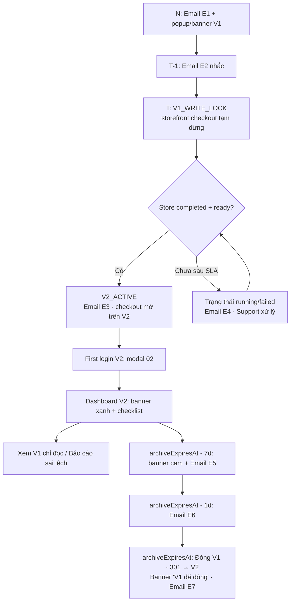

# PRD: Trải nghiệm chuyển đổi Prime Web V1 → V2 (MIG-UX — Direct Cutover + V1 Archive)
> **Version:** 0.1 (Draft) | **Created:** 2026-10-23 | **Owner:** BA
> **Priority:** P0 | **Size:** L
> **Depends on:** SSO_REDIRECT_MIGRATION_MASTER (C-15, T-PM-03), US-MIGA-01..12, US-MIGA-17 | **Blocks:** Cutover 30/10/2026
> **Stories:** [MIG-UX-direct-cutover-stories.md](../stories/MIG-UX-direct-cutover-stories.md)
> **Figma:** [TM_Prime-Web-V2.0 › Migration Flow](https://www.figma.com/design/oFACZVA1oplxslloJWEkLp/TM_Prime-Web-V2.0?node-id=34811-27299)

> [!IMPORTANT]
> **Phạm vi doc:** phần *người dùng nhìn thấy và nhận được* (UI V1/V2, storefront, email, trạng thái, báo cáo sai lệch) và *contract trạng thái* dev cần để điều khiển UI.
> ETL, mapping dữ liệu, SSO redirect flip, rollback hạ tầng nằm ở [Master PRD](./SSO_REDIRECT_MIGRATION_MASTER.md) — không lặp lại ở đây.

> [!WARNING]
> **Mốc ngày đã duyệt (2026-10-23):** thông báo 26/10/2026 · chuyển V2 30/10/2026 · đóng V1 15/11/2026. Còn 3 ngày tới ngày thông báo — các GAP mức 🔴 ở §16 phải chốt trước 26/10.

---

## 0. Story Traceability

| Story ID | Title | Figma | Status |
|---|---|---|---|
| US-MIGX-01 | Email thông báo trước chuyển | 07 | Draft |
| US-MIGX-02 | Popup + banner V1 trước cutover | 01 | Draft |
| US-MIGX-03 | Email nhắc T-1 | ❌ | Draft (GAP-E1) |
| US-MIGX-04 | V1 khóa ghi + trạng thái "Đang chuyển" | 01 (note) | Draft (GAP-U1) |
| US-MIGX-05 | Storefront tạm dừng checkout | 07 | Draft |
| US-MIGX-06 | Storefront mở checkout trên V2 | 07 | Draft |
| US-MIGX-07 | Email "Cửa hàng đã sẵn sàng trên V2" | 07 | Draft |
| US-MIGX-08 | Modal first login V2 | 02 | Draft |
| US-MIGX-09 | Dashboard V2: banner đối chiếu + checklist | 03 | Draft |
| US-MIGX-10 | V1 archive chỉ đọc | 04 | Draft |
| US-MIGX-11 | Gửi phản hồi từ nút header (MVP 29/10) | Feedback 01–10, 12 | Ready |
| US-MIGX-12 | Nhắc hạn đóng V1 + trạng thái sau đóng | 06 | Draft |
| US-MIGX-13 | Phiên xem V1 hết hạn | 04 | Draft |
| US-MIGX-14 | Login fallback token lỗi | 08 | Draft |
| US-MIGX-15 | Store chuyển chậm / lỗi | ❌ | Draft (GAP-U2, E2) |
| US-MIGX-16 | Email nhắc đóng V1 / V1 đã đóng | ❌ | Draft (GAP-E3) |
| US-MIGX-17 | Staff nhận thông báo + vào đúng store | ❌ | Draft (GAP-R1) |
| US-MIGX-18 | Lịch sử phản hồi "Phản hồi của tôi" | — | ⏸ Tạm hoãn |
| US-MIGX-19 | Thông báo in-app khi phản hồi được cập nhật (MVP) | Feedback 11 | Ready |
| US-MIGX-20 | Đồng bộ phản hồi 2 chiều với Lark Base (nội bộ, MVP) | — | Ready |

---

## 1. Problem Statement

Người dùng PW1 sẽ được chuyển thẳng sang PW2 (không có giai đoạn dùng thử, không quay lại được). Nếu thông báo không rõ hoặc trạng thái không minh bạch, chủ shop sẽ: thao tác trên V1 sau giờ chốt và mất thay đổi, không biết dữ liệu đã chuyển đủ chưa, buyer thanh toán trùng trong lúc chuyển, và Support bị ngập ticket.

## 2. Target User

- **Owner** — chủ shop SMB ở Malaysia, trình độ kỹ thuật thấp–trung bình, dùng EN hoặc BM (V2 có toggle MY/EN).
- **Staff** — tài khoản Team & Account của store.
- **Buyer** — khách mua trên storefront của Owner.
- **Support/Ops** — nhận báo cáo sai lệch, theo dõi store lỗi.

## 3. Solution Overview

Mô hình **Direct Cutover + V1 Legacy Archive** (Figma 00):

```
[N] Thông báo  →  [T] Khóa ghi V1 + drain giao dịch  →  V2_ACTIVE (theo từng store, khi completed + ready)
                                                    →  V1 chỉ đọc để đối soát  →  [archiveExpiresAt] Đóng V1, 301 về V2
```

So với các sản phẩm khác (research §17): Prime chọn cách nhanh nhất (giống Shopify auto-upgrade / GA4 forced), **bỏ** opt-in beta và switch-back. Để bù rủi ro, PRD này bắt buộc 4 thứ mà các case thành công đều có: (1) mốc thời gian cố định không đổi giữa chừng, (2) trạng thái từng store minh bạch, (3) nơi đối chiếu dữ liệu cũ có thời hạn rõ, (4) kênh báo sai lệch có mã theo dõi.

## 4. Scope

### In Scope
- Popup, banner trên V1 trước `T`; màn hình "Đang chuyển" trên V1 (US-MIGX-02, 04)
- Khóa ghi V1 phía server từ `T` (US-MIGX-04, 10)
- Storefront tạm dừng / mở lại checkout (US-MIGX-05, 06)
- Toàn bộ email chuyển đổi (US-MIGX-01, 03, 07, 15, 16)
- Modal first login, banner + checklist Dashboard V2 (US-MIGX-08, 09)
- V1 archive chỉ đọc + hết phiên + đóng V1 (US-MIGX-10, 12, 13)
- **Feedback MVP (release 29/10/2026):** nút "Gửi phản hồi" trên header V2 (30/10–15/11), form gửi phản hồi, đồng bộ Lark Base 2 chiều, thông báo in-app (US-MIGX-11, 19, 20). Lịch sử phản hồi (US-MIGX-18) tạm hoãn.
- Login fallback (US-MIGX-14)

### Out of Scope
- ETL, reconciliation engine, rollback hạ tầng → Master PRD §8–9
- Preview V2 trước cutover, switch-back về V1 (quyết định sản phẩm: không làm)
- Migrate lịch sử analytics/traffic V1 (V2 bắt đầu từ 0 — phải nói rõ với user, xem GAP-D3)
- Frame có tiền tố `ARCHIVE ·` trong Figma — đã bị thay thế, **dev không lấy**

## 5. Success Metrics

| Metric | Target | Đo bằng |
|---|---|---|
| Owner mở email thông báo (N) | ≥ 60% | SES open tracking |
| Store đạt `ready` trong 6h sau T | ≥ 99% | migration state table |
| Owner đăng nhập V2 trong 7 ngày sau T | ≥ 80% active owners | `users.lastLoginAt` |
| Ticket "không biết chuyển đổi / mất dữ liệu" | < 2% số store | Support tag `v2-migration` |
| Buyer thanh toán trùng trong cửa sổ cutover | 0 | payment reconciliation |
| Báo cáo sai lệch có xác nhận lỗi thật | < 1% số store | ticket outcome |

## 6. User Story Summary

Xem bảng §0 và file stories. Nhóm A trước cutover · B trong cutover · C sau cutover · D gap.

---

## 7. Functional Requirements

| ID | Requirement | Story Ref | Figma |
|---|---|---|---|
| FR-01 | Cấu hình cutover 1 nơi duy nhất: `migrationScheduledAt (N)`, `frozenAt (T)`, `archiveExpiresAt`, `timezone`. Mọi UI/email đọc từ đây | tất cả | 00 note |
| FR-02 | State machine theo **store** (§13.3); UI route theo state, không theo ngày client | US-MIGX-04, 09, 14 | 09 #1 |
| FR-03 | Banner V1 cố định + modal thông báo trong `[N, T)` | US-MIGX-02 | 01 |
| FR-04 | Server chặn ghi nghiệp vụ V1 từ `T`: admin + buyer checkout + webhooks/jobs/integrations (`V1_WRITE_LOCK`) | US-MIGX-04 | 01 dev note |
| FR-05 | Drain + reconcile giao dịch in-flight (payment/order), idempotent; final sync products/orders/customers/inventory; kiểm counts/totals/IDs | US-MIGX-04 | 01 dev note, 09 #3 |
| FR-06 | Storefront: banner + khóa checkout khi store chưa `ready`; mở khi `ready`; đơn mới chỉ ghi V2 | US-MIGX-05, 06 | 07 |
| FR-07 | Email engine cho 7 template chuyển đổi (§15.2), đa ngôn ngữ, idempotent, log gửi | US-MIGX-01, 03, 07, 15, 16 | 07 |
| FR-08 | Modal first login V2 hiện 1 lần / user × store, lưu server-side | US-MIGX-08 | 02 |
| FR-09 | Banner Dashboard V2 theo pha (xanh → cam → "V1 đã đóng"), countdown theo server time | US-MIGX-09, 12 | 03, 06 |
| FR-10 | Checklist "Kiểm tra cấu hình sau chuyển đổi" tính trạng thái từ dữ liệu thật | US-MIGX-09 | 03 |
| FR-11 | V1 archive: domain/path riêng, token scoped `read_only_archive_mode + tenant + expiry`, gateway chặn POST/PUT/PATCH/DELETE | US-MIGX-10 | 04 note |
| FR-12 | Re-auth archive qua SSO khi phiên hết hạn và `now < archiveExpiresAt` | US-MIGX-13 | 04 |
| FR-13 | Sau `archiveExpiresAt`: không cấp token archive; edge/gateway 301 link V1 → Dashboard V2 (kể cả khi origin V1 đã tắt) | US-MIGX-12 | 06 note, 09 #5 |
| FR-14 | Nút "Gửi phản hồi" trên header (chỉ 30/10–15/11 MYT) + form phản hồi (Loại · Khu vực · Mô tả · Mã tham chiếu · Ảnh), auto-attach context, idempotency key, rate limit, trả mã phản hồi | US-MIGX-11 | Feedback 01–10, 12 |
| FR-15 | Login fallback `/login?error=invalid_token` + toast network riêng | US-MIGX-14 | 08 |
| FR-16 | Màn hình V2 cho store `running` / `failed` + email chậm/lỗi | US-MIGX-15 | ❌ |
| FR-17 | ⏸ Tạm hoãn — trang "Phản hồi của tôi" (danh sách, chi tiết) | US-MIGX-18 | — |
| FR-18 | Thông báo in-app (collection `Notifications`, F16) khi phản hồi đổi trạng thái; kèm dòng "Trả lời" nếu có; bấm = đánh dấu đã đọc; không gửi email | US-MIGX-19 | Feedback 11 |
| FR-19 | Đồng bộ 2 chiều V2 ↔ Lark Base: tạo bản ghi + ảnh; nhận cập nhật trạng thái/trả lời qua webhook có xác thực; idempotent | US-MIGX-20 | — |

---

## 8. Business Rules

| ID | Rule |
|---|---|
| **BR-01** | Mốc **đã duyệt** (2026-10-23): `N` = 26/10/2026, `T` = 30/10/2026 00:00 (giờ chốt theo Figma 02), `archiveExpiresAt` = hết ngày 15/11/2026 (23:59:59). **Múi giờ MYT (UTC+8)** — đã chốt 2026-10-23, áp dụng cho mọi copy UI/email và mọi phép tính countdown. Sau khi đã gửi email N, không dời mốc trừ khi có quyết định PM + email đính chính. |
| **BR-02** | Countdown "còn X ngày" tính bằng server time theo MYT, làm tròn lên. Không dùng giờ máy client. |
| **BR-03** | Store chỉ chuyển `V2_ACTIVE` khi **cả hai**: `completed` (final sync + reconcile pass) và `ready` (V2 checkout + traffic sẵn sàng). Chỉ một writer tại một thời điểm (`writeOwner`). |
| **BR-04** | Routing sau xác thực (server-side): trước `T` → V1; `running`/`failed` → trang trạng thái; `V2_ACTIVE` → Dashboard V2; archive intent hợp lệ → V1 archive (không loop về V2). |
| **BR-05** | Modal V1 (trước T): hiện ở lần vào dashboard đầu tiên mỗi phiên đăng nhập; banner luôn hiện, không đóng được. *(Figma không ghi rõ — BA đề xuất, chờ Design xác nhận GAP-U3)* |
| **BR-06** | V1 không nhận dữ liệu mới sau `T`; thay đổi trên V2 **không** đồng bộ ngược về V1. Không có user-driven rollback; recovery chỉ do Ops. |
| **BR-07** | Email gửi theo store. Owner nhiều store nhận 1 email / store (cùng template) — *đề xuất; GAP-R2 nếu muốn gộp*. |
| **BR-08** | *(Chốt 2026-10-27, bản cuối)* Nút "Gửi phản hồi" trên header chỉ hiện từ 30/10/2026 00:00 đến 15/11/2026 23:59:59 MYT (giờ server); ngoài khoảng này nút ẩn và `POST /api/v1/feedback` trả 403. 3 loại: Báo lỗi · Sai lệch dữ liệu · Góp ý; "Sai lệch dữ liệu" chỉ hiện với cửa hàng chuyển từ V1. Kênh trả lời: **chỉ thông báo in-app**, không email. **Không cam kết SLA** — không hiển thị bất kỳ thời hạn xử lý nào. |
| **BR-13** | Thông báo in-app gửi cho người gửi phản hồi; nếu người gửi là Staff thì Owner nhận thêm thông báo khi Staff gửi và khi trạng thái đổi. |
| **BR-14** | Trạng thái phản hồi map 1–1 với Lark Base: Đã nhận (`new`) · Đang xử lý (`in_progress`) · Đã giải quyết (`resolved`) · Đã đóng (`closed`). Chỉ trường "Trả lời cho user" trên Lark Base được gửi về V2; ghi chú nội bộ không bao giờ hiện. |
| **BR-09** | Banner cam "V1 sẽ đóng sau X ngày" hiện từ `archiveExpiresAt - 7 ngày`; trước đó dùng banner xanh (03). *(Ngưỡng 7 ngày là đề xuất BA — GAP-U4)* |
| **BR-10** | Banner storefront "Thanh toán đã sẵn sàng" hiện tối đa 24h sau khi mở checkout. *(đề xuất)* |
| **BR-11** | Checklist sau chuyển: "Verify your products" ✓ khi Owner mở trang Products ít nhất 1 lần; "Customize your design" ✓ khi đã có theme migrate; "Set up shipping fees" ✓ khi có ≥1 shipping rate; "Kiểm tra trạng thái website" ✓ khi site published. Ẩn checklist khi 100% hoặc Owner đóng. *(đề xuất — GAP-U5)* |
| **BR-12** | Email không chứa token/session; mọi link đi qua TM SSO. Không yêu cầu mật khẩu, thông tin thanh toán. |

---

## 9. User Flow



---

## 10. Screen Layout — Figma map

| # | Section Figma | Màn hình / trạng thái | Trạng thái thiết kế |
|---|---|---|---|
| 00 | Tổng quan | Flow 5 bước + yêu cầu kỹ thuật | ✅ |
| 01 | PW1 thông báo / đang chuyển | Banner + modal V1 (T-?) ; màn "Đang cutover" | ⚠️ Màn "Đang cutover" dùng sai nội dung (GAP-U1); thiếu trạng thái lỗi |
| 02 | PW2 first login | Modal thành công Light/Dark | ✅ |
| 03 | PW2 Dashboard | Banner đối chiếu + checklist 4 mục | ⚠️ Trộn EN/VI; dữ liệu analytics = 0 chưa giải thích |
| 04 | PW1 Legacy Archive | Read-only state; phiên hết hạn | ✅ |
| 05 | Báo cáo sai lệch → **Gửi phản hồi (MVP)** | Thay bằng 12 frame mới ở file Untitled | ✅ Xem §10.4 |
| 06 | Sunset | Nhắc trước hạn; V1 đã đóng | ✅ (thiếu mobile) |
| 07 | Storefront + email | Checkout tạm dừng / sẵn sàng; 2 email | ⚠️ Tiền tệ "đ"; chỉ 2/7 email |
| 08 | Login fallback | Invalid token Light/Dark | ✅ |
| 09 | Dev handoff | 6 handoff + source ref + checklist QA | ✅ (là proposal) |

Tất cả frame là **Desktop**. Không có frame mobile cho V1 banner/modal, V2 banner, storefront, email (GAP-U6).

### 10.3 Copy chính (theo Figma, tiếng Việt — cần bản EN/BM, GAP-L1)

| Vị trí | Tiêu đề | Nội dung / CTA |
|---|---|---|
| Banner V1 (01) | Prime Web V2 sẽ trở thành trang quản trị chính từ 30/10/2026 | "Trong lúc chuyển đổi, thao tác quản trị và checkout có thể tạm gián đoạn. V1 được giữ ở chế độ chỉ xem đến 15/11/2026." · CTA: Video giới thiệu V2 |
| Modal V1 (01) | (như trên) | "…Mọi dữ liệu mới sẽ được ghi nhận và xử lý trên Prime Web V2." · Đã hiểu · Video giới thiệu V2 |
| Modal V2 (02) | Cửa hàng đã chuyển sang Prime Web V2 | "Dữ liệu V1 được đóng băng lúc 00:00 ngày 30/10/2026 và có thể xem để đối chiếu đến 15/11/2026…" · Mở Prime Web V2 · Xem V1 (chỉ đọc) |
| Banner V2 (03) | Bạn đang quản lý cửa hàng trên Prime Web V2 | "…Có thể đối chiếu dữ liệu V1 chốt lúc [frozenAt] đến [ngày đóng V1]. Hiện còn [X] ngày…" · Xem V1 (chỉ đọc) · Báo cáo sai lệch dữ liệu |
| Banner V1 archive (04) | V1 — Chế độ chỉ xem | "V1 sẽ đóng sau [X] ngày · [ngày đóng V1] ([múi giờ])" · Mở Prime Web V2 · Báo cáo sai lệch dữ liệu |
| Modal archive hết phiên (04) | Phiên xem V1 đã hết hạn | Xác thực lại để xem V1 · Mở Prime Web V2 |
| Banner cam V2 (06) | V1 sẽ đóng sau [X] ngày | Mở V2 · Xem V1 (chỉ đọc) · Báo cáo sai lệch dữ liệu |
| Banner V2 sau đóng (06) | V1 đã ngừng hoạt động từ [ngày đóng V1] | Báo cáo sai lệch dữ liệu |
| Storefront (07) | Cửa hàng đang nâng cấp hệ thống / Thanh toán đã sẵn sàng | Kiểm tra trạng thái đơn · Thử lại / Tiếp tục thanh toán |
| Toast login (08) | — | "Phiên đăng nhập đã hết hạn hoặc không hợp lệ. Vui lòng đăng nhập lại." / "Chưa thể kết nối. Vui lòng thử lại." |

### 10.4 Feedback MVP — spec màn hình (release 29/10/2026)

> **Chốt PO 2026-10-27 (bản cuối):** chỉ có nút "Gửi phản hồi" trên header, hiện 30/10–15/11/2026 MYT. Luồng MVP: tạo + gửi → Lark Base → đổi trạng thái → thông báo in-app. Không SLA.
> **Figma:** file [Untitled](https://www.figma.com/design/Ni2MSoBtONKqMJjfgNF1g7/Untitled?node-id=0-1) › ngay dưới section 05 cũ có 3 bộ frame 00–12: **VI** (có ghi chú Quy tắc cho dev), **EN** và **BM** (chữ đúng copy deck, dùng để build UI). CMS V2 chỉ có locale `en` / `ms` → user chỉ thấy EN/BM. Copy: [copy deck §6](./MIG-UX-direct-cutover-copy.md#6-phản-hồi-feedback).

| # | Frame | Nội dung chính |
|---|---|---|
| 01 | Header V2 — nút Gửi phản hồi | Nút cạnh chuông thông báo; mobile chỉ còn icon + tooltip; ẩn ngoài khoảng 30/10–15/11 |
| 02 | Form — mặc định | 3 loại (Báo lỗi · Sai lệch dữ liệu · Góp ý), Khu vực 10 mục, Mô tả + bộ đếm, Mã tham chiếu, Ảnh ≤3 |
| 03 | Form — Sai lệch dữ liệu | Mở từ banner "Báo cáo sai lệch dữ liệu"; loại chọn sẵn (đổi được); hộp xanh nhắc so sánh cùng thời điểm |
| 04 | Form — thiếu thông tin | Lỗi cạnh từng trường bắt buộc |
| 05 | Form — lỗi tải ảnh | Thumbnail viền đỏ + "Ảnh vượt quá 5 MB" |
| 06 | Form — đang gửi | Khoá trường + nút |
| 07 | Form — gửi lỗi | Banner đỏ, giữ nội dung |
| 08 | Form — quá giới hạn | Banner vàng (429) |
| 09 | Xác nhận đóng | "Bỏ nội dung đã nhập?" |
| 10 | Gửi thành công | Mã phản hồi + Sao chép; "Chúng tôi sẽ thông báo cho bạn trong Prime Web (biểu tượng chuông)…"; nút Đóng |
| 11 | Thông báo trong chuông | Đang xử lý / Đã giải quyết (+ dòng Trả lời) / Đã đóng / Staff vừa gửi |
| 12 | Mobile 375 | Modal full-screen |

**Tạm hoãn (không vẽ, không build cho 29/10):** trang "Phản hồi của tôi", trang chi tiết, trạng thái "Cần thêm thông tin", lối vào từ V1 archive, mục trong sidebar.

Badge / trạng thái: Đã nhận (`new`) · Đang xử lý (`in_progress`) · Đã giải quyết (`resolved`) · Đã đóng (`closed`).

**Chi tiết kỹ thuật cho dev (đề xuất, Dev Lead xác nhận khi review PR):**
- Mã phản hồi: `FB-{YY}-{6 số}` tăng dần, unique (VD `FB-26-004812`).
- `isMigratedStore` = `Tenants.migrationStatus === 'migrated'` (field có sẵn) → quyết định hiện loại "Sai lệch dữ liệu".
- Rate limit: 5 phản hồi / giờ / user (429).
- Thông báo: thêm option `FEEDBACK_UPDATE`, `FEEDBACK_SUBMITTED` vào `Notifications.type` (cột `varchar` → không cần ALTER TYPE); `dedupeKey` = `FEEDBACK:{code}:{lark_event_id}`; copy theo copy deck §6.6.
- Ảnh chụp màn hình có thể chứa dữ liệu khách → **không** lưu dạng Media công khai; chỉ admin và Lark Base xem được (GAP-D13).

---

## 11. Acceptance Criteria

Copy nguyên từ file stories (US-MIGX-01..17). Bổ sung AC chung:

### AC-X1: Đa ngôn ngữ
- [ ] Mọi chuỗi trong §10.3 và 7 email có bản EN + BM; render theo `users.prefer_lang` (admin) hoặc locale storefront (buyer).

### AC-X2: Mobile
- [ ] Banner/modal V1, V2, archive, storefront hiển thị đúng ở 375px; CTA không bị cắt; modal cuộn được.

### AC-X3: Bảo mật
- [ ] Khóa ghi và read-only được kiểm ở server/gateway; tắt JS hoặc gọi API trực tiếp vẫn bị chặn.
- [ ] Redirect 301 sau sunset không cho open redirect (chỉ path nội bộ, whitelist host).

---

## 12. Non-Functional Requirements

- Thời gian khóa checkout trên storefront mục tiêu ≤ 30 phút / store; trả HTTP **503 + `Retry-After`** cho trang checkout trong cửa sổ cutover để không ảnh hưởng SEO (đề xuất).
- Job gửi email: chịu được chạy lại, rate-limit theo SES quota, retry có backoff.
- Mọi mốc thời gian hiển thị kèm múi giờ.
- Log đầy đủ: thay đổi state store, email gửi/bounce, báo cáo sai lệch (không chứa PII trong log).

---

## 13. Technical Architecture

### 13.1 Components (tham chiếu Figma 09 "Source code cần đối chiếu")

| Khu vực | File hiện có (staging) |
|---|---|
| SSO loading | `src/app/sso/authorization/_components/SsoAuthorizationClient.tsx` |
| Redirect API | `src/app/api/auth/sso-session/route.ts` (đã có `WebStoreRedirectIntent = generic \| initial-setting \| product`) |
| Dashboard | `src/app/(dashboard)/dashboard/page.tsx` |
| Orders / Metrics | `src/lib/dashboard/pending-orders-data.ts`, `src/lib/dashboard/glance-data.ts` |
| Login | `src/app/(auth)/login/page.tsx`, `src/app/(auth)/layout.tsx` |
| Email | `src/lib/email/template-registry.ts`, `src/lib/email/send.ts` (AWS SES, xem `.claude/rules/email-smtp.md`) |

### 13.2 Dữ liệu — hiện trạng vs cần thêm

Code staging hiện **chỉ có** `migrationStatus: migrated | pending | failed` trên `Users` và `Tenants` (`src/collections/Users.ts`, `src/collections/Tenants.ts`). **Chưa có** field nào trong số: `migrationScheduledAt`, `frozenAt`, `archiveExpiresAt`, `writeOwner`, `read_only_archive_mode`, `V2_ACTIVE`, `V1_WRITE_LOCK`.

Đề xuất (chờ Dev Lead chốt — GAP-T1):

| Field / bảng | Ở đâu | Ghi chú |
|---|---|---|
| `cutover_config` (singleton: `migrationScheduledAt`, `frozenAt`, `archiveExpiresAt`, `timezone`) | Payload global | FR-01 |
| `Tenants.cutoverState` enum: `scheduled → write_locked → syncing → completed → ready(V2_ACTIVE) \| failed` | Tenants | Tách khỏi `migrationStatus` (identity) hay mở rộng enum — Dev Lead quyết |
| `Tenants.writeOwner` enum `v1 \| v2` | Tenants | BR-03 |
| `user_migration_notices` (user_id, tenant_id, notice_key, seen_at) | bảng mới | Modal 1 lần (FR-08) |
| `migration_email_log` (tenant_id, user_id, template, sent_at, status) | bảng mới | Idempotent FR-07 |
| `feedback_reports` (id, code, tenant_id, created_by, type, area, description, reference, is_migrated_store, page_url, app_version, locale, status, public_reply, lark_record_id, lark_sync_status, created_at, updated_at) | collection mới | FR-14, 18, 19 |
| `feedback_reports_attachments` (array: media ref) | array table | FR-14 |
| `feedback_report_events` (report_id, kind: status_change\|public_reply, payload, lark_event_id unique, created_at) | bảng mới | FR-18, 19 — chống trùng sự kiện Lark |

### 13.4 Lark Base (US-MIGX-20)

Bảng Lark Base "Prime Web Feedback" — trường đề xuất:

| Trường Lark | Kiểu | Nguồn |
|---|---|---|
| Mã phản hồi | Text (primary) | `code` |
| Loại · Khu vực | Single select | `type`, `area` |
| Mô tả | Long text | `description` |
| Mã tham chiếu | Text | `reference` |
| Ảnh | Attachment | upload từ V2 |
| Cửa hàng · Tenant ID · Người gửi · Vai trò | Text | context |
| Cửa hàng chuyển từ V1? · URL trang · Ngôn ngữ · App version | Text | context |
| Trạng thái | Single select (`new`, `in_progress`, `resolved`, `closed`) | Support cập nhật → sync về V2 |
| Trả lời cho user | Long text | Support nhập → hiện cho user |
| Ghi chú nội bộ | Long text | **Không** sync về V2 |
| Người phụ trách | Person | Support |
| Link xem trong admin | URL | V2 |

- Env và các bước thiết lập: xem §13.5.
- Hiện repo **chưa có** tích hợp Lark Base (chỉ có Lark notify cho CI; `LARK_APP_*` trong `.env.*.example` là của bot khác, code app chưa dùng) → cần spike kỹ thuật (§13.5 bước D).

Mọi cột/bảng mới → entry `scripts/db-setup.js` `MIGRATIONS` (CI gate).

### 13.5 Thiết lập Lark & biến môi trường `LARK_FEEDBACK_*` (US-MIGX-20)

> Chốt BA 2026-10-27. Workspace Lark của công ty là bản quốc tế (`primecommerce.sg.larksuite.com`) → API `https://open.larksuite.com/open-apis`. Hạn: **staging xong trước 28/10** để dev test; **production xong trước 29/10**.

**Quyết định:**
- Tạo **app Lark riêng** cho Feedback (không dùng chung app bot `LARK_APP_*` hiện có) → quyền tối thiểu, đổi secret không ảnh hưởng bot.
- **2 app + 2 bảng**, mỗi môi trường một bộ: `Prime Web Feedback (Staging)` và `Prime Web Feedback`. Lý do: mỗi app Lark chỉ có **một** URL nhận sự kiện; dùng chung sẽ bắn sự kiện production sang staging và dữ liệu test lẫn vào bảng Support.
- Môi trường `Preview` và local dev dùng bộ **Staging**.
- Lark → V2 dùng **Event Subscription** của app (sự kiện bản ghi Base thay đổi), xác thực bằng Encrypt Key + Verification Token, theo cùng kiểu đặt tên với bot hiện có (`LARK_ENCRYPT_KEY`, `LARK_VERIFICATION_TOKEN`). Bỏ tên cũ `LARK_FEEDBACK_WEBHOOK_SECRET`.

**Biến môi trường (6):**

| Biến | Lấy ở đâu | Ví dụ định dạng | Bí mật? |
|---|---|---|---|
| `LARK_FEEDBACK_APP_ID` | Lark Developer Console › app › Credentials & Basic Info | `cli_a1b2c3…` | Không (vẫn để trong Vercel) |
| `LARK_FEEDBACK_APP_SECRET` | Cùng trang trên | chuỗi 32 ký tự | **Có** |
| `LARK_FEEDBACK_BASE_TOKEN` | URL của Base: `…larksuite.com/base/<BASE_TOKEN>?table=…` | `bascn…` / `Xyz…` | Không |
| `LARK_FEEDBACK_TABLE_ID` | Cùng URL, tham số `table=` | `tbl…` | Không |
| `LARK_FEEDBACK_ENCRYPT_KEY` | Developer Console › Events & Callbacks › Encryption Strategy | chuỗi ngẫu nhiên | **Có** |
| `LARK_FEEDBACK_VERIFICATION_TOKEN` | Cùng trang trên | chuỗi ngẫu nhiên | **Có** |

Không thêm biến cho API base: dùng hằng `https://open.larksuite.com/open-apis` (giống ghi chú `LARK_API_BASE` trong `.env.staging.example`).

**Checklist thiết lập (ai làm gì):**

| Bước | Việc | Người làm | Xong khi |
|---|---|---|---|
| A1 | Tạo 2 Base theo đúng trường ở §13.4 (Trạng thái là Single select với 4 giá trị `new`, `in_progress`, `resolved`, `closed`) | Support Lead (chủ bảng, GAP-D12) | Có 2 URL Base |
| A2 | Tạo 2 Custom App trong Lark Developer Console: `Prime Web Feedback (Staging)`, `Prime Web Feedback` | Lark Admin (IT/Ops) | Có App ID + Secret |
| A3 | Cấp quyền (scope) cho app: đọc/ghi Base (`bitable:app`) và tải tệp lên Base (Drive, cho ảnh đính kèm). Phát hành phiên bản app, Lark Admin duyệt | Lark Admin | App ở trạng thái Released |
| A4 | Thêm app vào đúng Base với quyền **chỉnh sửa** (Base › ⋯ › thêm ứng dụng) | Support Lead | App ghi thử được 1 bản ghi |
| B1 | Events & Callbacks: đặt Request URL = `{NEXT_PUBLIC_SERVER_URL}/api/v1/integrations/lark/feedback-webhook` (staging URL cho app Staging, production URL cho app Production); bật Encrypt Key; đăng ký sự kiện bản ghi Base thay đổi | Dev (sau khi endpoint deploy lên staging) | Lark báo URL hợp lệ |
| C1 | Thêm 6 biến vào Vercel Dashboard đúng scope: bộ Staging → `staging` + `Preview` + `Development`; bộ Production → `Production` | Dev Lead (có quyền Vercel) | `vercel env ls` thấy đủ 6 biến mỗi môi trường |
| C2 | Thêm 6 key placeholder vào `.env.staging.example` và `.env.production.example`; thêm dòng vào bảng secret trong `.claude/rules/env-vars.md` | Dev (trong PR code) | CI `check-env-vars` pass |
| D1 | Spike: tạo bản ghi + tải ảnh qua API; nhận sự kiện đổi trạng thái về staging; xác nhận tên scope và tên sự kiện chính xác | Dev | Demo trên staging |

Gửi secret: chỉ qua Vercel Dashboard hoặc trình quản lý mật khẩu của công ty. **Không** gửi qua chat, email hay commit vào git.

**Phương án dự phòng (nếu B1/D1 không kịp trước 29/10):** cron Vercel 5 phút/lần đọc các bản ghi đã đổi từ Lark rồi tạo thông báo. Không cần 2 biến Encrypt Key / Verification Token. Đổi lại thông báo đến chậm tối đa 5 phút. PO chọn nếu cần.

**Kiểm thử chấp nhận (staging):**
1. Gửi phản hồi trên staging → trong 1 phút có bản ghi mới ở bảng Staging, đủ trường và ảnh.
2. Đổi Trạng thái sang Đang xử lý → user nhận thông báo trong chuông.
3. Điền "Trả lời cho user" rồi đổi sang Đã giải quyết → thông báo có dòng "Reply: …".
4. Điền "Ghi chú nội bộ" → không xuất hiện ở V2.
5. Gửi lại cùng sự kiện → không tạo thông báo trùng.
6. Tắt app hoặc sai secret → phản hồi vẫn lưu ở V2, `lark_sync_status = failed`, user không thấy lỗi.

### 13.3 State machine theo store

```
scheduled ──T──▶ write_locked ──drain ok──▶ syncing ──reconcile pass──▶ completed ──checkout+traffic ok──▶ ready (V2_ACTIVE, writeOwner=v2)
                       │                        │                            │
                       └──────── lỗi ───────────┴────────────── lỗi ─────────┴──▶ failed ──Ops recovery──▶ syncing
```

| State | V1 admin | V1 storefront | V2 | Email |
|---|---|---|---|---|
| scheduled | ghi được + banner/modal | bình thường | — | E1, E2 |
| write_locked / syncing | màn "Đang chuyển" | checkout tạm dừng | trang trạng thái | — |
| completed | màn "Đang chuyển" | checkout tạm dừng | trang trạng thái | — |
| ready | archive chỉ đọc (đến hạn) | → V2 | Dashboard + modal 02 | E3 |
| failed | màn "Chưa hoàn tất" | checkout tạm dừng | trang lỗi + mã hỗ trợ | E4 |

---

## 14. Dependencies

- US-MIGA-01..12 (ETL) + reconcile pass — điều kiện `completed`
- US-MIGA-11 (SEO redirect map) — cho 301 sau sunset
- US-MIGA-17 (Team members) — Staff vào đúng store
- TM SSO team: flip redirect, intent `generic`, re-auth archive
- Design: bổ sung frame GAP §16
- Content/Marketing: bản EN/BM, video giới thiệu V2, link Help Center
- Support: kênh hỗ trợ (WhatsApp / email / live chat), quy trình xử lý phản hồi trên Lark Base
- Lark: app + bảng Base "Prime Web Feedback" + automation webhook (US-MIGX-20)
- F16 Notification center: collection `Notifications` hiện có

## 15. API Contract & Email

### 15.1 API (đề xuất)

| Method | Path | Mục đích |
|---|---|---|
| GET | `/api/v1/feedback/availability` | `{enabled, types[]}` — header dùng để quyết định hiện nút và loại "Sai lệch dữ liệu" |
| GET | `/api/v1/migration/status` | Trả `cutoverState`, mốc thời gian, `daysLeft` (server time) cho store hiện tại |
| POST | `/api/v1/migration/notices/:key/seen` | Đánh dấu modal đã xem |
| POST | `/api/v1/feedback` | Header `Idempotency-Key`; multipart `{type, area, description, reference?, attachments[]≤3}`; server tự gắn context. 201 `{code}` · 400 validation · 403 ngoài khoảng 30/10–15/11 · 413 ảnh quá lớn · 429 rate limit |
| POST | `/api/v1/integrations/lark/feedback-webhook` | Lark → V2 (Event Subscription); giải mã và xác thực bằng `LARK_FEEDBACK_ENCRYPT_KEY` + `LARK_FEEDBACK_VERIFICATION_TOKEN` (§13.5); trả lời `challenge` khi Lark kiểm tra URL; idempotent theo `lark_event_id`; tạo `Notifications` |
| POST | `/api/v1/archive/session` | Cấp token archive scoped; 403 nếu `now ≥ archiveExpiresAt` hoặc không có quyền |

Mã lỗi khóa ghi V1: `423 Locked` + `{error: "v1_write_locked", frozenAt}` (đề xuất).

### 15.2 Lịch email

| Mã | Khi gửi | Người nhận | Tiêu đề (Figma / đề xuất) | Nội dung chính | CTA | Figma |
|---|---|---|---|---|---|---|
| E1 | `N` (26/10) | Owner mọi store eligible | "Lịch chuyển cửa hàng sang Prime Web V2" | Thời điểm chuyển, giờ chốt, hạn V1 chỉ đọc; "V1 để đối chiếu, không phải để quay lại" | — (không CTA preview) | ✅ 07 |
| E2 | `T - 24h` | Owner + Staff | *Đề xuất:* "Ngày mai cửa hàng chuyển sang Prime Web V2" | Hoàn tất xử lý đơn trước giờ chốt; checkout có thể tạm dừng | — | ❌ GAP-E1 |
| E3 | Khi store `ready` | Owner | "Cửa hàng đã chuyển sang Prime Web V2" | Thời điểm đã chuyển, giờ chốt, hạn V1 | Mở V2 · Xem V1 (chỉ đọc) · Báo cáo sai lệch | ✅ 07 |
| E4 | Store chưa `ready` sau `T + 6h` | Owner | *Đề xuất:* "Cửa hàng của bạn cần thêm thời gian để chuyển đổi" | Trạng thái, mã hỗ trợ, kênh hỗ trợ; không nêu ETA | Kiểm tra trạng thái | ❌ GAP-E2 |
| E5 | `archiveExpiresAt - 7d` | Owner | *Đề xuất:* "Còn 7 ngày để đối chiếu dữ liệu V1" | Nhắc xuất báo cáo cần lưu | Xem V1 (chỉ đọc) | ❌ GAP-E3 |
| E6 | `archiveExpiresAt - 1d` | Owner | *Đề xuất:* "Ngày mai V1 đóng hoàn toàn" | Nhắc cuối | Xem V1 (chỉ đọc) | ❌ GAP-E3 |
| E7 | `archiveExpiresAt` | Owner | *Đề xuất:* "V1 đã đóng — tiếp tục trên Prime Web V2" | V1 đóng; báo cáo sai lệch vẫn gửi được trên V2 | Mở V2 | ❌ GAP-E3 |

Chung: footer "Email thông báo hệ thống dành cho chủ cửa hàng [store]"; dòng "Cần trợ giúp? Liên hệ hỗ trợ Prime Web và cung cấp mã cửa hàng. Không gửi mật khẩu hoặc thông tin thanh toán." Email giao dịch hệ thống — không chèn link unsubscribe marketing, nhưng phải có sender đã verify (Master R-24).

---

## 16. Open Questions & Gap Analysis

> Mức: 🔴 chặn trước 26/10 · 🟠 chặn trước 30/10 · 🟡 trước 15/11 / nên có

### 16.1 Mâu thuẫn / chưa rõ trong thiết kế

| ID | Vấn đề | Bằng chứng | Đề xuất | Mức | Owner |
|---|---|---|---|---|---|
| GAP-P1 | ~~Mốc ngày chưa duyệt~~ ✅ Đã duyệt 2026-10-23. Còn lại: note Figma 01 ghi "T-7" nhưng 26/10 là T-4 | Figma 01 | Sửa nhãn Figma thành "T-4" | 🟡 | Design |
| GAP-P2 | ~~Múi giờ chưa chốt~~ ✅ MYT (UTC+8), chốt 2026-10-23. Còn lại: thay placeholder `[múi giờ]` trong Figma bằng "MYT" | Figma 02, 04 | Sửa copy Figma | 🟡 | Design |
| GAP-L1 | Toàn bộ copy chỉ có tiếng Việt; user là Malaysia, V2 có toggle MY/EN; V1 sidebar có "English" | Figma 01–08 | 🟡 Đã có bản nháp EN + BM: [MIG-UX-direct-cutover-copy.md](./MIG-UX-direct-cutover-copy.md) — còn chờ native reviewer BM duyệt trước N | 🔴 | Content |
| GAP-L2 | Storefront hiển thị giá "180.000 đ" (VND) | Figma 07 | Dùng tiền tệ của store (RM) | 🟠 | Design |
| GAP-U1 | Frame "Đang cutover" (01) hiển thị lại modal *trước* cutover; note mô tả nội dung khác ("Đang chuyển cửa hàng…", CTA "Kiểm tra trạng thái + Liên hệ hỗ trợ") | Figma 01 | Vẽ đúng màn T0 + trạng thái lỗi/chậm | 🟠 | Design |
| GAP-U3 | Tần suất modal V1 (1 lần? mỗi phiên? mỗi ngày?) | Figma 01 | BR-05 | 🟠 | Design/PM |
| GAP-E0 | "Video giới thiệu V2" chưa có link/asset, ngôn ngữ video | Figma 01 | Cung cấp URL trước N, hoặc ẩn nút | 🔴 | Marketing |
| GAP-S1 | "Liên hệ hỗ trợ" chưa xác định kênh (WhatsApp / email / Lark / live chat) và giờ hỗ trợ tuần cutover | Figma 01, 07, 05 | Chốt kênh + trực tăng cường 29/10–02/11 | 🔴 | Support |

### 16.2 Màn hình / email chưa có trong Figma

| ID | Thiếu | Tại sao cần | Mức |
|---|---|---|---|
| GAP-E1 | Email T-1 | Research: mọi case forced cutover đều nhắc ngay trước khóa (GA4, Shopify) | 🟠 |
| GAP-E2 | Email + màn V2 khi store chuyển chậm/lỗi (route "running/failed status" có nhắc trong note 08 nhưng không có frame) | Không có thì Owner lỗi chỉ thấy login vòng lặp | 🟠 |
| GAP-E3 | Email nhắc đóng V1 (T-7d, T-1d) + email "V1 đã đóng" | Bài học GA4: xóa dữ liệu cũ không báo → phản ứng mạnh | 🟡 |
| GAP-U2 | Màn V2 cho store `running` / `failed` | xem trên | 🟠 |
| GAP-U4 | Ngưỡng chuyển banner xanh (03) → cam (06); hai banner khác style, cùng vị trí | Figma 03 vs 06 | 🟡 |
| GAP-U5 | Logic tick checklist (03); "Set up shipping fees" có nên chưa xong với store đã migrate shipping? | Figma 03 | 🟡 |
| GAP-U6 | Không có frame mobile cho bất kỳ màn nào | Chủ shop MY dùng mobile nhiều | 🟠 |
| GAP-U7 | Banner "V1 đã đóng" (06) hiện bao lâu, đóng được không | Figma 06 | 🟡 |
| GAP-R1 | Staff: popup, email, quyền gửi báo cáo, vào đúng store | Figma chỉ thể hiện Owner | 🟠 |
| GAP-R2 | Owner nhiều store: email gộp hay tách; store A ready, store B failed thì Dashboard/switcher thế nào | Master US-MIG-05 | 🟠 |

### 16.3 Edge case nghiệp vụ cần xác nhận

| ID | Case | Câu hỏi | Mức |
|---|---|---|---|
| GAP-D1 | Đơn tạo trên V1 trong khoảng drain (thanh toán xong sau `T`, webhook Billplz/Xendit/Stripe về muộn) | Webhook về V1 hay V2? Đơn có vào final sync không? | 🔴 |
| GAP-D2 | ✅ Chốt 2026-10-27 (bản cuối): Feedback MVP qua nút header 30/10–15/11, 3 loại, in-app + Lark Base, không SLA; lịch sử tạm hoãn (BR-08, §10.4) | Figma file Untitled | ✅ |
| GAP-D12 | Ai quản trị bảng Lark Base, ai được đổi trạng thái; quy ước khi nào chuyển `resolved` → `closed`. **Cần có trước 29/10** để Support xử lý từ ngày 30/10 | US-MIGX-20 | 🔴 |
| GAP-D13 | Ảnh chụp màn hình phản hồi lưu ở đâu, ai xem được (Media hiện tại ai có URL đều mở được); giữ bao lâu | US-MIGX-11, 20 | 🟠 |
| GAP-D14 | Lark app + bảng Base + env `LARK_FEEDBACK_*` chưa tồn tại. Đã có checklist §13.5; **cần chốt người làm A1–A4 (Support Lead, Lark Admin) và xong trước 28/10** | US-MIGX-20 | 🔴 |
| GAP-D15 | Chưa có test case (TC-ID) cho Feedback trong `docs/qa/` — QC cần bổ sung để dev viết test theo `.claude/rules/testing.md` | US-MIGX-11, 19, 20 | 🟠 |
| GAP-D3 | Dashboard V2 traffic/analytics = 0 sau chuyển | Thêm dòng giải thích "Số liệu truy cập bắt đầu từ [T]"; V1 analytics có export không | 🟡 |
| GAP-D4 | Đơn V1 đang Pending/Shipping lúc `T` | Xử lý tiếp trên V2; email trạng thái đơn cho buyer gửi từ V2 với sender domain nào | 🟠 |
| GAP-D5 | Abandoned cart / email marketing V1 đang chạy trong cửa sổ cutover | Tắt job V1 tại `T` (FR-04 "jobs/integrations") — xác nhận danh sách job | 🟠 |
| GAP-D6 | Custom domain + SSL: storefront trỏ sang V2 lúc nào; DNS cache | Note 01: "DNS alone không đủ vì cache, enforce tại application/gateway" — cần runbook | 🟠 |
| GAP-D7 | Store đang `past_due` / `suspended` / `cancelled` | Có migrate? Có nhận email? Landing nào? | 🟠 |
| GAP-D8 | User không đăng nhập >90 ngày | Vẫn gửi E1? (Master out-of-scope cleanup) | 🟡 |
| GAP-D9 | Tài khoản đăng ký mới trên V1 sau snapshot / trong `[N, T)` | Có vào final sync không; có chặn sign-up V1 từ N? (Wix đã đóng sign-up bản cũ trước) | 🟠 |
| GAP-D10 | Owner đang sửa theme/editor V1 lúc `T` (draft chưa lưu) | Cảnh báo trước 15 phút? Draft có migrate? | 🟡 |
| GAP-D11 | Xuất báo cáo trên V1 archive: định dạng, giới hạn dòng | Figma 04 có "Xuất báo cáo" nhưng không có spec | 🟡 |
| GAP-T1 | Schema state mới vs `migrationStatus` hiện có | §13.2 | 🟠 |
| GAP-T2 | Global rollback (Ops) xảy ra thì UI/email cho user là gì | Note: "không user-driven rollback" — nhưng không có kịch bản truyền thông | 🟠 |
| GAP-T3 | Notification center V2 (chuông) có tạo thông báo cho các sự kiện này không (F16) | Figma 03 có badge chuông | 🟡 |

---

## 17. Research — sản phẩm khác làm thế nào (tóm tắt)

| Sản phẩm | Cách làm | Áp dụng cho Prime |
|---|---|---|
| Squarespace 7.0→7.1 | Preview không giới hạn trước khi publish; cam kết rõ giữ URL/SEO/đơn hàng/billing; công khai tính năng mất | Không có preview → bù bằng V1 archive + cam kết rõ trong E1 (giữ dữ liệu, giữ domain, giữ gói) |
| Shopify Checkout | Upgrade guide riêng từng store; deadline theo nhóm; store không làm bị auto-upgrade và mất script | Nói rõ tracking pixel / script / integration nào không chuyển (feature matrix) |
| Gmail / Atlassian / Xero | opt-in → mặc định có switch-back → bắt buộc; deadline theo plan | Prime bỏ 2 bước đầu → càng cần mốc rõ và trạng thái minh bạch |
| GA4 | Báo trước 15 tháng nhưng deadline trượt; xóa dữ liệu cũ gây sốc | Không dời mốc sau N; báo trước ngày đóng V1 bằng email (GAP-E3) |
| QuickBooks | User bị chuyển mà không biết → phàn nàn | Popup + email + banner + T-1; Staff cũng phải được báo (GAP-R1) |
| Facebook Pages | Quay lại bản cũ làm mất nội dung bản mới | Prime không có switch-back; nói rõ "thay đổi trên V2 không đồng bộ ngược" |
| Wix Studio | Đóng sign-up bản cũ trước khi migrate | Cân nhắc chặn sign-up V1 từ N (GAP-D9) |

Nguồn đầy đủ: help center chính thức Google, Shopify, Squarespace, Atlassian, Xero, WooCommerce, Mailchimp (BA research 2026-10-23).

---

## 18. Definition of Ready

- [x] PM duyệt mốc N / T / archiveExpiresAt (2026-10-23)
- [x] Chốt múi giờ hiển thị: MYT (2026-10-23)
- [ ] Copy EN + BM cho mọi chuỗi §10.3 và E1–E3 (GAP-L1)
- [ ] Kênh hỗ trợ + video URL (GAP-S1, E0)
- [ ] Design bổ sung GAP-U1, U2, E1, E2 và mobile tối thiểu cho banner/modal
- [ ] Dev Lead chốt schema state (GAP-T1) và xử lý webhook drain (GAP-D1)

## 19. Definition of Done

- [ ] Toàn bộ AC US-MIGX-01..14 pass trên staging với store test đi đủ state machine §13.3
- [ ] QA chạy được kịch bản: store ready; store failed → recovery; Owner nhiều store; Staff; token hết hạn; archive hết phiên; sau sunset 301
- [ ] Email E1–E3 gửi thử đúng ngôn ngữ, không trùng khi chạy lại job
- [ ] Gọi API ghi V1 sau T bị chặn (không chỉ UI)
- [ ] Runbook cutover + truyền thông khi rollback được Support/Ops xác nhận
