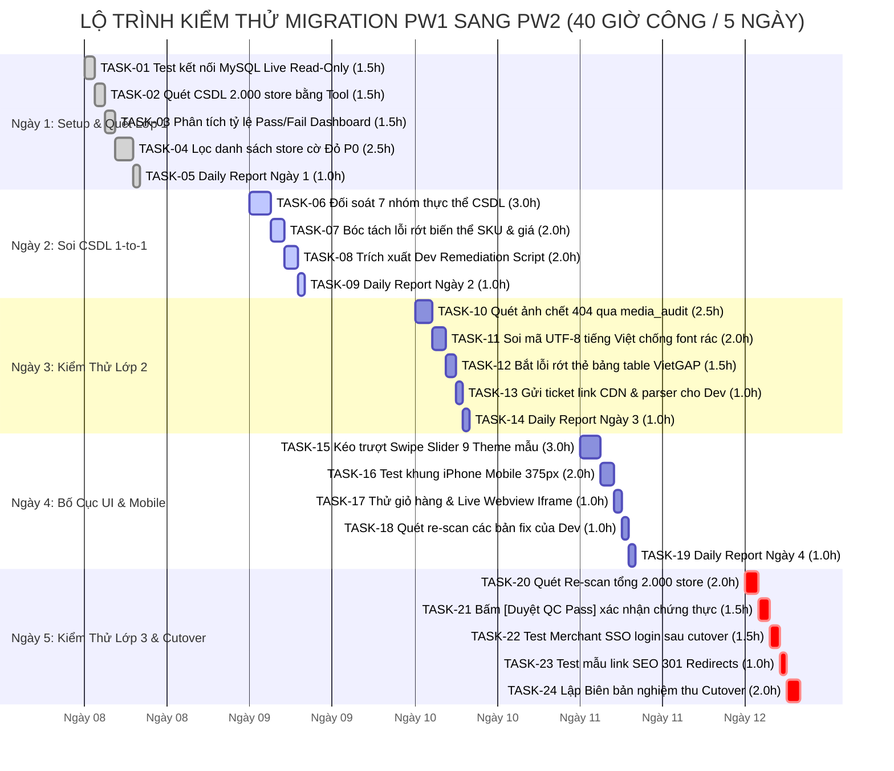
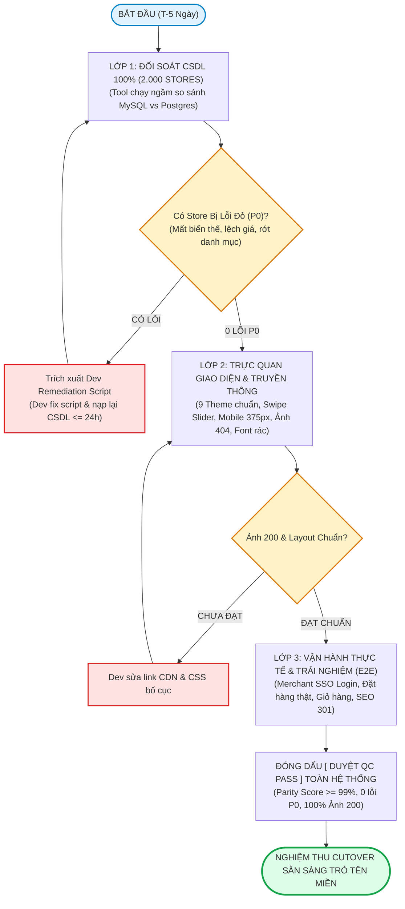
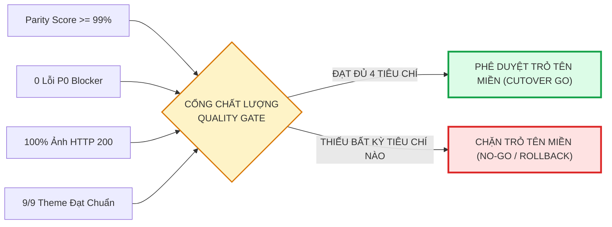

# KẾ HOẠCH KIỂM THỬ CHUYỂN ĐỔI DỮ LIỆU (TEST PLAN & ROADMAP)
**Hệ thống:** ECH Prime Web v2 | **Quy mô:** 2.000 Website Merchants & 9 Canonical Themes  
**Chiến lược:** 3 Lớp Kiểm Định Chất Lượng Toàn Diện (3-Layer Quality Strategy)  
**Tổng thời lượng dự toán (Estimation):** **40.0 Giờ công (5 Ngày làm việc x 8h/ngày)**

---

### THÔNG TIN TÀI LIỆU (DOCUMENT CONTROL)

| Hạng mục | Chi tiết |
| :--- | :--- |
| **Mã kế hoạch** | `TP-MIG-PW1-PW2` |
| **Phiên bản** | `2.0.0` (Chiến Lược 3 Lớp Kiểm Định Chất Lượng & Visual Roadmap) |
| **Ngày lập** | 2026-09-07 |
| **Người lập** | QC Tester (`Team QC`) |
| **Người duyệt** | Tech Lead / Project Manager |
| **Tổng Estimate** | **40.0 Man-hours** (1 Nhân sự QC x 5 Ngày) |
| **Trạng thái** | 🟡 **Chờ Leader Phê Duyệt** |
| **Công cụ hỗ trợ** | Module đối soát CSDL & Giao diện tại [`/studio/qa/migration-diff`](file:///home/primer69/source/ech-prime-web-v2/src/app/studio/qa/migration-diff/MigrationDiffClient.tsx) |

---

## 1. LỘ TRÌNH TRỰC QUAN & TIẾN ĐỘ 5 NGÀY (VISUAL ROADMAP & CHARTS)

Dành cho Leader / PM xem nhanh trong 30 giây để nắm trọn toàn bộ tiến độ, phân bổ giờ công và quy trình kiểm thử:

### 1.1 Sơ Đồ Lộ Trình Thời Gian 5 Ngày (Gantt Chart 40h)

![Lộ Trình Kiểm Thử 5 Ngày Gantt Chart](https://mermaid.ink/img/pako:eJx9lV1r21YYx7_KH8NCCnarN-fFd0m8uCGx41hOQ1hHUaQT6VD5yJOO04RSGOtFbza2wMYG3aBZCCPbwlZ6MbAueqGx73G-ydBLqqPa5Ma-kP17Hj2_53_O85odOKTWqrkW4_wxAwBOuU-wI-KfMBwkX_ceYntLxF91MXwo4j_R3eoM1oZbuz30D1SYa70O-gcaFg0FnS0R_4yN5PteBw_QRK-TfHl4L6c6FiebQTiyOHB4eHjY6HYb7Xb-zDql0e2znpu8OcMnTv4k_4yIzWnAimdqCybhkzEWsDdJrnna6usx1Py3wzVzu6GoGJKI46mYvudgIj6n6J6ZezvYoScEA2I5jV3mn2FRvd_07qX_azkBI3Uw9Ylah6ZoSw1ltaGs1JH-QkZrRdUNs70D7b6iKIh4EBIcielb5mIYBL7ElclaHdYxJ2FR5WOyjr6X_MrAkxvbAxfxP_BF_Ap9K4oebFrUR9uKvKPACp2yQEnXJbo2SzfSOX1jw7GYhyi5sL2ib1vEv-Df70T8LfoKFrWy82r3hsTX69A-4jfRtqh_hgEZByG_dZU2qsi8OeCmBDbSxhXvMZtnXmvBDGg-ebXBg0bF-VL2EucUUZBccCyDecm7Ebgn4rd29vUy_-uiXmmpZdmcnqStaBX3q3XoWStliWWsJ-9s8Gx6voh_pAhF_JrjiIrpe1YUMbf3sQCXJhfpNPNScpFyDfKCHxVZwTDMNuB0IqZXHG1yggEZEYda2SxMO6RjXqKrcF2Ca7Pw1XmWtDssSWhDQut3edJb2KYifjnC0BPxTRFQTepDVYoUiekl82B7WVANxcAXEwvZuz6xJg7l8j62mC4LUpWZJVTVbEFGySX2h5uNFfDMi4tHVMSveFonPmcujgPGESYXdjHFlFxa0edYUTWsi-lfvGKde2Iap7m_ZC64deQTPKKEd9b68sHCdEmKPieaqo6OiG8oOLWfEg6fsqfYaPewgLEVRiSE7QXZGtxqSpmGxPxgo2Qa80Trd4hmuhRE_e4gGi2si_gcGyK-srG_hQV0gyPqE7mDJraT6wA8_O9vEV9ymM_omMD0qUNCrGLokRHBSEz_mEiJbDGj4lidCaG6VJzt3oS5oH0vYKSoDn25OT6Vk1EQS7fGPLfLxZ66ND0EveQNc7GQXxUH5OiEkmfYOg6tEZHGl2J1CavNKlgpdjwkjci2GOx04bJtwTE9Tc_d36yK1luuIXHnqJ2bYeMutYak1rhbbXNudnUsYGPCgxMSSp1otykeFG_IRfwDcyu3YlUGWnZIeR2sWbE8e1Bpapq3qxE-a0_OsuzubWQX4ec4TcfIPDG9YVmgr9Pw5Yd8nrqyRum9OefC1bR8k7oktD2LcZjmLvzApQyRNYGdv6901X7g6hJ3Ns-annPz3c7SbH66C11RMSAODYnNo6qtkmxI5Fn1WnqJT2_GWKfJ76zYJeZ66emW3nSTW0nVsZf4poQ38qHX6rURCUcWdWqt5zWeprLWqjnk2Jr4vPbixf9erTIA)

> 🖼️ *File ảnh gốc độ phân giải cao:* [`docs/qa/images/gantt-chart-40h.png`](file:///home/primer69/source/ech-prime-web-v2/docs/qa/images/gantt-chart-40h.png) | Vector: [`gantt-chart-40h.svg`](file:///home/primer69/source/ech-prime-web-v2/docs/qa/images/gantt-chart-40h.svg)  
> 💡 *Hướng dẫn xem trong Lark Doc:* Nếu import markdown chưa hiện hình, chỉ cần copy file ảnh PNG ở trên dán (Ctrl+V) vào Lark Doc, hoặc gõ `/uml` trong Lark Doc và dán đoạn mã Mermaid bên dưới.

#### Bảng Tiến Độ Trực Quan Từng Ngày (Roadmap Timeline)

| Ngày (Date) | Trọng Tâm Giai Đoạn (Milestones) | Khối Lượng Task | Giờ Công | Thanh Tiến Độ (Progress Bar) | Sản Phẩm Bàn Giao (Deliverables) |
| :---: | :--- | :---: | :---: | :--- | :--- |
| **Ngày 1** | **Setup & Quét Lớp 1 (CSDL 2.000 store)** | TASK-01 $\rightarrow$ 05 | **8.0h** | `[██░░░░░░░░] 20%` | CSDL 2.000 store được phân loại Xanh / Vàng / Đỏ (P0) |
| **Ngày 2** | **Soi CSDL 1-to-1 & Bàn Giao Dev Fix** | TASK-06 $\rightarrow$ 09 | **8.0h** | `[████░░░░░░] 40%` | Bóc tách chi tiết biến thể SKU, giá & xuất Remediation Script |
| **Ngày 3** | **Kiểm Thử Lớp 2 (Media 404 & Bảng biểu)** | TASK-10 $\rightarrow$ 14 | **8.0h** | `[██████░░░░] 60%` | 100% link ảnh 404 & bảng table VietGAP được xử lý |
| **Ngày 4** | **Kiểm Thử Lớp 2 (9 Theme & Mobile 375px)** | TASK-15 $\rightarrow$ 19 | **8.0h** | `[████████░░] 80%` | 9/9 Theme khớp Swipe Slider, menu mobile không vỡ |
| **Ngày 5** | **Kiểm Thử Lớp 3 (E2E) & Nghiệm Thu Cutover** | TASK-20 $\rightarrow$ 24 | **8.0h** | `[██████████] 100%` | Merchant SSO Login OK, Đóng dấu [Duyệt QC Pass] |

<details>
<summary><b>▶ Bấm để xem mã nguồn Mermaid Gantt (Dùng cho Lark Doc UML / Notion / Obsidian)</b></summary>



</details>

---

### 1.2 Sơ Đồ Quy Trình Thẩm Định 3 Lớp (Quality Pipeline)

![Sơ Đồ Quy Trình Thẩm Định 3 Lớp](https://mermaid.ink/img/pako:eJydVG1r21YY_SsHlQYH5E2W3WTx2pRUdm2DLTu-cmHE_aDIV9YlshTk6yQmBFIKGWywZXSssH2Jy7oXWLbBBgMJtg8q-x_3n2ySXNt9gb18EUi6zznnnvM8z6lk-QMqlSXb9Y8txww4jErfAwDCzYDn9vrSPRH-aODFpQi_6SFn5G9BH8ZX0_W-9HAd-fw2muaUBoW9vtQU0ZcdFMrJ4eiyAdKOHxnQSKWJgqLcRE59R1EUEKPdrZL12_vBu9s5w_ddWI4IZ1N4QxF-O8LYxzieeQ5aU7LbxNEYHX_MhwEdJ5yZuuyZMaciNIdaB83CaV_S4l9AuB9Q3BPRx2iK6ClLFX2KXEdZv5vxtkT4nGOfifAPD9wR0WMZrog-tBwMWTyTEYjoK46B6TkYiei5td6XzjLWORXyeWjxk4Tgi0aq4T47aSY-GEF8bTk4maQcFXqELh3RATM58z0QK2CHPFOR_LPZCcbpN6zBE-HsEK4IZywz7vYdqCVnefGUY8X2VTtWhClzWR1leVZdRKSWYXRF9LOG3d6Ojlpjp41KQ0QXOtZgdHsfiOhch1GPP9drmdAtGA4dUVjORITfezLIMTukIC4b0EBGy99nLkVx89bhiQwRPvMclJSSjPu-xxHEM-ut0akr0amnfSkrVBUFa8kBf8KhZYR3X3NfTd2v__nTTtqZV8YigOSWia1jEV2bcJl3AK2S3EsjBPsi-gxWEucrhqorJr1paMo1Z9HqPRF-py_PFxemFst4IMIfdNTjc70Oo54abIjw99RUET5rQK_VE5tbyFXV6nwCWjSwHNPjIKSNpj9knpyy_cbhxFfeMOnO8JrLqLGkh9NvMki1jaJSeKutxVQeYUPPt-2_7XhxGT_Ra6iI8Ose9lBJ8r0wsKuhs0MIHsJox-c66iK6SGVfvky9YwaMT0GsZJq272Br66YMJZmTpwwdRc7GepHaUsycO4t3wv0jGnSpOZgm-2ThgVHvQesZ7QfVLogIf9VB4nO9lrbmJzDij3S0GkknJpum72XIYz51abacYDPXLd-giq3aVB7zwD-g5RuK-l7J2py_5o_ZgDtl9fDk_dXyVUlzlIFlW3RzgVLYMIsl81WU4uso83HLAGxqF60lwGBrc1PZ-AcZ8_b63wDZMnhZTlWqLsstdUP9F-XqfyuXZGlEg5HJBlL5VOLJTpDK0oDa5sTl0tnZXxKAOBQ)

> 🖼️ *File ảnh gốc độ phân giải cao:* [`docs/qa/images/quality-pipeline-3layers.png`](file:///home/primer69/source/ech-prime-web-v2/docs/qa/images/quality-pipeline-3layers.png) | Vector: [`quality-pipeline-3layers.svg`](file:///home/primer69/source/ech-prime-web-v2/docs/qa/images/quality-pipeline-3layers.svg)

#### Sơ Đồ Khối Quy Trình Kiểm Thử (Pipeline Text Flow)

```text
  ┌─────────────────────────────────────────────────────────────┐
  │  BƯỚC 1 (LỚP 1): ĐỐI SOÁT CSDL 100% TOÀN BỘ 2.000 STORES    │
  │  - Thuật toán Tool so khớp từng ô CSDL MySQL vs Postgres    │
  └──────────────────────────────┬──────────────────────────────┘
                                 │
                                 ▼
                       [Có Store Bị Lỗi Đỏ P0?]
                      /                        \
              [CÓ LỖI P0]                    [0 LỖI P0]
                  │                              │
                  ▼                              ▼
    ┌───────────────────────────┐  ┌─────────────────────────────────────────┐
    │ Trích xuất Remediation    │  │  BƯỚC 2 (LỚP 2): TRỰC QUAN GIAO DIỆN &  │
    │ Script gửi Dev sửa <= 24h │  │  MEDIA 404 / FONT TIẾNG VIỆT / BẢNG     │
    └─────────────┬─────────────┘  │  - 9 Theme mẫu: Kéo Swipe Slider độ lệch│
                  │ (Dev sửa xong) │  - Khung Mobile 375px chống tràn viền   │
                  └───────► Re-scan│  - media_audit: Quét URL ảnh chết 404   │
                                   └────────────────────┬────────────────────┘
                                                        │
                                                        ▼
                                            [Ảnh 200 & Layout Chuẩn?]
                                           /                         \
                                    [CHƯA ĐẠT]                     [ĐẠT CHUẨN]
                                       │                                │
                                       ▼                                ▼
                         ┌───────────────────────────┐    ┌────────────────────────────┐
                         │ Dev sửa link CDN & CSS    │    │  BƯỚC 3 (LỚP 3): VẬN HÀNH  │
                         └─────────────┬─────────────┘    │  THỰC TẾ & E2E LUỒNG MUA   │
                                       │ (Dev fix xong)   │  - Merchant SSO Login < 3s │
                                       └───────► Re-test  │  - Luồng giỏ hàng, đặt mua │
                                                          │  - Kiểm thử SEO 301 URLs   │
                                                          └─────────────┬──────────────┘
                                                                        │
                                                                        ▼
                                                          ┌────────────────────────────┐
                                                          │   CỔNG DUYỆT QC PASS       │
                                                          │   - Parity Score >= 99.0%  │
                                                          │   - 0 Store cờ Đỏ (P0 = 0) │
                                                          │   - 100% Ảnh HTTP 200      │
                                                          └─────────────┬──────────────┘
                                                                        │
                                                                        ▼
                                                          ┌────────────────────────────┐
                                                          │ ★ NGHIỆM THU CUTOVER GO ★  │
                                                          │ (SẴN SÀNG TRỎ TÊN MIỀN)    │
                                                          └────────────────────────────┘
```

<details>
<summary><b>▶ Bấm để xem mã nguồn Mermaid Pipeline (Dùng cho Lark Doc UML / Notion)</b></summary>



</details>

---

## 2. CHIẾN LƯỢC 3 LỚP KIỂM ĐỊNH CHẤT LƯỢNG (3-LAYER QUALITY STRATEGY)

Kế hoạch loại bỏ hoàn toàn rủi ro bằng việc kiểm định theo **3 Lớp Chất Lượng Khép Kín**, khẳng định **100% cả 2.000 store đều được kiểm tra CSDL**, không bỏ sót bất kỳ store nào:

| Lớp Kiểm Thử (Layer) | Phạm Vi & Quy Mô | Mục Tiêu Kiểm Định | Phương Pháp & Thao Tác Chi Tiết | Tiêu Chuẩn Đạt (Pass) | Biện Pháp Ngăn Ngừa Rủi Ro |
| :--- | :---: | :--- | :--- | :--- | :--- |
| **Lớp 1: Toàn Vẹn Dữ Liệu (Data Integrity)** | **100% toàn bộ 2.000 stores** | Bảo toàn 100% dữ liệu gốc: Sản phẩm, biến thể SKU, giá bán, danh mục, bài viết, đơn hàng cũ. | **Thuật toán Tool chạy ngầm:** So sánh từng ô CSDL giữa MySQL PW1 và Postgres PW2; tự động gắn cờ Đỏ (P0) nếu thiếu biến thể hoặc lệch giá; tự động xuất mã `Dev Remediation Script` để Dev sửa CSDL. | - Parity Score $\ge 99.0\%$.<br/>- 0 lỗi P0 Blocker.<br/>- 100% không mất biến thể. | **Triệt tiêu 100% rủi ro mất mát dữ liệu**, dù là cửa hàng lớn hay nhỏ. |
| **Lớp 2: Trực Quan Giao Diện & Truyền Thông** | **Đại diện theo 9 Theme Gốc & toàn bộ tài nguyên ảnh** | Đảm bảo giao diện chuẩn mực, không vỡ layout trên mobile, không có ảnh chết 404, không lỗi font tiếng Việt. | **QC thao tác tay kết hợp Tool:** Dùng `Swipe Slider` kéo từ 0% $\rightarrow$ 100% soi độ lệch bố cục; mở khung iPhone `Mobile 375px` kiểm tra tràn viền; Tool gửi request HTTP HEAD quét ảnh 404 và kiểm tra bảng mã UTF-8. | - 100% ảnh trả về HTTP 200.<br/>- Không lỗi font rác (mojibake).<br/>- Giữ nguyên thẻ `<table>`.<br/>- 9/9 Theme đạt chuẩn giao diện. | Đảm bảo giao diện mới đẹp mắt, chuyên nghiệp, giữ nguyên trải nghiệm mua hàng cho khách. |
| **Lớp 3: Vận Hành Thực Tế (E2E Business Flow)** | **Mẫu thực chiến trên môi trường Live** | Xác nhận toàn bộ luồng kinh doanh của Merchant và Khách mua hàng hoạt động thông suốt sau Cutover. | **QC test luồng thực tế:** Thử nghiệm đăng nhập SSO từ TM SSO Portal vào `/dashboard` trong `< 3s`; thực hiện luồng đặt hàng thật, thêm vào giỏ, kiểm tra tính thuế SST, trừ kho và tạo hóa đơn. | - Đăng nhập SSO thành công `< 3s`.<br/>- Luồng tạo đơn hàng và trừ kho chuẩn xác 100%.<br/>- SEO 301 redirects hoạt động đúng. | Đảm bảo Merchant mở bán và nhận đơn hàng được ngay sau Cutover, không gián đoạn kinh doanh. |

---

## 3. BẢNG PHÂN RÃ CÔNG VIỆC & ESTIMATE 40 GIỜ (TASK BREAKDOWN & WBS)

| Mã Task | Ngày & Ca | Chi Tiết Công Việc (Task Description) | Phương Pháp | Est (Giờ) | Sản Phẩm Đầu Ra (Deliverable) |
| :---: | :---: | :--- | :---: | :---: | :--- |
| **TASK-01** | Ngày 1 - Sáng | Cấu hình `.env.local` (`PW1_DATABASE_URL`), test ping CSDL MySQL Live qua Tool, xác nhận độ trễ < 200ms và quyền Read-Only an toàn. | Tool + Tay | **1.5h** | CSDL kết nối thông suốt, an toàn 100%. |
| **TASK-02** | Ngày 1 - Sáng | Bấm `[ Quét Lại CSDL ]` để batch scan tự động Lớp 1 (CSDL 2.000 store); kiểm tra logs và xử lý timeout mạng nếu có. | Tool (90%) | **1.5h** | CSDL 2.000 store được phân loại Xanh/Vàng/Đỏ. |
| **TASK-03** | Ngày 1 - Chiều | Thu thập & phân tích số liệu Dashboard tổng quan: tỷ lệ % Pass, số lượng Warning, số lượng Fail. | Tool + Tay | **1.5h** | Bảng thống kê tỷ lệ sẵn sàng Cutover ban đầu. |
| **TASK-04** | Ngày 1 - Chiều | Lọc & phân loại danh sách các store bị cờ Đỏ (P0 Blocker) theo nhóm nguyên nhân sơ bộ (biến thể, bảng, kết nối). | Tay | **2.5h** | Danh mục store cờ Đỏ cần xử lý ưu tiên cho Ngày 2. |
| **TASK-05** | Ngày 1 - Chiều | Tổng hợp và gửi Daily Report Ngày 1 cho Leader / PM. | Tay | **1.0h** | Báo cáo tiến độ Ngày 1 trên nhóm chat. |
| *Subtotal* | **Ngày 1** | *Setup CSDL & Quét Lớp 1 (CSDL 2.000 Store)* | | **8.0h** | *Tiến độ lũy kế: 20%* |
| **TASK-06** | Ngày 2 - Sáng | Mở tab `field_diff` trên các store cờ Đỏ đại diện (`SITE-0001`, `SITE-0025`...); đối soát chi tiết 7 nhóm thực thể CSDL Lớp 1. | Tay + Tool | **3.0h** | Bảng bóc tách chi tiết trường dữ liệu bị lệch. |
| **TASK-07** | Ngày 2 - Sáng | Kiểm tra sâu lỗi rớt biến thể SKU (size, màu sắc, dung tích) và sai lệch đơn giá sản phẩm. | Tay | **2.0h** | Danh sách chính xác các mã sản phẩm/biến thể bị thiếu. |
| **TASK-08** | Ngày 2 - Chiều | Mở rộng dòng lỗi, trích xuất đoạn code `Dev Remediation Script`; tạo ticket gửi Dev kèm sẵn mã script sửa lỗi. | Tay | **2.0h** | Ticket bug gửi Dev kèm sẵn mã script sửa lỗi. |
| **TASK-09** | Ngày 2 - Chiều | Tổng hợp và gửi Daily Report Ngày 2 cho Leader / PM. | Tay | **1.0h** | Báo cáo tiến độ Ngày 2 & danh sách bug gửi Dev. |
| *Subtotal* | **Ngày 2** | *Soi Chi Tiết CSDL & Bàn Giao Fix Cho Dev* | | **8.0h** | *Tiến độ lũy kế: 40%* |
| **TASK-10** | Ngày 3 - Sáng | Mở tab `media_audit` (Kiểm thử Lớp 2): Tool quét tự động URL ảnh PW1 vs PW2, lọc danh sách ảnh bị 404 Not Found hoặc méo tỷ lệ. | Tool Auto | **2.5h** | Danh sách link ảnh 404 bàn giao Dev sửa link CDN/S3. |
| **TASK-11** | Ngày 3 - Sáng | Mở tab `text_audit`: Quét mã UTF-8 tiếng Việt trên các bài viết và sản phẩm, phát hiện lỗi font rác (mojibake). | Tool Auto | **2.0h** | Báo cáo kiểm định font chữ tiếng Việt có dấu. |
| **TASK-12** | Ngày 3 - Chiều | Kiểm tra cấu trúc thẻ bảng `<table>` (bảng thành phần, bảng VietGAP) khi chuyển đổi sang Lexical AST RichText. | Tool + Tay | **1.5h** | Danh sách bài viết bị lỗi rớt bảng table. |
| **TASK-13** | Ngày 3 - Chiều | Tạo ticket tổng hợp lỗi ảnh 404 và rớt bảng gửi Dev team sửa link CDN và hàm parser Lexical. | Tay | **1.0h** | Ticket chuyển giao lỗi Media & RichText cho Dev. |
| **TASK-14** | Ngày 3 - Chiều | Tổng hợp và gửi Daily Report Ngày 3 cho Leader / PM. | Tay | **1.0h** | Báo cáo tiến độ Ngày 3 trên nhóm chat. |
| *Subtotal* | **Ngày 3** | *Kiểm Tra Media 404, Font Tiếng Việt & Bảng Biểu* | | **8.0h** | *Tiến độ lũy kế: 60%* |
| **TASK-15** | Ngày 4 - Sáng | Kiểm thử Lớp 2 trên 9 Store đại diện 9 Theme; dùng thanh trượt `Swipe Slider` (0% -> 100%) kéo trượt đối chiếu độ lệch bố cục. | Tay | **3.0h** | 9/9 Theme chuẩn được xác nhận độ khít giao diện. |
| **TASK-16** | Ngày 4 - Sáng | Bật chế độ `Mobile (375px)`, kiểm tra hiển thị trên khung iPhone: menu hamburger, nút mua hàng, banner không bị tràn viền. | Tay | **2.0h** | Xác nhận giao diện mobile 375px không vỡ bố cục. |
| **TASK-17** | Ngày 4 - Chiều | Mở tab `live_webview`, thử nghiệm tương tác thật trên dual iframe (cuộn trang, xem sản phẩm, mở giỏ hàng). | Tay | **1.0h** | Kiểm thử hành vi tương tác thật của khách hàng. |
| **TASK-18** | Ngày 4 - Chiều | Bấm `[ Quét Lại CSDL ]` kiểm tra độ hồi phục sau khi Dev nạp bản vá CSDL và cập nhật script. | Tool (90%) | **1.0h** | Báo cáo re-test các bản fix của Dev team. |
| **TASK-19** | Ngày 4 - Chiều | Tổng hợp và gửi Daily Report Ngày 4 cho Leader / PM. | Tay | **1.0h** | Báo cáo tiến độ Ngày 4 trên nhóm chat. |
| *Subtotal* | **Ngày 4** | *Kiểm Thử Trực Quan Giao Diện 9 Theme Mẫu* | | **8.0h** | *Tiến độ lũy kế: 80%* |
| **TASK-20** | Ngày 5 - Sáng | Bấm `[ Quét Lại CSDL ]` lần cuối trên toàn bộ 2.000 store; kiểm tra Parity Score >= 99.0%, P0 = 0, Media HTTP 200 = 100%. | Tool Auto | **2.0h** | Toàn bộ hệ thống 2.000 store đạt chuẩn xanh Lớp 1 & Lớp 2. |
| **TASK-21** | Ngày 5 - Sáng | Bấm nút `[ Duyệt QC Pass ]` cho các store đạt chuẩn để hệ thống ghi nhận dấu chứng thực (`certifiedBy`, `certifiedAt`). | Tay | **1.5h** | 100% store được đóng dấu QC Pass cho Cutover. |
| **TASK-22** | Ngày 5 - Chiều | Kiểm thử Lớp 3 (E2E Live): Merchant đăng nhập SSO (TM Portal -> `/dashboard` < 3s); đặt thử đơn hàng kiểm tra trừ kho. | Tay | **1.5h** | Xác nhận luồng đăng nhập và bán hàng thông suốt. |
| **TASK-23** | Ngày 5 - Chiều | Kiểm thử mẫu 5 link SEO 301 Redirects cũ (`.html` chuyển hướng sang URL mới trên PW2). | Tay | **1.0h** | Xác nhận các liên kết cũ tự chuyển hướng 301 chuẩn. |
| **TASK-24** | Ngày 5 - Chiều | Lập Biên bản nghiệm thu chuyển đổi (Final Cutover Sign-off Report), trình ký với Tech Lead và PM. | Tay | **2.0h** | Biên bản nghiệm thu Cutover hoàn tất, sẵn sàng trỏ DNS. |
| *Subtotal* | **Ngày 5** | *Re-scan Tổng, Đóng Dấu QC Pass & Nghiệm Thu* | | **8.0h** | *Tiến độ lũy kế: 100%* |
| **TỔNG CỘNG** | | **24 Tasks Chi Tiết Cho 1 QC Tester** | | **40.0h** | **1 TUẦN LÀM VIỆC (5 NGÀY x 8H)** |

---

## 4. MA TRẬN ĐỐI SOÁT DỮ LIỆU & GIAO DIỆN (CHECKLIST MATRIX)

| Hạng mục kiểm tra | CSDL Nguồn (PW1) | CSDL Đích (PW2) | Tiêu chuẩn chấp thuận | Mức độ |
| :--- | :--- | :--- | :--- | :---: |
| **Sản phẩm & Biến thể** | `products`, `product_skus` | `products`, `variants` | Tên, slug, giá bán, SKU và tồn kho khớp 100%; không mất size/màu. | **P0 Blocker** |
| **Cấu trúc Bảng Biểu** | `pages.content` (HTML) | `pages.blocks` (Lexical AST) | Giữ nguyên thẻ `<table>`, `<tr>`, `<td>`; không bị phẳng thành text thường. | **P0 Blocker** |
| **Mã hóa Tiếng Việt** | MySQL UTF8MB4 | PostgreSQL UTF8 | Không lỗi font rác (mojibake), hiển thị chuẩn 100% tiếng Việt có dấu. | **P0 Blocker** |
| **Liên kết Hình ảnh** | `banners`, `product_images` | `media` | 100% URL ảnh trả về HTTP 200; không có ảnh chết 404. | **P1 Warning** |
| **Bố cục Giao diện** | Giao diện gốc Laravel | Giao diện mới Next.js | Kéo trượt Swipe Slider đè khít bố cục; mobile 375px không tràn nút. | **P1 Warning** |
| **Merchant SSO Login** | TM SSO Portal | `/post-sso-landing` | Đăng nhập chuyển hướng vào Dashboard trong < 3s, hiển thị đủ dữ liệu. | **P0 Blocker** |

---

## 5. ĐIỀU KIỆN CHẤP THUẬN NGHIỆM THU (GO / NO-GO CUTOVER GATE)


> 🖼️ *File ảnh gốc độ phân giải cao:* [`docs/qa/images/quality-gate.png`](file:///home/primer69/source/ech-prime-web-v2/docs/qa/images/quality-gate.png) | Vector: [`quality-gate.svg`](file:///home/primer69/source/ech-prime-web-v2/docs/qa/images/quality-gate.svg)

```text
  [ Parity Score >= 99.0%  ] ──┐
  [ 0 Lỗi P0 Blocker       ] ──┤
  [ 100% Ảnh trả HTTP 200  ] ──┼──► ⟨ CỔNG CHẤT LƯỢNG ⟩ ──► ĐẠT ĐỦ 4 TIÊU CHÍ ──► [ PHÊ DUYỆT TRỎ TÊN MIỀN (GO) ]
  [ 9/9 Theme Đạt Giao Diện] ──┘             │
                                             └──► THIẾU BẤT KỲ TIÊU CHÍ NÀO ──► [ DỪNG LẠI / ROLLBACK (NO-GO) ]
```

<details>
<summary><b>▶ Bấm để xem mã nguồn Mermaid Quality Gate (Dùng cho Lark Doc UML / Notion)</b></summary>



</details>

---

## 6. ĐỀ XUẤT HỖ TRỢ TỪ PHÍA DEV & LEADER

Để đảm bảo kế hoạch 40 giờ về đích an toàn, đề xuất Leader chỉ đạo:
1. **Cam kết SLA sửa lỗi CSDL $\le 24$ giờ:** Dev team ưu tiên nạp lại CSDL sạch ngay trong Ngày 3 sau khi nhận danh sách lỗi từ QC vào cuối Ngày 2.
2. **Hỗ trợ tính năng Duyệt Hàng Loạt (Batch Approve):** Bổ sung 1 nút bấm trên Tool để QC duyệt đồng loạt các website đã đạt điểm xanh $\ge 99.0\%$, tránh thao tác bấm thủ công 2.000 lần.

---

## 7. BIÊN BẢN KÝ DUYỆT KẾ HOẠCH (APPROVAL SIGN-OFF)

| Đại diện | Họ và tên | Chức vụ | Chữ ký | Ngày duyệt | Ý kiến / Ghi chú |
| :--- | :--- | :--- | :---: | :---: | :--- |
| **Người lập kế hoạch** | | QC Tester / Lead | | | Đã sẵn sàng thực thi (40h) |
| **Trưởng nhóm kỹ thuật** | | Tech Lead | | | |
| **Quản lý dự án** | | Project Manager (PM) | | | |
