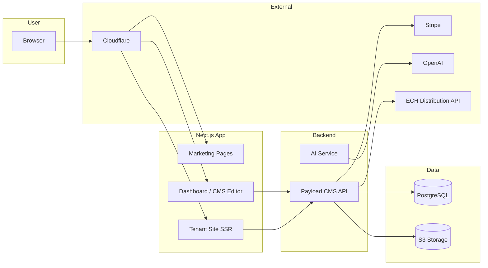
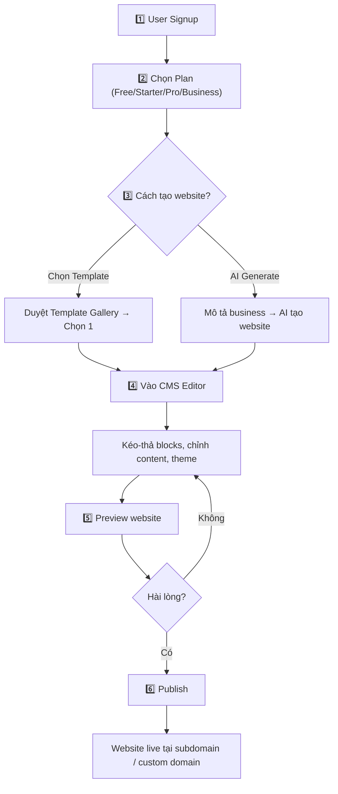
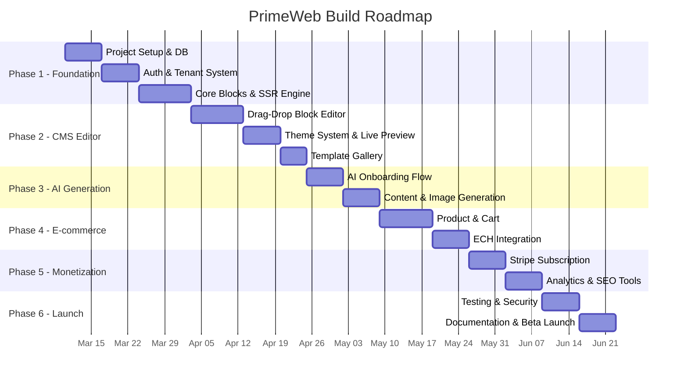

# PrimeWeb — Product Plan (Start → Release)

> SaaS Website Builder Platform cho SME
> Phiên bản: v1.0 | Ngày: 07/03/2026

---

## 1. 🎯 Tổng Quan Sản Phẩm

### Vấn đề hiện tại (ECH Web Store cũ)
- Template cứng, mỗi template phải code riêng → **khó scale, khó maintain**
- CMS hạn chế → website không đẹp, khó tuỳ chỉnh
- Frontend dùng **Client-Side Rendering** → Google không index → **SEO = 0**
- Không có AI hỗ trợ → user phải tự setup từ đầu

### Giải pháp: PrimeWeb
Một platform **SaaS** cho phép SME:
1. **Mô tả business** → AI tự tạo website hoàn chỉnh trong vài phút
2. **Kéo-thả blocks** trong CMS để tuỳ chỉnh (không cần code)
3. **Publish** → Website live ngay, SEO-ready, Google index được
4. **Subscription** theo tháng/năm để duy trì

---

## 2. 🏗️ Mô Hình Triển Khai

### SaaS Multi-Tenant Architecture

```
                    ┌─────────────────────────────────────┐
                    │         PRIMEWEB PLATFORM            │
                    │          (1 codebase duy nhất)       │
   ┌────────────────┼─────────────────────────────────────┼──────────────┐
   │                │                                     │              │
   ▼                ▼                                     ▼              ▼
┌──────┐     ┌───────────┐                        ┌───────────┐   ┌──────────┐
│ Admin │     │ Tenant A  │                        │ Tenant B  │   │ Tenant C │
│ Panel │     │ bakery.   │                        │ shop.     │   │ agency.  │
│       │     │ primeweb  │                        │ primeweb  │   │ primeweb │
│       │     │ .app      │                        │ .app      │   │ .app     │
└──────┘     └───────────┘                        └───────────┘   └──────────┘
```

**Giải thích đơn giản:**
- Anh chỉ deploy **1 app duy nhất** — phục vụ tất cả khách hàng
- Mỗi khách hàng (tenant) có **subdomain riêng** hoặc **custom domain**
- Data của mỗi tenant **cách ly** trong cùng 1 database (dùng `tenant_id`)
- Tiết kiệm chi phí server, dễ maintain, scale tốt

### Cách user truy cập

| URL | Ai thấy | Nội dung |
|-----|---------|----------|
| `primeweb.app` | Ai cũng thấy | Marketing page + Signup |
| `primeweb.app/dashboard` | User đã login | Dashboard quản lý site |
| `bakery.primeweb.app` | Public | Website của tenant "bakery" (SSR) |
| `www.mybakery.com` | Public | Custom domain → dẫn tới tenant "bakery" |
| `primeweb.app/admin` | Super Admin | Payload CMS quản lý toàn bộ hệ thống |

---

## 3. ⚙️ Tech Stack

### Tại sao chọn stack này?

| Layer | Công nghệ | Tại sao? |
|-------|-----------|----------|
| **Framework** | **Next.js 15** (App Router) | SSR/SSG → SEO tốt, React ecosystem lớn, Vercel deploy nhanh |
| **CMS Backend** | **Payload CMS 3** | Open-source, tích hợp sẵn Next.js, có plugin multi-tenant, block editor, REST API tự động |
| **Database** | **PostgreSQL** | Ổn định, hỗ trợ JSON, Row-Level Security cho multi-tenant |
| **Styling** | **Tailwind CSS** | Nhanh, responsive, utility-first, team dễ maintain |
| **AI** | **OpenAI GPT-4** | Tạo content, gợi ý layout, chọn template phù hợp |
| **Image AI** | **DALL-E 3** | Tạo hero images, banners cho website |
| **Payment** | **Stripe** | Subscription billing, webhook events, invoice tự động |
| **Auth** | **Payload Auth** | JWT, session, role-based, tích hợp sẵn |
| **Storage** | **S3 (AWS/MinIO)** | Upload media (ảnh, video, PDF) |
| **CDN** | **Cloudflare** | Cache, SSL, DDoS protection, custom domain |
| **Deploy** | **Docker + Cloud Server** | Giống cách anh deploy OpenClaw hiện tại |

### Sơ đồ kiến trúc đơn giản



---

## 4. 📋 Tính Năng Chi Tiết

### 4.1 User Flow (Từ signup đến publish)



### 4.2 Danh sách tính năng theo module

#### 🔐 Auth & User Management
- Signup / Login (email + password)
- Quên mật khẩu
- Quản lý tài khoản, avatar
- Mời team members (Owner / Editor / Viewer roles)

#### 🏠 Dashboard
- Overview: Danh sách websites, traffic tổng quan
- Tạo website mới (từ template hoặc AI)
- Quản lý subscription / billing
- Quản lý domain

#### 🤖 AI Website Generation
- User nhập: tên business, ngành, mô tả ngắn
- AI phân tích → chọn template phù hợp
- AI tạo content: headlines, body text, CTA
- AI tạo/chọn hình ảnh
- Output: Website hoàn chỉnh, user chỉ cần review & publish

#### 🧩 CMS / Visual Editor (Block-based)

> **Block**: Mỗi section trên website là 1 block. User kéo-thả, reorder, thêm/xoá.

| Block | Mô tả | Variants |
|-------|-------|----------|
| Navigation | Menu bar | Fixed, Sticky, Transparent |
| Hero | Banner chính | Centered, Split, Fullscreen, Video |
| About | Giới thiệu | Image-left, Image-right, Centered, Cards |
| Features | Tính năng | Grid-2, Grid-3, Alternating |
| Testimonials | Đánh giá KH | Carousel, Grid, Masonry |
| Contact | Form liên hệ | Form tuỳ chỉnh + Map |
| Gallery | Bộ sưu tập ảnh | Masonry, Grid, Carousel |
| Footer | Chân trang | Multi-column + Social links |
| Pricing | Bảng giá | 2-4 columns |
| Blog | Bài viết | Grid, List, Featured |
| Product Grid | Sản phẩm | Card, List (cho E-commerce) |
| FAQ | Câu hỏi thường gặp | Accordion |
| CTA | Call-to-action | Banner, Inline, Floating |

#### 🎨 Theme System
- Chọn primary color, secondary color
- Chọn font chữ (Heading + Body riêng)
- Light / Dark mode
- Border radius style (sharp → pill)
- Preview realtime khi thay đổi

#### 🛒 E-commerce (Phase 4)
- Quản lý sản phẩm (tên, giá, ảnh, variants)
- Giỏ hàng + Checkout
- Thanh toán: Stripe, PayPal
- Quản lý đơn hàng
- Sync với ECH Centralised Distribution

#### 🔍 SEO (Built-in)
- SSR → Google crawl full HTML
- Meta title, description per page
- Auto sitemap.xml
- Structured data (JSON-LD)
- Open Graph + Twitter Cards
- Google Analytics integration

#### 📊 Analytics
- Page views, unique visitors
- Traffic sources
- Top pages
- Conversion tracking (Phase 5)

#### 💰 Subscription & Billing
- Stripe Checkout cho thanh toán
- 4 Plans: Free → Starter → Pro → Business
- Auto invoice, receipt
- Upgrade / Downgrade / Cancel
- Webhook sync trạng thái

---

## 5. 💰 Subscription Plans

| | 🆓 Free | ⭐ Starter ($9/mo) | 🚀 Pro ($29/mo) | 🏢 Business ($79/mo) |
|---|---------|-------------------|-----------------|---------------------|
| Websites | 1 | 3 | 10 | Unlimited |
| Custom Domain | ❌ | ✅ | ✅ | ✅ |
| AI Generation | 1 lần | 5/tháng | 20/tháng | Unlimited |
| Blocks | 8 cơ bản | 15 | Tất cả (20+) | Tất cả + Custom |
| Storage | 500MB | 2GB | 10GB | 50GB |
| E-commerce | ❌ | Basic | Full | Full + API |
| ECH Integration | ❌ | ❌ | ✅ | ✅ |
| Support | Community | Email | Chat | Dedicated |

---

## 6. 🗺️ Build Plan: 6 Phases (Start → Release)

### Tổng quan timeline



---

### Phase 1: Foundation (3-4 tuần) ← **Đang làm**

> **Mục tiêu**: Có 1 app chạy được, tạo được tenant, render được website SSR

| Step | Công việc | Output |
|------|-----------|--------|
| 1.1 | Setup project (Next.js + Payload CMS + PostgreSQL) | App chạy local `localhost:3000` |
| 1.2 | Database schema + Multi-tenant config | Tạo/xoá tenant qua admin |
| 1.3 | Auth system (signup / login) | User đăng ký, đăng nhập |
| 1.4 | 8 core blocks + SSR renderer | Một tenant site render đầy đủ blocks |
| 1.5 | Middleware routing (subdomain + custom domain) | `tenant.localhost:3000` hiển thị đúng site |

**Kết quả Phase 1**: Admin tạo tenant → thêm page → thêm blocks → website hiển thị SSR

---

### Phase 2: CMS & Visual Editor (3-4 tuần)

> **Mục tiêu**: User có thể tự kéo-thả chỉnh sửa website mà không cần vào admin Payload

| Step | Công việc | Output |
|------|-----------|--------|
| 2.1 | Dashboard UI (danh sách sites, tạo site mới) | Giao diện quản lý |
| 2.2 | Block Editor: drag-drop, add, remove, reorder | User kéo thả sections |
| 2.3 | Inline editing: chỉnh text, ảnh, link trực tiếp | Click vào text → sửa tại chỗ |
| 2.4 | Theme Editor: colors, fonts, dark/light | Thay đổi giao diện realtime |
| 2.5 | Live Preview | Xem website giống thật trước khi publish |
| 2.6 | Template Gallery | Chọn template → apply vào site |
| 2.7 | Media Library | Upload, quản lý ảnh/video |

**Kết quả Phase 2**: User login → kéo thả chỉnh website → preview → publish

---

### Phase 3: AI Generation (2-3 tuần)

> **Mục tiêu**: User mô tả business → AI tạo website hoàn chỉnh

| Step | Công việc | Output |
|------|-----------|--------|
| 3.1 | AI Onboarding Flow (form nhập thông tin business) | UI wizard 3-4 bước |
| 3.2 | LLM chọn template + tạo content (headlines, copy, CTA) | Website có nội dung thật |
| 3.3 | AI tạo/chọn hình ảnh (DALL-E hoặc stock) | Hero image, thumbnails |
| 3.4 | Assemble & Preview | Website hoàn chỉnh để review |

**Kết quả Phase 3**: User nhập "Tiệm bánh ABC ở quận 3, bán bánh kem và coffee" → AI tạo website hoàn chỉnh với content + ảnh

---

### Phase 4: E-commerce & Integrations (3-4 tuần)

> **Mục tiêu**: User có thể bán hàng trực tiếp trên website

| Step | Công việc | Output |
|------|-----------|--------|
| 4.1 | Product CRUD (tên, giá, ảnh, variants, stock) | Quản lý sản phẩm |
| 4.2 | Product Grid block trên website | Hiển thị sản phẩm đẹp |
| 4.3 | Cart + Checkout flow | Khách mua hàng được |
| 4.4 | Stripe / PayPal payment | Thanh toán hoạt động |
| 4.5 | Order management | Xem và xử lý đơn hàng |
| 4.6 | ECH Centralised Distribution sync | Đồng bộ tồn kho + đơn |
| 4.7 | Blog module | Viết + publish bài blog |

**Kết quả Phase 4**: Website bán hàng full-featured, sync với ECH

---

### Phase 5: Monetization & Scale (2-3 tuần)

> **Mục tiêu**: Thu tiền, tracking, custom domain

| Step | Công việc | Output |
|------|-----------|--------|
| 5.1 | Stripe Subscription (4 plans) | User chọn plan, thanh toán tự động |
| 5.2 | Plan enforcement (giới hạn theo tier) | Free user bị giới hạn đúng |
| 5.3 | Custom domain setup | User gắn domain → SSL auto |
| 5.4 | Analytics dashboard | Xem traffic, page views |
| 5.5 | SEO tools UI | User chỉnh meta tags, sitemap |

**Kết quả Phase 5**: Platform thu tiền, user có analytics, custom domain hoạt động

---

### Phase 6: Polish & Launch (2-3 tuần)

> **Mục tiêu**: Production-ready, beta launch

| Step | Công việc | Output |
|------|-----------|--------|
| 6.1 | Performance: caching, CDN, image optimization | Lighthouse 90+ |
| 6.2 | Security audit | OWASP check, data isolation verify |
| 6.3 | Error handling, edge cases | App stable |
| 6.4 | Help documentation | User biết cách dùng |
| 6.5 | Deploy lên production (Docker + Cloud Server) | Platform live |
| 6.6 | Beta invite 10-20 SME test thử | Real user feedback |

**Kết quả Phase 6**: 🚀 **PrimeWeb LIVE** — sẵn sàng mời user đầu tiên

---

## 7. 🖥️ Deployment (Cách deploy)

```
┌────────────────────────────────────────────────────┐
│                Production Deploy                    │
│                                                     │
│  ┌─────────────┐    ┌──────────────────────────┐   │
│  │ Cloudflare   │───▶│ Cloud Server (Docker)    │   │
│  │ (DNS + CDN   │    │                          │   │
│  │  + SSL)      │    │  ┌────────────────────┐  │   │
│  └─────────────┘    │  │ Next.js App         │  │   │
│                      │  │ (Port 3000)         │  │   │
│  Domains:            │  │ + Payload CMS       │  │   │
│  • primeweb.app      │  └────────┬───────────┘  │   │
│  • *.primeweb.app    │           │              │   │
│  • custom domains    │  ┌────────▼───────────┐  │   │
│                      │  │ PostgreSQL         │  │   │
│                      │  │ (Port 5432)        │  │   │
│                      │  └────────────────────┘  │   │
│                      │                          │   │
│                      │  ┌────────────────────┐  │   │
│                      │  │ MinIO / S3         │  │   │
│                      │  │ (Media Storage)    │  │   │
│                      │  └────────────────────┘  │   │
│                      └──────────────────────────┘   │
└────────────────────────────────────────────────────┘
```

**Giống cách deploy OpenClaw** — Docker Compose trên BytePlus ECS, Cloudflare Tunnel cho domain.

---

## 8. 📂 Cấu Trúc Project (Đã tạo)

```
prime-web/
├── src/
│   ├── app/
│   │   ├── (frontend)/          # Marketing pages, Dashboard
│   │   │   └── page.tsx         # Homepage (primeweb.app)
│   │   ├── (payload)/
│   │   │   ├── admin/           # Payload CMS Admin Panel
│   │   │   └── api/             # REST API tự động
│   │   ├── sites/
│   │   │   └── [slug]/          # Tenant site renderer (SSR)
│   │   ├── layout.tsx           # Root layout
│   │   └── globals.css          # Design system
│   ├── collections/             # 7 Payload collections
│   │   ├── Tenants.ts
│   │   ├── Users.ts  
│   │   ├── Sites.ts
│   │   ├── Pages.ts             # 8 block types defined here
│   │   ├── Media.ts
│   │   ├── Templates.ts
│   │   └── Subscriptions.ts
│   ├── components/
│   │   └── site-renderer/       # SSR block rendering engine
│   ├── middleware.ts             # Multi-tenant routing
│   └── payload.config.ts        # Payload CMS configuration
├── package.json
├── next.config.ts
├── tailwind.config.js
├── tsconfig.json
├── .env.local
└── .env.example
```

---

## 9. ✅ Checklist: Những gì cần anh chuẩn bị

| Item | Cần cho Phase | Ghi chú |
|------|---------------|---------|
| PostgreSQL chạy local | Phase 1 | `brew install postgresql` hoặc Docker |
| OpenAI API Key | Phase 3 | Cho AI content generation |
| Stripe Account | Phase 4-5 | Test mode key cho dev |
| Domain `primeweb.app` (hoặc tương tự) | Phase 5-6 | Cho production |
| Cloud Server (BytePlus ECS) | Phase 6 | Giống server OpenClaw |
| Cloudflare Account | Phase 6 | DNS + CDN + SSL |
| ECH Distribution API docs | Phase 4 | Để em tích hợp sync |

> [!NOTE]
> Phase 1-3 chỉ cần **local development** (Mac của anh). Chưa cần server hay domain.
