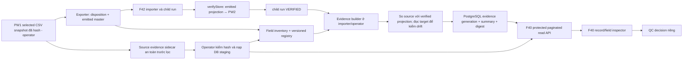

# Kế hoạch F42 → F40 field evidence

> **Tích hợp Commerce 2026-10-09:** [Kế hoạch F40 Commerce toàn nguồn](../261009-1146-f40-commerce-full-reconciliation/plan.md) tiêu thụ source sidecar, generation và comparator từ Phase 01–07/09 của kế hoạch này. Phase contract/API/UI của F40 có thể bắt đầu độc lập; nghiệm thu dữ liệu thật phụ thuộc producer và handoff staging. Kế hoạch F40 không thay thế Phase 10 hoặc tự kết luận toàn bộ migration/cutover đạt.

> **Trạng thái triển khai 2026-10-01:** Xem [checklist đóng gap theo yêu cầu QC](qc-gap-closure-implementation.md) trước khi thực hiện phase tiếp theo. Code hiện tại chỉ giữ phần migration/F42; các trang/API Studio F40 đã được gỡ và thuộc nhánh F40 riêng. Không coi các phase bên dưới là đã hoàn thành chỉ vì local synthetic fixture trả đủ sáu nhãn status.

Tracking issue: [#1905](https://github.com/primeproduction/ech-prime-web-v2/issues/1905). Các phase triển khai cần issue/PR riêng theo quy ước 1 US = 1 branch = 1 PR; #1905 theo dõi acceptance tổng thể và gate QC.

## Baseline QC F40 giữ nguyên

Kế hoạch này **bổ sung evidence và khả năng truy vết**, không thay thế phạm vi kiểm thử migration mà QC đã ghi trong [PRD F40](../../docs/prd/F40-qa-control-center.md) và [test plan PW1 → PW2](../../docs/qa/TEST_PLAN_MIGRATION_PW1_PW2.md). Giữ nguyên các bài test và tiêu chí dự kiến sau; Phase 10 ghi kết quả thực thi/gap của từng bài trên staging, không tự đánh dấu PASS khi chỉ có UI hoặc fixture:

1. **TC-MIG.01–02 — An toàn nguồn và quét diện rộng:** PW1 MySQL read-only; quét, phân loại Pass/Warning/Fail trên toàn bộ tập Store QC chốt. Mốc 2.000 Store trong test plan là mục tiêu gốc, cần đối chiếu inventory thật trước khi tính coverage.
2. **TC-MIG.03 — Dữ liệu:** đối soát Product/Variant/SKU, giá, stock và các nhóm Banners, RichText, Menus, Categories, Shop Settings theo US-F40-11; phát hiện record/field mất hoặc lệch. Các kiểm tra Commerce/Settings mở rộng như Order, Customer, Discount và payment/delivery/domain/integration giữ ở phần bổ sung F42/F40, không thay bộ test gốc.
3. **TC-MIG.04–06 — Nội dung và media:** bảng HTML → Lexical, tiếng Việt UTF-8, ảnh/banner/product URL HTTP 200 cùng alt/kích thước theo test plan.
4. **TC-MIG.07–09 — Giao diện và hành trình:** slider, live webview, 9 canonical themes, desktop/mobile 375px; Merchant SSO sau cutover. Kiểm tra SEO 301 theo phạm vi test plan.
5. **TC-MIG.10 — Nghiệm thu:** retest sau fix, parity ≥99% theo mẫu số được QC ký, 0 P0, chặn QC Pass khi còn P0 và lưu quyết định cutover có chứng cứ. Duy trì chiến lược tool quét diện rộng và QC kiểm tay 9 theme, 30–50 Store rủi ro cao/store cờ đỏ.

**Yêu cầu bổ sung từ QC** là F42 cung cấp source inventory trước lọc exporter, field evidence bền vững theo numeric Source Store ID + child run UUID VERIFIED, sáu status, rule giá/stock, summary/fixture và API để F40 drill-down. Hai phần cần được báo cáo riêng: kết quả từng bài test F40 gốc và kết quả evidence mới. Field evidence `complete` không tự làm TC-MIG.01–10 PASS.

## Kết quả cần đạt

QC chọn **Source Store ID dạng số + child `migration_runs.run_id` UUID có trạng thái VERIFIED** và xem được từng record/field đã thuộc run với sáu status `match`, `mismatch`, `missing`, `duplicate`, `unsupported`, `unverified`; summary có mẫu số đầy đủ; provenance, rule, thời điểm và lý do đủ để kiểm toán. F42 tạo và lưu evidence trong PostgreSQL staging; F40 đọc qua API server-side có phân trang. File JSON chỉ có thể là export phụ, không phải nguồn phục vụ UI. `VERIFIED` của importer, `complete` của evidence generation và QC Pass/cutover là **ba gate độc lập**.

**Điều kiện bổ sung sau review source exporter:** `master-*.json` chỉ chứa Store/document được emit; `migration_entity_map` chỉ chứa phần importer xử lý. `mapping-report.json/csv` kiểm kê nhiều record/field từ CSV đã chọn nhưng **không chứa raw source value**; Product/Customer receipt chủ yếu giữ ID/disposition. Giá trị gốc của record bị lọc chỉ còn ở **CSV snapshot gốc ngoài artifact**. QC có thể không được bàn giao CSV, nên exporter phải tạo **source evidence sidecar an toàn ngay khi còn đọc CSV, trước lọc**, pin hash vào manifest; operator nạp sidecar đã kiểm hash vào DB staging. F40 chỉ đọc safe DB evidence. Phải có hai phép kiểm riêng: (A) toàn bộ PW1 selected CSV → export disposition/master và (B) master emitted → PW2/child run. Chỉ (B) thì không thể chứng minh không mất dữ liệu ở exporter. Store bị blocked/policy-excluded không có child VERIFIED; F40 cần export-coverage view theo source snapshot + Store ID, bên cạnh run view cho Store đã emit. Artifact cũ không có CSV/sidecar chỉ hỗ trợ coverage metadata, không đủ field-value parity toàn nguồn.

Phạm vi Phase 01–07 là yêu cầu QC mới cho **Commerce/Settings field evidence**. F40 test migration tổng thể còn các AC của US-F40-09/10/11/12/13 và TC-MIG.01–10; [Phase 10](phase-10-full-f40-qc-traceability.md) là gate truy vết và kiểm chứng riêng. Không tuyên bố toàn bộ F40 migration test đạt chỉ vì Phase 01–07 hoàn tất.

Kế hoạch này triển khai [sáu yêu cầu QC](../reports/260930-f42-f40-evidence/00-overview.md), các báo cáo [01](../reports/260930-f42-f40-evidence/01-staging-run-identity.md)–[06](../reports/260930-f42-f40-evidence/06-read-contract-handoff.md), và tích hợp F40. Chưa thực hiện migration/deploy hoặc xác nhận dữ liệu staging. Checkout có nhiều file F42 đang sửa dở; khi triển khai, giữ nguyên thay đổi đó và rebase kế hoạch vào revision thực tế trước mỗi PR.

## Nguyên tắc không được phá

1. Importer `verifyStore()` đã đối chiếu emitted projection với target trước khi đánh dấu child run `VERIFIED`. Không làm yếu bước này để tạo fixture `mismatch/missing`; fixture importer thật và fixture comparator synthetic phải được dán nhãn, báo cáo riêng.
2. Artifact PW1 nằm ở máy/operator và không có trên Vercel. Builder chạy nơi artifact đã được bind/kiểm hash, ghi inventory + canonical evidence an toàn vào PW2 DB. F40 không đọc file riêng hoặc PW1 live từ request staging.
3. Import fidelity summary đếm từ **emitted expected inventory + field registry** đã pin version, không từ số evidence row tồn tại. Mỗi expected field instance thuộc scope import có đúng một trong sáu status; `unsupported` nằm trong mẫu số này. Source-wide export coverage dùng selected CSV inventory và tally riêng cho phần retained/excluded/blocked/deferred.
4. `duplicate` cần provenance hai target cùng một source; trùng SKU/email không đủ. `missing` cần source đã xác nhận và target read thành công. Thiếu proof là `unverified`.
5. Field chưa migrate/support phải hiện `unsupported` với reason; chưa có source/target/rule đáng tin cậy là `unverified`. Không hứa mọi field QC liệt kê sẽ `match`.
6. Payment/Delivery/Domain/Integration data comparison không chứng minh provider hoạt động. Page/Block/live render là [gate riêng F40-13](../260911-f40-13-pw2-render-evidence/plan.md), không được gộp vào commerce evidence.
7. Sáu status của F42 là kết quả so sánh source-scoped; `orphan_in_pw2`/target-only và phân loại severity P0/P1 của F40-11 là các chiều riêng, không ép thành `missing` hoặc `duplicate`. Không lấy demo `SITE-0001` hay batch scan canned làm dữ liệu migration thật.
8. `excluded/retained-source/blocked/deferred/security-excluded` là **export disposition**, không tự gán `missing` của PW2. `missing` chỉ hợp lệ khi record/field thuộc scope phải import và target absence được xác minh. Nếu không còn CSV gốc **và** chưa tạo sidecar nguồn có hash từ lúc export, full field-value coverage là `unverified/BLOCKED`; mapping-report có thể cho coverage metadata nhưng không thể khôi phục giá trị đã lọc.

## Ranh giới, owner và thứ tự

| Phase | Kết quả / owner đề xuất | Phụ thuộc trực tiếp | Ước lượng |
| --- | --- | --- | --- |
| [01 Contract và kiểm kê nguồn](phase-01-contract-source-audit.md) | F42 + QC + F40 khóa registry, semantics, nguồn artifact, fixture decision | Không | 3–5d |
| [02 Schema và lifecycle](phase-02-schema-generation.md) | F42 thêm DDL, generation atomic/idempotent, run binding | 01 core contract | 3–5d |
| [03 Product/SKU và Order](phase-03-commerce-comparators.md) | F42 tạo comparator, money/stock/order rule | 01, 02 | 5–8d |
| [04 Customer/Discount/Settings](phase-04-identity-settings-comparators.md) | F42 hoàn thành field registry và privacy | 01, 02; có thể song song 03 | 4–7d |
| [05 Coverage và duplicate/drift](phase-05-summary-integrity.md) | F42 summary, anomaly, digest, replay | 02; tích hợp 03–04 | 3–5d |
| [06 Read contract và F40 UI](phase-06-read-api-f40.md) | F42/F40 API bảo vệ, adapter, inspector, pagination | 01 DTO; DB thật từ 02, 05 | 5–8d, song song một phần |
| [07 Fixture, tests và staging](phase-07-fixture-staging.md) | F42 + QC hai loại fixture, deploy, execution proof | 02–06 cho gate cuối | 4–7d |
| [08 F40-13 render evidence](phase-08-page-block-render.md) | Migration + F40 + QA block crosswalk/live runner | Mapping owner/runner; có thể chạy song song | 5d+ riêng, re-estimate |
| [09 Handoff field evidence](phase-09-handoff-cutover.md) | F42 + F40 + QC ký contract, runbook và phạm vi đã chứng minh | 01–07 | 2–3d |
| [10 Full F40 migration test traceability](phase-10-full-f40-qc-traceability.md) | QC + F40 + các owner Media/Content/SSO chứng minh TC-MIG.01–10 và AC F40-09/10/11/12/13 | 01–09 cho field evidence; các luồng khác độc lập | Ước lượng lại theo gap sau audit |

Ước lượng là **dev effort**, không phải cam kết lịch. Baseline Phase 01–07 ban đầu cộng khoảng 27–45 dev-days cho field evidence của emitted runs; **chưa tính đầy đủ producer/source-wide export coverage từ CSV gốc, Store blocked/excluded và UI riêng**. Phase 01 phải đo và ước lượng lại phần này trước khi chốt lịch; không dùng mốc F42 4–7 tuần/F40 1–2 tuần như cam kết cho toàn bộ QC. Phase 08 có **5d+ riêng**; Phase 10 cũng có estimate riêng sau audit. Không gắn `blockedBy` cho toàn plan: schema skeleton và F40 UI shell có thể tiến hành trước khi dữ liệu fixture/staging sẵn sàng; mỗi phase ghi gate riêng.

Phase 10 **không nằm trong ước lượng trên**: các luồng batch scan 2.000 Store, RichText/media, visual/theme, SSO/redirect và Page/Block có owner và baseline riêng. QC audit trạng thái thực tế trước, rồi ước lượng phần còn thiếu; không tự coi test cũ `[x] AUTO` hoặc PR đã merge là PASS trên staging QC hiện tại.

## Truy vết điều kiện QC

| Yêu cầu | Phase tạo bằng chứng | Gate nghiệm thu |
| --- | --- | --- |
| Staging revision, fixture resettable, Store ID số + child UUID VERIFIED | 02, 07, 09 | Importer run thật, DB/schema và run binding được query lại |
| Durable field evidence, sáu status, privacy, version/snapshot/transform | 01–05 | Expected inventory = tổng sáu status; review DB/API không lộ dữ liệu nhạy cảm |
| Product/SKU/Order/Customer/Discount/Settings và money/stock | 03–05 | Support matrix từng field, rule được QC ký; unsupported/unverified không tính match |
| F40 đọc, lọc và drill-down theo Store + child run | 06–07 | Real browser E2E trên DB staging, phân biệt fixture/demo |
| US-F40-11 AC 7 nhóm, page scope, remediation; TC-F40-11-07–10 | 06 cho field UI; 10 cho phần ngoài Commerce/Settings | Kiểm riêng page-scoped counts, field-level Chỉ Lỗi, giá trị rỗng, SKU, target-only và demo `SITE-0001` |
| US-F40-13 Page/Block data/component/live render | 08, 10 | TC-F40-13-07/08 manual và runner thật, ba lớp proof |
| US-F40-09/10/12 và TC-MIG.01–10, cutover | 09–10 | Matrix PASS/FAIL/NOT_RUN/BLOCKED trên staging, không dùng canned count hay synthetic fixture làm pass |

## Đường đi dữ liệu và gate

Generation `building/partial/unavailable` không được hiển thị như đã hoàn tất. Generation `complete` nghĩa là inventory được accounted, **không có nghĩa tất cả field match**. Nếu target thay đổi sau verify, giữ generation cũ nguyên vẹn và tạo generation mới hoặc current-state check với `reasonCode=TARGET_DRIFT`; không thêm status thứ bảy.

## Contract tối thiểu cần chốt ở Phase 01

- Identity: `sourceInstanceId`, numeric `sourceStoreId`, `childRunId` chỉ có với Store đã import, `batchId` chỉ để truy vết, selected CSV snapshot ID/hash/as-of, exporter artifact hash, target binding, mapping/registry/comparison versions.
- Registry cho mọi field QC yêu cầu: source input(s), target path, element key, transform, unit/null/absent/empty rule, sensitivity, support state/reason/owner.
- Status semantics và record precedence: identity `duplicate/missing`, rồi field `mismatch`, `unverified`, `unsupported`, `match`; field counts độc lập với record rollup. Rule này là versioned, không hard-code ngầm ở UI.
- Source audit: lúc exporter chạy, collector độc lập với mapper duyệt selected CSV **trước lọc**, tạo source ID/field inventory, safe canonical value hoặc keyed fingerprint, presence/absence, disposition và source snapshot hash. Bind sidecar hash vào manifest, kiểm row/field totals với `mapping-report`/master; operator xác minh rồi nạp safe evidence vào staging DB. QC/F40 không cần CSV. Master/receipts/report không thay thế sidecar khi cần so source value; `archive_only` không là target vận hành. Artifact cũ thiếu CSV/sidecar chỉ được báo metadata-only/BLOCKED cho full field parity.
- So sánh snapshot PW1 đã export với **verified projection PW2** được importer xác nhận; lần đọc PW2 tại `targetReadAt` kiểm target còn tồn tại và phát hiện drift sau verify. Không gán target current sau nhiều giờ thành trạng thái tại import time, cũng không so với PW1 live khác snapshot. Stock có `stockSnapshotAt`, SKU và location identity; money dùng Decimal/minor units, currency/rounding rõ.
- Privacy: chỉ canonical value đã duyệt được hiển thị; PII dùng HMAC có khóa hoặc masked/aggregate; secret/credential/password/token không lưu/trả.

## PR và chất lượng

Chia PR theo phase/risk, mỗi PR một feature/fix và trỏ issue với `Relates to #N` (không dùng `Closes`). Title `feat(F42): [US-F42-…] …` hoặc `feat(F40): [US-F40-…] …`; PR >500 lines nên chia. Nếu thêm Payload collection field, cập nhật `scripts/db-setup.js`; schema evidence SQL gốc thuộc `scripts/pw1-migration-schema.js`, phải cập nhật `PW1_MIGRATION_SCHEMA_REQUIREMENTS` và xác nhận lời gọi sẵn có trong `db-setup.js` chạy khi build/migrate. DDL additive, retry-safe, không `DROP TABLE`. Env mới phải có placeholder trong `.env.staging.example` và `.env.production.example`. Route mới cần auth, input validation, `dynamic='force-dynamic'`, `maxDuration<=60` và Playwright `tests/*.spec.ts` theo `docs/TEST_CONVENTION.md`/TC-ID.

## Definition of Done chung

- Staging có revision/schema/contract đã pin; một importer fixture thật có numeric Store ID + **child UUID VERIFIED**; evidence generation `complete` đọc được từ DB, summary/digest đúng expected. Exporter fixture tạo safe source evidence sidecar trước lọc và operator nạp DB theo manifest hash; QC test không cần CSV. Coverage bao gồm record/Store bị lọc; không suy full source coverage từ child run.
- Synthetic comparator fixture kiểm đủ sáu status và bảy case QC, được phân biệt rõ với run thật; reset/replay tái lập kết quả và không chạm dữ liệu ngoài marker.
- Product/SKU, Order, Customer, Discount, Settings có disposition cho **mọi field trong registry**; money/stock rule được QC duyệt; unsupported/unverified không được tính pass.
- F40 chọn đúng Store + child run, xem field/record/summary có pagination/filter, source label, provenance, `reasonCode`, transform; stale request và run/store mismatch fail closed.
- Existing F40-11 page-scoped seven-group inspector và target-only records phải có kết quả riêng; phần Commerce/Settings mới không được thay thế hoặc tự nhận đã cover chúng. `Chỉ Lỗi` phải lọc theo field, kể cả record rollup là match; hai giá trị rỗng không tự tạo bằng chứng match có ý nghĩa.
- API/DB không lộ PII thô, credential hoặc secret; kiểm auth/tenant/store, query bound, audit an toàn. E2E trên dữ liệu importer thật và fixture synthetic có kết quả thực thi, không chỉ `[x] AUTO` trên giấy.
- `/api/qa/migration-diff` và UI phân biệt nguồn `live/fixture`; `scan_batch`/`approve_pass` stub không được dùng như chứng nhận thật. QC Pass/cutover cần gate riêng theo test plan migration (parity, P0, ảnh, theme), không suy từ evidence generation.
- Handoff chứa owner, seed/reset, SHA, versions, support matrix, known gaps, expected/actual counts và các mục chưa chạy. F40-13 Page/Block/live-render được theo dõi bằng gate riêng trước khi claim F40 đầy đủ.
- Muốn tuyên bố **F40 migration test đầy đủ** hoặc QC cutover, phải hoàn tất [Phase 10](phase-10-full-f40-qc-traceability.md) và từng TC-MIG.01–10; field evidence generation `complete` chỉ là một đầu vào.
